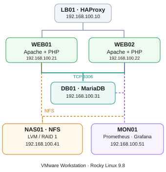

# Rocky Linux 9.8 기반 사내 업무 포털 인프라 구축 및 장애 복구

## 1. 프로젝트 소개

VMware Workstation 환경에서 Rocky Linux 9.8 기반 사내 업무 포털 인프라를 구축하고, Linux 서버 운영에 필요한 네트워크, 웹 서비스, 데이터베이스, 스토리지, 보안, 모니터링 및 장애 복구 기술을 실습하는 프로젝트이다.

각 서버의 역할을 분리하고 실제 서비스 연동과 장애 상황을 검증하여 Linux 시스템 엔지니어의 인프라 구축 및 운영 역량을 학습하는 것을 목표로 한다.

실습 과정은 기술 주제별로 구분하며, 각 단원 완료 후 명령어, 설정 내용, 실제 검증 결과 및 스크린샷을 GitHub에 기록한다.

## 2. 프로젝트 목표

- **Linux 인프라:** Rocky Linux, VMware 네트워크, SSH, 사용자 및 서비스 관리
- **웹 서비스:** Apache, PHP, MariaDB 기반 LAMP 환경 구축
- **로드밸런싱:** HAProxy Round Robin, 헬스 체크 및 장애 전환
- **스토리지:** RAID, LVM, NFS, UID/GID 및 ACL 관리
- **파일 배포 및 백업:** rsync, Bash, cron
- **보안:** Linux Hardening, firewalld, SELinux
- **운영 관리:** Process & Resource Management, Log Management
- **모니터링:** Prometheus, Node Exporter, Grafana, Alertmanager
- **장애 복구:** 웹·DB·스토리지 장애 재현 및 복구 검증
- **문서화:** GitHub 실습 문서, 인프라 구성도 및 최종 발표 자료

## 3. 실습 환경

| 항목 | 환경 |
|---|---|
| 가상화 | VMware Workstation |
| 운영체제 | Rocky Linux 9.8 |
| 호스트 운영체제 | Windows |
| 호스트 메모리 | 16GB |
| NAT 네트워크 | VMnet8 / 10.10.10.0/24 |
| Host-only 네트워크 | VMnet2 / 192.168.100.0/24 |
| Git | Git Bash |
| 문서 관리 | GitHub Markdown |

호스트의 메모리 자원을 고려하여 실습에 필요한 가상머신만 선택적으로 실행한다.

## 4. 인프라 구성

### 4.1 서버 역할

| 서버 | 내부 IP | 역할 | 주요 기술 |
|---|---|---|---|
| LB01 | 192.168.100.10 | 로드밸런서 | HAProxy |
| WEB01 | 192.168.100.21 | 웹 서버 1 | Apache, PHP |
| WEB02 | 192.168.100.22 | 웹 서버 2 | Apache, PHP |
| DB01 | 192.168.100.31 | 데이터베이스 서버 | MariaDB |
| NAS01 | 192.168.100.41 | 공유 스토리지 서버 | RAID, LVM, NFS |
| MON01 | 192.168.100.51 | 모니터링 서버 | Prometheus, Grafana |

### 4.2 목표 아키텍처

> 목표 구성도이다. 현재 HAProxy, Apache/PHP 및 MariaDB 연동 검증을 완료하였으며, 사내 업무 포털 구현과 NAS01·MON01 구성은 향후 실습에서 진행할 예정이다.

웹 애플리케이션 코드는 WEB01과 WEB02에 각각 배포한다.

업무 데이터는 DB01의 MariaDB에 저장하고, 공유 파일은 NAS01의 NFS 스토리지에서 관리하는 구조를 목표로 한다.

MON01에서 서버 자원 사용률과 주요 서비스 상태를 수집하고 장애를 감지하도록 구성할 예정이다.

## 5. 실습 문서 및 진행 계획

전체 프로젝트는 기술 주제별 **27개 단원**으로 진행한다.

기존 완료 단원은 유지하고, 서비스 구축 이후의 스토리지·보안·운영·복구 실습을 세분화하였다.

### PHASE 1. Linux 기본 인프라 구축

| 번호 | 실습 문서 | 상태 |
|---|---|---|
| 01 | [VMware 가상 네트워크 구축](docs/01-network.md) | 완료 |
| 02 | [WEB01 서버 구축 및 검증](docs/02-web01.md) | 완료 |
| 03 | [WEB02 서버 구축 및 검증](docs/03-web02.md) | 완료 |
| 04 | [LB01 서버 구축 및 검증](docs/04-lb01.md) | 완료 |

### PHASE 2. Apache 및 HAProxy 로드밸런싱

| 번호 | 실습 문서 | 상태 |
|---|---|---|
| 05 | [WEB01 Apache 웹 서버 구축 및 HTTP 검증](docs/05-web01-apache.md) | 완료 |
| 06 | [WEB02 Apache 웹 서버 구축 및 HTTP 검증](docs/06-web02-apache.md) | 완료 |
| 07 | [LB01 HAProxy 설치 및 로드밸런싱 구성](docs/07-haproxy.md) | 완료 |
| 08 | [HAProxy 장애 전환 및 복구 검증](docs/08-haproxy-failover.md) | 완료 |

### PHASE 3. MariaDB 및 LAMP 웹 서비스

| 번호 | 실습 주제 | 상태 |
|---|---|---|
| 09 | [DB01 서버 구축 및 MariaDB 설치·연동 검증](docs/09-mariadb.md) | 완료 |
| 10 | [WEB01/WEB02 PHP 설치 및 MariaDB 연동 검증](docs/10-php-mariadb.md) | 완료 |
| 11 | 사내 업무 포털 웹 애플리케이션 구현 | 예정 |
| 12 | rsync 기반 웹 애플리케이션 배포 및 동기화 | 예정 |

### PHASE 4. RAID · LVM · NFS 스토리지

| 번호 | 실습 주제 | 상태 |
|---|---|---|
| 13 | NAS01 서버 구축 및 네트워크 구성 | 예정 |
| 14 | RAID 구성, 디스크 장애 및 복구 검증 | 예정 |
| 15 | LVM 논리 볼륨 구성 및 용량 확장 | 예정 |
| 16 | NAS01 NFS 공유 스토리지 구축 | 예정 |
| 17 | WEB01/WEB02 NFS 연동 및 파일 권한 검증 | 예정 |

RAID 1을 NFS 스토리지의 기본 구성으로 활용하고, RAID 0·5·6은 구조 비교 및 선택적 추가 실습으로 다룬다.

### PHASE 5. Linux 보안 및 운영 관리

| 번호 | 실습 주제 | 상태 |
|---|---|---|
| 18 | Linux Server Hardening | 예정 |
| 19 | firewalld 및 SELinux 정책 심화 검증 | 예정 |
| 20 | Process & Resource Management | 예정 |
| 21 | Log Management 및 로그 기반 장애 분석 | 예정 |

### PHASE 6. 모니터링 및 장애 알림

| 번호 | 실습 주제 | 상태 |
|---|---|---|
| 22 | MON01 서버 구축 및 Prometheus 설치 | 예정 |
| 23 | Grafana 대시보드 및 Alertmanager 구성 | 예정 |

### PHASE 7. 백업 자동화 및 장애 복구

| 번호 | 실습 주제 | 상태 |
|---|---|---|
| 24 | Bash · rsync · cron 기반 백업 자동화 | 예정 |
| 25 | MariaDB 및 NFS 데이터 복구 검증 | 예정 |
| 26 | 통합 장애 시나리오 및 서비스 복구 | 예정 |

### PHASE 8. 최종 포트폴리오

| 번호 | 실습 주제 | 상태 |
|---|---|---|
| 27 | 통합 검증 및 GitHub·PPT 최종 결과 정리 | 예정 |

> 실습 완료 후 문서와 증거 스크린샷을 업로드하고 진행 상태를 갱신한다. 예정 단원의 링크는 실제 문서를 작성한 후 추가한다.

## 6. 주요 장애 대응 및 검증

현재까지 수행한 장애 분석 및 검증 기록:

- [WEB01 → Windows Ping 장애 분석 및 복구](docs/02-web01.md#7-트러블슈팅--web01에서-windows로-ping-실패)
- [HAProxy 장애 전환 및 복구 검증](docs/08-haproxy-failover.md)
- [MariaDB 원격 접속 및 최소 권한 검증](docs/09-mariadb.md)
- [WEB02 PHP → MariaDB 인증 오류 분석 및 복구](docs/10-php-mariadb.md#9-web02-php--mariadb-연동-오류-분석-및-복구)
- [HAProxy PHP Round Robin 및 공통 DB 조회 검증](docs/10-php-mariadb.md#10-haproxy-통합-연동-검증)

10단원에서는 WEB02의 HTTP 500 오류를 PHP-FPM 로그에서 확인하고, MariaDB ERROR 1045 인증 문제를 분석하여 복구하였다.

또한 HAProxy를 통해 WEB01과 WEB02가 번갈아 응답하면서 DB01의 동일한 데이터를 조회하는 것을 확인하였다.

검증 후 임시 PHP 테스트 파일을 제거하고 두 웹 서버에서 HTTP 404 응답을 확인하였다.

향후 RAID 디스크 장애, NFS 마운트 장애, MariaDB 데이터 복구, SELinux·firewalld 접근 오류 및 서비스 장애를 추가 검증할 예정이다.

## 7. 프로젝트 진행 현황

### 7.1 전체 진행률

| 구분 | 단원 수 |
|---|---:|
| 전체 계획 | 27 |
| 완료 | 10 |
| 예정 | 17 |

**현재 진행 단계: 10단원 완료 / 11단원 진행 예정**

진행률은 단원 개수를 기준으로 계산하며, 실제 작업 시간과 난이도에 따른 진행률을 의미하지는 않는다.

### 7.2 서버별 구축 현황

| 서버 | IP 주소 | 기본 구축 | 서비스 구축 |
|---|---|---|---|
| LB01 | 192.168.100.10 | 완료 | HAProxy 완료 |
| WEB01 | 192.168.100.21 | 완료 | Apache/PHP 및 MariaDB 연동 검증 완료 |
| WEB02 | 192.168.100.22 | 완료 | Apache/PHP 및 MariaDB 연동 검증 완료 |
| DB01 | 192.168.100.31 | 완료 | MariaDB 완료 |
| NAS01 | 192.168.100.41 | 예정 | RAID/LVM/NFS 예정 |
| MON01 | 192.168.100.51 | 예정 | Prometheus/Grafana 예정 |

## 8. 실습 문서화 원칙

각 단원은 실제 수행한 작업과 검증된 결과를 중심으로 기록한다.

- 실습 목적 및 구성 환경
- 서버별 설정과 사용 명령어
- 주요 명령어 옵션 설명
- 실제 실행 결과 및 검증
- 장애 발생 시 원인 분석과 해결 과정
- 핵심 스크린샷 및 결과 정리
- 배운 점과 다음 실습

비밀번호, 인증 정보 및 기타 민감한 설정값은 공개 저장소에 포함하지 않는다.

## 9. 다음 실습

10단원에서는 WEB01과 WEB02에 PHP 실행 환경을 구성하고, PHP PDO를 이용하여 DB01 MariaDB에 연결하는 실습을 완료하였다.

SELinux Enforcing 환경에서 DB 네트워크 접근 정책을 적용하였으며, HAProxy를 통한 요청 분산과 공통 데이터베이스 조회를 검증하였다.

또한 WEB02에서 발생한 MariaDB 인증 오류를 PHP-FPM 로그를 통해 분석하고 복구하였다.

**다음 실습: 11단원 사내 업무 포털 웹 애플리케이션 구현**

**예정 작업**

1. 사내 업무 포털 기능 및 데이터베이스 테이블 설계
2. 공지사항 또는 업무 게시판 구현
3. PHP PDO를 이용한 데이터 조회 기능 구현
4. 데이터 등록·수정·삭제(CRUD) 기능 구현
5. Prepared Statement 및 HTML 출력값 이스케이프 적용
6. WEB01/WEB02에 동일한 웹 애플리케이션 구성
7. HAProxy를 통한 서비스 분산 및 공통 데이터 검증

11단원에서는 10단원에서 구성한 Apache/PHP, MariaDB 연동 환경과 비공개 DB 설정 파일을 재사용할 예정이다.
