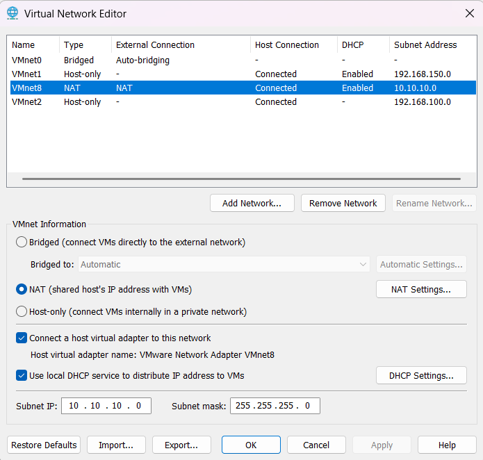
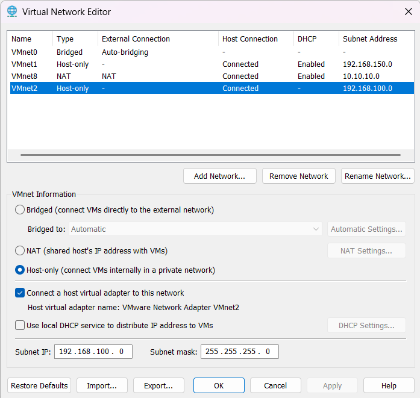
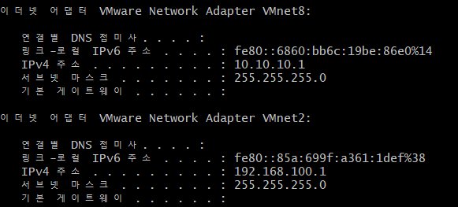

# 01. VMware 가상 네트워크 구축

## 1. 실습 개요

### 1.1 실습 목적

Rocky Linux 9.8 기반 사내 업무 포털 인프라 구축을 위해 VMware Workstation의 가상 네트워크 환경을 구성한다.

외부 인터넷 연결을 위한 NAT 네트워크와 서버 간 내부 통신을 위한 Host-only 네트워크를 분리하여 각 서버가 용도에 맞는 네트워크 인터페이스를 사용하도록 설계한다.

### 1.2 실습 목표

- VMware Workstation 가상 네트워크 구조 이해
- NAT 및 Host-only 네트워크 구성
- 내부 서비스망 IP 주소 체계 설계
- Windows 호스트의 VMware 네트워크 어댑터 검증
- 향후 서버 간 내부 통신을 위한 공통 네트워크 환경 구축

### 1.3 실습 환경

| 구분 | 환경 |
|---|---|
| Host OS | Windows |
| Virtualization | VMware Workstation |
| Guest OS | Rocky Linux 9.8 |
| CPU | Intel Core i5-12400 계열 |
| Host RAM | 16GB |
| 가상 네트워크 | VMnet8 (NAT), VMnet2 (Host-only) |

---

## 2. 네트워크 설계

### 2.1 네트워크 구성

| 네트워크 | 유형 | 네트워크 주소 | 서브넷 마스크 | DHCP | 용도 |
|---|---|---|---|---|---|
| VMnet8 | NAT | 10.10.10.0/24 | 255.255.255.0 | Enabled | 인터넷 연결 및 패키지 설치 |
| VMnet2 | Host-only | 192.168.100.0/24 | 255.255.255.0 | Disabled | 내부 서버 통신 및 SSH 관리 |

### 2.2 NAT 네트워크를 사용하는 이유

NAT는 가상머신이 호스트 PC의 네트워크 연결을 통해 외부 인터넷에 접근할 수 있도록 하는 방식이다.

본 프로젝트에서는 다음 목적으로 사용한다.

- Rocky Linux 패키지 설치 및 업데이트
- 외부 패키지 저장소 접근
- 각종 서버 소프트웨어 다운로드

VMnet8의 DHCP 기능을 활성화하여 가상머신의 NAT 인터페이스가 IP 주소를 자동으로 할당받도록 구성하였다.

### 2.3 Host-only 네트워크를 사용하는 이유

Host-only 네트워크는 Windows 호스트와 동일한 가상 네트워크에 연결된 가상머신이 내부적으로 통신할 수 있도록 하는 방식이다.

본 프로젝트에서는 다음 목적으로 사용한다.

- 웹 서버와 데이터베이스 서버 간 통신
- 웹 서버와 NFS 서버 간 파일 공유
- HAProxy와 웹 서버 간 통신
- 중앙 모니터링 서버의 상태 정보 수집
- Windows 호스트에서 Linux 서버로 SSH 접속

내부 서버는 고정 IP 주소를 사용하므로 VMnet2의 DHCP 기능을 비활성화하였다.

Host-only 인터페이스에는 외부 인터넷으로 직접 연결되는 기본 경로를 구성하지 않는다.

### 2.4 서버별 내부 IP 주소 설계

| Hostname | IP Address | 주요 역할 | 네트워크 설정 상태 |
|---|---|---|---|
| lb01 | 192.168.100.10 | HAProxy 로드밸런서 | 완료 |
| web01 | 192.168.100.21 | Apache/PHP 웹 서버 | 완료 |
| web02 | 192.168.100.22 | Apache/PHP 웹 서버 | 완료 |
| db01 | 192.168.100.31 | MariaDB 데이터베이스 | 예정 |
| nas01 | 192.168.100.41 | NFS 및 LVM 스토리지 | 예정 |
| mon01 | 192.168.100.51 | Prometheus/Grafana 모니터링 | 예정 |

WEB01과 WEB02의 Host-only 고정 IP 설정 및 통신 검증을 완료하였다. 나머지 서버는 이후 구축할 예정이다.

> 위 상태는 각 서버의 기본 네트워크 설정을 기준으로 하며, Apache/PHP 등 애플리케이션 서비스 구축 완료를 의미하지 않는다.

---

## 3. VMware 가상 네트워크 구성

### 3.1 Virtual Network Editor 실행

VMware Workstation에서 다음 경로로 이동하였다.

`Edit → Virtual Network Editor`

기존 VMnet0, VMnet1, VMnet8 구성을 확인하고 프로젝트 전용 네트워크인 VMnet2를 추가하였다.

### 3.2 VMnet8 NAT 설정

기존 VMnet8의 NAT 설정을 유지하고 DHCP 기능을 활성화하였다.

| 항목 | 설정값 |
|---|---|
| Network | VMnet8 |
| Network Type | NAT |
| Subnet IP | 10.10.10.0 |
| Subnet Mask | 255.255.255.0 |
| Host Virtual Adapter | Enabled |
| Local DHCP Service | Enabled |

**설정 화면**



### 3.3 VMnet2 Host-only 설정

Virtual Network Editor에서 `Add Network`를 선택하여 VMnet2를 생성하였다.

| 항목 | 설정값 |
|---|---|
| Network | VMnet2 |
| Network Type | Host-only |
| Subnet IP | 192.168.100.0 |
| Subnet Mask | 255.255.255.0 |
| Host Virtual Adapter | Enabled |
| Local DHCP Service | Disabled |

**설정 화면**



DHCP를 비활성화한 이유는 각 서버에 고정 IP를 직접 지정하여 서버 간 통신 주소를 일관되게 관리하기 위해서이다.

---

## 4. Windows 호스트 네트워크 검증

### 4.1 검증 명령어

Windows의 Git Bash에서 다음 명령어를 실행하였다.

```bash
ipconfig.exe
```

Windows에 생성된 VMware 가상 네트워크 어댑터의 IPv4 주소와 서브넷 마스크를 확인하였다.

### 4.2 VMnet8 검증 결과

```text
이더넷 어댑터 VMware Network Adapter VMnet8:

IPv4 주소         : 10.10.10.1
서브넷 마스크      : 255.255.255.0
기본 게이트웨이    : 없음
```

### 4.3 VMnet2 검증 결과

```text
이더넷 어댑터 VMware Network Adapter VMnet2:

IPv4 주소         : 192.168.100.1
서브넷 마스크      : 255.255.255.0
기본 게이트웨이    : 없음
```

### 4.4 검증 결과 분석

| 검증 항목 | 예상 결과 | 실제 결과 | 판정 |
|---|---|---|---|
| VMnet8 IPv4 | 10.10.10.1 | 10.10.10.1 | 정상 |
| VMnet8 Subnet Mask | 255.255.255.0 | 255.255.255.0 | 정상 |
| VMnet2 IPv4 | 192.168.100.1 | 192.168.100.1 | 정상 |
| VMnet2 Subnet Mask | 255.255.255.0 | 255.255.255.0 | 정상 |

Windows 호스트에서 두 가상 네트워크 어댑터가 계획한 IP 대역으로 구성된 것을 확인하였다.

두 어댑터의 기본 게이트웨이가 비어 있는 것은 Windows 호스트의 VMware 가상 어댑터 설정상 문제가 되지 않는다.



---

## 5. 실습 진행 현황

- [x] VMware Virtual Network Editor 설정 확인
- [x] VMnet8 NAT 및 DHCP 설정
- [x] VMnet2 Host-only 네트워크 생성
- [x] VMnet2 DHCP 비활성화
- [x] Windows VMnet8 IP 확인
- [x] Windows VMnet2 IP 확인
- [x] 전체 서버 내부 IP 주소 설계
- [x] WEB01 네트워크 구성 및 검증
- [x] WEB02 네트워크 구성 및 검증
- [x] WEB01 ↔ WEB02 내부망 통신 검증
- [ ] 나머지 서버 구축 및 내부 통신 검증

---

## 6. 배운 점

### 6.1 NAT와 Host-only의 차이

NAT 네트워크는 가상머신이 외부 인터넷에 접근하는 데 사용하며, Host-only 네트워크는 호스트와 가상머신 사이의 내부 통신 환경을 구성하는 데 사용한다.

두 네트워크를 분리함으로써 외부 연결과 내부 서비스 통신을 목적에 따라 관리할 수 있다.

### 6.2 DHCP와 고정 IP

DHCP는 IP 주소 등의 네트워크 정보를 자동으로 할당하므로 패키지 설치용 NAT 인터페이스에 사용하기 적합하다.

반면 웹 서버, DB 서버, NFS 서버 등은 다른 서버에서 항상 동일한 주소로 접근할 수 있어야 하므로 내부 통신 인터페이스에 고정 IP를 사용하도록 설계하였다.

### 6.3 Windows 가상 어댑터와 VM 내부 NIC

Windows 호스트의 VMnet2 어댑터는 `192.168.100.1/24`를 사용한다.

Linux 가상머신은 같은 서브넷에 속하지만 서로 다른 IP 주소를 사용한다.

- WEB01: `192.168.100.21/24`
- WEB02: `192.168.100.22/24`

이를 통해 Windows 호스트와 각 Linux 서버 간 내부 통신 및 SSH 원격 접속 환경을 구성하였다.

---

## 7. 관련 서버 구축 문서

- [WEB01 서버 구축](02-web01.md)
- [WEB02 서버 구축](03-web02.md)

각 서버의 운영체제 설치, 고정 IP 설정 명령어, 통신 검증 및 SSH 접속 결과는 해당 서버 문서에서 관리한다.
