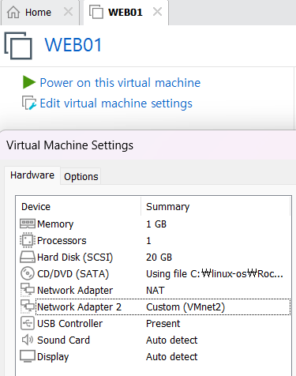
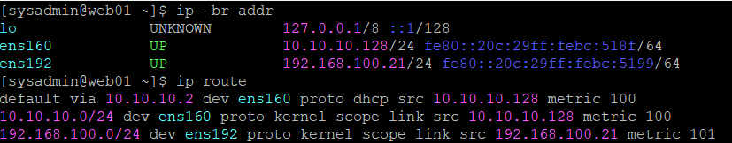
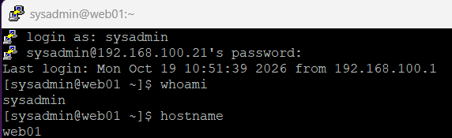
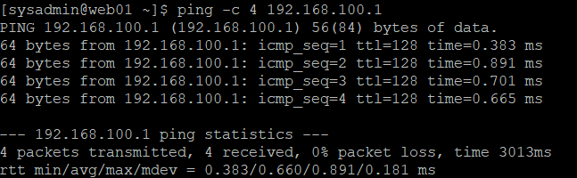

# 01. VMware 가상 네트워크 및 서버 구성

## 1. 실습 개요

### 1.1 실습 목적

Rocky Linux 9.8 기반 사내 업무 포털 인프라 구축을 위해 VMware Workstation의 가상 네트워크 환경을 구성한다.

외부 인터넷 연결을 위한 NAT 네트워크와 서버 간 내부 통신을 위한 Host-only 네트워크를 분리하여, 각 서버가 용도에 맞는 네트워크 인터페이스를 사용하도록 설계한다.

### 1.2 실습 목표

- VMware Workstation 가상 네트워크 구조 이해
- NAT 및 Host-only 네트워크 구성
- 내부 서비스망의 IP 주소 체계 설계
- Windows 호스트의 VMware 네트워크 어댑터 검증
- Rocky Linux 가상머신의 하드웨어 및 네트워크 어댑터 구성

### 1.3 실습 환경

| 구분 | 환경 |
|---|---|
| Host OS | Windows |
| Virtualization | VMware Workstation |
| Guest OS | Rocky Linux 9.8 |
| CPU | Intel Core i5-12400 계열 |
| Host RAM | 16GB |
| 가상 네트워크 | VMnet8 (NAT), VMnet2 (Host-only) |

---

## 2. 네트워크 설계

### 2.1 네트워크 구성

| 네트워크 | 유형 | 네트워크 주소 | 서브넷 마스크 | DHCP | 용도 |
|---|---|---|---|---|---|
| VMnet8 | NAT | 10.10.10.0/24 | 255.255.255.0 | Enabled | 인터넷 연결 및 패키지 설치 |
| VMnet2 | Host-only | 192.168.100.0/24 | 255.255.255.0 | Disabled | 내부 서버 통신 및 SSH 관리 |

### 2.2 NAT 네트워크를 사용하는 이유

NAT(Network Address Translation)는 가상머신이 호스트 PC의 네트워크 연결을 통해 외부 인터넷에 접근할 수 있도록 하는 방식이다.

본 프로젝트에서는 다음 목적으로 사용한다.

- Rocky Linux 패키지 설치 및 업데이트
- 외부 패키지 저장소 접근
- 각종 서버 소프트웨어 다운로드

VMnet8의 DHCP 기능을 활성화하여 가상머신의 NAT 인터페이스가 IP 주소를 자동으로 할당받도록 구성하였다.

### 2.3 Host-only 네트워크를 사용하는 이유

Host-only 네트워크는 Windows 호스트와 동일 가상 네트워크에 연결된 가상머신들이 내부적으로 통신할 수 있도록 하는 방식이다.

본 프로젝트에서는 다음 목적으로 사용한다.

- 웹 서버와 데이터베이스 서버 간 통신
- 웹 서버와 NFS 서버 간 파일 공유
- HAProxy와 웹 서버 간 통신
- 중앙 모니터링 서버의 상태 정보 수집
- Windows 호스트에서 Linux 서버로 SSH 접속

내부 서버는 고정 IP 주소를 사용하므로 VMnet2의 DHCP 기능을 비활성화하였다.

Host-only 네트워크에는 외부 인터넷으로 직접 연결되는 기본 경로를 구성하지 않는다.

### 2.4 서버별 내부 IP 주소 설계

| Hostname | IP Address | 주요 역할 | 설정 완료 |
|---|---|---|---|
| lb01 | 192.168.100.10 | HAProxy 로드밸런서 | 예정 |
| web01 | 192.168.100.21 | Apache/PHP 웹 서버 | 완료 |
| web02 | 192.168.100.22 | Apache/PHP 웹 서버 | 예정 |
| db01 | 192.168.100.31 | MariaDB 데이터베이스 | 예정 |
| nas01 | 192.168.100.41 | NFS 및 LVM 스토리지 | 예정 |
| mon01 | 192.168.100.51 | Prometheus/Grafana 모니터링 | 예정 |

※ 위 IP 주소는 프로젝트 전체 서버의 내부망 주소 설계이다. WEB01은 192.168.100.21/24 설정 및 검증을 완료, 나머지 서버는 추후 구축할 예정이다.

---

## 3. VMware 가상 네트워크 구성

### 3.1 Virtual Network Editor 실행

VMware Workstation에서 다음 경로로 이동하였다.

`Edit → Virtual Network Editor`

기존 VMnet0, VMnet1, VMnet8 구성을 확인하고 프로젝트 전용 네트워크인 VMnet2를 추가하였다.

### 3.2 VMnet8 NAT 설정

기존 VMnet8의 NAT 설정을 유지하고 DHCP 기능을 활성화하였다.

**적용 설정**

| 항목 | 설정값 |
|---|---|
| Network | VMnet8 |
| Network Type | NAT |
| Subnet IP | 10.10.10.0 |
| Subnet Mask | 255.255.255.0 |
| Host Virtual Adapter | Enabled |
| Local DHCP Service | Enabled |

**설정 화면**


### 3.3 VMnet2 Host-only 설정

Virtual Network Editor에서 `Add Network`를 선택하여 VMnet2를 생성하였다.

**적용 설정**

| 항목 | 설정값 |
|---|---|
| Network | VMnet2 |
| Network Type | Host-only |
| Subnet IP | 192.168.100.0 |
| Subnet Mask | 255.255.255.0 |
| Host Virtual Adapter | Enabled |
| Local DHCP Service | Disabled |

**설정 화면**


DHCP를 비활성화한 이유는 각 서버에 고정 IP를 직접 지정하여 서버 간 통신 주소를 일관되게 관리하기 위해서이다.

---

## 4. Windows 호스트 네트워크 검증

### 4.1 검증 명령어

Git Bash에서 다음 명령어를 실행하였다.

```bash
ipconfig.exe
```

Windows에 생성된 VMware 가상 네트워크 어댑터의 IPv4 주소와 서브넷 마스크를 확인하였다.

### 4.2 VMnet8 검증 결과

```text
이더넷 어댑터 VMware Network Adapter VMnet8:

IPv4 주소         : 10.10.10.1
서브넷 마스크      : 255.255.255.0
기본 게이트웨이    : 없음
```

### 4.3 VMnet2 검증 결과

```text
이더넷 어댑터 VMware Network Adapter VMnet2:

IPv4 주소         : 192.168.100.1
서브넷 마스크      : 255.255.255.0
기본 게이트웨이    : 없음
```

### 4.4 검증 결과 분석

| 검증 항목 | 예상 결과 | 실제 결과 | 판정 |
|---|---|---|---|
| VMnet8 IPv4 | 10.10.10.1 | 10.10.10.1 | 정상 |
| VMnet8 Subnet Mask | 255.255.255.0 | 255.255.255.0 | 정상 |
| VMnet2 IPv4 | 192.168.100.1 | 192.168.100.1 | 정상 |
| VMnet2 Subnet Mask | 255.255.255.0 | 255.255.255.0 | 정상 |

Windows 호스트의 VMnet8과 VMnet2 어댑터 설정을 확인하였다.

WEB01에서 NAT 인터넷 연결, DNS 조회, Host-only 양방향 Ping 및 PuTTY SSH 접속을 검증하였다.

두 어댑터의 기본 게이트웨이가 비어 있는 것은 Windows 가상 어댑터 설정상 문제가 되지 않는다.

**검증 범위:** WEB01의 NAT 인터넷 연결, DNS 조회, Windows 호스트와의 양방향 ICMP 통신 및 SSH 원격 접속을 검증하였다. 다른 Linux 서버와의 통신은 해당 서버 구축 후 검증할 예정이다.

---

## 5. WEB01 가상머신 생성 및 하드웨어 구성

### 5.1 가상머신 사양

첫 번째 웹 서버인 WEB01 가상머신을 생성하였다.

| 항목 | 설정값 |
|---|---|
| VM Name | WEB01 |
| vCPU | 1 |
| RAM | 1GB |
| Disk Type | SCSI |
| Disk Capacity | 20GB |
| Network Adapter 1 | NAT |
| Network Adapter 2 | Custom (VMnet2) |
| CD/DVD | SATA |


### 5.2 네트워크 어댑터 구성

WEB01에는 두 개의 네트워크 어댑터를 구성하였다.

**Network Adapter 1**

- Type: NAT
- Network: VMnet8
- 용도: 인터넷 연결 및 패키지 설치
- IP 할당: DHCP 적용 완료 (10.10.10.128/24)

**Network Adapter 2**

- Type: Custom
- Network: VMnet2 (Host-only)
- 용도: 내부 서버 간 통신
- 설정 IP: 192.168.100.21/24

NAT 인터페이스는 기본 경로로 사용하고 Host-only 인터페이스에는 별도의 기본 게이트웨이를 설정하지 않았다.

### 5.3 하드웨어 설정 확인

VMware Workstation의 Virtual Machine Settings에서 CPU, RAM, SCSI 디스크, 네트워크 어댑터 2개가 구성된 것을 확인하였다.



---

## 6. Rocky Linux 9.8 설치 및 기본 환경 검증

### 6.1 운영체제 설치

WEB01 가상머신에 Rocky Linux 9.8을 설치하였다.

| 항목 | 설정값 |
|---|---|
| OS | Rocky Linux 9.8 (Blue Onyx) |
| Installation Type | Minimal Install |
| Disk | 20GB SCSI |
| Hostname | web01 |
| Administrator Account | sysadmin |
| Network Interface 1 | ens160 (NAT) |
| Network Interface 2 | ens192 (Host-only) |
| SELinux | Enforcing |

GUI를 사용하지 않는 Minimal Install을 선택하여 메모리 사용량을 줄이고 CLI 기반 서버 관리 환경을 구성하였다.

### 6.2 운영체제 및 호스트명 확인

**실행 명령어**

```bash
cat /etc/rocky-release
hostnamectl
```

**결과**

```text
Rocky Linux release 9.8 (Blue Onyx)
Static hostname: web01
Operating System: Rocky Linux 9.8 (Blue Onyx)
Architecture: x86-64
Virtualization: vmware
```

Rocky Linux 9.8이 정상적으로 설치되고 호스트명이 `web01`로 설정된 것을 확인하였다.

### 6.3 SELinux 상태 확인

```bash
getenforce
```

**확인 결과**

```text
Enforcing
```

SELinux가 Enforcing 상태로 동작하고 있음을 확인하였다. 향후 Apache 및 NFS 구축 과정에서도 SELinux를 활성화하여 필요한 보안 정책을 설정할 예정이다.

---

## 7. WEB01 네트워크 설정

### 7.1 네트워크 인터페이스 확인

```bash
ip -br addr
```

**결과**

```text
ens160    UP    10.10.10.128/24
ens192    UP    IPv4 주소 미할당
```

- `ens160`: VMnet8 NAT 네트워크
- `ens192`: VMnet2 Host-only 네트워크

NAT 인터페이스는 VMware DHCP 서버에서 IP를 자동 할당받았으며, Host-only 인터페이스는 DHCP를 비활성화했으므로 고정 IP 설정이 필요하였다.

### 7.2 ens192 고정 IP 설정

**실행 명령어**

```bash
sudo nmcli connection modify ens192 \
  ipv4.method manual \
  ipv4.addresses 192.168.100.21/24 \
  ipv4.never-default yes \
  connection.autoconnect yes
```

**옵션 설명**

| 옵션 | 설명 |
|---|---|
| `connection modify ens192` | ens192 연결 프로필 수정 |
| `ipv4.method manual` | IPv4 주소를 수동으로 설정 |
| `ipv4.addresses` | IP 주소 및 Prefix 지정 |
| `ipv4.never-default yes` | 기본 경로가 생성되지 않도록 설정 |
| `connection.autoconnect yes` | 부팅 시 자동 연결 활성화 |

설정 적용:

```bash
sudo nmcli connection up ens192
```

**결과**

```text
Connection successfully activated
```

### 7.3 IP 주소 및 라우팅 확인

```bash
ip -br addr
ip route
```

**IP 설정**

```text
ens160    UP    10.10.10.128/24
ens192    UP    192.168.100.21/24
```

**라우팅 결과**

```text
default via 10.10.10.2 dev ens160 proto dhcp src 10.10.10.128 metric 100

10.10.10.0/24 dev ens160 proto kernel scope link src 10.10.10.128 metric 100

192.168.100.0/24 dev ens192 proto kernel scope link src 192.168.100.21 metric 101
```

**결과 확인**

- 기본 게이트웨이 `10.10.10.2`는 NAT 인터페이스인 `ens160`에 설정되었다.
- 내부망 `192.168.100.0/24`는 `ens192`를 통해 통신하도록 구성되었다.
- Host-only 인터페이스에는 별도의 게이트웨이를 설정하지 않았다.

이로써 인터넷 연결과 내부 서버 통신에 사용할 네트워크 경로를 구분하였다.



---

## 8. 네트워크 통신 검증

### 8.1 WEB01 → 외부 인터넷 통신

```bash
ping -c 4 1.1.1.1
```

**결과**

```text
4 packets transmitted, 4 received, 0% packet loss
rtt min/avg/max/mdev = 7.957/18.626/26.539/6.809 ms
```

WEB01에서 외부 IP로 정상적으로 통신할 수 있음을 확인하였다.

### 8.2 DNS 작동 확인

```bash
getent ahostsv4 rockylinux.org
```

**결과**

```text
76.223.126.88   STREAM rockylinux.org
76.223.126.88   DGRAM
76.223.126.88   RAW
```

도메인 이름이 IPv4 주소로 정상 변환되는 것을 확인하였다.

### 8.3 Windows → WEB01 통신

Windows Git Bash에서 다음 명령어를 실행하였다.

```bash
ping.exe 192.168.100.21
```

**결과**

```text
패킷: 보냄 = 4, 받음 = 4, 손실 = 0 (0% 손실)
```

Windows 호스트에서 WEB01의 Host-only IP로 통신이 정상적으로 이루어짐을 확인하였다.

### 8.4 WEB01 → Windows 통신

```bash
ping -c 4 192.168.100.1
```

최초 테스트에서는 100% 패킷 손실이 발생하였다.

Windows 방화벽에 필요한 ICMPv4 허용 규칙을 추가한 후 동일한 테스트를 재실행하였다.

**결과**

```text
4 packets transmitted, 4 received, 0% packet loss
rtt min/avg/max/mdev = 0.383/0.660/0.891/0.181 ms
```

Windows와 WEB01 간 양방향 ICMP 통신을 검증하였다.

---

## 9. SSH 원격 접속 검증

### 9.1 PuTTY 접속

Windows 호스트에서 PuTTY를 사용하여 WEB01에 접속하였다.

| 항목 | 설정값 |
|---|---|
| Host Name | 192.168.100.21 |
| Port | 22 |
| Protocol | SSH |
| Username | sysadmin |

### 9.2 접속 검증

PuTTY에서 SSH 로그인 후 다음 명령어를 실행하였다.

```bash
whoami
hostname
ip -br addr
ip route
```

**결과**

```text
whoami  → sysadmin
hostname → web01

ens160  UP  10.10.10.128/24
ens192  UP  192.168.100.21/24
```

SSH 로그인 기록에서도 접속 출발지 주소가 Windows의 Host-only IP인 `192.168.100.1`로 확인되었다.

이를 통해 Windows 호스트에서 WEB01을 원격 관리할 수 있음을 검증하였다.



---

## 10. 트러블슈팅 — WEB01에서 Windows로 Ping 실패

### 10.1 장애 증상

WEB01에서 Windows 호스트의 IP 주소 `192.168.100.1`로 Ping을 실행했으나 응답을 받지 못하였다.

```bash
ping -c 4 192.168.100.1
```

**결과**

```text
4 packets transmitted, 0 received, 100% packet loss
```

반면 Windows에서 WEB01로 Ping을 실행하거나 PuTTY로 SSH에 접속하는 것은 정상적으로 동작하였다.

### 10.2 원인 분석

Windows PowerShell에서 다음 명령어로 방화벽 규칙을 조회하였다.

```powershell
Get-NetFirewallRule -Name FPS-ICMP4-ERQ-In* |
    Select-Object DisplayName, Enabled, Profile, Action
```

**확인 결과**

Windows의 기존 ICMPv4 Echo Request 허용 규칙이 비활성화되어 있었다.

```text
Enabled : False
Action  : Allow
```

따라서 Windows Defender 방화벽의 ICMP 수신 정책을 원인으로 생각하였다.

### 10.3 해결 과정

Windows 방화벽 전체를 비활성화하지 않고, WEB01에서 Windows VMnet2 주소로 들어오는 ICMP Echo Request만 허용하는 규칙을 추가하였다.

관리자 PowerShell에서 실행:

```powershell
New-NetFirewallRule `
  -DisplayName "Lab - Allow ICMPv4 from WEB01" `
  -Direction Inbound `
  -Protocol ICMPv4 `
  -IcmpType 8 `
  -LocalAddress 192.168.100.1 `
  -RemoteAddress 192.168.100.21 `
  -Action Allow `
  -Profile Any
```

**옵션 설명**

| 옵션 | 설명 |
|---|---|
| `Direction Inbound` | Windows로 들어오는 트래픽 |
| `Protocol ICMPv4` | IPv4 ICMP 프로토콜 |
| `IcmpType 8` | Echo Request |
| `LocalAddress` | Windows VMnet2 주소 |
| `RemoteAddress` | WEB01 주소 |
| `Action Allow` | 해당 통신 허용 |
| `Profile Any` | 모든 네트워크 프로필에 규칙 적용 |

처음 일반 PowerShell에서 명령어를 실행했을 때는 다음 오류가 발생하였다.

```text
New-NetFirewallRule : 액세스가 거부되었습니다.
Windows System Error 5
```

관리자 권한으로 PowerShell을 실행한 뒤 동일한 명령어를 재실행하여 방화벽 규칙 생성에 성공하였다.

### 10.4 장애 복구 검증

```bash
ping -c 4 192.168.100.1
```

**복구 결과**

```text
4 packets transmitted, 4 received, 0% packet loss
```

방화벽 규칙 추가 전에는 Ping 응답이 없었으나 규칙을 추가한 후 정상 응답을 확인하였다.

따라서 Windows 방화벽의 ICMP Echo Request 차단이 장애 원인이었음을 검증하였다.



### 10.5 배운 점

- 네트워크 장애 분석에서는 IP, 라우팅뿐 아니라 목적지의 방화벽 규칙도 확인해야 한다.
- Windows에서 Linux로의 Ping이 성공하더라도 반대 방향의 Ping이 허용된다는 의미는 아니다.
- Windows 방화벽 규칙 변경에는 관리자 권한이 필요하다.
- 방화벽 전체를 비활성화하는 대신 필요한 출발지·목적지·프로토콜만 허용하여 문제를 해결할 수 있다.

---

## 11. 실습 진행 현황

- [x] VMware NAT 및 Host-only 네트워크 구성
- [x] Windows 가상 네트워크 어댑터 확인
- [x] WEB01 가상머신 생성
- [x] Rocky Linux 9.8 Minimal 설치
- [x] 호스트명 web01 설정
- [x] ens160 NAT DHCP 설정 확인
- [x] ens192 내부망 고정 IP 설정
- [x] 기본 게이트웨이 및 라우팅 검증
- [x] 외부 인터넷 통신 확인
- [x] DNS 조회 확인
- [x] Windows ↔ WEB01 Ping 검증
- [x] PuTTY SSH 접속 확인
- [x] Windows 방화벽 ICMP 문제 해결
- [ ] 나머지 Linux 서버 구성
- [ ] Linux 서버 간 통신 검증

---

## 12. 배운 점

### 12.1 NAT와 Host-only의 차이

NAT 네트워크는 가상머신이 외부 인터넷에 접근하는 데 사용하며, Host-only 네트워크는 호스트와 가상머신 사이의 내부 통신 환경을 구성하는 데 사용한다.

두 네트워크를 분리함으로써 외부 연결과 내부 서비스 통신을 목적에 따라 관리할 수 있다.

### 12.2 DHCP와 고정 IP

DHCP는 IP 주소 등의 네트워크 정보를 자동으로 할당하므로 패키지 설치용 NAT 인터페이스에 사용하기 적합하다.

반면 웹 서버, DB 서버, NFS 서버 등은 다른 서버에서 항상 동일한 주소로 접근할 수 있어야 하므로 내부 통신 인터페이스에 고정 IP를 사용하도록 설계하였다.

### 12.3 Windows 가상 어댑터와 VM 내부 NIC

Rocky Linux WEB01의 내부 네트워크 인터페이스인 ens192에 192.168.100.21/24를 설정하였다.

Windows 호스트의 VMnet2 어댑터(192.168.100.1/24)와 WEB01의 ens192는 동일한 서브넷(192.168.100.0/24)에 속하지만 서로 다른 IP 주소를 사용한다.

이를 통해 Windows 호스트와 WEB01 간 내부 네트워크 통신 및 SSH 원격 접속이 가능함을 확인하였다.

---

## 13. 다음 실습

**추가 Linux 서버 구축 및 내부 네트워크 통신 검증**

예정 작업:

1. WEB01 정상 상태 스냅샷 생성
2. 나머지 VM 구축 방식 결정
3. LB01, WEB02, DB01, NAS01 생성
4. 서버별 고정 IP 및 호스트명 설정
5. 서버 간 Ping 및 SSH 검증
6. MON01 모니터링 서버 추가 구성

모든 서버의 네트워크 설정이 완료되면 서버 간 통신 결과를 이 문서에 추가할 예정이다.

