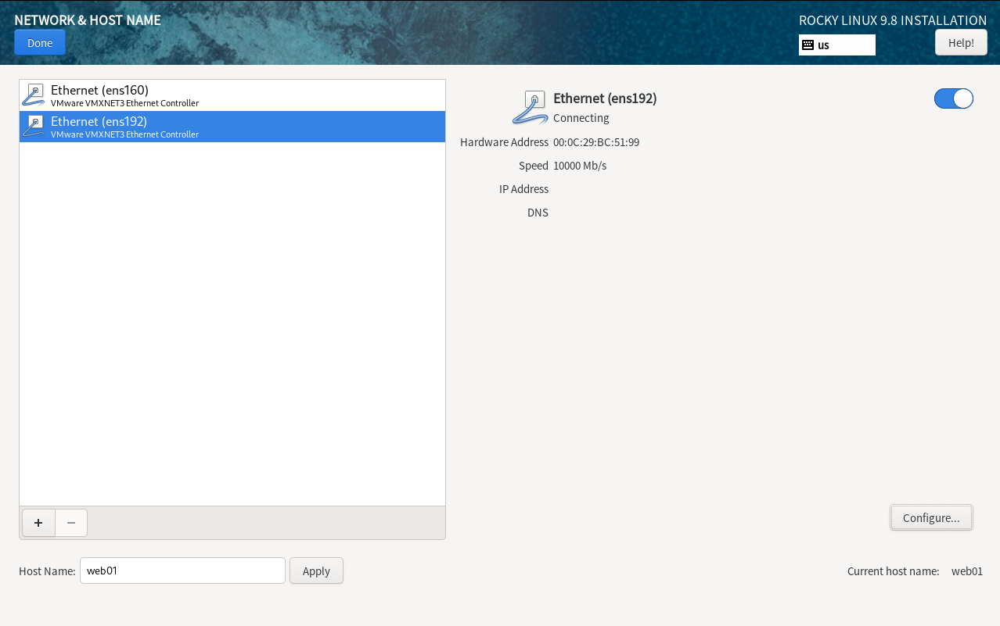
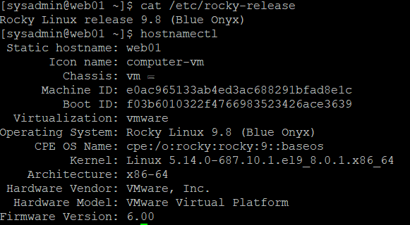
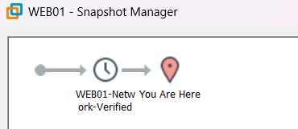

# 02. WEB01 서버 구축 및 네트워크 검증

## 1. 실습 개요

### 1.1 실습 목적

사내 업무 포털의 첫 번째 웹 서버인 WEB01을 구축한다.

Rocky Linux 9.8 Minimal 환경에서 NAT 및 Host-only 네트워크를 구성하고, 인터넷 연결과 SSH 원격 접속을 검증한다.

WEB01은 향후 Apache/PHP 기반 웹 서비스와 HAProxy 로드밸런싱의 백엔드 서버로 사용할 예정이다.

### 1.2 실습 목표

- WEB01 가상머신 생성
- Rocky Linux 9.8 Minimal 설치
- 고정 IP 및 라우팅 설정
- 외부 인터넷과 DNS 조회 검증
- Windows ↔ WEB01 내부 통신 검증
- PuTTY SSH 원격 접속 검증
- 네트워크 장애 분석 및 해결
- 정상 상태 VMware 스냅샷 생성

### 1.3 실습 환경

| 항목 | 설정값 |
|---|---|
| VM Name | WEB01 |
| OS | Rocky Linux 9.8 |
| Hostname | web01 |
| vCPU | 1 |
| RAM | 1GB |
| Disk Type | SCSI |
| Disk Capacity | 20GB |
| Network Adapter 1 | NAT (VMnet8) |
| Network Adapter 2 | Custom (VMnet2) |
| NAT IP | 10.10.10.128/24 |
| Internal IP | 192.168.100.21/24 |
| Default Gateway | 10.10.10.2 |
| Administrator Account | sysadmin |

공통 네트워크 설계는 [01-network.md](01-network.md)를 참고한다.

---

## 2. WEB01 가상머신 생성

### 2.1 하드웨어 구성

VMware Workstation에서 WEB01 가상머신을 생성하였다.

- CPU: 1 vCPU
- Memory: 1GB
- SCSI Disk: 20GB
- Network Adapter 1: NAT
- Network Adapter 2: Custom (VMnet2)
- CD/DVD: SATA

### 2.2 네트워크 어댑터 구성

**Network Adapter 1**

- Network: VMnet8 NAT
- Interface: `ens160`
- 용도: 인터넷 연결 및 패키지 설치
- IP 할당: DHCP

**Network Adapter 2**

- Network: VMnet2 Host-only
- Interface: `ens192`
- 용도: 내부 서버 통신 및 SSH 관리
- 고정 IP: `192.168.100.21/24`

NAT 인터페이스를 기본 경로로 사용하며, Host-only 인터페이스에는 별도의 기본 게이트웨이를 설정하지 않았다.

### 2.3 하드웨어 설정 확인

VMware Workstation에서 CPU, RAM, 디스크, 네트워크 어댑터 2개가 계획대로 구성된 것을 확인하였다.


---

## 3. Rocky Linux 9.8 설치 및 기본 환경 확인

### 3.1 운영체제 설치

| 항목 | 설정값 |
|---|---|
| OS | Rocky Linux 9.8 (Blue Onyx) |
| Installation Type | Minimal Install |
| Disk | 20GB SCSI |
| Hostname | web01 |
| Administrator Account | sysadmin |
| Network Interface 1 | ens160 |
| Network Interface 2 | ens192 |
| SELinux | Enforcing |

GUI를 사용하지 않는 Minimal Install을 선택하여 메모리 사용량을 줄이고 CLI 기반 서버 관리 환경을 구성하였다.

**설치 중 네트워크 및 호스트명 설정 화면**



### 3.2 운영체제 및 호스트명 확인

```bash
cat /etc/rocky-release
hostnamectl
```

**확인 결과**

```text
Rocky Linux release 9.8 (Blue Onyx)
Static hostname: web01
Operating System: Rocky Linux 9.8 (Blue Onyx)
Architecture: x86-64
Virtualization: vmware
```

Rocky Linux 9.8이 정상적으로 설치되고 호스트명이 `web01`로 설정된 것을 확인하였다.



### 3.3 SELinux 상태 확인

```bash
getenforce
```

**확인 결과**

```text
Enforcing
```

SELinux가 Enforcing 상태로 동작하고 있음을 확인하였다.

향후 Apache 및 NFS 연동 과정에서도 SELinux를 비활성화하지 않고 필요한 정책을 설정할 예정이다.

---

## 4. WEB01 네트워크 설정

### 4.1 초기 인터페이스 확인

```bash
ip -br addr
```

**확인 결과**

```text
ens160    UP    10.10.10.128/24
ens192    UP    IPv4 주소 미할당
```

- `ens160`: VMnet8 NAT 네트워크
- `ens192`: VMnet2 Host-only 네트워크

NAT 인터페이스는 DHCP로 주소를 자동 할당받았으며, Host-only 인터페이스는 수동으로 고정 IP를 설정해야 하는 상태였다.

### 4.2 ens192 고정 IP 설정

```bash
sudo nmcli connection modify ens192 \
  ipv4.method manual \
  ipv4.addresses 192.168.100.21/24 \
  ipv4.never-default yes \
  connection.autoconnect yes
```

**옵션 설명**

| 옵션 | 설명 |
|---|---|
| `connection modify ens192` | ens192 연결 프로필 수정 |
| `ipv4.method manual` | IPv4 주소를 수동으로 설정 |
| `ipv4.addresses` | IP 주소 및 Prefix 지정 |
| `ipv4.never-default yes` | 기본 경로 생성 방지 |
| `connection.autoconnect yes` | 부팅 시 자동 연결 활성화 |

설정 적용:

```bash
sudo nmcli connection up ens192
```

**실행 결과**

```text
Connection successfully activated
```

### 4.3 IP 주소 및 라우팅 확인

```bash
ip -br addr
ip route
```

**IP 설정**

```text
ens160    UP    10.10.10.128/24
ens192    UP    192.168.100.21/24
```

**라우팅 결과**

```text
default via 10.10.10.2 dev ens160 proto dhcp src 10.10.10.128 metric 100
10.10.10.0/24 dev ens160 proto kernel scope link src 10.10.10.128 metric 100
192.168.100.0/24 dev ens192 proto kernel scope link src 192.168.100.21 metric 101
```

**결과 분석**

- 기본 게이트웨이 `10.10.10.2`는 NAT 인터페이스인 `ens160`에 설정되었다.
- 내부망 `192.168.100.0/24`는 `ens192`를 통해 통신한다.
- Host-only 인터페이스에는 별도의 기본 게이트웨이를 설정하지 않았다.


---

## 5. 네트워크 통신 검증

### 5.1 외부 인터넷 통신

```bash
ping -c 4 1.1.1.1
```

**실제 결과**

```text
4 packets transmitted, 4 received, 0% packet loss
rtt min/avg/max/mdev = 7.957/18.626/26.539/6.809 ms
```

WEB01에서 외부 IP로 정상적으로 통신할 수 있음을 확인하였다.

### 5.2 DNS 조회 검증

```bash
getent ahostsv4 rockylinux.org
```

**실제 결과**

```text
76.223.126.88   STREAM rockylinux.org
76.223.126.88   DGRAM
76.223.126.88   RAW
```

도메인 이름이 IPv4 주소로 정상 변환되는 것을 확인하였다.

### 5.3 Windows → WEB01 Ping 검증

Windows Git Bash에서 실행하였다.

```bash
ping.exe 192.168.100.21
```

**실제 결과**

```text
패킷: 보냄 = 4, 받음 = 4, 손실 = 0 (0% 손실)
```

Windows 호스트에서 WEB01의 내부 IP로 정상적으로 통신하였다.

### 5.4 WEB01 → Windows Ping 검증

WEB01에서 Windows VMnet2 주소로 Ping을 실행하였다.

```bash
ping -c 4 192.168.100.1
```

최초에는 패킷 손실이 100% 발생하였다.

Windows 방화벽 규칙을 추가한 뒤 동일한 테스트를 다시 실행하였다.

**최종 결과**

```text
4 packets transmitted, 4 received, 0% packet loss
rtt min/avg/max/mdev = 0.383/0.660/0.891/0.181 ms
```

Windows와 WEB01 간 양방향 ICMP 통신에 성공하였다.

장애 분석 및 복구 과정은 7번 항목에서 자세히 설명한다.

---

## 6. SSH 원격 접속 검증

### 6.1 PuTTY 접속

Windows 호스트에서 PuTTY로 WEB01에 접속하였다.

| 항목 | 설정값 |
|---|---|
| Host Name | 192.168.100.21 |
| Port | 22 |
| Protocol | SSH |
| Username | sysadmin |

### 6.2 접속 후 검증

```bash
whoami
hostname
ip -br addr
ip route
```

**실제 확인 결과**

```text
whoami  → sysadmin
hostname → web01

ens160  UP  10.10.10.128/24
ens192  UP  192.168.100.21/24
```

SSH 로그인 기록에서 출발지 주소가 Windows VMnet2 IP인 `192.168.100.1`로 확인되었다.

이를 통해 내부망을 통한 WEB01 원격 관리가 정상적으로 동작함을 검증하였다.


---

## 7. 트러블슈팅 — WEB01에서 Windows로 Ping 실패

### 7.1 장애 증상

WEB01에서 Windows 호스트 주소 `192.168.100.1`로 Ping을 실행했으나 응답을 받지 못하였다.

```bash
ping -c 4 192.168.100.1
```

**최초 결과**

```text
4 packets transmitted, 0 received, 100% packet loss
```

반면 Windows에서 WEB01로 Ping을 실행하거나 PuTTY로 SSH 접속하는 것은 정상적으로 동작하였다.

### 7.2 원인 분석

Windows PowerShell에서 ICMPv4 Echo Request 허용 규칙을 조회하였다.

```powershell
Get-NetFirewallRule -Name FPS-ICMP4-ERQ-In* |
    Select-Object DisplayName, Enabled, Profile, Action
```

**확인 결과**

```text
Enabled : False
Action  : Allow
```

기존 Windows ICMPv4 Echo Request 허용 규칙이 비활성화된 것을 확인하였다.

이에 따라 Windows 방화벽의 ICMP 수신 정책을 장애 원인으로 생각하였다.

### 7.3 해결 과정

Windows 방화벽 전체를 비활성화하지 않고, WEB01에서 Windows VMnet2 주소로 들어오는 ICMP Echo Request만 허용하는 규칙을 생성하였다.

관리자 PowerShell에서 실행하였다.

```powershell
New-NetFirewallRule `
  -DisplayName "Lab - Allow ICMPv4 from WEB01" `
  -Direction Inbound `
  -Protocol ICMPv4 `
  -IcmpType 8 `
  -LocalAddress 192.168.100.1 `
  -RemoteAddress 192.168.100.21 `
  -Action Allow `
  -Profile Any
```

**옵션 설명**

| 옵션 | 설명 |
|---|---|
| `Direction Inbound` | Windows로 들어오는 트래픽 |
| `Protocol ICMPv4` | IPv4 ICMP 프로토콜 |
| `IcmpType 8` | Echo Request |
| `LocalAddress` | Windows VMnet2 IP |
| `RemoteAddress` | WEB01 내부 IP |
| `Action Allow` | 해당 통신 허용 |
| `Profile Any` | 모든 네트워크 프로필에 규칙 적용 |

처음에는 일반 PowerShell에서 명령어를 실행하여 권한 오류가 발생하였다.

```text
New-NetFirewallRule : 액세스가 거부되었습니다.
Windows System Error 5
```

관리자 권한으로 PowerShell을 다시 실행한 후 동일한 명령어를 적용하여 규칙 생성에 성공하였다.

### 7.4 장애 복구 검증

```bash
ping -c 4 192.168.100.1
```

**복구 결과**

```text
4 packets transmitted, 4 received, 0% packet loss
```

규칙 적용 전에는 응답이 없었지만 적용 후 정상 응답을 확인하였다.

따라서 Windows 방화벽의 ICMP Echo Request 차단이 통신 장애의 원인이었음을 검증하였다.


### 7.5 트러블슈팅에서 배운 점

- 네트워크 장애 분석 시 IP 및 라우팅뿐 아니라 목적지 방화벽 정책도 확인해야 한다.
- 한 방향의 Ping 성공이 반대 방향의 Ping 허용을 의미하지는 않는다.
- Windows 방화벽 설정 변경에는 관리자 권한이 필요하다.
- 전체 방화벽을 비활성화하는 대신 필요한 트래픽만 허용하는 방식으로 문제를 해결할 수 있다.

---

## 8. WEB01 정상 상태 스냅샷

WEB01의 운영체제 설치, NAT/Host-only 네트워크 설정, 통신 검증 및 SSH 원격 접속 확인 후 VMware 스냅샷을 생성하였다.

| 항목 | 내용 |
|---|---|
| Snapshot Name | `WEB01-Network-Verified` |
| Server | WEB01 |
| 생성 시점 | 기본 OS 및 네트워크 설정 검증 완료 후 |
| 목적 | 이후 서비스 구성 과정에서 정상 상태로 복원 |



스냅샷은 특정 시점의 가상머신 상태를 보존하는 기능이다. 단, 별도의 백업을 대체하지 않는다.

---

## 9. 실습 진행 현황

- [x] WEB01 가상머신 생성
- [x] Rocky Linux 9.8 Minimal 설치
- [x] 호스트명 `web01` 설정
- [x] NAT DHCP IP 확인
- [x] Host-only 고정 IP 설정
- [x] 기본 게이트웨이 및 라우팅 검증
- [x] 외부 인터넷 통신 검증
- [x] DNS 조회 검증
- [x] Windows ↔ WEB01 Ping 검증
- [x] PuTTY SSH 원격 접속 검증
- [x] Windows 방화벽 장애 해결
- [x] 정상 상태 스냅샷 생성
- [ ] Apache/PHP 웹 서비스 구축
- [ ] WEB02 및 HAProxy와 웹 서비스 연동

---

## 10. 배운 점

### 10.1 네트워크 인터페이스 역할 분리

NAT 인터페이스와 Host-only 인터페이스를 분리하여 외부 인터넷 통신과 내부 관리망 통신에 서로 다른 경로를 사용하도록 구성하였다.

### 10.2 고정 IP와 라우팅

`nmcli`를 사용하여 내부망 IP를 고정하고, `ipv4.never-default yes` 옵션으로 Host-only 인터페이스에 불필요한 기본 경로가 추가되지 않도록 설정하였다.

### 10.3 네트워크 검증 절차

IP 설정, 라우팅, 인터넷 Ping, DNS 조회, 내부망 Ping, SSH 접속을 순서대로 확인함으로써 네트워크 문제를 단계적으로 파악할 수 있음을 학습하였다.

---

## 11. 다음 실습

- WEB01 Apache/PHP 설치 및 웹 서비스 구성
- WEB02와 웹 서비스 구성 비교
- HAProxy를 통한 WEB01/WEB02 부하 분산
- NFS 및 MariaDB 연동

공통 가상 네트워크 구성은 [01-network.md](01-network.md), 두 번째 웹 서버 구축은 [03-web02.md](03-web02.md)를 참고한다.
