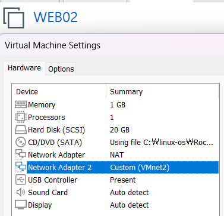
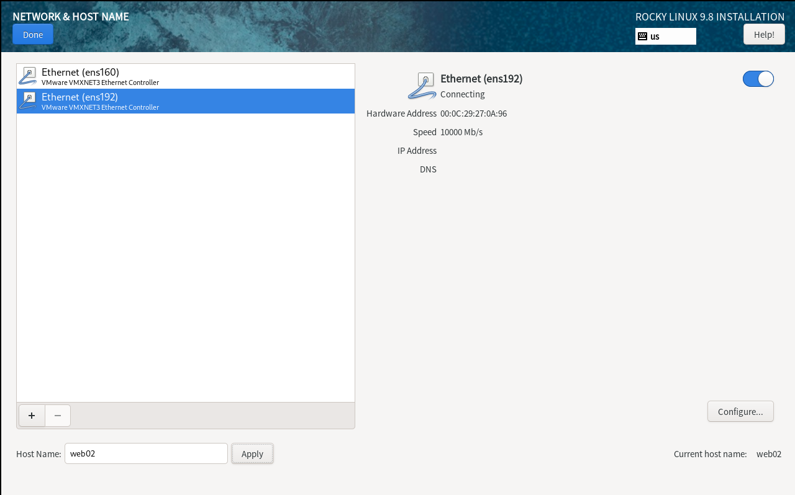
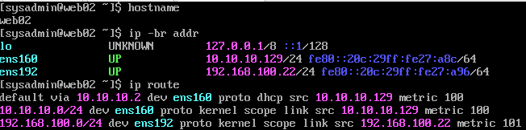
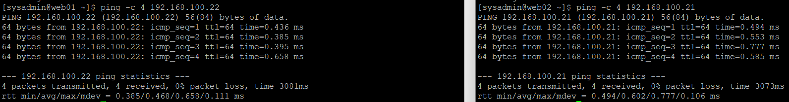
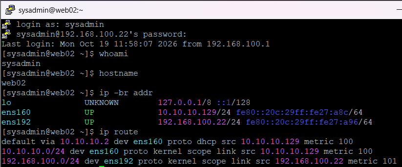

# 03. WEB02 서버 구축 및 네트워크 검증

## 1. 실습 개요

### 1.1 실습 목적

사내 업무 포털의 두 번째 웹 서버인 WEB02를 구축한다.

WEB01과 동일한 Rocky Linux 9.8 기반의 서버 환경을 구성하고, Host-only 네트워크에서 두 서버 간 통신이 가능한지 검증한다.

향후 두 서버에 Apache/PHP 웹 서비스를 구성하여 HAProxy 기반 로드밸런싱 환경으로 확장할 예정이다.

### 1.2 실습 목표

- WEB02 가상머신 생성
- Rocky Linux 9.8 Minimal 설치
- 호스트명 및 네트워크 인터페이스 확인
- Host-only 고정 IP 설정
- NAT 기본 경로 및 내부망 라우팅 확인
- WEB01 ↔ WEB02 양방향 ICMP 통신 검증
- Windows에서 WEB02로 SSH 원격 접속 검증
- 정상 상태 스냅샷 생성 예정

### 1.3 실습 환경

| 항목 | 설정값 |
|---|---|
| VM Name | WEB02 |
| OS | Rocky Linux 9.8 |
| Hostname | web02 |
| vCPU | 1 |
| RAM | 1GB |
| Disk Type | SCSI |
| Disk Capacity | 20GB |
| Network Adapter 1 | NAT (VMnet8) |
| Network Adapter 2 | Custom (VMnet2) |
| NAT IP | 10.10.10.129/24 |
| Internal IP | 192.168.100.22/24 |
| Default Gateway | 10.10.10.2 |
| Administrator Account | sysadmin |

공통 VMware 네트워크 구성은 [01-network.md](01-network.md)를 참고한다.

---

## 2. WEB02 가상머신 생성

### 2.1 가상머신 구성

VMware Workstation에서 WEB02 가상머신을 새로 생성하였다.

기존 WEB01 가상머신을 복제하지 않고 Rocky Linux 9.8을 별도로 설치하여 서버별 IP 주소와 호스트명, 시스템 식별 정보의 중복을 방지하고자 하였다.

### 2.2 하드웨어 구성

| 항목 | 설정값 |
|---|---|
| vCPU | 1 |
| RAM | 1GB |
| Disk | 20GB SCSI |
| CD/DVD | Rocky Linux ISO 연결 |
| Network Adapter 1 | NAT |
| Network Adapter 2 | Custom (VMnet2) |



### 2.3 네트워크 어댑터 구성

**ens160 — NAT 인터페이스**

- 연결 네트워크: VMnet8
- IP 할당: DHCP
- 역할: 인터넷 접근 및 패키지 다운로드

**ens192 — Host-only 인터페이스**

- 연결 네트워크: VMnet2
- IP 할당: 수동
- 고정 IP: `192.168.100.22/24`
- 역할: 내부 서버 통신 및 SSH 원격 관리

---

## 3. Rocky Linux 9.8 설치

### 3.1 설치 설정

WEB02에 Rocky Linux 9.8 Minimal Install을 진행하였다.

| 항목 | 설정값 |
|---|---|
| OS | Rocky Linux 9.8 (Blue Onyx) |
| Installation Type | Minimal Install |
| Hostname | web02 |
| Administrator Account | sysadmin |
| Network Interface 1 | ens160 |
| Network Interface 2 | ens192 |

설치 중 Network & Host Name 화면에서 호스트명을 `web02`로 설정하였다.

`ens192`는 설치 후 `nmcli`를 사용하여 고정 IPv4 주소를 적용하였다.



### 3.2 운영체제 설치 후 확인

WEB02에 `sysadmin` 계정으로 로그인하였다.

```bash
hostname
ip -br addr
```

**초기 확인 결과**

```text
web02

lo       UNKNOWN  127.0.0.1/8
ens160   UP       10.10.10.129/24
ens192   UP       IPv4 주소 미할당
```

확인 결과:

- 호스트명 `web02` 설정 완료
- `ens160` NAT DHCP 주소 할당 완료
- `ens192` 인터페이스 인식 완료
- `ens192`에 수동 IPv4 주소 설정 필요

---

## 4. WEB02 고정 IP 설정

### 4.1 NetworkManager 연결 프로필 확인

```bash
nmcli connection show
```

**확인 결과**

`ens160`과 `ens192` 연결 프로필이 존재하며 각 인터페이스에 연결되어 있었다.

인터페이스 이름과 NetworkManager 연결 프로필 이름을 확인한 뒤 설정을 진행하였다.

### 4.2 ens192 고정 IP 설정

```bash
sudo nmcli connection modify ens192 \
  ipv4.method manual \
  ipv4.addresses 192.168.100.22/24 \
  ipv4.never-default yes \
  connection.autoconnect yes
```

**옵션 설명**

| 옵션 | 설명 |
|---|---|
| `connection modify ens192` | ens192 연결 프로필 수정 |
| `ipv4.method manual` | IPv4 주소 수동 지정 |
| `ipv4.addresses` | `192.168.100.22/24` 설정 |
| `ipv4.never-default yes` | Host-only 기본 경로 생성 방지 |
| `connection.autoconnect yes` | 부팅 시 자동 연결 활성화 |

### 4.3 변경 사항 적용

```bash
sudo nmcli connection up ens192
```

**실행 결과**

```text
Connection successfully activated
```

변경된 IP 설정으로 연결이 활성화되었다.

### 4.4 IP 및 라우팅 검증

```bash
hostname
ip -br addr
ip route
```

**실제 IP 설정**

```text
ens160    UP    10.10.10.129/24
ens192    UP    192.168.100.22/24
```

**실제 라우팅 결과**

```text
default via 10.10.10.2 dev ens160 proto dhcp src 10.10.10.129 metric 100
10.10.10.0/24 dev ens160 proto kernel scope link src 10.10.10.129 metric 100
192.168.100.0/24 dev ens192 proto kernel scope link src 192.168.100.22 metric 101
```

**결과 분석**

- 기본 경로는 NAT 인터페이스 `ens160`을 통해 설정되었다.
- 내부망 `192.168.100.0/24`는 `ens192`를 통해 접근한다.
- Host-only 네트워크에는 별도의 기본 게이트웨이를 설정하지 않았다.
- WEB01과 서로 다른 내부 고정 IP를 사용한다.



---

## 5. WEB01 ↔ WEB02 내부 네트워크 통신 검증

### 5.1 검증 목적

WEB01과 WEB02가 동일한 VMnet2 Host-only 네트워크에서 양방향으로 통신할 수 있는지 확인하였다.

| 서버 | 내부 IP |
|---|---|
| WEB01 | 192.168.100.21/24 |
| WEB02 | 192.168.100.22/24 |

### 5.2 WEB01 → WEB02 Ping

WEB01에서 실행하였다.

```bash
ping -c 4 192.168.100.22
```

**실제 결과**

```text
4 packets transmitted, 4 received, 0% packet loss
rtt min/avg/max/mdev = 0.385/0.468/0.658/0.111 ms
```

### 5.3 WEB02 → WEB01 Ping

WEB02에서 실행하였다.

```bash
ping -c 4 192.168.100.21
```

**실제 결과**

```text
4 packets transmitted, 4 received, 0% packet loss
rtt min/avg/max/mdev = 0.494/0.602/0.777/0.106 ms
```

### 5.4 통신 검증 결과

| 검증 방향 | 전송 / 수신 | 패킷 손실률 | 평균 RTT | 결과 |
|---|---|---|---|---|
| WEB01 → WEB02 | 4 / 4 | 0% | 0.468ms | 성공 |
| WEB02 → WEB01 | 4 / 4 | 0% | 0.602ms | 성공 |

두 서버 모두 상대방의 Host-only IP 주소로 통신하는 데 성공하였다.

이는 내부망의 양방향 ICMP 통신이 가능함을 확인한 결과이며, HTTP 등 애플리케이션 서비스 연결은 추후 별도로 검증할 예정이다.



---

## 6. WEB02 SSH 원격 접속 검증

### 6.1 PuTTY 접속

Windows 호스트에서 PuTTY를 이용하여 WEB02에 SSH로 접속하였다.

| 항목 | 설정값 |
|---|---|
| Client | Windows Host |
| Client IP | 192.168.100.1 |
| Server | WEB02 |
| Server IP | 192.168.100.22 |
| Protocol | SSH |
| Port | 22 |
| Username | sysadmin |

### 6.2 원격 접속 후 시스템 확인

```bash
whoami
hostname
ip -br addr
ip route
```

**실제 확인 결과**

```text
whoami   → sysadmin
hostname → web02

ens160  UP  10.10.10.129/24
ens192  UP  192.168.100.22/24

default via 10.10.10.2 dev ens160
```

SSH 로그인 기록에서 클라이언트 주소가 `192.168.100.1`로 표시되었다.

이는 Windows 호스트의 VMware VMnet2 가상 어댑터를 통한 SSH 접속임을 보여준다.



### 6.3 검증 결과

Windows 호스트에서 WEB02로 SSH 접속이 정상적으로 이루어졌다.

이로써 WEB02의 운영체제 설치, 내부 고정 IP 설정, WEB01과의 양방향 Ping, Windows에서의 SSH 원격 접속 검증을 완료하였다.

---

## 7. WEB02 정상 상태 스냅샷

**진행 상태: 생성 및 확인 예정**

WEB02 네트워크와 SSH 검증을 완료한 상태를 보존하기 위해 VMware 스냅샷을 생성할 예정이다.

| 항목 | 계획 |
|---|---|
| Snapshot Name | `WEB02-Network-Verified` |
| 대상 서버 | WEB02 |
| 생성 시점 | 기본 네트워크 및 SSH 검증 완료 후 |
| 목적 | 향후 웹 서비스 구축 과정의 복구 지점 확보 |

스냅샷 생성과 Snapshot Manager 확인 후 증거 화면을 추가할 예정이다.

예정 스크린샷 경로:

`../screenshots/network/16-web02-snapshot.png`

> 스냅샷 생성 전이므로 완료한 작업으로 표시하지 않는다. 스냅샷은 별도의 백업을 대체하지 않는다.

---

## 8. 실습 진행 현황

- [x] WEB02 가상머신 생성
- [x] Rocky Linux 9.8 Minimal 설치
- [x] 호스트명 `web02` 설정
- [x] NAT DHCP IP 할당 확인
- [x] Host-only 고정 IP 설정
- [x] 내부 네트워크 라우팅 검증
- [x] WEB01 → WEB02 Ping 성공
- [x] WEB02 → WEB01 Ping 성공
- [x] Windows → WEB02 SSH 접속 성공
- [ ] WEB02 정상 상태 스냅샷 생성 및 확인
- [ ] Apache/PHP 웹 서비스 구축
- [ ] HAProxy 백엔드 서버 연동

---

## 9. 배운 점

### 9.1 서버별 고정 IP 관리

WEB01과 WEB02에 서로 다른 내부 IP를 설정함으로써 IP 주소 충돌 없이 동일한 내부 네트워크에 연결할 수 있었다.

### 9.2 NetworkManager 활용

`nmcli`를 사용하여 운영체제 설치 후 네트워크 연결 프로필을 수정하고, 고정 IP 및 자동 연결 설정을 적용하였다.

### 9.3 양방향 네트워크 검증

두 서버에서 각각 상대 서버로 Ping을 실행하여 양방향 통신을 확인하였다.

이를 통해 한 방향의 통신 성공만으로 전체 연결 상태를 판단하지 않고, 서로 다른 출발지에서 검증하는 방법을 익혔다.

### 9.4 SSH 원격 관리

Windows에서 WEB02로 SSH 접속을 수행하여 Host-only 네트워크를 통한 Linux 서버 원격 관리가 가능함을 확인하였다.

---

## 10. 다음 실습

1. WEB02 정상 상태 스냅샷 생성
2. LB01 가상머신 구축
3. LB01 고정 IP `192.168.100.10/24` 설정
4. LB01과 WEB01/WEB02 간 내부 통신 검증
5. Apache/PHP 및 HAProxy 연동 준비

공통 네트워크 설정은 [01-network.md](01-network.md), 첫 번째 웹 서버 설정은 [02-web01.md](02-web01.md)를 참고한다.
