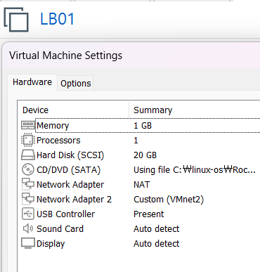
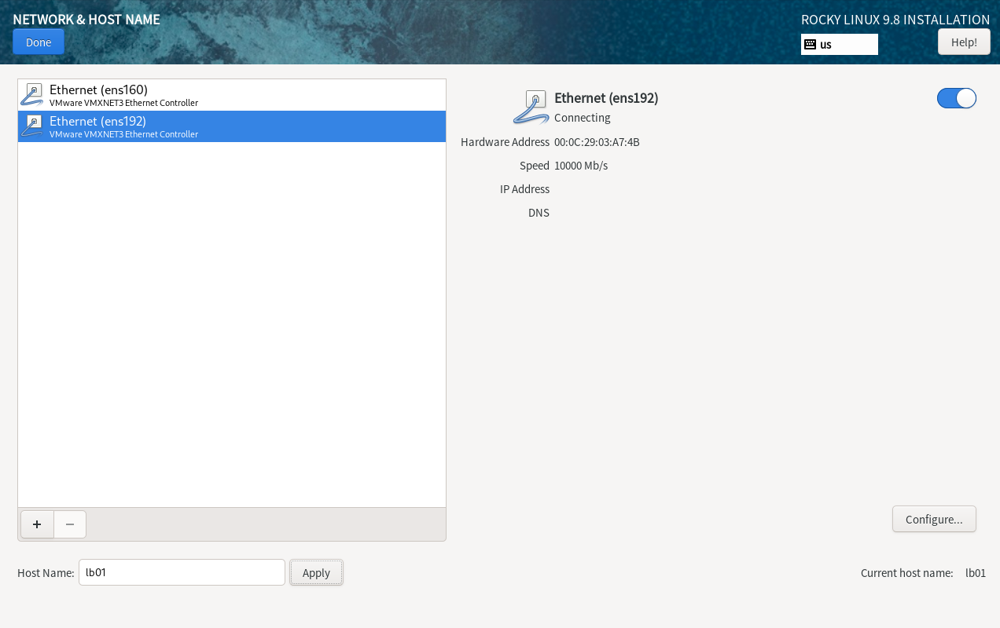
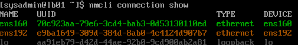
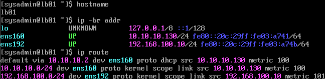
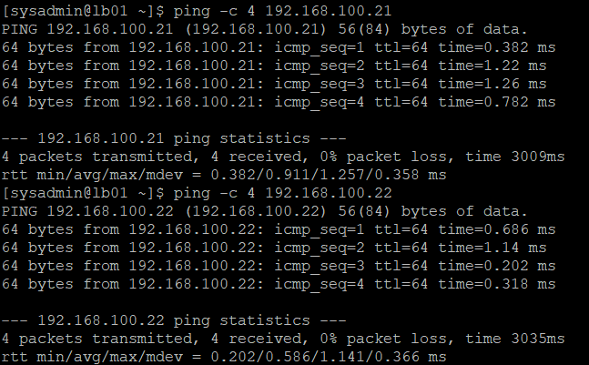
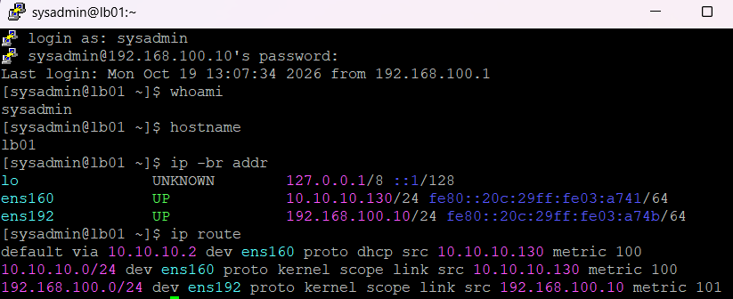
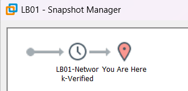

# 04. LB01 서버 구축 및 네트워크 검증

## 1. 실습 개요

### 1.1 실습 목적

Rocky Linux 9.8 기반 사내 업무 포털 인프라의 로드밸런서 서버인 LB01을 구축한다.

LB01은 향후 HAProxy를 사용하여 클라이언트 요청을 WEB01과 WEB02에 분산하는 역할을 수행할 예정이다.

Rocky Linux 9.8 Minimal 환경을 구성하고, NAT 및 Host-only 네트워크를 분리하여 외부 인터넷 접근과 내부 서버 통신이 가능하도록 설정한다.

### 1.2 실습 목표

- LB01 가상머신 생성
- Rocky Linux 9.8 Minimal 설치
- 호스트명 및 네트워크 인터페이스 확인
- Host-only 고정 IP 설정
- NAT 기본 경로 및 내부망 라우팅 검증
- LB01 → WEB01 / WEB02 통신 검증
- Windows에서 LB01로 SSH 원격 접속 검증
- 정상 상태 VMware 스냅샷 생성 및 확인

### 1.3 실습 환경

| 항목 | 설정값 |
|---|---|
| VM Name | LB01 |
| OS | Rocky Linux 9.8 (Blue Onyx) |
| Hostname | lb01 |
| vCPU | 1 |
| RAM | 1GB |
| Disk Type | SCSI |
| Disk Capacity | 20GB |
| Network Adapter 1 | NAT (VMnet8) |
| Network Adapter 2 | Custom (VMnet2) |
| NAT IP | 10.10.10.130/24 |
| Internal IP | 192.168.100.10/24 |
| Default Gateway | 10.10.10.2 |
| Administrator Account | sysadmin |
| 향후 서비스 | HAProxy |

공통 VMware 네트워크 설계는 [01-network.md](01-network.md)를 참고한다.

---

## 2. LB01 가상머신 생성

### 2.1 가상머신 구성

VMware Workstation에서 로드밸런서 서버로 사용할 LB01 가상머신을 생성하였다.

WEB01, WEB02와 동일하게 CPU 1개, 메모리 1GB, 20GB SCSI 디스크를 사용하도록 구성하였다.

### 2.2 하드웨어 구성

| 항목 | 설정값 |
|---|---|
| vCPU | 1 |
| RAM | 1GB |
| Disk | 20GB SCSI |
| CD/DVD | Rocky Linux 9.8 ISO |
| Network Adapter 1 | NAT |
| Network Adapter 2 | Custom (VMnet2) |

네트워크 어댑터는 외부 인터넷 접근과 내부 서버 통신을 구분하기 위해 2개를 구성하였다.



### 2.3 네트워크 어댑터 구성

**ens160 — NAT 인터페이스**

- 연결 네트워크: VMnet8
- IP 할당: DHCP
- 역할: 인터넷 접근 및 패키지 설치

**ens192 — Host-only 인터페이스**

- 연결 네트워크: VMnet2
- IP 할당: 수동
- 고정 IP: `192.168.100.10/24`
- 역할: WEB01/WEB02와 내부 통신 및 SSH 관리

---

## 3. Rocky Linux 9.8 설치

### 3.1 운영체제 설치

LB01에 Rocky Linux 9.8 Minimal Install을 진행하였다.

| 항목 | 설정값 |
|---|---|
| OS | Rocky Linux 9.8 (Blue Onyx) |
| Installation Type | Minimal Install |
| Hostname | lb01 |
| Administrator Account | sysadmin |
| Network Interface 1 | ens160 |
| Network Interface 2 | ens192 |

설치 중 Network & Host Name 화면에서 호스트명을 `lb01`로 설정하였다.

`ens160`은 NAT 네트워크에서 DHCP로 IPv4 주소를 할당받도록 구성하였다.

`ens192`는 VMnet2의 DHCP 기능이 비활성화되어 있으므로 운영체제 설치 후 고정 IP를 설정하기로 하였다.



### 3.2 운영체제 설치 후 확인

Rocky Linux 설치 완료 후 `sysadmin` 계정으로 로그인하였다.

**실행 명령어**

```bash
hostname
ip -br addr
```

**확인 결과**

```text
lb01

lo       UNKNOWN  127.0.0.1/8
ens160   UP       10.10.10.130/24
ens192   UP       IPv4 주소 미할당
```

**확인 결과**

- 호스트명 `lb01` 설정 완료
- `ens160` NAT 인터페이스 정상 인식
- `10.10.10.130/24` DHCP 주소 할당 완료
- `ens192` Host-only 인터페이스 정상 인식
- `ens192`에 IPv4 고정 IP 설정 필요



---

## 4. LB01 고정 IP 설정

### 4.1 NetworkManager 연결 프로필 확인

NetworkManager에 등록된 네트워크 연결 프로필을 확인하였다.

```bash
nmcli connection show
```

**확인 결과**

```text
NAME      TYPE      DEVICE
ens160    ethernet  ens160
ens192    ethernet  ens192
lo        loopback  lo
```

`ens160`과 `ens192` 연결 프로필이 각각 해당 네트워크 인터페이스에 연결되어 있음을 확인하였다.

### 4.2 ens192 고정 IP 설정

LB01의 내부 통신용 고정 IP를 `192.168.100.10/24`로 설정하였다.

**실행 명령어**

```bash
sudo nmcli connection modify ens192 \
  ipv4.method manual \
  ipv4.addresses 192.168.100.10/24 \
  ipv4.never-default yes \
  connection.autoconnect yes
```

**옵션 설명**

| 옵션 | 설명 |
|---|---|
| `connection modify ens192` | ens192 연결 프로필 수정 |
| `ipv4.method manual` | IPv4 주소 수동 설정 |
| `ipv4.addresses` | 내부 고정 IP 설정 |
| `ipv4.never-default yes` | Host-only 인터페이스의 기본 경로 생성 방지 |
| `connection.autoconnect yes` | 부팅 시 자동 연결 활성화 |

기본 게이트웨이는 별도로 지정하지 않았다.

### 4.3 설정 적용

변경한 네트워크 연결 프로필을 활성화하였다.

```bash
sudo nmcli connection up ens192
```

**실제 실행 결과**

```text
Connection successfully activated
```

NetworkManager를 통해 `ens192` 연결이 정상적으로 활성화되었다.

### 4.4 IP 주소 및 라우팅 검증

**실행 명령어**

```bash
ip -br addr
ip route
```

**IP 설정 확인**

```text
ens160    UP    10.10.10.130/24
ens192    UP    192.168.100.10/24
```

**라우팅 결과**

```text
default via 10.10.10.2 dev ens160 proto dhcp src 10.10.10.130 metric 100
10.10.10.0/24 dev ens160 proto kernel scope link src 10.10.10.130 metric 100
192.168.100.0/24 dev ens192 proto kernel scope link src 192.168.100.10 metric 101
```

**결과 분석**

- 기본 게이트웨이 `10.10.10.2`가 NAT 인터페이스 `ens160`에 설정되어 있다.
- `10.10.10.0/24` 네트워크는 `ens160`을 통해 통신한다.
- `192.168.100.0/24` 내부망은 `ens192`를 통해 통신한다.
- Host-only 인터페이스에는 별도의 기본 게이트웨이가 설정되지 않았다.

이를 통해 LB01의 NAT 및 내부 네트워크 경로가 계획대로 분리되었음을 확인하였다.



---

## 5. LB01 → WEB01 / WEB02 내부 통신 검증

### 5.1 검증 목적

LB01에서 두 웹 서버로 통신할 수 있는지 확인한다.

향후 HAProxy가 WEB01과 WEB02를 백엔드 서버로 사용할 예정이므로, 로드밸런서에서 각 웹 서버의 내부 IP로 접근할 수 있는지 먼저 검증하였다.

**서버별 내부 IP**

| 서버 | 내부 IP | 역할 |
|---|---|---|
| LB01 | 192.168.100.10/24 | HAProxy 로드밸런서 |
| WEB01 | 192.168.100.21/24 | 첫 번째 웹 서버 |
| WEB02 | 192.168.100.22/24 | 두 번째 웹 서버 |

### 5.2 LB01 → WEB01 Ping

LB01에서 WEB01로 ICMP 통신을 확인하였다.

```bash
ping -c 4 192.168.100.21
```

**결과**

```text
4 packets transmitted, 4 received, 0% packet loss, time 3009ms
rtt min/avg/max/mdev = 0.382/0.911/1.257/0.358 ms
```

WEB01로 전송한 패킷 4개가 모두 응답하였다.

### 5.3 LB01 → WEB02 Ping

LB01에서 WEB02로 ICMP 통신을 확인하였다.

```bash
ping -c 4 192.168.100.22
```

**결과**

```text
4 packets transmitted, 4 received, 0% packet loss, time 3035ms
rtt min/avg/max/mdev = 0.202/0.586/1.141/0.366 ms
```

WEB02로 전송한 패킷 4개가 모두 응답하였다.

### 5.4 통신 검증 결과

| 검증 방향 | 전송 / 수신 | 패킷 손실률 | 평균 RTT | 판정 |
|---|---|---|---|---|
| LB01 → WEB01 | 4 / 4 | 0% | 0.911ms | 성공 |
| LB01 → WEB02 | 4 / 4 | 0% | 0.586ms | 성공 |

두 웹 서버 모두 LB01에서 전송한 Ping 요청에 정상적으로 응답하였다.

이를 통해 LB01에서 WEB01과 WEB02로의 Host-only 내부망 ICMP 통신이 정상적으로 이루어짐을 확인하였다.

단, Ping 성공이 HTTP 서비스나 HAProxy의 백엔드 연결까지 보장하는 것은 아니다. 웹 서비스 및 포트 연결은 추후 별도로 검증할 예정이다.



---

## 6. LB01 SSH 원격 접속 검증

### 6.1 PuTTY 접속

Windows 호스트에서 PuTTY를 이용하여 LB01에 SSH로 접속하였다.

| 항목 | 설정값 |
|---|---|
| Client | Windows Host |
| Client IP | 192.168.100.1 |
| Server | LB01 |
| Server IP | 192.168.100.10 |
| Protocol | SSH |
| Port | 22 |
| Username | sysadmin |

### 6.2 원격 접속 후 시스템 확인

SSH 접속 후 다음 명령어를 실행하였다.

```bash
whoami
hostname
ip -br addr
ip route
```

**실제 확인 결과**

```text
whoami   → sysadmin
hostname → lb01

ens160   UP  10.10.10.130/24
ens192   UP  192.168.100.10/24

default via 10.10.10.2 dev ens160 proto dhcp src 10.10.10.130 metric 100
10.10.10.0/24 dev ens160 proto kernel scope link src 10.10.10.130 metric 100
192.168.100.0/24 dev ens192 proto kernel scope link src 192.168.100.10 metric 101
```

SSH 로그인 기록에서 접속 출발지 IP가 `192.168.100.1`로 표시되었다.

이는 Windows 호스트의 VMnet2 가상 네트워크 어댑터를 통해 LB01에 원격 접속한 기록이다.



### 6.3 SSH 검증 결과

Windows 호스트에서 LB01의 `192.168.100.10:22`로 SSH 접속하는 데 성공하였다.

접속 후 사용자 계정, 호스트명, 인터페이스별 IP 및 라우팅을 확인하였다.

이를 통해 Host-only 네트워크를 이용한 LB01 원격 관리 환경이 정상적으로 동작함을 검증하였다.

---

## 7. LB01 정상 상태 스냅샷

### 7.1 스냅샷 생성 목적

LB01의 운영체제 설치, 고정 IP 설정, WEB01/WEB02 통신 검증 및 SSH 원격 접속을 완료한 후 정상 상태를 보존하기 위해 VMware 스냅샷을 생성하였다.

향후 HAProxy 설치 및 설정 과정에서 문제가 발생할 경우 기본 서버 구성이 정상적으로 동작하던 시점으로 복원하기 위한 목적이다.

### 7.2 스냅샷 생성 정보

| 항목 | 내용 |
|---|---|
| Snapshot Name | `LB01-Network-Verified` |
| 대상 서버 | LB01 |
| 생성 시점 | OS 및 네트워크 설정 검증 완료 후 |
| 목적 | HAProxy 구축 전 정상 상태 복원 지점 확보 |
| 생성 결과 | 완료 |

### 7.3 스냅샷 생성 검증

VMware Workstation의 Snapshot Manager에서 `LB01-Network-Verified` 스냅샷이 생성된 것을 확인하였다.

Snapshot Manager에는 생성된 스냅샷과 현재 가상머신 상태를 나타내는 `You Are Here` 위치가 표시되었다.



> VMware 스냅샷은 특정 시점의 가상머신 상태를 보존하는 기능으로, 별도의 백업을 대체하지 않는다.

---

## 8. 실습 진행 현황

- [x] LB01 가상머신 생성
- [x] Rocky Linux 9.8 Minimal 설치
- [x] 호스트명 `lb01` 설정
- [x] NAT DHCP IP 할당 확인
- [x] Host-only 고정 IP 설정
- [x] 기본 게이트웨이 및 내부 라우팅 검증
- [x] LB01 → WEB01 Ping 성공
- [x] LB01 → WEB02 Ping 성공
- [x] Windows → LB01 SSH 원격 접속 성공
- [x] LB01 정상 상태 스냅샷 생성 및 확인
- [ ] HAProxy 설치 및 기본 설정
- [ ] WEB01 / WEB02 백엔드 서버 등록
- [ ] 로드밸런싱 동작 검증
- [ ] 웹 서버 장애 발생 시 서비스 전환 검증

---

## 9. 배운 점

### 9.1 NAT와 Host-only 네트워크 역할 분리

NAT는 인터넷 접근에 사용하고 Host-only 네트워크는 내부 서버 간 통신 및 SSH 원격 관리에 사용하도록 구성하였다.

이를 통해 네트워크 용도에 따라 인터페이스를 분리하여 관리하는 방법을 학습하였다.

### 9.2 NetworkManager를 이용한 고정 IP 설정

`nmcli`를 사용하여 연결 프로필을 확인하고, `ens192`에 고정 IPv4 주소를 지정하였다.

특히 `ipv4.never-default yes`를 설정하여 내부망 인터페이스가 불필요한 기본 경로를 생성하지 않도록 구성하였다.

### 9.3 라우팅 테이블 검증

`ip route` 명령어를 이용하여 기본 경로가 NAT 인터페이스에 설정되고 내부망 경로가 Host-only 인터페이스에 설정되었는지 확인하였다.

IP 주소뿐 아니라 라우팅 테이블까지 함께 확인해야 올바른 네트워크 경로를 검증할 수 있다는 점을 학습하였다.

### 9.4 백엔드 서버 통신 사전 검증

HAProxy 설치 전에 LB01에서 WEB01과 WEB02로 Ping을 실행하였다.

이를 통해 로드밸런서와 웹 서버 사이의 기본 내부 네트워크 연결을 사전에 확인하는 절차를 익혔다.

### 9.5 SSH 원격 관리

Windows에서 LB01로 SSH 접속하여 서버 관리가 가능한지 확인하였다.

GUI에 의존하지 않고 CLI 환경에서 서버의 호스트명, IP 및 라우팅 상태를 검증하였다.

### 9.6 스냅샷을 이용한 정상 상태 보존

서비스 소프트웨어 설치 전 정상 네트워크 상태의 스냅샷을 생성하였다.

이를 통해 향후 설정 오류 발생 시 비교 및 복원에 활용할 수 있는 기준점을 확보하였다.

---

## 10. 다음 실습

LB01의 기본 운영체제 구축 및 네트워크 검증을 완료하였다.

다음 단계에서는 HAProxy를 설치하고 WEB01, WEB02를 백엔드 서버로 등록하여 실제 로드밸런싱 기능을 구성할 예정이다.

**예정 작업**

1. HAProxy 패키지 설치
2. HAProxy 기본 설정 파일 분석
3. WEB01 / WEB02 백엔드 서버 등록
4. HAProxy 설정 문법 검사
5. 방화벽 및 SELinux 정책 검토
6. 클라이언트 요청 분산 동작 검증
7. 웹 서버 장애 발생 시 서비스 전환 및 복구 검증

공통 네트워크 설정은 [01-network.md](01-network.md), 백엔드 웹 서버 구축은 [02-web01.md](02-web01.md) 및 [03-web02.md](03-web02.md)를 참고한다.
