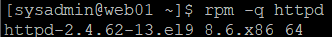
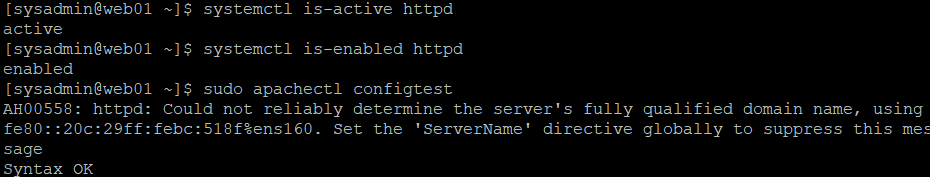
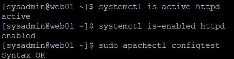
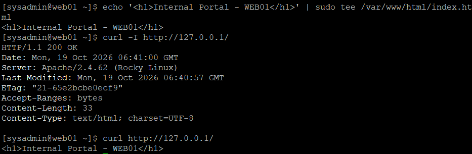
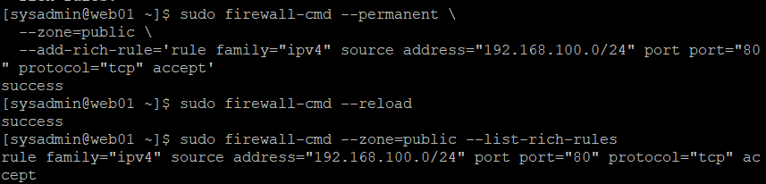
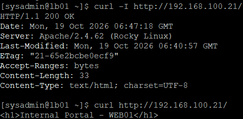

# 05. WEB01 Apache 웹 서버 구축 및 HTTP 통신 검증

## 1. 실습 개요

### 1.1 실습 목적

Rocky Linux 9.8 기반 사내 업무 포털 인프라의 첫 번째 웹 서버인 WEB01에 Apache Server를 설치하고 기본 웹 서비스를 구축한다.

firewalld를 이용하여 내부 네트워크의 HTTP 접근을 허용하고, LB01 로드밸런서에서 WEB01의 웹 페이지에 접근할 수 있는지 검증한다.

향후 WEB02에 동일한 웹 서비스를 구성한 뒤 HAProxy를 통해 두 웹 서버로 요청을 분산할 예정이다.

### 1.2 실습 목표

- Apache HTTP Server 설치 및 버전 확인
- Apache 서비스 실행 및 부팅 시 자동 시작 설정
- 기본 웹 페이지 생성 및 HTTP 200 OK 검증
- firewalld를 이용한 내부망 HTTP 접근 허용
- LB01에서 WEB01로 HTTP 원격 접속 검증
- Apache 관련 트러블슈팅 과정 기록

### 1.3 실습 환경

| 항목 | 설정값 |
|---|---|
| Server | WEB01 |
| OS | Rocky Linux 9.8 (Blue Onyx) |
| Hostname | web01 |
| NAT IP | 10.10.10.128/24 |
| Internal IP | 192.168.100.21/24 |
| Web Server | Apache HTTP Server |
| Apache Package | httpd |
| Apache Version | 2.4.62-13.el9_8.6 |
| Service Name | httpd |
| HTTP Port | TCP 80 |
| DocumentRoot | /var/www/html |
| ServerName | web01.lab.local |
| Firewall | firewalld |
| HTTP 검증 클라이언트 | LB01 (192.168.100.10) |

WEB01의 운영체제 설치, 네트워크 설정 및 SSH 구성은 [02-web01.md](02-web01.md)를 참고한다.

---

## 2. Apache HTTP Server 설치

### 2.1 Apache 설치 전 상태 확인

Apache 설치에 앞서 서비스 실행 상태를 확인하였다.

```bash
systemctl is-active httpd
```

**확인 결과**

```text
inactive
```

이후 RPM 패키지 설치 여부를 확인하였다.

```bash
rpm -q httpd
```

**확인 결과**

```text
package httpd is not installed
```

Apache 서비스가 실행되고 있지 않았으며, `httpd` 패키지도 설치되지 않은 상태임을 확인하였다.

### 2.2 Apache 패키지 설치

DNF 패키지 관리 도구를 사용하여 Apache HTTP Server를 설치하였다.

```bash
sudo dnf install -y httpd
```

**명령어 설명**

| 명령어 및 옵션 | 설명 |
|---|---|
| `sudo` | 관리자 권한으로 명령 실행 |
| `dnf` | Rocky Linux 패키지 관리 도구 |
| `install` | 패키지 설치 |
| `-y` | 설치 확인 질문에 자동으로 동의 |
| `httpd` | Apache HTTP Server 패키지 |

패키지 설치 과정에서 Apache와 필요한 의존성 패키지 총 12개를 설치하였다.

**설치 결과**

```text
Transaction check succeeded.
Transaction test succeeded.

Installed:
  httpd-2.4.62-13.el9_8.6.x86_64
  httpd-core-2.4.62-13.el9_8.6.x86_64
  httpd-filesystem-2.4.62-13.el9_8.6.noarch
  httpd-tools-2.4.62-13.el9_8.6.x86_64

Complete!
```

### 2.3 Apache 설치 결과 검증

```bash
rpm -q httpd
```

**결과**

```text
httpd-2.4.62-13.el9_8.6.x86_64
```

Apache HTTP Server 패키지가 정상적으로 설치되었음을 확인하였다.



---

## 3. Apache 서비스 실행 및 자동 시작 설정

### 3.1 Apache 서비스 시작

Apache 설치 후 서비스를 실행하고 부팅 시 자동으로 시작되도록 설정하였다.

```bash
sudo systemctl enable --now httpd
```

**명령어 설명**

| 명령어 및 옵션 | 설명 |
|---|---|
| `systemctl` | systemd 서비스 관리 |
| `enable` | 부팅 시 서비스 자동 시작 활성화 |
| `--now` | 자동 시작 설정과 동시에 현재 서비스 실행 |
| `httpd` | Apache 서비스 이름 |

`enable`은 부팅 시 자동 시작을 설정하고, `--now`는 현재 서비스도 즉시 시작하도록 한다.

### 3.2 서비스 실행 상태 검증

```bash
systemctl is-active httpd
```

**실제 결과**

```text
active
```

Apache 서비스가 실행 중임을 확인하였다.

### 3.3 부팅 시 자동 시작 검증

```bash
systemctl is-enabled httpd
```

**실제 결과**

```text
enabled
```

부팅 시 Apache 서비스가 자동으로 시작되도록 설정되었음을 확인하였다.

### 3.4 검증 결과

| 검증 항목 | 실제 결과 | 판정 |
|---|---|---|
| Apache 패키지 설치 | 2.4.62-13.el9_8.6 | 정상 |
| 서비스 실행 상태 | active | 성공 |
| 부팅 시 자동 시작 | enabled | 성공 |

패키지 설치와 서비스 실행은 서로 다른 작업이므로, 설치 후 서비스 상태를 별도로 검증해야 한다는 점을 확인하였다.



---

## 4. 트러블슈팅 — Apache ServerName 경고 해결

### 4.1 장애 증상

Apache 설치 및 서비스 실행 후 설정 파일의 문법을 확인하였다.

```bash
sudo apachectl configtest
```

**최초 결과**

```text
AH00558: httpd: Could not reliably determine the server's fully qualified domain name, using fe80::20c:29ff:febc:518f%ens160. Set the 'ServerName' directive globally to suppress this message
Syntax OK
```

`Syntax OK`가 출력되어 설정 문법 검사는 통과했지만, `AH00558` 경고가 함께 발생하였다.

### 4.2 원인 분석

Apache의 전역 `ServerName`이 명시적으로 설정되지 않아 서버 이름을 안정적으로 결정하지 못한 상태였다.

Apache는 서버 이름을 자동으로 판단하는 과정에서 `ens160` 인터페이스의 IPv6 링크 로컬 주소를 사용하였다.

**경고와 문법 오류의 차이**

- `Syntax OK`: Apache 설정 파일의 문법 검사 통과
- `AH00558`: 서버 이름을 안정적으로 판단하지 못했다는 경고

따라서 해당 경고가 발생했다고 해서 Apache 서비스가 실행되지 않는 것은 아니다.

### 4.3 해결 과정

기본 설정 파일인 `/etc/httpd/conf/httpd.conf`를 직접 수정하는 대신 별도의 설정 파일을 생성하여 ServerName을 지정하였다.

```bash
echo 'ServerName web01.lab.local' | sudo tee /etc/httpd/conf.d/servername.conf
```

**명령어 설명**

| 명령어 | 설명 |
|---|---|
| `echo` | 설정 문자열 출력 |
| `ServerName` | Apache 서버 이름 지정 |
| `web01.lab.local` | 실습에서 사용할 서버 이름 |
| `\|` | 앞 명령어의 출력을 뒤 명령어에 전달 |
| `sudo tee` | 관리자 권한으로 파일 작성 |
| `/etc/httpd/conf.d/servername.conf` | Apache 추가 설정 파일 |

`web01.lab.local`은 실습용으로 지정한 서버 이름이다.

### 4.4 설정 문법 재검증

```bash
sudo apachectl configtest
```

**실제 결과**

```text
Syntax OK
```

기존에 발생했던 `AH00558` 경고가 사라지고 `Syntax OK`만 출력되었다.

이후 실행 중인 Apache 서비스에 변경된 설정을 반영하였다.

```bash
sudo systemctl reload httpd
```

`reload`는 Apache 서비스를 완전히 중지했다가 시작하는 대신 변경된 설정을 다시 읽도록 요청하는 명령어이다.

### 4.5 트러블슈팅 결과

| 항목 | 변경 전 | 변경 후 |
|---|---|---|
| ServerName | 전역 설정 없음 | web01.lab.local |
| Apache 설정 검사 | AH00558 경고 발생 | Syntax OK |
| 문법 오류 | 없음 | 없음 |
| 결과 | 경고 발생 | 경고 해결 |



---

## 5. 트러블슈팅 — HTTP 403 Forbidden 해결

### 5.1 최초 HTTP 응답 확인

Apache의 설정을 적용한 후 WEB01 내부에서 HTTP 요청을 실행하였다.

```bash
curl -I http://127.0.0.1/
```

**최초 결과**

```text
HTTP/1.1 403 Forbidden
Server: Apache/2.4.62 (Rocky Linux)
Content-Type: text/html; charset=UTF-8
```

Apache가 HTTP 요청을 수신하여 응답했으나, 상태 코드가 `403 Forbidden`으로 표시되었다.

### 5.2 원인 분석

Apache의 기본 웹 문서 디렉터리에 콘텐츠가 존재하는지 확인하였다.

```bash
ls -la /var/www/html/
```

**실제 결과**

```text
total 0
drwxr-xr-x. 2 root root  6 Aug 26 08:00 .
drwxr-xr-x. 4 root root 33 Oct 19 14:58 ..
```

`/var/www/html/` 디렉터리 내부에 기본 웹 문서인 `index.html`이 존재하지 않는 것을 확인하였다.

이 상태에서는 Apache가 디렉터리 요청을 처리할 때 기본 문서를 찾지 못하며, 디렉터리 목록 표시가 허용되지 않은 경우 `403 Forbidden`이 발생할 수 있다.

이번 실습에서는 기본 웹 문서를 생성한 후 HTTP 응답이 정상으로 변경되는지 확인하였다.

### 5.3 기본 웹 페이지 생성

WEB01을 구분할 수 있는 테스트용 HTML 파일을 생성하였다.

```bash
echo '<h1>Internal Portal - WEB01</h1>' | sudo tee /var/www/html/index.html
```

**명령어 설명**

| 명령어 및 경로 | 설명 |
|---|---|
| `echo` | HTML 문자열 출력 |
| `<h1>` | HTML 제목 요소 |
| `sudo tee` | 관리자 권한으로 파일 작성 |
| `/var/www/html/index.html` | Apache 기본 웹 문서 |

**생성된 HTML**

```html
<h1>Internal Portal - WEB01</h1>
```

이 페이지는 향후 HAProxy 실습에서 WEB01과 WEB02의 응답을 구분하는 테스트 콘텐츠로도 활용할 예정이다.

### 5.4 HTTP 응답 상태 재검증

```bash
curl -I http://127.0.0.1/
```

**실제 결과**

```text
HTTP/1.1 200 OK
Server: Apache/2.4.62 (Rocky Linux)
Content-Length: 33
Content-Type: text/html; charset=UTF-8
```

기존 `403 Forbidden` 응답이 `200 OK`로 변경되었다.

### 5.5 HTML 본문 확인

```bash
curl http://127.0.0.1/
```

**실제 결과**

```html
<h1>Internal Portal - WEB01</h1>
```

HTTP 응답 헤더뿐 아니라 실제 웹 페이지 내용도 정상적으로 출력됨을 확인하였다.

### 5.6 트러블슈팅 결과

| 검증 항목 | 변경 전 | 변경 후 |
|---|---|---|
| index.html | 없음 | 생성 완료 |
| HTTP 상태 코드 | 403 Forbidden | 200 OK |
| HTML 본문 출력 | 정상 페이지 미제공 | 정상 출력 |
| Apache 서비스 | 실행 중 | 실행 중 |

웹 문서 생성 후 별도의 Apache 재시작 없이 정상 응답을 확인하였다.

이를 통해 이번 실습의 403 응답은 기본 웹 콘텐츠가 배포되지 않은 상태와 관련이 있음을 검증하였다.



---

## 6. HTTP 방화벽 설정

### 6.1 방화벽 설정 목적

WEB01 내부에서 HTTP 서비스가 정상 동작함을 확인했으므로, 다음으로 내부 네트워크의 다른 서버에서 WEB01의 웹 페이지에 접근할 수 있도록 방화벽을 설정하였다.

본 프로젝트의 내부 네트워크는 `192.168.100.0/24`를 사용한다.

외부 인터넷 연결을 위한 NAT 인터페이스에도 HTTP 서비스를 일괄 허용하는 대신, 출발지 IP 주소가 내부망 대역에 속하는 요청만 허용하도록 설정하였다.

### 6.2 firewalld 실행 상태 확인

```bash
sudo firewall-cmd --state
```

**실제 결과**

```text
running
```

firewalld가 정상적으로 실행 중임을 확인하였다.

### 6.3 활성 Zone 확인

```bash
sudo firewall-cmd --get-active-zones
```

**실제 결과**

```text
public
  interfaces: ens160 ens192
```

WEB01의 NAT 인터페이스 `ens160`과 Host-only 인터페이스 `ens192`가 모두 `public` zone에 연결되어 있었다.

### 6.4 기존 방화벽 규칙 확인

```bash
sudo firewall-cmd --zone=public --list-all
```

**실제 확인 결과**

```text
public (active)
  target: default
  interfaces: ens160 ens192
  services: cockpit dhcpv6-client ssh
  ports:
  rich rules:
```

`services`에 `http`가 없으며, 별도의 TCP 80 포트 허용 규칙도 존재하지 않는 것을 확인하였다.

### 6.5 내부망 HTTP 접근 허용

`public` zone에 HTTP 서비스를 전체 허용하지 않고, 내부 네트워크 대역을 출발지로 하는 TCP 80 요청을 허용하는 Rich Rule을 추가하였다.

```bash
sudo firewall-cmd --permanent \
  --zone=public \
  --add-rich-rule='rule family="ipv4" source address="192.168.100.0/24" port port="80" protocol="tcp" accept'
```

**옵션 설명**

| 옵션 | 설명 |
|---|---|
| `--permanent` | 영구 설정에 규칙 저장 |
| `--zone=public` | public zone에 규칙 적용 |
| `--add-rich-rule` | 세부 조건이 포함된 방화벽 규칙 추가 |
| `family="ipv4"` | IPv4 트래픽 지정 |
| `source address="192.168.100.0/24"` | 허용할 출발지 IP 대역 |
| `port port="80"` | TCP 80 포트 |
| `protocol="tcp"` | TCP 프로토콜 지정 |
| `accept` | 조건에 맞는 트래픽 허용 |

**실제 결과**

```text
success
```

이 규칙은 출발지 주소를 `192.168.100.0/24`로 제한한다.

단, 인터페이스 자체를 `ens192`로만 제한하는 규칙은 아니므로, 출발지 기반 접근 제어와 인터페이스 기반 접근 제어는 구분해야 한다.

### 6.6 방화벽 설정 적용

영구 설정을 실행 중인 firewalld에 반영하였다.

```bash
sudo firewall-cmd --reload
```

**결과**

```text
success
```

### 6.7 Rich Rule 적용 확인

```bash
sudo firewall-cmd --zone=public --list-rich-rules
```

**실제 결과**

```text
rule family="ipv4" source address="192.168.100.0/24" port port="80" protocol="tcp" accept
```

내부 네트워크 출발지의 TCP 80 접근 허용 규칙이 정상적으로 등록된 것을 확인하였다.



---

## 7. LB01 → WEB01 HTTP 원격 통신 검증

### 7.1 검증 목적

방화벽 설정 후 LB01 로드밸런서에서 WEB01의 웹 서비스에 접근할 수 있는지 확인하였다.

향후 HAProxy가 WEB01을 백엔드 서버로 사용할 예정이므로, 실제 HTTP 연결을 통해 기본 통신 상태를 검증하였다.

**검증 환경**

| 항목 | 설정값 |
|---|---|
| Client | LB01 |
| Client IP | 192.168.100.10 |
| Server | WEB01 |
| Server IP | 192.168.100.21 |
| Protocol | HTTP |
| Port | TCP 80 |

### 7.2 HTTP 응답 헤더 검증

LB01에서 다음 명령어를 실행하였다.

```bash
curl -I http://192.168.100.21/
```

**실제 결과**

```text
HTTP/1.1 200 OK
Server: Apache/2.4.62 (Rocky Linux)
Content-Length: 33
Content-Type: text/html; charset=UTF-8
```

WEB01에서 정상적인 HTTP 200 OK 응답을 반환하였다.

### 7.3 HTTP 본문 검증

LB01에서 다음 명령어를 실행하였다.

```bash
curl http://192.168.100.21/
```

**실제 결과**

```html
<h1>Internal Portal - WEB01</h1>
```

WEB01에 생성한 웹 페이지가 LB01에서도 정상적으로 출력됨을 확인하였다.

### 7.4 HTTP 통신 검증 결과

| 검증 항목 | 실제 결과 | 판정 |
|---|---|---|
| LB01 → WEB01 HTTP 연결 | 성공 | 정상 |
| HTTP 응답 코드 | 200 OK | 성공 |
| Apache 서버 응답 | Apache/2.4.62 | 정상 |
| HTML 본문 | Internal Portal - WEB01 | 정상 |
| 내부망 HTTP 접근 | 허용 | 성공 |

이를 통해 다음 항목이 정상적으로 작동함을 확인하였다.

- WEB01 Apache 서비스
- WEB01의 TCP 80 HTTP 응답
- LB01과 WEB01 간 내부망 연결
- HTTP 접근을 위한 firewalld 규칙
- WEB01 테스트 웹 페이지 제공

단, 현재 검증한 것은 LB01에서 WEB01으로의 직접 HTTP 요청이며, HAProxy를 통한 로드밸런싱 동작은 아직 검증하지 않았다.



---

## 8. 실습 진행 현황

- [x] Apache 설치 전 상태 확인
- [x] Apache HTTP Server 설치
- [x] Apache 버전 확인
- [x] Apache 서비스 시작
- [x] 부팅 시 자동 시작 설정
- [x] Apache 설정 문법 검사
- [x] ServerName 경고 분석 및 해결
- [x] 최초 HTTP 403 Forbidden 확인
- [x] 웹 문서 디렉터리 상태 확인
- [x] 기본 index.html 생성
- [x] 로컬 HTTP 200 OK 검증
- [x] HTML 본문 출력 확인
- [x] firewalld 상태 및 Zone 확인
- [x] 내부망 HTTP 접근 허용 Rich Rule 설정
- [x] 방화벽 설정 적용 및 규칙 검증
- [x] LB01 → WEB01 HTTP 200 OK 검증
- [x] LB01 → WEB01 HTML 본문 검증
- [ ] PHP 설치 및 사내 업무 포털 기능 구현
- [ ] WEB02 Apache 웹 서버 구축
- [ ] HAProxy 백엔드 서버 연동
- [ ] 웹 서버 장애 발생 시 서비스 전환 검증

---

## 9. 배운 점

### 9.1 패키지 설치와 서비스 실행의 차이

`dnf`를 이용한 패키지 설치는 웹 서버 프로그램을 시스템에 설치하는 작업이다.

실제 서비스를 사용하려면 `systemctl`을 통해 서비스를 실행해야 한다.

또한 `enable --now`를 사용하면 현재 실행과 부팅 시 자동 시작을 함께 설정할 수 있다.

### 9.2 Apache 설정 문법 검사의 중요성

`apachectl configtest`를 사용하여 설정 파일의 문법을 확인할 수 있었다.

`Syntax OK`와 경고 메시지가 동시에 나타날 수 있으며, 경고가 발생한 경우 해당 메시지의 원인을 별도로 분석해야 한다는 점을 학습하였다.

### 9.3 ServerName 설정 관리

Apache가 서버 이름을 자동으로 결정하지 못할 경우 `AH00558` 경고가 발생할 수 있다.

별도의 `conf.d` 설정 파일을 생성하여 ServerName을 명시적으로 지정하는 방법을 학습하였다.

### 9.4 HTTP 상태 코드 기반 문제 분석

Apache가 실행 중이어도 웹 페이지가 정상적으로 제공된다는 의미는 아니다.

최초 `403 Forbidden` 응답을 확인한 뒤 웹 문서 디렉터리와 기본 파일 존재 여부를 점검하였다.

`index.html`을 생성한 후 `200 OK` 응답을 확인하여 웹 서비스 상태를 검증하였다.

### 9.5 HTTP 헤더와 본문 검증

`curl -I`를 통해 HTTP 상태 코드 및 응답 헤더를 확인하였다.

`curl`을 이용한 일반 요청으로 실제 HTML 본문도 확인하였다.

이를 통해 웹 서버 연결 상태와 콘텐츠 제공 여부를 구분하여 검증하는 방법을 학습하였다.

### 9.6 firewalld Rich Rule을 이용한 접근 제어

기본 HTTP 서비스를 전체 허용하는 대신 내부망 주소 대역을 지정한 Rich Rule을 생성하였다.

이를 통해 IP 출발지와 서비스 포트 조건을 사용하여 접근 허용 범위를 제한하는 방법을 학습하였다.

### 9.7 로드밸런서 연동 전 HTTP 통신 검증

HAProxy를 구성하기 전에 LB01에서 WEB01으로 직접 HTTP 요청을 수행하였다.

Ping만으로는 HTTP 서비스 연결을 보장할 수 없으므로, 실제 애플리케이션 프로토콜을 이용한 검증이 필요하다는 점을 확인하였다.

---

## 10. 다음 실습

WEB01의 Apache 설치, 기본 웹 페이지 구성 및 LB01에서의 HTTP 접근 검증을 완료하였다.

다음 단계에서는 WEB02에도 Apache 웹 서버를 구축하여 두 웹 서버가 각각 정상적으로 HTTP 요청에 응답하도록 구성할 예정이다.

**예정 작업**

1. WEB02 Apache HTTP Server 설치
2. WEB02 Apache 서비스 시작 및 자동 시작 설정
3. WEB02 ServerName 설정
4. WEB02 테스트 웹 페이지 생성
5. WEB02 로컬 HTTP 응답 검증
6. WEB02 내부망 HTTP 방화벽 설정
7. LB01 → WEB02 HTTP 원격 통신 검증
8. HAProxy 구축 및 WEB01/WEB02 로드밸런싱 구성
9. PHP 기반 사내 업무 포털 기능 구현

### 관련 문서

- [VMware 가상 네트워크 구축](01-network.md)
- [WEB01 서버 기본 구축](02-web01.md)
- [WEB02 서버 기본 구축](03-web02.md)
- [LB01 로드밸런서 기본 구축](04-lb01.md)
