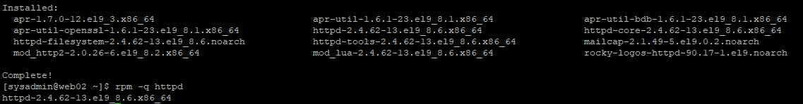
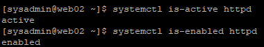
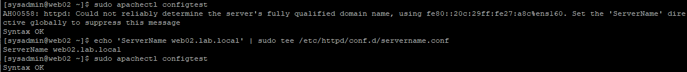
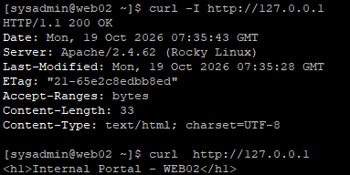
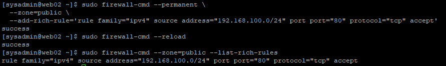
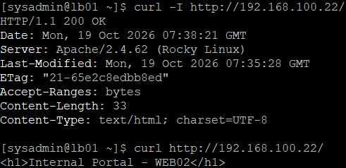

# 06. WEB02 Apache 웹 서버 구축 및 HTTP 통신 검증

## 1. 실습 개요

### 1.1 실습 목적

Rocky Linux 9.8 기반 두 번째 웹 서버인 WEB02에 Apache HTTP Server를 구축한다.

WEB01과 동일한 서비스 환경을 구성하고, 각 웹 서버가 서로 다른 HTML 응답을 반환하도록 설정하여 향후 HAProxy 로드밸런싱 검증에 활용한다.

WEB01에서 확인한 설정 방법을 재적용하고, LB01에서 WEB02로 HTTP 원격 통신이 가능한지 검증한다.

### 1.2 실습 환경

| 항목 | 설정값 |
|---|---|
| Server | WEB02 |
| OS | Rocky Linux 9.8 |
| Hostname | web02 |
| NAT IP | 10.10.10.129/24 |
| Internal IP | 192.168.100.22/24 |
| Apache Version | 2.4.62-13.el9_8.6 |
| Service | httpd |
| HTTP Port | TCP 80 |
| DocumentRoot | /var/www/html |
| ServerName | web02.lab.local |
| Internal Network | 192.168.100.0/24 |
| 검증 클라이언트 | LB01 (192.168.100.10) |

서버 설치 및 네트워크 구성은 [WEB02 기본 구축](03-web02.md)을 참고한다.

---

## 2. Apache 설치 및 서비스 실행

### 2.1 설치 전 상태 확인

```bash
rpm -q httpd
```

**실제 결과**

```text
package httpd is not installed
```

### 2.2 Apache 설치

```bash
sudo dnf install -y httpd
```

**설치 결과**

```text
Install 12 Packages

httpd-2.4.62-13.el9_8.6.x86_64

Complete!
```

Apache 및 의존성 패키지 총 12개가 정상적으로 설치되었다.



### 2.3 서비스 실행 및 검증

```bash
sudo systemctl enable --now httpd

systemctl is-active httpd
systemctl is-enabled httpd
```

**실제 결과**

```text
active
enabled
```

Apache 서비스가 실행 중이며 부팅 시 자동 시작하도록 설정되었다.



---

## 3. Apache ServerName 설정

### 3.1 ServerName 경고 확인

WEB02에서도 WEB01과 동일한 `AH00558` 경고가 발생하였다.

```bash
sudo apachectl configtest
```

**최초 결과**

```text
AH00558: httpd: Could not reliably determine the server's fully qualified domain name, using fe80::20c:29ff:fe27:a8c%ens160. Set the 'ServerName' directive globally to suppress this message
Syntax OK
```

원인 분석 및 상세 해결 과정은 [WEB01 Apache ServerName 트러블슈팅](05-web01-apache.md#4-트러블슈팅--apache-servername-경고-해결)을 참고한다.

### 3.2 ServerName 설정 및 적용

WEB01에서 검증한 방법을 WEB02에도 적용하였다.

```bash
echo 'ServerName web02.lab.local' | sudo tee /etc/httpd/conf.d/servername.conf

sudo apachectl configtest
sudo systemctl reload httpd
systemctl is-active httpd
```

**실제 검증 결과**

```text
Syntax OK
active
```

`AH00558` 경고가 사라졌으며, 설정 적용 후에도 Apache 서비스가 정상 동작하였다.

`web02.lab.local`은 실습용으로 지정한 서버 이름이며 DNS 등록을 의미하지 않는다.



---

## 4. 웹 페이지 구축 및 로컬 HTTP 검증

### 4.1 WEB02 전용 페이지 생성

HAProxy를 통해 요청을 처리한 서버를 구분할 수 있도록 WEB02 전용 HTML 페이지를 생성하였다.

```bash
echo '<h1>Internal Portal - WEB02</h1>' | sudo tee /var/www/html/index.html
```

WEB01과 WEB02의 웹 페이지 내용은 다음과 같다.

| 서버 | HTML 응답 |
|---|---|
| WEB01 | Internal Portal - WEB01 |
| WEB02 | Internal Portal - WEB02 |

### 4.2 로컬 HTTP 검증

```bash
curl -I http://127.0.0.1/
curl http://127.0.0.1/
```

**실제 결과**

```text
HTTP/1.1 200 OK
Server: Apache/2.4.62 (Rocky Linux)
Content-Length: 33
Content-Type: text/html; charset=UTF-8
```

```html
<h1>Internal Portal - WEB02</h1>
```

HTTP `200 OK`와 실제 HTML 본문이 정상 출력됨을 확인하였다.



---

## 5. 내부망 HTTP 방화벽 설정

### 5.1 기존 방화벽 상태 확인

```bash
sudo firewall-cmd --state
sudo firewall-cmd --get-active-zones
sudo firewall-cmd --zone=public --list-all
```

**주요 확인 결과**

```text
running

public
  interfaces: ens160 ens192

services: cockpit dhcpv6-client ssh
ports:
rich rules:
```

firewalld는 실행 중이었으나 HTTP 접근 허용 규칙은 존재하지 않았다.

### 5.2 내부망 HTTP 접근 허용

WEB01과 동일하게 내부 네트워크 `192.168.100.0/24`를 출발지로 하는 TCP 80 요청을 허용하였다.

```bash
sudo firewall-cmd --permanent \
  --zone=public \
  --add-rich-rule='rule family="ipv4" source address="192.168.100.0/24" port port="80" protocol="tcp" accept'
```

**실제 결과**

```text
success
```

### 5.3 방화벽 적용 및 검증

```bash
sudo firewall-cmd --reload
sudo firewall-cmd --zone=public --list-rich-rules
```

**실제 결과**

```text
success
rule family="ipv4" source address="192.168.100.0/24" port port="80" protocol="tcp" accept
```

내부망 출발지의 HTTP 요청을 허용하는 규칙이 정상 적용되었다.

해당 규칙은 출발지 IP를 기준으로 제한하며, 특정 인터페이스만 지정한 것은 아니다.



---

## 6. LB01 → WEB02 HTTP 원격 통신 검증

### 6.1 검증 목적

LB01에서 WEB02로 HTTP 요청을 전송하여 서버 간 통신과 웹 서비스 제공 상태를 검증하였다.

| 항목 | 설정값 |
|---|---|
| Client | LB01 (192.168.100.10) |
| Server | WEB02 (192.168.100.22) |
| Protocol | HTTP |
| Port | TCP 80 |

### 6.2 HTTP 응답 검증

**LB01에서 실행**

```bash
curl -I http://192.168.100.22/
curl http://192.168.100.22/
```

**실제 결과**

```text
HTTP/1.1 200 OK
Server: Apache/2.4.62 (Rocky Linux)
Content-Length: 33
Content-Type: text/html; charset=UTF-8
```

```html
<h1>Internal Portal - WEB02</h1>
```

LB01에서 WEB02의 웹 페이지에 정상적으로 접근하였다.

이를 통해 내부망 연결, HTTP 방화벽 규칙 및 Apache 응답을 검증하였다.



---

## 7. WEB01 · WEB02 구축 결과 비교

| 항목 | WEB01 | WEB02 |
|---|---|---|
| Internal IP | 192.168.100.21 | 192.168.100.22 |
| Apache Version | 2.4.62 | 2.4.62 |
| Service State | active | active |
| Auto Start | enabled | enabled |
| ServerName | web01.lab.local | web02.lab.local |
| HTTP Port | TCP 80 | TCP 80 |
| Firewall | 내부망 Rich Rule | 내부망 Rich Rule |
| Local HTTP | 200 OK | 200 OK |
| LB01 → WEB HTTP | 200 OK | 200 OK |
| HTML 응답 | Internal Portal - WEB01 | Internal Portal - WEB02 |

### 백엔드 구성

```text
               LB01
          192.168.100.10
                 |
          직접 HTTP 검증
          /             \
         v               v
       WEB01           WEB02
  192.168.100.21  192.168.100.22
       Apache          Apache
       TCP 80          TCP 80
```

두 웹 서버 모두 Apache 기본 구축과 HTTP 통신 검증을 완료하였다.

현재는 LB01에서 각 웹 서버로 직접 요청을 전송한 상태이며, HAProxy 로드밸런싱은 아직 구성하지 않았다.

---

## 8. 실습 결과 및 배운 점

### 8.1 실습 결과

- [x] WEB02 Apache 설치
- [x] 서비스 실행 및 자동 시작 설정
- [x] ServerName 경고 해결
- [x] Apache 설정 적용 및 상태 확인
- [x] WEB02 전용 HTML 페이지 생성
- [x] 로컬 HTTP 200 OK 검증
- [x] 내부망 HTTP 방화벽 규칙 적용
- [x] LB01 → WEB02 HTTP 통신 검증
- [x] WEB01과 WEB02 구성 비교

### 8.2 배운 점

**설정 재현 및 표준화**

WEB01에서 검증한 Apache 설정 방법을 WEB02에 동일하게 적용하였다. 이를 통해 여러 서버에서 동일한 서비스 환경을 재현하는 방법을 학습하였다.

**서버별 응답 구분**

웹 페이지에 서버 이름을 표시하여 향후 HAProxy 로드밸런싱 시 어느 웹 서버가 요청을 처리했는지 확인할 수 있는 기반을 마련하였다.

**서비스 단위 통신 검증**

서버 간 네트워크 연결뿐 아니라 HTTP 상태 코드와 HTML 본문까지 확인하여 실제 웹 서비스의 정상 동작을 검증하였다.

---

## 9. 다음 실습

WEB01과 WEB02의 Apache 기본 웹 서비스 구축을 완료하였다.

다음 단계에서는 LB01에 HAProxy를 설치하고 두 웹 서버로 요청을 분산하도록 구성할 예정이다.

**예정 작업**

1. HAProxy 설치 및 설정
2. WEB01/WEB02 백엔드 등록
3. HTTP 로드밸런싱 검증
4. 웹 서버 장애 전환 및 복구 검증
5. PHP 기반 사내 업무 포털 기능 구현

### 관련 문서

- [VMware 가상 네트워크 구축](01-network.md)
- [WEB01 서버 기본 구축](02-web01.md)
- [WEB02 서버 기본 구축](03-web02.md)
- [LB01 서버 기본 구축](04-lb01.md)
- [WEB01 Apache 구축 및 트러블슈팅](05-web01-apache.md)
