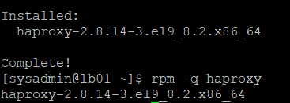
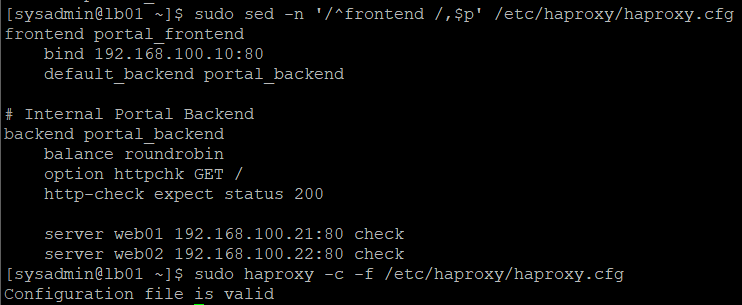
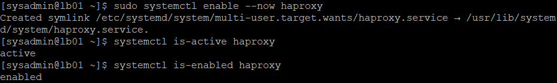
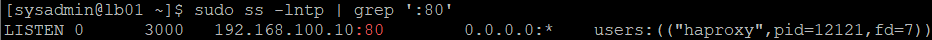
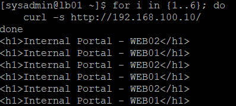
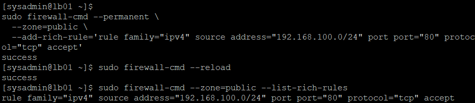
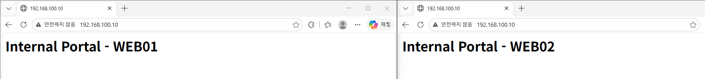

# 07. LB01 HAProxy 로드밸런싱 구축 및 HTTP 통신 검증

## 1. 실습 개요

### 1.1 실습 목적

Rocky Linux 9.8 기반 사내 업무 포털 인프라의 LB01 서버에 HAProxy를 설치하고, WEB01과 WEB02로 HTTP 요청을 분산하는 로드밸런싱 환경을 구축한다.

Round Robin 알고리즘을 적용하고 HTTP 헬스 체크를 설정하여 백엔드 웹 서버의 상태를 확인할 수 있도록 구성한다.

이후 LB01 내부와 Windows 클라이언트에서 HTTP 요청을 전송하여 HAProxy의 정상 동작과 요청 분산 결과를 검증한다.

### 1.2 실습 목표

- HAProxy 패키지 설치 및 버전 확인
- 기본 설정 파일 분석 및 백업
- Frontend와 Backend 설정
- Round Robin 로드밸런싱 구성
- HTTP 헬스 체크 설정
- HAProxy 설정 문법 검사
- 서비스 실행 및 부팅 시 자동 시작 설정
- TCP 80 포트 수신 상태 확인
- 실제 HTTP 요청 분산 검증
- 내부망 HTTP 방화벽 설정
- Windows 브라우저를 통한 서비스 접속 검증

### 1.3 실습 환경

| 항목 | 설정값 |
|---|---|
| Server | LB01 |
| OS | Rocky Linux 9.8 |
| Hostname | lb01 |
| Internal IP | 192.168.100.10/24 |
| Load Balancer | HAProxy |
| HAProxy Version | 2.8.14-3.el9_8.2 |
| Service Name | haproxy |
| Frontend | portal_frontend |
| Backend | portal_backend |
| Listen Address | 192.168.100.10:80 |
| Load Balancing | Round Robin |
| Health Check | HTTP GET /, 200 OK |
| WEB01 | 192.168.100.21:80 |
| WEB02 | 192.168.100.22:80 |
| Firewall | firewalld |
| Internal Network | 192.168.100.0/24 |

LB01 서버의 운영체제 및 기본 네트워크 구성은 [LB01 기본 서버 구축](04-lb01.md)을 참고한다.

### 1.4 로드밸런싱 구성도

```text
              Windows Client
               192.168.100.1
                      |
                      | HTTP / TCP 80
                      v
                LB01 - HAProxy
                192.168.100.10
                      |
               Round Robin
                      |
             +--------+--------+
             |                 |
             v                 v
          WEB01               WEB02
     192.168.100.21      192.168.100.22
       Apache :80          Apache :80
             |                 |
             v                 v
      Internal Portal    Internal Portal
           - WEB01            - WEB02
```

두 웹 서버는 앞선 Apache 구축 실습에서 HTTP 200 OK 응답을 검증한 상태이다.

- [WEB01 Apache 구축](05-web01-apache.md)
- [WEB02 Apache 구축](06-web02-apache.md)

---

## 2. HAProxy 설치 및 기본 상태 확인

### 2.1 패키지 설치 여부 확인

```bash
rpm -q haproxy
```

**실제 결과**

```text
package haproxy is not installed
```

HAProxy가 설치되지 않은 상태임을 확인하였다.

### 2.2 HAProxy 패키지 설치

```bash
sudo dnf install -y haproxy
```

**설치 결과**

```text
Installing:
 haproxy  x86_64  2.8.14-3.el9_8.2  appstream

Transaction check succeeded.
Transaction test succeeded.

Installed:
  haproxy-2.8.14-3.el9_8.2.x86_64

Complete!
```

Rocky Linux AppStream 저장소에서 HAProxy 패키지가 정상적으로 설치되었다.



### 2.3 설치 직후 서비스 상태 확인

```bash
systemctl is-active haproxy
systemctl is-enabled haproxy
```

**실제 결과**

```text
inactive
disabled
```

설치 직후 HAProxy 서비스는 실행되지 않았으며, 자동 시작 설정도 비활성화되어 있었다.

실제 서비스 실행 전에 로드밸런싱 설정을 구성하기로 하였다.

---

## 3. HAProxy 기본 설정 분석 및 백업

### 3.1 기본 설정 파일 확인

HAProxy의 기본 설정 파일은 다음 경로에 위치한다.

```text
/etc/haproxy/haproxy.cfg
```

파일 전체 내용을 확인하였다.

```bash
sudo cat /etc/haproxy/haproxy.cfg
```

**기본 설정의 주요 항목**

| 설정 영역 | 기존 설정 | 설명 |
|---|---|---|
| global | maxconn 4000 등 | HAProxy 전역 설정 |
| defaults | mode http | 공통 HTTP 설정 |
| frontend main | bind *:5000 | TCP 5000에서 요청 수신 |
| backend static | 127.0.0.1:4331 | 기본 예제 서버 |
| backend app | 127.0.0.1:5001~5004 | 기본 예제 애플리케이션 서버 |
| balance | roundrobin | 순차 요청 분산 알고리즘 |

기본 설정은 로컬 주소를 사용하는 예제 구성이므로, 실제 프로젝트에 사용할 WEB01과 WEB02 주소로 변경해야 했다.

### 3.2 설정 파일 백업

설정 변경 전 원본 파일을 보존하기 위해 백업을 생성하였다.

```bash
sudo cp -a /etc/haproxy/haproxy.cfg /etc/haproxy/haproxy.cfg.bak
```

백업 결과를 확인하였다.

```bash
sudo ls -l /etc/haproxy/haproxy.cfg*
```

**실제 결과**

```text
-rw-r--r--. 1 root root 3284 Aug 18 05:58 /etc/haproxy/haproxy.cfg
-rw-r--r--. 1 root root 3284 Aug 18 05:58 /etc/haproxy/haproxy.cfg.bak
```

원본과 백업 파일의 크기, 권한, 소유자 및 수정 시간이 동일함을 확인하였다.

`cp -a`를 사용하여 파일 속성을 최대한 보존하면서 원본 설정을 백업하였다.

---

## 4. HAProxy Frontend 및 Backend 구성

### 4.1 설정 파일 수정

다음 명령어로 설정 파일을 열었다.

```bash
sudo vi /etc/haproxy/haproxy.cfg
```

기존 `global`, `defaults` 영역은 유지하고, 기본 예제 `frontend`와 `backend` 영역을 프로젝트용 설정으로 변경하였다.

### 4.2 로드밸런싱 설정

```haproxy
# Internal Portal Frontend
frontend portal_frontend
    bind 192.168.100.10:80
    default_backend portal_backend

# Internal Portal Backend
backend portal_backend
    balance roundrobin
    option httpchk GET /
    http-check expect status 200

    server web01 192.168.100.21:80 check
    server web02 192.168.100.22:80 check
```

**주요 설정 설명**

| 설정 | 설명 |
|---|---|
| `frontend portal_frontend` | 클라이언트 요청을 수신하는 영역 |
| `bind 192.168.100.10:80` | LB01 내부망 IP의 TCP 80 포트에서 수신 |
| `default_backend portal_backend` | 요청을 전달할 기본 백엔드 그룹 |
| `backend portal_backend` | WEB01과 WEB02를 하나의 그룹으로 구성 |
| `balance roundrobin` | 정상 서버에 순차적으로 요청 분산 |
| `option httpchk GET /` | 백엔드의 `/` 경로에 HTTP 요청 전송 |
| `http-check expect status 200` | HTTP 200 응답을 정상으로 판단 |
| `server ... check` | 백엔드 서버 등록 및 헬스 체크 활성화 |

### 4.3 주요 설정 확인

전체 설정 파일 중 Frontend부터 마지막 줄까지 출력하였다.

```bash
sudo sed -n '/^frontend /,$p' /etc/haproxy/haproxy.cfg
```

이 명령어는 `frontend `로 시작하는 줄부터 파일 끝까지 출력한다.

현재 설정에서는 Frontend 다음에 Backend가 위치하므로 두 설정 영역을 함께 확인할 수 있다.

**확인 결과**

```haproxy
frontend portal_frontend
    bind 192.168.100.10:80
    default_backend portal_backend

# Internal Portal Backend
backend portal_backend
    balance roundrobin
    option httpchk GET /
    http-check expect status 200

    server web01 192.168.100.21:80 check
    server web02 192.168.100.22:80 check
```

### 4.4 설정 문법 검사

HAProxy 실행 전 설정 파일의 유효성을 검사하였다.

```bash
sudo haproxy -c -f /etc/haproxy/haproxy.cfg
```

**옵션 설명**

| 옵션 | 설명 |
|---|---|
| `-c` | 설정 파일 검증만 수행 |
| `-f` | 검증할 설정 파일 지정 |

**실제 결과**

```text
Configuration file is valid
```

HAProxy 설정 문법 검사에 성공하였다.

단, 설정 문법 검사가 성공했다고 해서 실제 HTTP 통신까지 보장되는 것은 아니므로, 이후 서비스와 네트워크 상태를 별도로 검증하였다.



---

## 5. HAProxy 서비스 실행 및 포트 검증

### 5.1 HAProxy 서비스 실행

설정 검증 후 HAProxy 서비스를 실행하고 부팅 시 자동 시작하도록 설정하였다.

```bash
sudo systemctl enable --now haproxy
```

**실제 결과**

```text
Created symlink /etc/systemd/system/multi-user.target.wants/haproxy.service → /usr/lib/systemd/system/haproxy.service.
```

### 5.2 서비스 상태 확인

```bash
systemctl is-active haproxy
systemctl is-enabled haproxy
```

**실제 결과**

```text
active
enabled
```

서비스가 정상 실행 중이고 부팅 시 자동 시작하도록 설정된 것을 확인하였다.



### 5.3 TCP 80 포트 수신 확인

HAProxy가 설정한 IP 주소와 포트에서 요청을 수신하는지 확인하였다.

```bash
sudo ss -lntp | grep ':80'
```

**실제 결과**

```text
LISTEN 0 3000 192.168.100.10:80 0.0.0.0:* users:(("haproxy",pid=12121,fd=7))
```

**결과 분석**

| 항목 | 실제 결과 | 의미 |
|---|---|---|
| 상태 | LISTEN | 연결 대기 중 |
| 수신 주소 | 192.168.100.10:80 | 내부망 HTTP 포트 |
| 프로세스 | haproxy | HAProxy가 소켓 사용 |
| PID | 12121 | 당시 실행 중인 프로세스 ID |

설정 파일의 `bind 192.168.100.10:80`이 실제 서비스에 반영된 것을 확인하였다.



---

## 6. Round Robin 로드밸런싱 검증

### 6.1 단일 HTTP 요청 검증

LB01에서 HAProxy의 내부망 IP로 HTTP 요청을 전송하였다.

```bash
curl http://192.168.100.10/
```

**실제 결과**

```html
<h1>Internal Portal - WEB01</h1>
```

HAProxy에 전달한 요청이 WEB01의 Apache 웹 서버를 통해 처리된 것을 확인하였다.

단일 요청만으로는 Round Robin 방식의 정상 동작을 판단할 수 없으므로 반복 요청을 수행하였다.

### 6.2 HTTP 요청 6회 반복

LB01에서 다음 Bash 반복문을 실행하였다.

```bash
for i in {1..6}; do
    curl -s http://192.168.100.10/
done
```

**명령어 설명**

| 구문 | 설명 |
|---|---|
| `for i in {1..6}` | 6회 반복 |
| `do ... done` | 반복 실행할 명령 지정 |
| `curl -s` | 일반 진행률과 오류 메시지 출력을 숨기고 HTTP 요청 |
| `192.168.100.10` | HAProxy Frontend 접속 주소 |

**실제 결과**

```html
<h1>Internal Portal - WEB02</h1>
<h1>Internal Portal - WEB01</h1>
<h1>Internal Portal - WEB02</h1>
<h1>Internal Portal - WEB01</h1>
<h1>Internal Portal - WEB02</h1>
<h1>Internal Portal - WEB01</h1>
```

WEB02와 WEB01이 번갈아 응답하였다.

### 6.3 요청 분산 결과

| 요청 순서 | 응답 서버 | 결과 |
|---|---|---|
| 1 | WEB02 | 성공 |
| 2 | WEB01 | 성공 |
| 3 | WEB02 | 성공 |
| 4 | WEB01 | 성공 |
| 5 | WEB02 | 성공 |
| 6 | WEB01 | 성공 |

**서버별 요청 분포**

| 서버 | 응답 횟수 | 비율 |
|---|---|---|
| WEB01 | 3회 | 50% |
| WEB02 | 3회 | 50% |
| 합계 | 6회 | 100% |

두 웹 서버가 교대로 요청을 처리하여 설정한 Round Robin 방식이 정상 동작함을 확인하였다.

이는 소규모 HTTP 요청에 대한 분산 검증 결과이며, 실제 동시 접속 부하나 처리 성능까지 측정한 것은 아니다.



---

## 7. HAProxy HTTP 방화벽 설정

### 7.1 기존 방화벽 상태 확인

LB01에서 firewalld 실행 상태와 기존 정책을 확인하였다.

```bash
sudo firewall-cmd --state
sudo firewall-cmd --get-active-zones
sudo firewall-cmd --zone=public --list-all
```

**주요 확인 결과**

```text
running

public
  interfaces: ens160 ens192

services: cockpit dhcpv6-client ssh
ports:
rich rules:
```

firewalld는 실행 중이었으나 HTTP 서비스를 허용하는 규칙은 존재하지 않았다.

### 7.2 내부망 HTTP 접근 허용

WEB01, WEB02와 동일하게 내부망 `192.168.100.0/24`에서 오는 TCP 80 요청을 허용하는 Rich Rule을 등록하였다.

```bash
sudo firewall-cmd --permanent \
  --zone=public \
  --add-rich-rule='rule family="ipv4" source address="192.168.100.0/24" port port="80" protocol="tcp" accept'
```

**결과**

```text
success
```

### 7.3 방화벽 적용 및 검증

```bash
sudo firewall-cmd --reload
sudo firewall-cmd --zone=public --list-rich-rules
```

**실제 결과**

```text
success
rule family="ipv4" source address="192.168.100.0/24" port port="80" protocol="tcp" accept
```

내부망 출발지에서 HAProxy HTTP 포트로 접근할 수 있도록 방화벽 규칙이 정상 적용되었다.



---

## 8. Windows 클라이언트 접속 검증

### 8.1 검증 목적

앞선 테스트에서는 LB01 내부에서 HAProxy로 요청을 전송하였다.

이번에는 Windows 호스트에서 HAProxy로 HTTP 요청을 전송하여 실제 클라이언트 관점에서 서비스가 정상 동작하는지 검증하였다.

**접속 주소**

```text
http://192.168.100.10/
```

**통신 경로**

```text
Windows Client
      |
      v
LB01 HAProxy :80
      |
      +----> WEB01 Apache :80
      |
      +----> WEB02 Apache :80
```

### 8.2 브라우저 접속 결과

Windows 브라우저에서 동일한 HAProxy 주소로 접속했을 때 각각 다음 페이지가 표시되는 것을 확인하였다.

**WEB01 응답**

```text
Internal Portal - WEB01
```

**WEB02 응답**

```text
Internal Portal - WEB02
```

두 응답 모두 주소창에는 동일한 `192.168.100.10`이 표시되었다.

이를 통해 클라이언트는 개별 WEB 서버의 IP 주소를 직접 입력하지 않고, HAProxy를 통해 두 웹 서버의 콘텐츠에 접근할 수 있음을 확인하였다.

### 8.3 최종 검증 결과

| 검증 항목 | 실제 결과 | 판정 |
|---|---|---|
| Windows → LB01 HTTP 접속 | 성공 | 정상 |
| HAProxy Frontend 접속 | 192.168.100.10:80 | 정상 |
| WEB01 페이지 응답 | 확인 | 성공 |
| WEB02 페이지 응답 | 확인 | 성공 |
| 동일 접속 주소 사용 | 확인 | 정상 |

이번 브라우저 검증으로 실제 클라이언트 환경에서도 HAProxy를 통한 HTTP 서비스가 동작함을 확인하였다.



---

## 9. 실습 결과 및 배운 점

### 9.1 실습 완료 항목

- [x] HAProxy 설치 전 상태 확인
- [x] HAProxy 2.8.14 설치
- [x] 기본 설정 파일 확인
- [x] 기존 설정 파일 백업
- [x] Frontend 설정
- [x] WEB01/WEB02 Backend 등록
- [x] Round Robin 알고리즘 설정
- [x] HTTP 200 기반 헬스 체크 설정
- [x] HAProxy 설정 문법 검사
- [x] 서비스 실행 및 자동 시작 설정
- [x] TCP 80 LISTEN 확인
- [x] HAProxy 경유 단일 HTTP 요청 검증
- [x] HTTP 6회 반복 요청 분산 검증
- [x] 내부망 HTTP 방화벽 설정
- [x] Windows 브라우저 접속 검증

### 9.2 배운 점

**Frontend와 Backend의 역할**

Frontend는 클라이언트의 요청을 받고, Backend는 실제 요청을 처리할 웹 서버 그룹을 정의한다. HAProxy 설정을 통해 두 영역을 분리하여 관리하는 방법을 학습하였다.

**Round Robin 로드밸런싱**

`balance roundrobin`을 설정하고 HTTP 요청을 반복 전송하여 WEB01과 WEB02가 순서대로 응답하는 것을 확인하였다.

**HTTP 헬스 체크 구성**

`option httpchk GET /`와 `http-check expect status 200`을 사용하여 백엔드 서버의 정상 상태 판단 기준을 구성하였다.

단, 실제 백엔드 장애 발생 시 HAProxy의 자동 제외 및 복구 동작은 아직 검증하지 않았다.

**설정 검증과 서비스 검증의 차이**

`haproxy -c`로 설정 문법을 검사하고, `systemctl`로 서비스 상태를 확인하였다. 이후 `ss`와 `curl`을 이용하여 실제 네트워크 수신 및 HTTP 응답을 검증하였다.

**클라이언트 접속 검증**

LB01 내부 테스트에 이어 Windows에서도 동일한 HAProxy 주소로 두 웹 서버의 페이지를 확인하였다.

---

## 10. 다음 실습

HAProxy 설치 및 Round Robin 로드밸런싱 구축을 완료하였다.

다음 단계에서는 백엔드 웹 서버의 장애를 재현하여 HAProxy의 헬스 체크와 자동 전환 기능을 검증한다.

**예정 작업**

1. WEB01 서비스 중지로 장애 재현
2. HAProxy의 WEB01 장애 감지 확인
3. WEB02로 요청 전환되는지 검증
4. WEB01 서비스 복구
5. 복구된 WEB01의 로드밸런싱 재참여 검증
6. 장애 전환 및 복구 시간 측정
7. 장애 원인·로그·검증 결과 문서화

### 관련 문서

- [VMware 가상 네트워크 구축](01-network.md)
- [WEB01 기본 서버 구축](02-web01.md)
- [WEB02 기본 서버 구축](03-web02.md)
- [LB01 기본 서버 구축](04-lb01.md)
- [WEB01 Apache 웹 서버 구축](05-web01-apache.md)
- [WEB02 Apache 웹 서버 구축](06-web02-apache.md)
