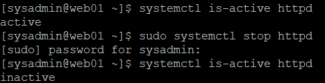
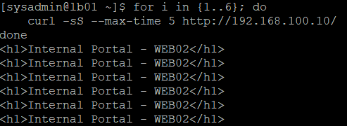
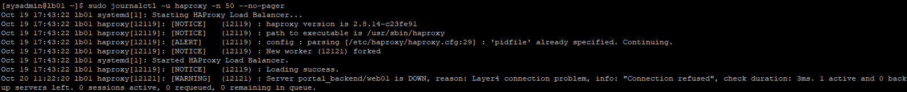
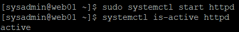
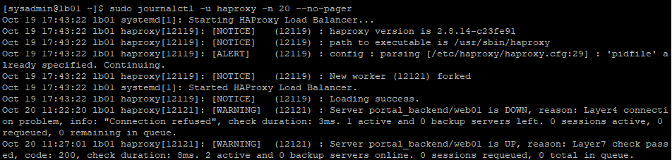
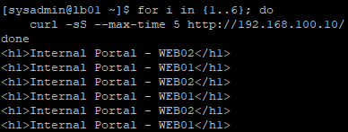
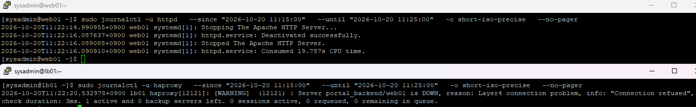
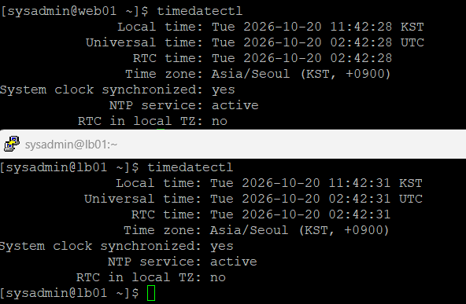
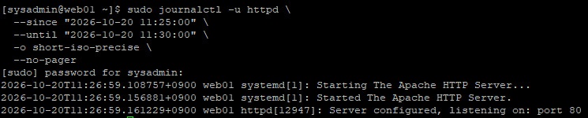
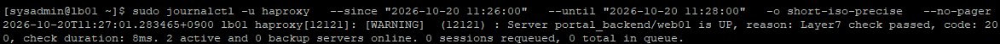

# 08. HAProxy 장애 전환 및 복구 검증

## 1. 실습 개요

### 1.1 실습 목적

Rocky Linux 9.8 기반 사내 업무 포털 인프라에서 HAProxy의 장애 감지 및 자동 전환 기능을 확인한다.

WEB01의 Apache 서비스를 의도적으로 중지하여 장애를 재현하고, HAProxy가 해당 서버를 비정상 상태로 판단한 후 정상 서버인 WEB02로 요청을 전달하는지 확인한다.

WEB01의 Apache 서비스를 복구하여 HAProxy의 정상 상태 재감지와 Round Robin 로드밸런싱 기능을 확인한다.

systemd 및 HAProxy 로그의 타임스탬프를 비교하여 장애 감지와 복구 감지에 걸린 시간을 확인한다.

### 1.2 실습 목표

- WEB01 Apache 서비스 장애 재현
- HAProxy의 백엔드 장애 감지 확인
- WEB02로 HTTP 요청 자동 전환 검증
- WEB01 Apache 서비스 복구
- HAProxy의 WEB01 복구 감지 확인
- Round Robin 로드밸런싱 재참여 검증
- NTP 시간 동기화 상태 확인
- 장애 감지 및 복구 감지 시간 측정
- 장애 복구 과정과 실제 결과 문서화

### 1.3 실습 환경

| 항목 | 설정값 |
|---|---|
| OS | Rocky Linux 9.8 |
| Load Balancer | LB01 |
| HAProxy IP | 192.168.100.10 |
| HAProxy Version | 2.8.14-3.el9_8.2 |
| Backend | portal_backend |
| WEB01 | 192.168.100.21:80 |
| WEB02 | 192.168.100.22:80 |
| Web Server | Apache HTTP Server |
| Load Balancing | Round Robin |
| Health Check | HTTP GET /, Status 200 |
| 장애 대상 | WEB01 Apache 서비스 |
| 장애 유형 | 서비스 중지 |
| 로그 확인 | journalctl |
| 시간 동기화 | NTP |

HAProxy 설치 및 로드밸런싱 구성은 [07. HAProxy 로드밸런싱 구축](07-haproxy.md)을 참고한다.

### 1.4 장애 시나리오

**정상 상태**

```text
                  LB01 - HAProxy
                  192.168.100.10
                         |
                     Round Robin
                         |
                +--------+--------+
                |                 |
                v                 v
              WEB01             WEB02
             Apache            Apache
              UP                UP
```

**WEB01 장애 발생 후**

```text
                  LB01 - HAProxy
                  192.168.100.10
                         |
                  HTTP Health Check
                         |
                +--------+--------+
                |                 |
                X                 v
              WEB01             WEB02
          Apache 중지        Apache 정상
              DOWN              UP
                                  |
                                  v
                           HTTP 요청 처리
```

WEB01 장애 시 WEB02가 서비스를 유지하고, WEB01 복구 후 두 서버가 다시 요청을 분산하는 것을 목표로 한다.

---

## 2. WEB01 Apache 장애 재현

### 2.1 장애 발생 전 서비스 상태 확인

WEB01에서 Apache 서비스의 실행 상태를 확인하였다.

```bash
systemctl is-active httpd
```

**실제 결과**

```text
active
```

### 2.2 Apache 서비스 중지

웹 서비스 장애를 재현하기 위해 WEB01의 Apache 서비스를 중지하였다.

```bash
sudo systemctl stop httpd
```

이후 서비스 상태를 다시 확인하였다.

```bash
systemctl is-active httpd
```

**실제 결과**

```text
inactive
```

WEB01의 Apache 서비스가 정상적으로 중지되었다.

이번 실습에서는 가상머신을 종료하지 않고 Apache 서비스만 중지하여 SSH 접속과 서버 복구 작업이 가능하도록 하였다.



---

## 3. HAProxy 자동 장애 전환 검증

### 3.1 HAProxy 경유 HTTP 요청

WEB01의 Apache 서비스가 중지된 상태에서 LB01의 HAProxy로 HTTP 요청을 6회 전송하였다.

**LB01에서 실행**

```bash
for i in {1..6}; do
    curl -sS --max-time 5 http://192.168.100.10/
done
```

**실제 결과**

```html
<h1>Internal Portal - WEB02</h1>
<h1>Internal Portal - WEB02</h1>
<h1>Internal Portal - WEB02</h1>
<h1>Internal Portal - WEB02</h1>
<h1>Internal Portal - WEB02</h1>
<h1>Internal Portal - WEB02</h1>
```

### 3.2 장애 전환 결과

| 서버 | 정상 운영 시 | WEB01 장애 후 |
|---|---:|---:|
| WEB01 | 3회 | 0회 |
| WEB02 | 3회 | 6회 |
| 합계 | 6회 | 6회 |

WEB01 장애 상태에서 HTTP 요청 6회 모두 WEB02의 HTML 페이지를 반환하였다.

이를 통해 HAProxy가 장애 서버에 요청을 계속 전달하지 않고, 정상 백엔드 서버를 이용하여 서비스를 제공하는 것을 확인하였다.



---

## 4. HAProxy 장애 감지 로그 분석

### 4.1 HAProxy 로그 확인

LB01에서 HAProxy 서비스 로그를 조회하였다.

```bash
sudo journalctl -u haproxy -n 50 --no-pager
```

**주요 로그**

```text
Oct 20 11:22:20 lb01 haproxy[12121]: [WARNING] (12121) :
Server portal_backend/web01 is DOWN,
reason: Layer4 connection problem,
info: "Connection refused",
check duration: 3ms.
1 active and 0 backup servers left.
```

### 4.2 로그 분석

| 로그 항목 | 의미 |
|---|---|
| `portal_backend/web01` | 장애가 발생한 백엔드 |
| `is DOWN` | HAProxy가 비정상 상태로 판정 |
| `Layer4 connection problem` | TCP 연결 단계에서 문제 발생 |
| `Connection refused` | WEB01의 HTTP 연결 거부 |
| `check duration: 3ms` | 해당 헬스 체크 1회의 소요 시간 |
| `1 active` | 정상 활성 백엔드가 1대 남음 |

WEB01의 Apache를 중지하면서 TCP 80 포트 연결이 거부되었고, HAProxy는 이를 감지하여 WEB01을 DOWN 상태로 판정하였다.

`check duration: 3ms`는 개별 헬스 체크 시간이며, 전체 장애 감지 시간이 아니다.



---

## 5. WEB01 Apache 복구 및 HAProxy UP 확인

### 5.1 Apache 서비스 복구

WEB01에서 Apache 서비스를 다시 시작하였다.

```bash
sudo systemctl start httpd
```

서비스 상태를 확인하였다.

```bash
systemctl is-active httpd
```

**실제 결과**

```text
active
```

Apache 서비스가 정상 실행 상태로 복구되었다.



### 5.2 HAProxy 복구 감지 로그 확인

LB01에서 HAProxy 로그를 조회하였다.

```bash
sudo journalctl -u haproxy -n 20 --no-pager
```

**주요 로그**

```text
Oct 20 11:27:01 lb01 haproxy[12121]: [WARNING] (12121) :
Server portal_backend/web01 is UP,
reason: Layer7 check passed,
code: 200,
check duration: 8ms.
2 active and 0 backup servers online.
```

### 5.3 로그 분석

| 로그 항목 | 의미 |
|---|---|
| `portal_backend/web01 is UP` | WEB01을 정상 서버로 다시 판정 |
| `Layer7 check passed` | HTTP 헬스 체크 성공 |
| `code: 200` | HTTP 200 응답 확인 |
| `check duration: 8ms` | 해당 헬스 체크 1회의 소요 시간 |
| `2 active` | 정상 백엔드 서버 2대 확인 |

WEB01의 Apache를 복구한 후 HAProxy는 HTTP 상태 코드 200을 확인하고 WEB01을 다시 정상 백엔드로 인식하였다.



---

## 6. Round Robin 로드밸런싱 복구 검증

### 6.1 HTTP 요청 반복 테스트

WEB01 복구 후 LB01에서 HAProxy에 HTTP 요청을 6회 전송하였다.

```bash
for i in {1..6}; do
    curl -sS --max-time 5 http://192.168.100.10/
done
```

**실제 결과**

```html
<h1>Internal Portal - WEB02</h1>
<h1>Internal Portal - WEB01</h1>
<h1>Internal Portal - WEB02</h1>
<h1>Internal Portal - WEB01</h1>
<h1>Internal Portal - WEB02</h1>
<h1>Internal Portal - WEB01</h1>
```

### 6.2 복구 결과

| 요청 순서 | 응답 서버 |
|---|---|
| 1 | WEB02 |
| 2 | WEB01 |
| 3 | WEB02 |
| 4 | WEB01 |
| 5 | WEB02 |
| 6 | WEB01 |

**서버별 요청 분포**

| 서버 | 응답 횟수 | 비율 |
|---|---:|---:|
| WEB01 | 3회 | 50% |
| WEB02 | 3회 | 50% |
| 합계 | 6회 | 100% |

WEB01이 복구된 후 두 백엔드 서버가 다시 Round Robin 방식으로 요청을 처리하는 것을 확인하였다.



---

## 7. 장애 감지 시간 측정

### 7.1 측정 방법

WEB01의 Apache 서비스 중지 완료 시각과 LB01의 HAProxy DOWN 판정 시각을 비교하였다.

**계산식**

```text
장애 감지 지연 추정값
= HAProxy DOWN 판정 시각 - Apache 중지 완료 시각
```

### 7.2 WEB01 Apache 중지 시각 확인

WEB01에서 다음 명령어를 실행하였다.

```bash
sudo journalctl -u httpd \
  --since "2026-10-20 11:15:00" \
  --until "2026-10-20 11:25:00" \
  -o short-iso-precise \
  --no-pager
```

**실제 로그**

```text
2026-10-20T11:22:14.990955+0900 web01 systemd[1]: Stopping The Apache HTTP Server...
2026-10-20T11:22:16.087637+0900 web01 systemd[1]: httpd.service: Deactivated successfully.
2026-10-20T11:22:16.089088+0900 web01 systemd[1]: Stopped The Apache HTTP Server.
```

Apache 서비스 중지 완료 시각은 다음과 같다.

```text
2026-10-20 11:22:16.089088 KST
```

### 7.3 LB01 HAProxy DOWN 판정 시각 확인

LB01에서 다음 명령어를 실행하였다.

```bash
sudo journalctl -u haproxy \
  --since "2026-10-20 11:15:00" \
  --until "2026-10-20 11:25:00" \
  -o short-iso-precise \
  --no-pager
```

**실제 로그**

```text
2026-10-20T11:22:20.532978+0900 lb01 haproxy[12121]: [WARNING] (12121) : Server portal_backend/web01 is DOWN, reason: Layer4 connection problem, info: "Connection refused", check duration: 3ms.
```

HAProxy의 WEB01 DOWN 판정 시각은 다음과 같다.

```text
2026-10-20 11:22:20.532978 KST
```

### 7.4 장애 감지 시간 계산

```text
HAProxy DOWN : 11:22:20.532978
Apache 중지 : 11:22:16.089088
--------------------------------
로그 시각 차이 : 4.443890초
```

**측정 결과: 약 4.44초**

WEB01의 Apache 중지 완료 시각부터 HAProxy의 DOWN 판정 시각까지 약 4.44초의 차이가 발생하였다.

이는 로그 타임스탬프에 기반한 장애 감지 지연 추정값이다.



---

## 8. 시간 동기화 상태 검증

### 8.1 NTP 확인 목적

서로 다른 서버의 로그 타임스탬프를 비교하려면 서버 간 시간 동기화 상태를 확인해야 한다.

WEB01과 LB01에서 다음 명령어를 실행하였다.

```bash
timedatectl
```

### 8.2 실제 확인 결과

| 확인 항목 | WEB01 | LB01 |
|---|---|---|
| Time Zone | Asia/Seoul | Asia/Seoul |
| System clock synchronized | yes | yes |
| NTP service | active | active |
| RTC in local TZ | no | no |

두 서버 모두 NTP 서비스가 활성화되어 있었으며 시스템 시계가 동기화된 상태로 표시되었다.

단, NTP 동기화 상태가 정상이라고 해서 두 서버의 시계 오차가 완전히 0이라는 의미는 아니다.

따라서 로그 시각의 차이를 절대적으로 정확한 장애 감지 시간으로 단정하지 않고 추정값으로 기록하였다.



---

## 9. WEB01 복구 감지 시간 측정

### 9.1 측정 방법

WEB01의 Apache 시작 완료 시각과 LB01의 HAProxy UP 판정 시각을 비교하였다.

**계산식**

```text
복구 감지 지연 추정값
= HAProxy UP 판정 시각 - Apache 시작 완료 시각
```

### 9.2 WEB01 Apache 시작 시각 확인

WEB01에서 다음 명령어를 실행하였다.

```bash
sudo journalctl -u httpd \
  --since "2026-10-20 11:25:00" \
  --until "2026-10-20 11:30:00" \
  -o short-iso-precise \
  --no-pager
```

**실제 로그**

```text
2026-10-20T11:26:59.108757+0900 web01 systemd[1]: Starting The Apache HTTP Server...
2026-10-20T11:26:59.156881+0900 web01 systemd[1]: Started The Apache HTTP Server.
2026-10-20T11:26:59.161229+0900 web01 httpd[12947]: Server configured, listening on: port 80
```

Apache 시작 완료 시각은 다음과 같다.

```text
2026-10-20 11:26:59.156881 KST
```



### 9.3 HAProxy UP 판정 시각 확인

LB01에서 다음 명령어를 실행하였다.

```bash
sudo journalctl -u haproxy \
  --since "2026-10-20 11:26:00" \
  --until "2026-10-20 11:28:00" \
  -o short-iso-precise \
  --no-pager
```

**실제 로그**

```text
2026-10-20T11:27:01.283465+0900 lb01 haproxy[12121]: [WARNING] (12121) : Server portal_backend/web01 is UP, reason: Layer7 check passed, code: 200, check duration: 8ms. 2 active and 0 backup servers online.
```

HAProxy의 WEB01 UP 판정 시각은 다음과 같다.

```text
2026-10-20 11:27:01.283465 KST
```

### 9.4 복구 감지 시간 계산

```text
HAProxy UP  : 11:27:01.283465
Apache 시작 : 11:26:59.156881
--------------------------------
로그 시각 차이 : 2.126584초
```

**측정 결과: 약 2.13초**

WEB01의 Apache 시작 완료 시각부터 HAProxy의 UP 판정 시각까지 약 2.13초의 차이가 발생하였다.



---

## 10. 장애 전환 및 복구 최종 결과

### 10.1 장애 복구 시나리오 결과

| 단계 | 수행 작업 | 실제 결과 | 판정 |
|---|---|---|---|
| 1 | WEB01 Apache 중지 | inactive | 성공 |
| 2 | HAProxy WEB01 장애 감지 | DOWN | 성공 |
| 3 | WEB02 자동 전환 | 6회 모두 WEB02 응답 | 성공 |
| 4 | WEB01 Apache 복구 | active | 성공 |
| 5 | HAProxy WEB01 복구 감지 | UP, HTTP 200 | 성공 |
| 6 | Round Robin 재참여 | WEB01 3회 / WEB02 3회 | 성공 |
| 7 | 장애 감지 시간 분석 | 약 4.44초 | 완료 |
| 8 | 복구 감지 시간 분석 | 약 2.13초 | 완료 |

### 10.2 시간 측정 결과 요약

| 측정 항목 | 로그 시각 차이 |
|---|---:|
| Apache 중지 완료 → HAProxy DOWN | 4.443890초 |
| Apache 시작 완료 → HAProxy UP | 2.126584초 |

**측정 시 주의 사항**

- 이번 측정은 각 서버의 로그 타임스탬프 차이를 이용하였다.
- 두 서버의 NTP 활성화 및 동기화 상태를 확인하였다.
- 서버 간 잔여 시계 오차가 측정값에 영향을 줄 수 있다.
- `check duration` 값은 개별 헬스 체크 시간으로, 전체 장애 감지 지연과 다르다.
- 실제 클라이언트의 서비스 중단 시간이나 요청 실패율을 직접 측정한 것은 아니다.
- 한 번의 장애 재현으로 얻은 값이므로 평균 장애 전환 성능을 의미하지 않는다.

### 10.3 최종 결론

WEB01의 Apache 서비스를 중지한 후 HAProxy가 장애를 감지하고 정상 서버인 WEB02로 HTTP 요청을 전달하는 것을 검증하였다.

또한 WEB01을 복구한 뒤 HAProxy가 HTTP 200 응답을 확인하고 WEB01을 정상 백엔드로 다시 등록하였으며, Round Robin 요청 분산이 복구되는 것을 확인하였다.

이를 통해 **HAProxy 기반 웹 서버 장애 감지, 자동 전환 및 복구 후 재참여 기능**을 검증하였다.

---

## 11. 배운 점

### 11.1 로드밸런싱과 장애 전환의 차이

로드밸런싱은 정상 상태의 여러 백엔드 서버로 요청을 분산하는 기능이다.

장애 전환은 백엔드 서버에 문제가 발생했을 때 해당 서버를 제외하고 정상 서버로 요청을 전달하는 기능이다.

이번 실습에서는 두 기능을 각각 검증하였다.

### 11.2 Layer4와 Layer7 장애 감지

WEB01의 Apache 중지 시 HAProxy는 `Layer4 connection problem`을 기록하였다.

이는 TCP 연결 단계에서 백엔드 서비스에 접근하지 못한 상태를 의미한다.

복구 시에는 `Layer7 check passed, code: 200`을 기록하였다.

이는 HTTP 프로토콜 수준에서 정상 응답을 확인했다는 의미이다.

### 11.3 서비스 복구와 백엔드 재참여의 차이

Apache 서비스를 시작해 `active` 상태로 복구되더라도 HAProxy가 즉시 해당 서버를 정상 백엔드로 사용한다고 단정할 수 없다.

따라서 Apache 실행 상태, HAProxy UP 로그, 실제 Round Robin 분산 결과를 각각 확인하였다.

### 11.4 로그 기반 장애 분석

`journalctl`을 이용하여 서비스 중지·시작 시각과 HAProxy 상태 변경 시각을 확인하였다.

또한 `short-iso-precise` 출력 형식을 통해 정밀한 로그 타임스탬프를 조회하고 장애 감지 지연을 분석하였다.

### 11.5 시간 동기화의 중요성

여러 서버의 로그를 비교할 때 시스템 시간 동기화가 중요하다는 점을 확인하였다.

NTP 상태를 검증하고, 측정값의 한계를 명시하여 장애 분석 결과를 과장하지 않도록 하였다.

---

## 12. 다음 실습

HAProxy 장애 전환 및 복구 실습을 완료하였다.

다음 단계에서는 DB01 서버를 구축하고 MariaDB를 설치하여 사내 업무 포털의 데이터베이스 환경을 구성할 예정이다.

**예정 작업**

1. DB01 Rocky Linux 설치 및 네트워크 구성
2. MariaDB 패키지 설치 및 서비스 실행
3. 업무 포털 데이터베이스 및 전용 사용자 생성
4. WEB01/WEB02에서 MariaDB 연결 검증
5. PHP와 MariaDB 연동을 통한 업무 포털 기능 구현

### 관련 문서

- [VMware 가상 네트워크 구축](01-network.md)
- [WEB01 기본 서버 구축](02-web01.md)
- [WEB02 기본 서버 구축](03-web02.md)
- [LB01 기본 서버 구축](04-lb01.md)
- [WEB01 Apache 웹 서버 구축](05-web01-apache.md)
- [WEB02 Apache 웹 서버 구축](06-web02-apache.md)
- [HAProxy 로드밸런싱 구축](07-haproxy.md)
