# 09. DB01 서버 구축 및 MariaDB 설치·연동 검증

## 1. 실습 개요

### 1.1 실습 목적

Rocky Linux 9.8 기반 사내 업무 포털 인프라에서 데이터베이스 서버인 DB01을 구축한다.

DB01에 MariaDB를 설치하고, WEB01과 WEB02가 공통 데이터베이스에 접근할 수 있도록 네트워크, 계정 권한 및 방화벽 정책을 구성한다.

두 웹 서버에서 데이터를 추가하고 조회하여 데이터 공유 기능을 확인한다.

애플리케이션 계정에 필요한 권한만 부여하고, 허용되지 않은 SQL 작업이 거부되는지 확인하여 최소 권한 원칙을 확인한다.

### 1.2 실습 목표

- DB01 가상머신 생성 및 Rocky Linux 9.8 설치
- NAT 및 Host-only 네트워크 구성
- 고정 IP 설정과 라우팅 검증
- Windows에서 SSH 원격 접속 확인
- MariaDB 10.5 설치 및 서비스 실행
- MariaDB 내부망 IP 바인딩
- 업무 포털 전용 데이터베이스 생성
- WEB01/WEB02 전용 DB 계정 생성
- 데이터베이스 단위 최소 권한 설정
- firewalld TCP 3306 접근 제한
- WEB01/WEB02 원격 DB 접속 검증
- WEB01/WEB02 데이터 공유 검증
- CREATE 권한 거부 검증

### 1.3 실습 환경

| 항목 | 설정값 |
|---|---|
| Virtualization | VMware Workstation |
| OS | Rocky Linux 9.8 |
| Server | DB01 |
| Hostname | db01 |
| vCPU | 1 |
| RAM | 2GB |
| Disk | 20GB |
| NAT Network | VMnet8 |
| Host-only Network | VMnet2 |
| NAT Interface | ens160 |
| Host-only Interface | ens192 |
| Internal IP | 192.168.100.31/24 |
| Database | MariaDB 10.5.29 |
| MariaDB Port | TCP 3306 |
| Database Name | portal_db |
| Application User | portal_app |

### 1.4 서버 구성

| 서버 | IP 주소 | 역할 |
|---|---|---|
| LB01 | 192.168.100.10 | HAProxy 로드밸런서 |
| WEB01 | 192.168.100.21 | Apache 웹 서버 |
| WEB02 | 192.168.100.22 | Apache 웹 서버 |
| DB01 | 192.168.100.31 | MariaDB 데이터베이스 서버 |

### 1.5 데이터베이스 연동 구조

```text
                 LB01 - HAProxy
                 192.168.100.10
                        |
                 HTTP Round Robin
                        |
               +--------+--------+
               |                 |
               v                 v
             WEB01             WEB02
        192.168.100.21    192.168.100.22
               |                 |
               |    TCP 3306     |
               +--------+--------+
                        |
                        v
                      DB01
                192.168.100.31
                     MariaDB
                        |
                     portal_db
```

WEB01과 WEB02는 각각 독립적인 웹 서버로 동작하며, 업무 데이터는 DB01의 `portal_db`에 공통으로 저장하도록 설계하였다.

이번 실습에서는 MariaDB 클라이언트를 이용한 원격 SQL 연동을 확인한다.

### 1.6 데이터베이스 접근 제어 설계

데이터베이스 접근을 다음 세 단계로 제한한다.

| 구분 | 설정 | 목적 |
|---|---|---|
| MariaDB 수신 주소 | `bind-address=192.168.100.31` | 내부망 IP에서만 TCP 연결 수신 |
| 네트워크 방화벽 | firewalld Rich Rule | WEB01/WEB02의 TCP 3306 접근 허용 |
| DB 계정 | `portal_app@웹서버_IP` | 지정한 접속 호스트 및 DB 권한 제한 |

이를 통해 데이터베이스를 불필요하게 외부에 노출하지 않고, 웹 애플리케이션이 사용할 수 있는 기능도 제한한다.

---

## 2. DB01 가상머신 생성 및 운영체제 설치

### 2.1 가상머신 생성

VMware Workstation에서 DB01 가상머신을 생성하였다.

**하드웨어 구성**

| 하드웨어 | 설정값 |
|---|---|
| Processor | 1 |
| Memory | 2GB |
| Hard Disk | 20GB |
| Network Adapter 1 | NAT |
| Network Adapter 2 | Custom (VMnet2) |

기존 WEB01, WEB02, LB01과 동일하게 NAT와 Host-only 네트워크를 분리하였다.

DB01은 MariaDB를 실행하는 데이터베이스 서버이므로 실습용 메모리를 2GB로 설정하였다.

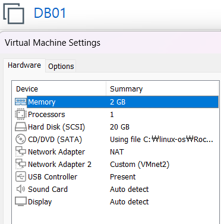

### 2.2 Rocky Linux 설치 및 시스템 정보 확인

Rocky Linux 9.8을 설치한 후 `sysadmin` 계정으로 로그인하였다.

운영체제 및 호스트명을 확인하였다.

```bash
hostnamectl
```

**확인 결과**

```text
Static hostname: db01
Virtualization: vmware
Operating System: Rocky Linux 9.8 (Blue Onyx)
Architecture: x86-64
```

네트워크 인터페이스를 확인하였다.

```bash
ip -br addr
```

**확인 결과**

```text
lo       UNKNOWN 127.0.0.1/8 ::1/128
ens160   UP      10.10.10.131/24
ens192   UP      IPv6 link-local 주소
```

초기 상태에서 NAT 인터페이스인 `ens160`은 IPv4 주소를 할당받았지만, Host-only 인터페이스인 `ens192`에는 내부망 IPv4 주소가 설정되지 않은 상태였다.

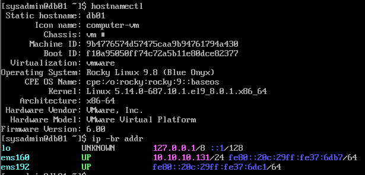

---

## 3. DB01 네트워크 설정

### 3.1 NetworkManager 연결 프로파일 확인

네트워크 연결 프로파일을 확인하였다.

```bash
nmcli connection show
```

**실제 확인 결과**

- `ens160`: NAT 연결 활성화
- `ens192`: 연결 프로파일 존재, 초기에는 비활성화

이후 `ens192`에 내부망 고정 IP를 설정하였다.

### 3.2 Host-only 고정 IP 설정

```bash
sudo nmcli connection modify ens192 \
  ipv4.method manual \
  ipv4.addresses 192.168.100.31/24 \
  ipv4.never-default yes \
  connection.autoconnect yes
```

**주요 옵션 설명**

| 옵션 | 의미 |
|---|---|
| `ipv4.method manual` | 수동 IPv4 설정 |
| `ipv4.addresses` | DB01 내부망 고정 IP |
| `ipv4.never-default yes` | 내부망 인터페이스의 기본 경로 생성 방지 |
| `connection.autoconnect yes` | 자동 연결 활성화 |

설정 후 연결 프로파일을 활성화하였다.

```bash
sudo nmcli connection up ens192
```

### 3.3 IP 주소 및 라우팅 검증

```bash
ip -br addr
ip route
```

**IP 주소**

```text
ens160  UP  10.10.10.131/24
ens192  UP  192.168.100.31/24
```

**라우팅 결과**

```text
default via 10.10.10.2 dev ens160 proto dhcp src 10.10.10.131 metric 100
10.10.10.0/24 dev ens160 proto kernel scope link src 10.10.10.131 metric 100
192.168.100.0/24 dev ens192 proto kernel scope link src 192.168.100.31 metric 101
```

**라우팅 분석**

| 네트워크 | 인터페이스 | 사용 목적 |
|---|---|---|
| 10.10.10.0/24 | ens160 | NAT 및 인터넷 연결 |
| 192.168.100.0/24 | ens192 | 내부 서버 간 통신 |
| Default Gateway | 10.10.10.2 | 외부 네트워크 통신 |

기본 경로는 NAT 인터페이스를 사용하고, 서버 간 내부 통신은 Host-only 인터페이스를 사용하도록 설정되었다.

`ens160` 주소는 DHCP로 할당된 실습 당시 IP이므로 이후 변경될 수 있다.

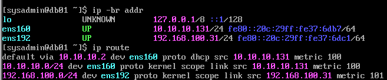

### 3.4 외부 네트워크 및 DNS 검증

NAT 게이트웨이와 외부 IP 통신을 확인하였다.

```bash
ping -c 4 10.10.10.2
ping -c 4 1.1.1.1
```

DNS 이름 해석을 확인하였다.

```bash
getent ahostsv4 rockylinux.org
```

**검증 결과**

- NAT 게이트웨이 Ping 성공
- 외부 인터넷 IP 통신 성공
- DNS 이름 해석 성공

### 3.5 Windows에서 DB01 SSH 원격 접속 검증

DB01의 Host-only 네트워크 설정 완료 후 Windows에서 PuTTY를 이용해 SSH 원격 접속을 검증하였다.

**PuTTY 접속 설정**

```text
Host: 192.168.100.31
Port: 22
Protocol: SSH
User: sysadmin
```

**실제 결과: SSH 접속 성공**

`sysadmin` 계정으로 DB01에 정상 로그인하였다.

로그인 기록에서 접속 출발지 IP가 Windows VMnet2 어댑터 주소인 `192.168.100.1`로 표시되는 것을 확인하였다.

이를 통해 Windows와 DB01 간 Host-only 네트워크 통신 및 SSH 원격 접속이 정상적으로 동작함을 검증하였다.

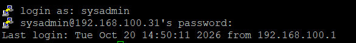

---

## 4. MariaDB 설치 및 서비스 구성

### 4.1 MariaDB 서버 설치

DB01에서 MariaDB 서버 패키지를 설치하였다.

```bash
sudo dnf install -y mariadb-server
```

**설치 결과**

```text
Installed:
  mariadb-server-3:10.5.29-3.el9_7.x86_64
  mariadb-3:10.5.29-3.el9_7.x86_64
  ...

Complete!
```

MariaDB 10.5.29 서버 설치를 완료하였다.

### 4.2 서비스 실행 및 자동 시작 설정

```bash
sudo systemctl enable --now mariadb
```

`enable`은 부팅 시 자동 시작 설정을 의미하며, `--now`는 서비스를 즉시 실행하는 옵션이다.

서비스 실행 상태와 자동 시작 설정을 확인하였다.

```bash
systemctl is-active mariadb
systemctl is-enabled mariadb
```

**실제 결과**

```text
active
enabled
```

MariaDB가 정상 실행 중이며, 서버 부팅 시 자동으로 시작되도록 설정된 것을 확인하였다.

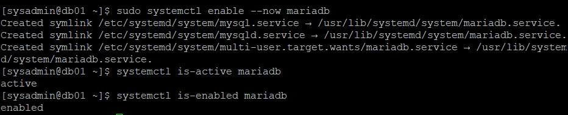

### 4.3 MariaDB 버전 및 SQL 실행 검증

DB01에서 관리자 권한으로 MariaDB에 접속해 서버 정보를 조회하였다.

```bash
sudo mariadb -e "SELECT VERSION(), @@hostname;"
```

**실제 결과**

```text
+-----------------+------------+
| VERSION()       | @@hostname |
+-----------------+------------+
| 10.5.29-MariaDB | db01       |
+-----------------+------------+
```

**검증 결과**

| 항목 | 결과 |
|---|---|
| MariaDB 버전 | 10.5.29 |
| DB 서버 호스트명 | db01 |
| 로컬 관리자 접속 | 성공 |
| SQL 실행 | 성공 |

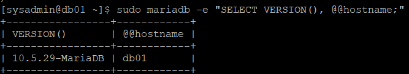

### 4.4 MariaDB 초기 계정 확인

DB01에서 초기 사용자 계정 목록을 확인하였다.

```bash
sudo mariadb -e "SELECT User, Host, plugin FROM mysql.user;"
```

**실제 결과**

| User | Host | plugin |
|---|---|---|
| mariadb.sys | localhost | mysql_native_password |
| root | localhost | mysql_native_password |
| mysql | localhost | mysql_native_password |

초기 조회 결과에서 익명 사용자 계정과 원격 접속용 root 계정은 발견되지 않았다.

모든 계정의 Host가 `localhost`로 설정되어 있는 것을 확인하였다.

---

## 5. MariaDB 수신 주소 제한

### 5.1 초기 TCP 3306 수신 상태 확인

MariaDB의 기본 TCP 포트인 3306의 수신 상태를 확인하였다.

```bash
sudo ss -lntp | grep ':3306'
```

**설정 전 실제 결과**

```text
LISTEN 0 80 *:3306 *:* users:(("mariadbd",pid=17677,fd=19))
```

`*:3306`은 MariaDB가 특정 로컬 IP로 제한되지 않은 상태에서 TCP 연결을 수신하고 있다는 의미이다.

DB01은 내부 업무 포털 전용 데이터베이스 서버이므로 Host-only 인터페이스 주소에서만 연결을 수신하도록 변경하였다.

### 5.2 MariaDB 설정 파일 확인

```bash
sudo cat /etc/my.cnf.d/mariadb-server.cnf
```

**초기 `[mysqld]` 설정**

```ini
[mysqld]
datadir=/var/lib/mysql
socket=/var/lib/mysql/mysql.sock
log-error=/var/log/mariadb/mariadb.log
pid-file=/run/mariadb/mariadb.pid
```

기존 설정에는 `bind-address`가 명시적으로 지정되어 있지 않았다.

### 5.3 설정 파일 백업

설정 변경 전 원본 파일을 백업하였다.

```bash
sudo cp -a /etc/my.cnf.d/mariadb-server.cnf \
  /etc/my.cnf.d/mariadb-server.cnf.bak
```

`cp -a`를 이용해 파일 속성을 유지하며 백업하였다.

### 5.4 bind-address 설정

설정 파일을 수정하였다.

```bash
sudo vi /etc/my.cnf.d/mariadb-server.cnf
```

`[mysqld]` 영역에 내부망 주소를 지정하였다.

```ini
[mysqld]
bind-address=192.168.100.31
datadir=/var/lib/mysql
socket=/var/lib/mysql/mysql.sock
log-error=/var/log/mariadb/mariadb.log
pid-file=/run/mariadb/mariadb.pid
```

**주요 설정**

```ini
bind-address=192.168.100.31
```

이 설정은 MariaDB가 DB01의 Host-only IP에서만 TCP 연결을 수신하도록 지정한다.

### 5.5 MariaDB 재시작 및 적용 검증

```bash
sudo systemctl restart mariadb
```

설정 적용 후 실제 수신 주소와 서비스 상태를 확인하였다.

```bash
sudo ss -lntp | grep ':3306'
systemctl status mariadb
```

**실제 결과**

```text
LISTEN 0 80 192.168.100.31:3306 0.0.0.0:* users:(("mariadbd",pid=17840,fd=19))
```

```text
Active: active (running)
Status: "Taking your SQL requests now..."
```

**설정 전후 비교**

| 구분 | TCP 3306 수신 주소 |
|---|---|
| 변경 전 | `*:3306` |
| 변경 후 | `192.168.100.31:3306` |

MariaDB의 TCP 3306 수신 주소가 *:3306에서 192.168.100.31:3306으로 변경된 것을 확인하였으며, 서비스 재시작 후에도 정상 실행 상태를 유지하였다.

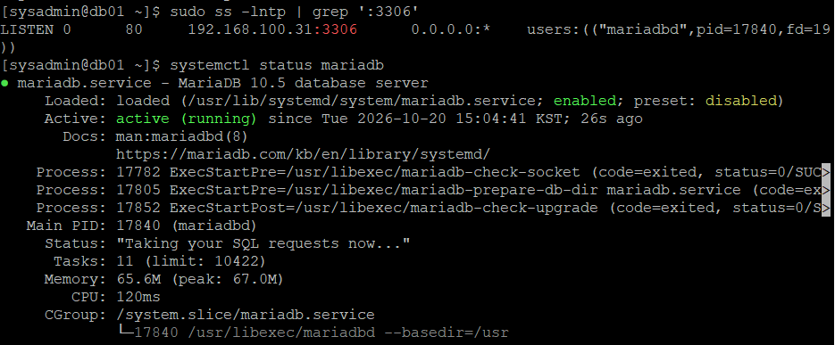

---

## 6. 업무 포털 데이터베이스 생성

### 6.1 portal_db 생성

사내 업무 포털에서 사용할 데이터베이스를 생성하였다.

```bash
sudo mariadb -e "CREATE DATABASE portal_db CHARACTER SET utf8mb4 COLLATE utf8mb4_unicode_ci;"
```

**주요 옵션**

| SQL 설정 | 의미 |
|---|---|
| `portal_db` | 업무 포털 데이터베이스 |
| `utf8mb4` | 한글, 영문, 이모지 등을 지원하는 문자 집합 |
| `utf8mb4_unicode_ci` | Unicode 기반 문자열 비교·정렬 규칙 |

### 6.2 데이터베이스 생성 검증

```bash
sudo mariadb -e "SHOW DATABASES;"
```

**실제 결과**

```text
+--------------------+
| Database           |
+--------------------+
| information_schema |
| mysql              |
| performance_schema |
| portal_db          |
+--------------------+
```

`portal_db`가 정상 생성된 것을 확인하였다.

---

## 7. MariaDB 애플리케이션 계정 및 최소 권한 설정

### 7.1 전용 계정 구성 목적

웹 애플리케이션이 데이터베이스 관리자 계정인 `root`를 사용하지 않도록 별도의 `portal_app` 계정을 생성하였다.

이번 실습에서는 WEB01과 WEB02에서 사용할 계정을 각각 생성하였다.

| 계정 | 접속 허용 호스트 | 용도 |
|---|---|---|
| portal_app | 192.168.100.21 | WEB01 |
| portal_app | 192.168.100.22 | WEB02 |

### 7.2 WEB01/WEB02 계정 생성

MariaDB 관리자 콘솔에 접속하였다.

```bash
sudo mariadb
```

두 웹 서버의 IP 주소를 각각 지정하여 계정을 생성하였다.

다음 SQL에는 실제 비밀번호 대신 예시 문자열을 사용하였다.

```sql
CREATE USER 'portal_app'@'192.168.100.21'
IDENTIFIED BY '<비밀번호>';

CREATE USER 'portal_app'@'192.168.100.22'
IDENTIFIED BY '<비밀번호>';
```

**실제 결과**

```text
Query OK, 0 rows affected
Query OK, 0 rows affected
```

두 계정이 정상 생성되었다.

### 7.3 데이터베이스 최소 권한 부여

웹 애플리케이션에 필요한 데이터 처리 권한만 부여하였다.

```sql
GRANT SELECT, INSERT, UPDATE, DELETE
ON portal_db.*
TO 'portal_app'@'192.168.100.21';

GRANT SELECT, INSERT, UPDATE, DELETE
ON portal_db.*
TO 'portal_app'@'192.168.100.22';
```

**실제 결과**

```text
Query OK, 0 rows affected
Query OK, 0 rows affected
```

**부여한 권한**

| 권한 | 용도 | 설정 |
|---|---|---|
| SELECT | 데이터 조회 | 허용 |
| INSERT | 데이터 추가 | 허용 |
| UPDATE | 데이터 수정 | 허용 |
| DELETE | 데이터 삭제 | 허용 |
| CREATE | 테이블 생성 | 미부여 |
| ALTER | 테이블 구조 변경 | 미부여 |
| DROP | 테이블 삭제 | 미부여 |

`ALL PRIVILEGES`를 사용하지 않고 `portal_db`에 필요한 DML 권한만 부여하였다.

테이블 생성이나 구조 변경과 같은 관리 작업은 데이터베이스 관리자 계정으로 수행하도록 구성하였다.

### 7.4 실제 권한 확인

다음 SQL로 계정별 권한을 조회하였다.

```sql
SHOW GRANTS FOR 'portal_app'@'192.168.100.21';

SHOW GRANTS FOR 'portal_app'@'192.168.100.22';
```

**확인된 권한**

```sql
GRANT SELECT, INSERT, UPDATE, DELETE
ON `portal_db`.*
TO 'portal_app'@'192.168.100.21'
```

```sql
GRANT SELECT, INSERT, UPDATE, DELETE
ON `portal_db`.*
TO 'portal_app'@'192.168.100.22'
```

WEB01과 WEB02 계정 모두 `portal_db`에 동일한 CRUD 권한이 부여된 것을 확인하였다.

`SHOW GRANTS` 출력에는 비밀번호 해시가 포함될 수 있으므로 해당 정보는 문서 및 공개 스크린샷에서 제외하였다.

---

## 8. DB01 firewalld 접근 제어

### 8.1 현재 방화벽 상태 확인

DB01에서 활성 Zone을 확인하였다.

```bash
sudo firewall-cmd --get-active-zones
```

**실제 결과**

```text
public
  interfaces: ens160 ens192
```

방화벽 설정을 확인하였다.

```bash
sudo firewall-cmd --list-all
```

**주요 결과**

```text
public (active)
  target: default
  interfaces: ens160 ens192
  services: cockpit dhcpv6-client ssh
  ports:
  rich rules:
```

초기 상태에서 TCP 3306 포트에 대한 전체 허용 설정이나 별도의 Rich Rule은 등록되어 있지 않았다.

### 8.2 WEB01 TCP 3306 접근 허용

WEB01의 내부망 IP에서 DB01의 MariaDB 포트로 접근할 수 있도록 설정하였다.

```bash
sudo firewall-cmd --permanent \
  --add-rich-rule='rule family="ipv4" source address="192.168.100.21/32" port port="3306" protocol="tcp" accept'
```

**결과**

```text
success
```

### 8.3 WEB02 TCP 3306 접근 허용

WEB02에도 동일한 정책을 적용하였다.

```bash
sudo firewall-cmd --permanent \
  --add-rich-rule='rule family="ipv4" source address="192.168.100.22/32" port port="3306" protocol="tcp" accept'
```

**결과**

```text
success
```

### 8.4 방화벽 설정 적용

```bash
sudo firewall-cmd --reload
```

**결과**

```text
success
```

### 8.5 Rich Rule 검증

```bash
sudo firewall-cmd --list-rich-rules
```

**결과**

```text
rule family="ipv4" source address="192.168.100.22/32" port port="3306" protocol="tcp" accept
rule family="ipv4" source address="192.168.100.21/32" port port="3306" protocol="tcp" accept
```

**방화벽 정책**

| 접속 출발지 | 목적지 | 설정 |
|---|---|---|
| WEB01 192.168.100.21 | DB01 TCP 3306 | 허용 |
| WEB02 192.168.100.22 | DB01 TCP 3306 | 허용 |
| 그 외 출발지 | DB01 TCP 3306 | 별도 허용 규칙 없음 |

WEB01과 WEB02의 접속 허용 규칙 등록 및 실제 원격 접속 성공까지 검증하였다.

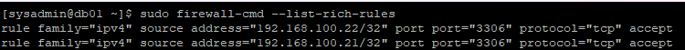

---

## 9. WEB01 MariaDB 원격 접속 검증

### 9.1 WEB01에서 DB01 네트워크 통신 확인

WEB01에서 DB01의 내부망 주소로 Ping을 실행하였다.

```bash
ping -c 4 192.168.100.31
```

**통신 성공**

### 9.2 MariaDB 클라이언트 설치

WEB01에서 MariaDB 클라이언트를 설치하였다.

```bash
sudo dnf install -y mariadb
```

설치된 패키지를 확인하였다.

```bash
rpm -q mariadb
```

**결과**

```text
mariadb-10.5.29-3.el9_7.x86_64
```

### 9.3 WEB01에서 DB01 원격 접속

WEB01의 `sysadmin` 계정으로 MariaDB 클라이언트를 실행하였다.

```bash
mariadb -h 192.168.100.31 -u portal_app -p portal_db
```

**옵션 설명**

| 옵션 | 의미 |
|---|---|
| `-h` | DB01 접속 IP |
| `-u` | MariaDB 사용자 |
| `-p` | 비밀번호 별도 입력 |
| `portal_db` | 접속할 데이터베이스 |

**결과**

```text
Welcome to the MariaDB monitor.
Server version: 10.5.29-MariaDB

MariaDB [portal_db]>
```

WEB01에서 DB01의 MariaDB에 정상 접속하였다.

### 9.4 접속 계정 및 데이터베이스 확인

MariaDB 프롬프트에서 실행하였다.

```sql
SELECT DATABASE(), USER(), CURRENT_USER();
```

**결과**

| DATABASE() | USER() | CURRENT_USER() |
|---|---|---|
| portal_db | portal_app@192.168.100.21 | portal_app@192.168.100.21 |

**결과 분석**

- `DATABASE()`는 현재 접속한 데이터베이스를 확인한다.
- `USER()`는 접속에 사용한 계정과 출발지를 나타낸다.
- `CURRENT_USER()`는 MariaDB에서 실제 인증 및 권한 확인에 사용하는 계정을 나타낸다.

WEB01에서 접속한 계정이 `portal_app@192.168.100.21`로 정상 인증된 것을 확인하였다.

이를 통해 WEB01에서 DB01으로의 TCP 통신, DB 계정 인증 및 데이터베이스 접근이 정상 동작함을 확인하였다.

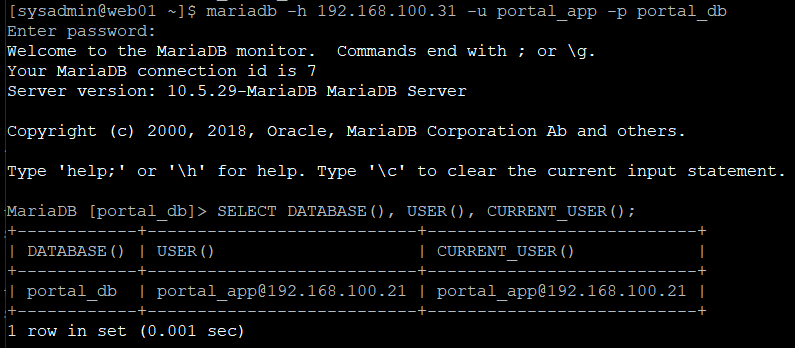

---

## 10. WEB02 MariaDB 원격 접속 검증

### 10.1 MariaDB 클라이언트 설치

WEB02에서도 MariaDB 클라이언트를 설치하였다.

```bash
sudo dnf install -y mariadb
```

패키지 설치 여부를 확인하였다.

```bash
rpm -q mariadb
```

**실제 결과**

```text
mariadb-10.5.29-3.el9_7.x86_64
```

### 10.2 WEB02에서 DB01 원격 접속

```bash
mariadb -h 192.168.100.31 -u portal_app -p portal_db
```

**결과**

```text
Welcome to the MariaDB monitor.
Server version: 10.5.29-MariaDB

MariaDB [portal_db]>
```

WEB02에서도 MariaDB에 정상 접속하였다.

### 10.3 접속 계정 확인

```sql
SELECT DATABASE(), USER(), CURRENT_USER();
```

**결과**

| DATABASE() | USER() | CURRENT_USER() |
|---|---|---|
| portal_db | portal_app@192.168.100.22 | portal_app@192.168.100.22 |

WEB02에서 접속한 계정이 `portal_app@192.168.100.22`로 정상 인증된 것을 확인하였다.

WEB01과 WEB02는 같은 데이터베이스를 사용하지만, MariaDB에서는 접속 호스트별로 구분된 사용자 계정으로 인증한다.

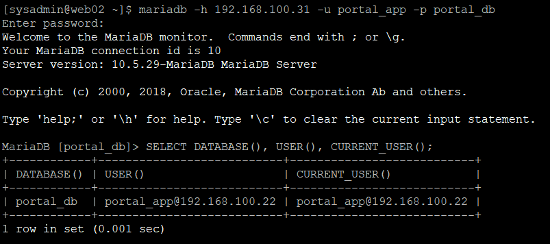

---

## 11. WEB01/WEB02 데이터 공유 검증

### 11.1 실습 목적

두 웹 서버가 DB01의 동일한 데이터베이스에 접속하여 데이터를 추가하고 조회할 수 있는지 검증한다.

이를 통해 웹 서버가 이중화된 환경에서도 공통 데이터를 사용할 수 있음을 확인한다.

### 11.2 테스트 테이블 생성

테이블 생성은 DB01의 관리자 계정으로 수행하였다.

```bash
sudo mariadb portal_db -e "
CREATE TABLE connection_test (
    id INT AUTO_INCREMENT PRIMARY KEY,
    server_name VARCHAR(20) NOT NULL,
    message VARCHAR(100) NOT NULL
);
"
```

**테이블 구조**

| 컬럼 | 자료형 | 용도 |
|---|---|---|
| id | INT AUTO_INCREMENT | 고유 식별자 |
| server_name | VARCHAR(20) | 데이터를 추가한 서버 |
| message | VARCHAR(100) | 테스트 메시지 |

테이블 생성 명령어는 오류 없이 완료되었다.

애플리케이션 계정에는 CREATE 권한이 없기 때문에 관리자 계정으로 테이블을 생성하였다.

### 11.3 WEB02에서 데이터 INSERT

WEB02에서 `portal_app` 계정으로 다음 SQL을 실행하였다.

```sql
INSERT INTO connection_test (server_name, message)
VALUES ('WEB02', 'Inserted from WEB02');
```

**결과**

```text
Query OK, 1 row affected
```

WEB02에서 데이터 1행 추가에 성공하였다.

### 11.4 WEB01에서 데이터 SELECT

WEB01에서 같은 테이블을 조회하였다.

```sql
SELECT * FROM connection_test;
```

**실제 결과**

```text
+----+-------------+---------------------+
| id | server_name | message             |
+----+-------------+---------------------+
|  1 | WEB02       | Inserted from WEB02 |
+----+-------------+---------------------+
```

WEB02에서 추가한 데이터를 WEB01에서도 조회할 수 있음을 확인하였다.

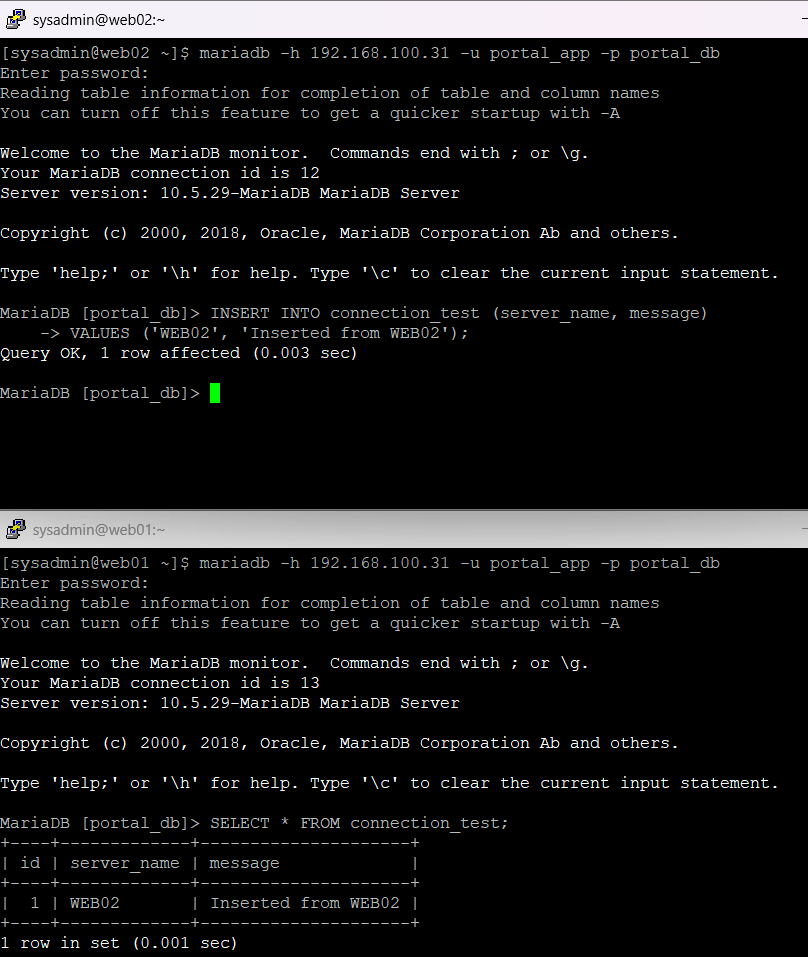

### 11.5 WEB01에서 데이터 INSERT

반대 방향도 검증하기 위해 WEB01에서 데이터를 추가하였다.

```sql
INSERT INTO connection_test (server_name, message)
VALUES ('WEB01', 'Inserted from WEB01');
```

**실제 결과**

```text
Query OK, 1 row affected
```

WEB01에서도 데이터 1행 추가에 성공하였다.

### 11.6 WEB02에서 전체 데이터 조회

WEB02에서 데이터를 다시 조회하였다.

```sql
SELECT * FROM connection_test ORDER BY id;
```

**실제 결과**

```text
+----+-------------+---------------------+
| id | server_name | message             |
+----+-------------+---------------------+
|  1 | WEB02       | Inserted from WEB02 |
|  2 | WEB01       | Inserted from WEB01 |
+----+-------------+---------------------+

2 rows in set
```

### 11.7 데이터 공유 검증 결과

| 검증 항목 | 결과 |
|---|---|
| WEB02 → DB01 INSERT | 성공 |
| WEB01 → DB01 SELECT | 성공 |
| WEB01 → DB01 INSERT | 성공 |
| WEB02 → DB01 SELECT | 성공 |
| 양방향 데이터 공유 | 성공 |

WEB01과 WEB02가 DB01의 동일한 테이블에 데이터를 추가하고 조회할 수 있음을 확인하였다.

---

## 12. 최소 권한 원칙 검증

### 12.1 실습 목적

`portal_app` 계정에는 `SELECT`, `INSERT`, `UPDATE`, `DELETE` 권한만 부여하였다.

따라서 새로운 테이블을 생성하는 `CREATE TABLE` 작업은 거부되어야 한다.

실제 명령어를 실행하여 계정 권한 제한이 정상 동작하는지 검증하였다.

### 12.2 WEB02에서 CREATE TABLE 실행

WEB02의 `portal_app` 계정으로 다음 SQL을 실행하였다.

```sql
CREATE TABLE privilege_test (
    id INT
);
```

**실제 결과**

```text
ERROR 1142 (42000): CREATE command denied to user 'portal_app'@'192.168.100.22' for table `portal_db`.`privilege_test`
```

### 12.3 결과 분석

| SQL 작업 | 필요한 권한 | 결과 |
|---|---|---|
| SELECT | SELECT | 허용 |
| INSERT | INSERT | 허용 |
| CREATE TABLE | CREATE | 거부 |

`ERROR 1142`는 계정에 해당 SQL을 실행할 권한이 없어 작업이 거부되었다는 의미이다.

이번 실습에서 CREATE 작업이 거부된 것은 오류 상황이 아니라 **의도한 최소 권한 정책이 정상적으로 작동한 검증 결과**이다.

테이블 생성과 같은 구조 변경은 DB01 관리자 계정으로 수행하고, 웹 애플리케이션 계정은 필요한 데이터 처리 작업만 수행하도록 역할을 분리하였다.

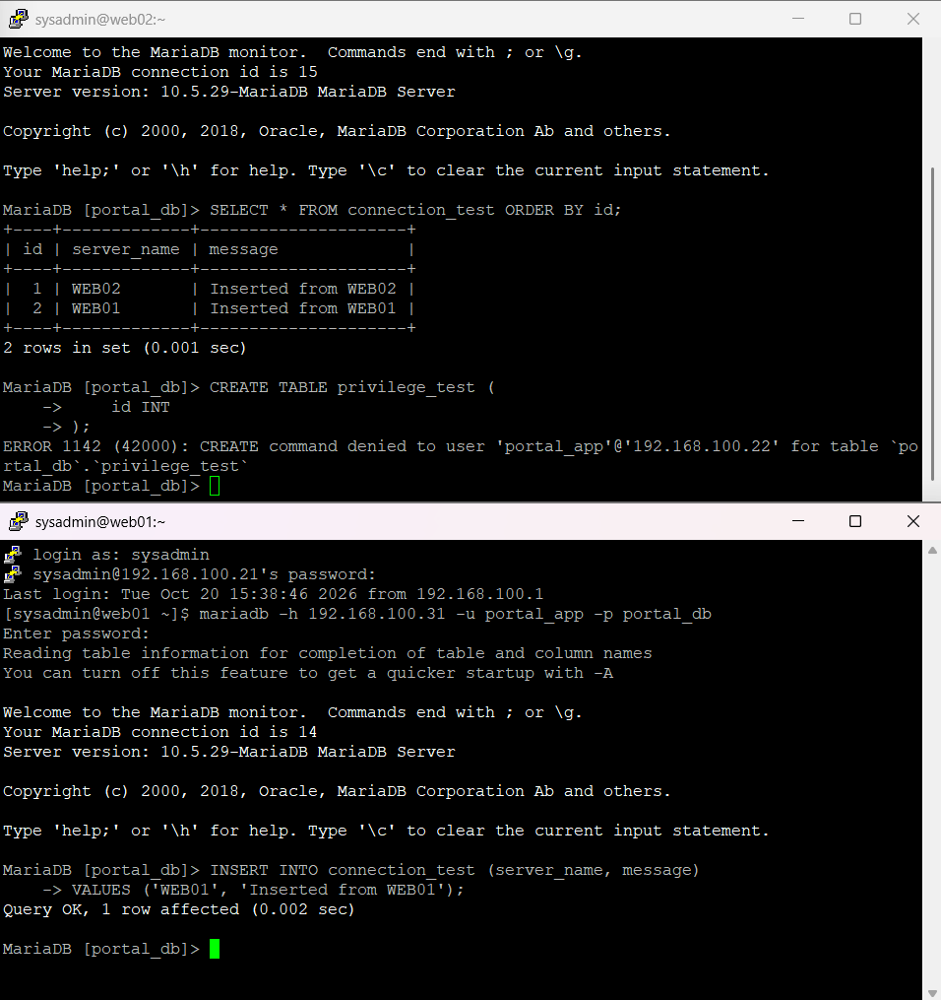

---

## 13. 실습 최종 검증 결과

### 13.1 DB01 구축 및 설정 결과

| 항목 | 실제 결과 | 판정 |
|---|---|---|
| Rocky Linux 9.8 설치 | db01 구성 | 성공 |
| NAT / Host-only 구성 | ens160 / ens192 | 성공 |
| DB01 고정 IP | 192.168.100.31/24 | 성공 |
| NAT 인터넷 및 DNS | 통신 성공 | 성공 |
| Windows → DB01 SSH | 접속 성공 | 성공 |
| MariaDB 설치 | 10.5.29 | 성공 |
| MariaDB 서비스 | active / enabled | 성공 |
| MariaDB 수신 주소 | 192.168.100.31:3306 | 성공 |
| portal_db 생성 | 데이터베이스 확인 | 성공 |
| portal_app 계정 생성 | WEB01/WEB02 계정 | 성공 |
| DB 권한 | SELECT / INSERT / UPDATE / DELETE | 성공 |
| firewalld Rich Rule | WEB01/WEB02 TCP 3306 허용 | 성공 |

### 13.2 WEB01/WEB02 연동 및 보안 검증

| 검증 항목 | 실제 결과 |
|---|---|
| WEB01 원격 DB 접속 | 성공 |
| WEB02 원격 DB 접속 | 성공 |
| WEB02 INSERT → WEB01 SELECT | 성공 |
| WEB01 INSERT → WEB02 SELECT | 성공 |
| WEB02 CREATE TABLE | 권한 부족으로 거부 (정상) |

### 13.3 최종 결론

DB01에 MariaDB 데이터베이스 서버를 구축하고 WEB01과 WEB02에서 내부망을 통해 원격 접속하는 환경을 구성하였다.

MariaDB의 수신 주소를 내부망 IP로 제한하고, firewalld Rich Rule과 계정별 Host 조건을 적용하여 접근 범위를 제한하였다.

또한 애플리케이션 계정에는 데이터 처리에 필요한 권한만 부여하였다.

WEB01과 WEB02에서 각각 데이터를 추가하고 상대 웹 서버에서 조회하여 공통 데이터베이스 구조가 정상 동작함을 검증하였다.

마지막으로 허용하지 않은 `CREATE TABLE` 작업이 거부되는 것을 확인하여 최소 권한 정책의 실제 적용 결과를 검증하였다.

**09단원의 핵심 목표인 MariaDB 서버 구축, 원격 접속, 데이터 공유 및 최소 권한 검증을 완료하였다.**

---

## 14. 배운 점

### 14.1 MariaDB 서버와 클라이언트의 차이

DB01에는 `mariadb-server`를 설치하여 데이터 저장 및 SQL 요청 처리를 담당하도록 구성하였다.

WEB01과 WEB02에는 `mariadb` 클라이언트를 설치하여 원격 DB 서버에 접속하였다.

이를 통해 서버 역할에 따라 필요한 패키지를 구분하는 방법을 익혔다.

### 14.2 bind-address와 방화벽의 차이

`bind-address`는 MariaDB가 어느 로컬 IP에서 TCP 연결을 수신할지 결정한다.

`firewalld`는 출발지 IP와 포트 등 네트워크 조건에 따라 접속을 허용하거나 제한한다.

두 설정은 서로 다른 역할을 수행하므로 함께 적용하면 데이터베이스의 노출 범위를 줄일 수 있다.

### 14.3 MariaDB 계정의 Host 조건

MariaDB는 사용자 이름이 같아도 접속 Host가 다르면 별도의 계정으로 관리한다.

이번 실습에서는 다음 계정을 구성하였다.

```text
portal_app@192.168.100.21
portal_app@192.168.100.22
```

이를 통해 접속 출발지에 따른 사용자 인증과 접근 제한 방법을 이해하였다.

### 14.4 최소 권한 원칙

애플리케이션 계정에는 필요한 CRUD 권한만 부여하고, 테이블 생성과 같은 관리 작업은 별도 관리자 계정으로 수행하였다.

또한 단순히 권한 설정을 조회하는 것뿐 아니라 실제로 허용되지 않은 명령을 실행하여 접근 제어가 동작하는지 검증하였다.

### 14.5 공통 데이터베이스 구조

WEB01과 WEB02는 독립적인 웹 서버지만 DB01의 동일한 데이터를 공유할 수 있다.

WEB02에서 저장한 데이터를 WEB01에서 조회하고, 반대 방향에서도 동일한 결과를 확인하여 웹 서버 이중화 환경에서의 공통 데이터 저장 구조를 이해하였다.

### 14.6 허용 정책과 차단 정책의 검증

이번 실습에서는 WEB01과 WEB02의 원격 DB 접속 성공을 통해 허용 정책을 검증하였다.

다만 허용되지 않은 다른 출발지에서의 실제 접속 차단은 별도 검증이 필요하다.

향후 통합 보안 검증에서 LB01 등 허용 목록에 없는 서버에서 DB01의 TCP 3306 접근을 시도하여 차단 동작을 추가로 확인할 예정이다.

---

## 15. 다음 실습

DB01 MariaDB 서버 구축 및 WEB01/WEB02 데이터베이스 연동 검증 실습을 완료하였다.

다음 단계에서는 WEB01과 WEB02에 PHP를 설치하고 MariaDB와 연동하여 사내 업무 포털의 웹 애플리케이션 환경을 구성할 예정이다.

**예정 작업**

1. WEB01/WEB02 PHP 및 MariaDB 드라이버 설치
2. Apache와 PHP 연동 및 실행 검증
3. PHP에서 DB01 MariaDB 원격 연결 설정
4. SELinux 설정 및 데이터베이스 접근 권한 검증
5. PHP 웹 페이지에서 데이터 조회 기능 구현 및 검증

PHP 연동 전에 실습용 DB 계정의 비밀번호를 강력한 값으로 변경하고, DB 접속 정보가 GitHub에 공개되지 않도록 관리할 예정이다.

### 관련 문서

- [01. VMware 가상 네트워크 구축](01-network.md)
- [02. WEB01 서버 구축](02-web01.md)
- [03. WEB02 서버 구축](03-web02.md)
- [04. LB01 서버 구축](04-lb01.md)
- [05. WEB01 Apache 웹 서버 구축](05-web01-apache.md)
- [06. WEB02 Apache 웹 서버 구축](06-web02-apache.md)
- [07. HAProxy 로드밸런싱 구축](07-haproxy.md)
- [08. HAProxy 장애 전환 및 복구 검증](08-haproxy-failover.md)
