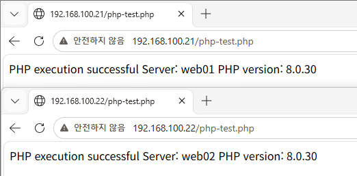
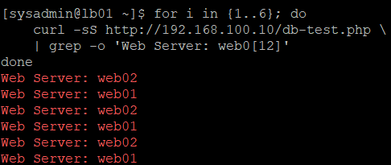
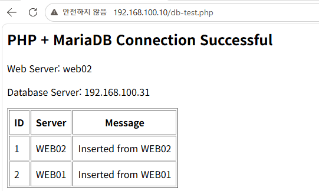

# 10. WEB01/WEB02 PHP 설치 및 MariaDB 연동 검증

## 1. 실습 개요

### 1.1 실습 목적

Rocky Linux 9.8 기반 사내 업무 포털 인프라의 WEB01과 WEB02에 PHP 실행 환경을 구축한다.

Apache에서 PHP가 정상 실행되는지 확인하고, PHP의 PDO 드라이버를 이용하여 DB01 MariaDB의 데이터를 조회한다.

HAProxy를 통해 웹 요청이 분산되는 상황에서도 두 웹 서버가 동일한 데이터베이스를 사용하는지 검증한다.

### 1.2 실습 목표

- WEB01/WEB02 PHP 및 MariaDB 드라이버 설치
- Apache와 PHP 연동 검증
- DB 계정 비밀번호 변경 및 기존 권한 검증
- 비공개 DB 접속 설정 파일 구성
- SELinux Enforcing 환경에서 DB 연결 정책 적용
- PHP PDO를 이용한 DB01 원격 연결
- WEB01/WEB02 공통 데이터 조회
- HAProxy Round Robin 및 공통 DB 연동 검증
- 테스트 파일 제거 및 HTTP 404 검증

### 1.3 실습 환경

| 항목 | 구성 |
|---|---|
| Virtualization | VMware Workstation |
| OS | Rocky Linux 9.8 |
| Apache | 2.4.62 |
| PHP | 8.0.30 |
| PHP DB Driver | php-mysqlnd |
| MariaDB | 10.5.29 |
| Database | portal_db |
| Application User | portal_app |
| SELinux | Enforcing |
| Load Balancer | HAProxy |

### 1.4 서버 구성

| 서버 | IP 주소 | 역할 |
|---|---|---|
| LB01 | 192.168.100.10 | HAProxy 로드밸런서 |
| WEB01 | 192.168.100.21 | Apache + PHP 웹 서버 |
| WEB02 | 192.168.100.22 | Apache + PHP 웹 서버 |
| DB01 | 192.168.100.31 | MariaDB 데이터베이스 서버 |

### 1.5 서비스 연동 구조

```text
                 Client
                    |
                    v
              LB01 - HAProxy
              192.168.100.10
                    |
              HTTP Round Robin
                    |
           +--------+--------+
           |                 |
           v                 v
         WEB01             WEB02
    192.168.100.21    192.168.100.22
      Apache/PHP        Apache/PHP
           |                 |
           +--------+--------+
                    |
                 TCP 3306
                    |
                    v
             DB01 - MariaDB
             192.168.100.31
                    |
                 portal_db
                    |
              connection_test
```

두 웹 서버의 PHP 프로그램이 공통 DB01에 연결하는 구조이다.

---

## 2. MariaDB 서비스 및 애플리케이션 계정 검증

### 2.1 DB01 MariaDB 서비스 확인

DB01에서 실행하였다.

```bash
sudo systemctl is-active mariadb
```

실제 결과:

```text
active
```

MariaDB 서비스가 정상 실행 중임을 확인하였다.

### 2.2 계정 비밀번호 변경

09단원에서 생성한 `portal_app` 계정의 비밀번호를 변경하였다.

WEB01과 WEB02는 MariaDB에서 서로 다른 호스트 계정으로 관리된다.

```text
portal_app@192.168.100.21
portal_app@192.168.100.22
```

DB01에서 관리자 콘솔에 접속하였다.

```bash
sudo env MYSQL_HISTFILE=/dev/null mariadb
```

계정별로 비밀번호를 변경하였다.

```sql
ALTER USER 'portal_app'@'192.168.100.21'
IDENTIFIED BY '<WEB01_PRIVATE_PASSWORD>';

ALTER USER 'portal_app'@'192.168.100.22'
IDENTIFIED BY '<WEB02_PRIVATE_PASSWORD>';
```

위 비밀번호는 문서용 자리표시자이며 실제 값은 공개하지 않는다.

### 2.3 계정 권한 확인

```sql
SHOW GRANTS FOR 'portal_app'@'192.168.100.21';

SHOW GRANTS FOR 'portal_app'@'192.168.100.22';
```

두 계정 모두 다음 권한을 보유하고 있음을 확인하였다.

```text
SELECT, INSERT, UPDATE, DELETE
ON portal_db.*
```

비밀번호 변경 이후에도 기존 최소 권한 정책이 유지되었다.

### 2.4 원격 접속 검증

WEB01과 WEB02에서 각각 실행하였다.

```bash
mariadb -h 192.168.100.31 -u portal_app -p portal_db
```

접속 후 다음 SQL을 실행하였다.

```sql
SELECT USER(), CURRENT_USER(), DATABASE();

SELECT * FROM connection_test;
```

검증 결과:

| 서버 | CURRENT_USER() | Database | 결과 |
|---|---|---|---|
| WEB01 | portal_app@192.168.100.21 | portal_db | 성공 |
| WEB02 | portal_app@192.168.100.22 | portal_db | 성공 |

공통 테이블에 저장된 기존 데이터 2건도 조회하였다.

---

## 3. PHP 및 MariaDB 드라이버 설치

### 3.1 PHP 설치

WEB01과 WEB02에서 PHP와 MariaDB 드라이버를 설치하였다.

```bash
sudo dnf install -y php php-mysqlnd
```

- `dnf install`: 패키지 설치
- `-y`: 설치 확인 질문에 자동 동의
- `php`: PHP 실행 환경
- `php-mysqlnd`: PHP용 MariaDB/MySQL 연동 드라이버

### 3.2 PHP 버전 확인

```bash
php -v
```

두 서버 모두 PHP 8.0.30이 설치되었다.

```text
PHP 8.0.30 (cli)
```

### 3.3 설치 패키지 확인

```bash
rpm -q php php-mysqlnd
```

실제 결과:

```text
php-8.0.30-8.el9_8.x86_64
php-mysqlnd-8.0.30-8.el9_8.x86_64
```

### 3.4 PHP DB 확장 확인

```bash
php -m | grep -Ei 'mysqli|pdo_mysql'
```

실제 결과:

```text
mysqli
pdo_mysql
```

이번 실습에서는 PDO를 사용하여 MariaDB에 연결하였다.

---

## 4. Apache 및 PHP 실행 검증

### 4.1 Apache 서비스 확인

WEB01과 WEB02에서 실행하였다.

```bash
sudo systemctl restart httpd

sudo systemctl is-active httpd

sudo systemctl is-enabled httpd
```

실제 결과:

```text
active
enabled
```

Apache 서비스가 정상 실행 중이며 부팅 시 자동 시작하도록 설정되어 있음을 확인하였다.

### 4.2 PHP 테스트 파일 생성

두 웹 서버의 Apache 웹 문서 경로에 테스트 파일을 생성하였다.

```text
/var/www/html/php-test.php
```

PHP 코드:

```php
<?php
echo "PHP execution successful\n";
echo "Server: " . gethostname() . "\n";
echo "PHP version: " . PHP_VERSION . "\n";
```

코드 설명:

| 코드 | 의미 |
|---|---|
| `echo` | 결과 출력 |
| `gethostname()` | PHP 실행 서버의 호스트명 조회 |
| `PHP_VERSION` | PHP 버전 확인 |

### 4.3 HTTP 실행 검증

각 서버에서 실행하였다.

```bash
curl -i http://127.0.0.1/php-test.php
```

WEB02의 실제 결과:

```text
HTTP/1.1 200 OK
X-Powered-By: PHP/8.0.30

PHP execution successful
Server: web02
PHP version: 8.0.30
```

WEB01에서도 PHP 코드가 정상적으로 실행되었다.

### 4.4 Windows 브라우저 검증

다음 주소로 접속하였다.

```text
http://192.168.100.21/php-test.php
http://192.168.100.22/php-test.php
```

| 서버 | 출력 호스트명 | PHP 버전 |
|---|---|---|
| WEB01 | web01 | 8.0.30 |
| WEB02 | web02 | 8.0.30 |

두 웹 서버에서 Apache가 PHP 코드를 실행하고 응답하는 것을 확인하였다.



---

## 5. MariaDB 접속 정보 분리 및 파일 권한 설정

### 5.1 설정 파일 분리 목적

PHP 애플리케이션은 DB 접속을 위해 IP 주소, DB 이름, 계정 및 비밀번호가 필요하다.

실제 비밀번호를 웹 공개 경로에 저장하지 않도록 DB 설정 파일을 별도의 디렉터리에 구성하였다.

| 경로 | 역할 |
|---|---|
| `/var/www/html/` | Apache 웹 공개 디렉터리 |
| `/var/www/private/` | 비공개 설정 파일 디렉터리 |

### 5.2 비공개 디렉터리 생성

WEB01과 WEB02에서 실행하였다.

```bash
sudo install -d -o root -g apache -m 750 /var/www/private

sudo restorecon -Rv /var/www/private

ls -ldZ /var/www/private
```

적용한 설정:

| 항목 | 설정 |
|---|---|
| 소유자 | root |
| 그룹 | apache |
| 권한 | 750 |
| SELinux 유형 | httpd_sys_content_t |

### 5.3 DB 설정 파일 생성

각 웹 서버에 다음 파일을 생성하였다.

```text
/var/www/private/db-config.php
```

최초 생성 명령어:

```bash
sudo install -o root -g apache -m 640 \
  /dev/null /var/www/private/db-config.php
```

설정 구조:

```php
<?php

return [
    'host' => '192.168.100.31',
    'database' => 'portal_db',
    'username' => 'portal_app',
    'password' => '<PRIVATE_PASSWORD>'
];
```

WEB01과 WEB02에는 각각 자신의 DB 계정에 해당하는 비밀번호를 설정하였다.

실제 비밀번호와 해당 설정 파일 원본은 GitHub에 업로드하지 않는다.

### 5.4 설정 파일 권한 확인

```bash
sudo restorecon -v /var/www/private/db-config.php

sudo ls -lZ /var/www/private/db-config.php
```

실제 확인한 주요 값:

```text
-rw-r-----. root apache ... httpd_sys_content_t ... db-config.php
```

- `root`: 파일 소유자
- `apache`: 파일 읽기가 허용된 그룹
- `640`: 소유자 읽기·쓰기, 그룹 읽기, 기타 사용자 접근 불가
- `httpd_sys_content_t`: 적용된 SELinux 파일 유형

---

## 6. SELinux의 PHP → MariaDB 네트워크 접근 설정

### 6.1 SELinux 상태 확인

WEB01과 WEB02에서 실행하였다.

```bash
getenforce
```

실제 결과:

```text
Enforcing
```

### 6.2 DB 연결 Boolean 확인

```bash
getsebool httpd_can_network_connect_db
```

확인 결과:

```text
httpd_can_network_connect_db --> off
```

이는 웹 서버 프로세스의 데이터베이스 네트워크 연결에 관련된 SELinux Boolean이다.

### 6.3 Boolean 활성화

두 웹 서버에서 실행하였다.

```bash
sudo setsebool -P httpd_can_network_connect_db on
```

설정 확인:

```bash
getsebool httpd_can_network_connect_db
```

실제 결과:

```text
httpd_can_network_connect_db --> on
```

`-P` 옵션을 사용해 재부팅 후에도 설정이 유지되도록 하였다.

SELinux를 비활성화하지 않고 필요한 DB 접근 정책만 활성화하였다.

---

## 7. PHP PDO 기반 MariaDB 조회 페이지 구성

### 7.1 테스트 목적 및 파일 경로

WEB01과 WEB02에서 실행되는 PHP가 DB01의 MariaDB에 정상적으로 연결하고 데이터를 조회할 수 있는지 확인하기 위해 **PHP PDO 기반 조회 예제 코드를 적용하였다.**

WEB01과 WEB02에 동일한 PHP 코드를 적용하였다.

**테스트 파일 경로**

```text
/var/www/html/db-test.php
```

### 7.2 PHP 조회 코드

```php
<?php
header('Content-Type: text/html; charset=UTF-8');

try {
    $config = require '/var/www/private/db-config.php';

    $dsn = "mysql:host={$config['host']};dbname={$config['database']};charset=utf8mb4";

    $pdo = new PDO(
        $dsn,
        $config['username'],
        $config['password'],
        [PDO::ATTR_ERRMODE => PDO::ERRMODE_EXCEPTION]
    );

    $stmt = $pdo->query(
        "SELECT id, server_name, message FROM connection_test ORDER BY id"
    );

    $rows = $stmt->fetchAll(PDO::FETCH_ASSOC);

    echo "<h2>PHP + MariaDB Connection Successful</h2>";
    echo "<p>Web Server: " . htmlspecialchars(gethostname()) . "</p>";
    echo "<p>Database Server: 192.168.100.31</p>";

    echo "<table border='1' cellpadding='8'>";
    echo "<tr><th>ID</th><th>Server</th><th>Message</th></tr>";

    foreach ($rows as $row) {
        echo "<tr>";
        echo "<td>" . htmlspecialchars((string)$row['id']) . "</td>";
        echo "<td>" . htmlspecialchars($row['server_name']) . "</td>";
        echo "<td>" . htmlspecialchars($row['message']) . "</td>";
        echo "</tr>";
    }

    echo "</table>";

} catch (Throwable $e) {
    http_response_code(500);
    error_log("PHP MariaDB test failed: " . $e->getMessage());
    echo "Database connection failed";
}
```

### 7.3 주요 코드 기능

| 코드 | 역할 |
|---|---|
| `require` | 별도의 비공개 DB 설정 파일 불러오기 |
| `new PDO()` | PHP에서 MariaDB에 연결 |
| `charset=utf8mb4` | DB 연결 문자 인코딩 설정 |
| `$pdo->query()` | SQL SELECT 문 실행 |
| `fetchAll()` | 조회 결과 가져오기 |
| `gethostname()` | 요청을 처리한 웹 서버 확인 |
| `foreach` | 조회 결과를 HTML 테이블로 출력 |
| `htmlspecialchars()` | 출력 문자열의 HTML 특수문자 처리 |
| `catch`, `error_log()` | 오류 발생 시 HTTP 500 반환 및 서버 로그 기록 |

테스트 프로그램은 `/var/www/private/db-config.php`에서 DB 접속 정보를 읽은 뒤, PDO를 통해 DB01(`192.168.100.31`)의 `portal_db` 데이터베이스에 연결한다.

이후 다음 SQL을 실행하여 데이터를 조회하고, 처리한 웹 서버의 호스트명과 조회 결과를 브라우저에 출력한다.

```sql
SELECT id, server_name, message
FROM connection_test
ORDER BY id;
```

DB 접속 정보는 PHP 조회 코드에 직접 작성하지 않고 별도의 비공개 설정 파일에서 불러오도록 구성하였다.

### 7.4 PHP 문법 검사 및 연동 확인

WEB01과 WEB02에서 PHP 문법 검사를 실행하였다.

```bash
php -l /var/www/html/db-test.php
```

**확인 결과**

```text
No syntax errors detected in /var/www/html/db-test.php
```

이후 HTTP 요청을 통해 PHP 실행과 MariaDB 연결 상태를 검증하였다.

```bash
curl -i http://127.0.0.1/db-test.php
```

최종적으로 WEB01과 WEB02 모두 `HTTP 200 OK` 응답을 반환하고, DB01의 `connection_test` 테이블에서 동일한 데이터 2건을 조회하는 데 성공하였다.

WEB02에서는 초기 DB 인증 오류가 발생하였으나, PHP-FPM 로그 분석과 설정 파일 수정을 통해 해결하였다. 해당 과정은 9장에 정리하였다.

**테스트 완료 후** `db-test.php`는 WEB01과 WEB02에서 삭제하였으며, HTTP `404` 응답을 통해 제거 여부를 확인하였다. 해당 과정은 11장에 기록하였다.

---

## 8. WEB01 PHP → MariaDB 조회 검증

### 8.1 HTTP 요청

WEB01에서 실행하였다.

```bash
curl -i http://127.0.0.1/db-test.php
```

실제 응답:

```text
HTTP/1.1 200 OK
X-Powered-By: PHP/8.0.30
Content-Type: text/html; charset=UTF-8
```

다음 내용이 HTML로 출력되었다.

```text
PHP + MariaDB Connection Successful
Web Server: web01
Database Server: 192.168.100.31
```

### 8.2 데이터 조회 결과

PHP에서 실행한 SQL:

```sql
SELECT id, server_name, message
FROM connection_test
ORDER BY id;
```

실제 결과:

| id | server_name | message |
|---|---|---|
| 1 | WEB02 | Inserted from WEB02 |
| 2 | WEB01 | Inserted from WEB01 |

WEB01에서 실행된 PHP 프로그램이 DB01 MariaDB와 연결하여 두 건의 데이터를 조회하는 데 성공하였다.

---

## 9. WEB02 PHP → MariaDB 연동 오류 분석 및 복구

### 9.1 초기 오류 발생

WEB02에서 다음 명령어를 실행하였다.

```bash
curl -i http://127.0.0.1/db-test.php
```

초기 응답:

```text
HTTP/1.1 500 Internal Server Error

Database connection failed
```

PHP 문법 검사는 성공했으나 데이터베이스 연결 과정에서 오류가 발생하였다.

### 9.2 PHP-FPM 상태 확인

```bash
sudo systemctl is-active php-fpm
```

실제 결과:

```text
active
```

PHP-FPM 서비스 자체는 정상 실행 중이었다.

### 9.3 PHP-FPM 오류 로그 확인

WEB02에서 실행하였다.

```bash
sudo ls -lh /var/log/php-fpm/

sudo tail -n 30 /var/log/php-fpm/www-error.log
```

로그에서 다음 오류를 확인하였다.

```text
PHP MariaDB test failed: SQLSTATE[HY000] [1045]
Access denied for user 'portal_app'@'192.168.100.22'
(using password: YES)
```

`ERROR 1045`는 MariaDB의 사용자 인증이 거부되었음을 나타낸다.

### 9.4 MariaDB CLI 접속 재검증

WEB02에서 다음 명령어를 실행하여 DB에 접속하였다.

```bash
mariadb -h 192.168.100.31 -u portal_app -p portal_db
```

실행 SQL:

```sql
SELECT CURRENT_USER(), DATABASE();

SELECT COUNT(*) FROM connection_test;
```

확인 결과:

```text
CURRENT_USER(): portal_app@192.168.100.22
DATABASE():     portal_db
COUNT(*):       2
```

이를 통해 MariaDB 서비스, 네트워크 연결, 계정 및 데이터 조회 권한이 정상임을 확인하였다.

### 9.5 원인 분석 및 수정

PHP-FPM의 인증 오류 로그와 MariaDB CLI 접속 결과를 비교하여, WEB02의 PHP 설정 파일에 저장된 DB 비밀번호가 실제 계정 비밀번호와 일치하지 않는 문제를 확인하였다.

WEB02에서 설정 파일을 수정하였다.

```bash
sudo vi -n /var/www/private/db-config.php
```

올바른 WEB02 전용 비밀번호를 적용한 후 문법과 파일 권한을 확인하였다.

```bash
sudo php -l /var/www/private/db-config.php

sudo ls -lZ /var/www/private/db-config.php
```

실제 문법 검사 결과:

```text
No syntax errors detected in /var/www/private/db-config.php
```

파일 권한도 `root:apache`, `640`, `httpd_sys_content_t` 상태로 유지되었다.

### 9.6 복구 검증

WEB02에서 다시 실행하였다.

```bash
curl -i http://127.0.0.1/db-test.php
```

실제 결과:

```text
HTTP/1.1 200 OK
```

HTML 응답에 다음 내용이 포함되었다.

```text
PHP + MariaDB Connection Successful
Web Server: web02
Database Server: 192.168.100.31
```

`connection_test` 테이블의 데이터 2건도 정상 조회하였다.

**비공개 DB 설정 파일 수정 후 WEB02의 HTTP 500 오류가 해결되었다.**

### 9.7 Windows 브라우저 비교 검증

다음 주소로 접속하였다.

```text
http://192.168.100.21/db-test.php
http://192.168.100.22/db-test.php
```

검증 결과:

| 항목 | WEB01 | WEB02 |
|---|---|---|
| 웹 서버 표시 | web01 | web02 |
| MariaDB IP | 192.168.100.31 | 192.168.100.31 |
| 데이터 조회 | 2건 | 2건 |
| HTTP 응답 | 200 OK | 200 OK |


두 웹 서버에서 공통 DB 데이터를 동일하게 조회하는 것을 확인하였다.

---

## 10. HAProxy 통합 연동 검증

### 10.1 HAProxy 서비스 상태 확인

LB01에서 실행하였다.

```bash
sudo systemctl is-active haproxy
```

실제 결과:

```text
active
```

### 10.2 Round Robin 반복 테스트

LB01에서 다음 명령어를 실행하였다.

```bash
for i in {1..6}; do
    curl -sS http://192.168.100.10/db-test.php \
    | grep -o 'Web Server: web0[12]'
done
```

실제 검증 결과 중 하나:

```text
Web Server: web01
Web Server: web02
Web Server: web01
Web Server: web02
Web Server: web01
Web Server: web02
```

6회 요청에서 두 웹 서버가 번갈아 응답하였다.

스크린샷으로도 교대 응답을 확인하였다.



### 10.3 HAProxy 경유 MariaDB 데이터 조회

LB01에서 실행하였다.

```bash
curl -sS http://192.168.100.10/db-test.php
```

실제 응답에 다음 내용이 포함되었다.

```text
PHP + MariaDB Connection Successful
Web Server: web01
Database Server: 192.168.100.31
```

조회된 데이터:

| id | server_name | message |
|---|---|---|
| 1 | WEB02 | Inserted from WEB02 |
| 2 | WEB01 | Inserted from WEB01 |

### 10.4 Windows 브라우저 통합 검증

Windows 브라우저에서 다음 주소로 접속하였다.

```text
http://192.168.100.10/db-test.php
```

브라우저 화면에서 다음 항목을 확인하였다.

- PHP + MariaDB 연결 성공
- HAProxy가 선택한 백엔드 웹 서버
- DB01 IP `192.168.100.31`
- 공통 DB 데이터 2건



HAProxy를 경유하여 PHP가 실행되고 DB01의 동일한 데이터가 출력되는 것을 확인하였다.

---

## 11. 실습용 테스트 파일 정리 및 검증

### 11.1 정리 목적

이번 실습에서 사용한 PHP 테스트 파일은 Apache 웹 공개 디렉터리인 `/var/www/html/`에 저장하였다.

특히 `db-test.php`는 MariaDB 데이터를 브라우저에 출력하는 테스트 페이지이므로 실습과 증빙 수집이 끝난 후 제거하였다.

제거 대상:

```text
/var/www/html/php-test.php
/var/www/html/db-test.php
```

비공개 DB 설정 파일인 `/var/www/private/db-config.php`는 11단원 업무 포털 구현에 재사용하기 위해 유지하였다.

### 11.2 WEB01 테스트 파일 제거

WEB01에서 실행하였다.

```bash
sudo rm -f /var/www/html/php-test.php /var/www/html/db-test.php
```

삭제 후 HTTP 요청을 실행하였다.

```bash
curl -s -o /dev/null -w '%{http_code}\n' \
  http://127.0.0.1/db-test.php
```

실제 결과:

```text
404
```

WEB01에서 DB 테스트 페이지가 더 이상 제공되지 않음을 확인하였다.

### 11.3 WEB02 테스트 파일 제거

WEB02에서 동일한 명령어를 실행하였다.

```bash
sudo rm -f /var/www/html/php-test.php /var/www/html/db-test.php
```

HTTP 요청으로 확인하였다.

```bash
curl -s -o /dev/null -w '%{http_code}\n' \
  http://127.0.0.1/db-test.php
```

실제 결과:

```text
404
```

WEB02에서도 DB 테스트 페이지가 더 이상 제공되지 않음을 확인하였다.

### 11.4 정리 결과

| 항목 | WEB01 | WEB02 |
|---|---|---|
| 테스트 파일 삭제 명령 실행 | 완료 | 완료 |
| db-test.php HTTP 응답 | 404 | 404 |
| 비공개 DB 설정 파일 | 유지 | 유지 |

**두 웹 서버 모두 공개 DB 조회 테스트 페이지 제거를 완료하였다.**

---

## 12. 실습 최종 검증 결과

| 검증 항목 | 결과 |
|---|---|
| DB01 MariaDB 서비스 | 정상 |
| WEB01 PHP 설치 | 성공 |
| WEB02 PHP 설치 | 성공 |
| php-mysqlnd 드라이버 | 정상 |
| Apache + PHP 실행 | 두 서버 모두 성공 |
| DB 접속 설정 파일 분리 | 완료 |
| 설정 파일 소유권 및 권한 | root:apache / 640 |
| SELinux Enforcing | 유지 |
| DB 연결 Boolean | 두 서버 모두 on |
| WEB01 PHP → MariaDB | 성공 |
| WEB02 PHP → MariaDB | 성공 |
| WEB02 ERROR 1045 분석 | 완료 |
| WEB02 인증 오류 수정 및 복구 | 성공 |
| 공통 데이터 조회 | 두 서버 모두 2건 조회 |
| HAProxy Round Robin | 교대 응답 확인 |
| HAProxy 경유 MariaDB 조회 | 성공 |
| 공개 DB 테스트 페이지 정리 | 두 서버 모두 HTTP 404 확인 |

**10단원 실습 최종 결과: 완료**

---

## 13. 배운 점

### 13.1 Apache와 PHP의 역할 구분

Apache는 HTTP 요청을 수신하고 PHP 프로그램의 실행 결과를 사용자에게 전달한다.

PHP는 서버 내부에서 DB 조회 등 필요한 작업을 수행한 후 HTML 응답을 생성한다.

### 13.2 CLI 접속과 PHP 접속의 차이

MariaDB 클라이언트로 접속하는 것과 PHP 프로그램에서 접속하는 것은 실행 환경이 다르다.

CLI 접속이 성공하더라도 PHP 설정 파일의 비밀번호나 SELinux 정책이 잘못되어 있으면 웹 애플리케이션에서 DB 연결이 실패할 수 있다.

### 13.3 SELinux Enforcing 유지

SELinux를 비활성화하지 않고 `httpd_can_network_connect_db` Boolean을 사용해 필요한 DB 접근을 허용하였다.

### 13.4 DB 인증 정보 보호

DB 접속 비밀번호를 PHP 웹 페이지에 직접 포함하지 않고, 웹 공개 디렉터리 밖의 별도 설정 파일에 저장하였다.

파일 권한과 SELinux 컨텍스트를 확인하여 접근 범위를 제한하였다.

### 13.5 로그 기반 장애 분석

WEB02에서 HTTP 500 오류가 발생했을 때 PHP-FPM 로그를 통해 `ERROR 1045`를 발견하였다.

CLI 접속 결과와 비교하여 DB 인증 정보 불일치를 분석하고, 설정 수정 후 HTTP 200과 데이터 조회 성공으로 복구를 확인하였다.

### 13.6 로드밸런싱과 공통 데이터베이스

HAProxy가 WEB01과 WEB02에 요청을 분산하더라도 두 웹 서버가 공통 MariaDB를 사용하므로 동일한 데이터를 조회할 수 있었다.

### 13.7 검증 이후 테스트 파일 정리

실습용 페이지도 운영 환경에서는 불필요한 정보 노출 지점이 될 수 있다.

따라서 기능 검증과 증빙 수집 후 테스트 파일을 제거하고 HTTP 404 응답으로 정리 결과를 확인하였다.

---

## 14. 다음 실습

**11단원: 사내 업무 포털 웹 애플리케이션 구현**

이번 단원에서는 Apache, PHP, MariaDB 및 HAProxy 연동을 완료하였다.

다음 단원에서는 간단한 사내 업무 포털 기능을 구현할 예정이다.

예정 작업:

1. 업무 포털 데이터베이스 테이블 설계
2. 공지사항 또는 업무 게시판 구현
3. PHP PDO를 이용한 데이터 조회
4. 데이터 등록·수정·삭제 기능 구현
5. Prepared Statement와 HTML 출력값 이스케이프 적용
6. WEB01/WEB02 서비스 구성 및 HAProxy 통합 검증
