# 11. PHP + MariaDB 기반 사내 업무 포털 CRUD 구현 및 HAProxy 통합 검증

## 1. 실습 개요

### 1.1 실습 목적

10단원에서 구축한 Apache, PHP, MariaDB 연동 환경을 기반으로 사내 업무 포털의 공지사항 관리 기능을 구성한다.

WEB01과 WEB02에 PHP PDO 기반 공지사항 CRUD 예제 애플리케이션을 적용하고, DB01의 공통 MariaDB를 통해 데이터 등록(Create), 조회(Read), 수정(Update), 삭제(Delete) 기능을 검증한다.

또한 LB01의 HAProxy를 통해 HTTP 요청을 분산하고, PHP 세션 기반 CSRF 토큰을 사용하는 애플리케이션의 특성을 고려하여 쿠키 기반 Sticky Session을 구성한다.

이번 실습은 PHP 애플리케이션 개발 자체보다는 **웹 애플리케이션 배포, 데이터베이스 연동, 파일 권한 및 SELinux 관리, 로드밸런싱, 세션 처리와 서비스 동작 검증**에 중점을 두었다.

### 1.2 실습 목표

- DB01의 MariaDB 서비스 및 계정 권한 확인
- 공지사항 데이터 저장을 위한 `notices` 테이블 생성
- WEB01에서 PHP PDO 기반 CRUD 기능 구성 및 검증
- Prepared Statement와 HTML 출력 이스케이프 적용
- POST 요청 및 CSRF 토큰 검증
- SCP를 이용한 WEB01 → WEB02 PHP 파일 배포
- WEB02 파일 권한과 SELinux 컨텍스트 확인
- WEB01/WEB02의 공통 MariaDB 데이터 사용 검증
- HAProxy Round Robin 동작 확인
- HAProxy 쿠키 기반 Sticky Session 구성 및 검증
- HAProxy 경유 CRUD 통합 테스트
- SQL 조회 및 HTTP 상태 코드를 통한 최종 서비스 검증

### 1.3 실습 환경

| 항목 | 구성 |
|---|---|
| 가상화 환경 | VMware Workstation |
| 운영체제 | Rocky Linux 9.8 |
| 웹 서버 | Apache HTTP Server |
| PHP | 8.0.30 |
| PHP DB 드라이버 | PDO / pdo_mysql |
| 데이터베이스 | MariaDB 10.5.29 |
| 데이터베이스 이름 | portal_db |
| 애플리케이션 계정 | portal_app |
| 로드밸런서 | HAProxy |
| SELinux | Enforcing |
| 웹 애플리케이션 | PHP 공지사항 CRUD 예제 |
| 배포 방식 | SCP 기반 수동 배포 |

### 1.4 서버 구성

| 서버 | IP 주소 | 역할 |
|---|---|---|
| LB01 | 192.168.100.10 | HAProxy 로드밸런서 |
| WEB01 | 192.168.100.21 | Apache/PHP 웹 서버 |
| WEB02 | 192.168.100.22 | Apache/PHP 웹 서버 |
| DB01 | 192.168.100.31 | MariaDB 데이터베이스 서버 |

### 1.5 서비스 아키텍처

```text
                 Windows Browser
                        |
                        | HTTP
                        v
                  LB01 - HAProxy
                  192.168.100.10
                        |
              Round Robin + Sticky Session
                        |
               +--------+--------+
               |                 |
               v                 v
             WEB01             WEB02
        192.168.100.21    192.168.100.22
         Apache / PHP      Apache / PHP
          Portal CRUD       Portal CRUD
               |                 |
               +--------+--------+
                        |
                     TCP 3306
                        |
                        v
                  DB01 - MariaDB
                  192.168.100.31
                        |
                     portal_db
                        |
                      notices
```

WEB01과 WEB02는 동일한 PHP 애플리케이션 파일을 실행하지만, 업무 데이터는 DB01의 공통 MariaDB에 저장한다.

각 웹 서버는 별도의 비공개 DB 설정 파일을 사용하며, HAProxy는 클라이언트의 HTTP 요청을 두 웹 서버에 전달한다.

---

## 2. DB01 MariaDB 기존 환경 확인

### 2.1 MariaDB 서비스 상태 확인

DB01에서 실행하였다.

```bash
sudo systemctl is-active mariadb
```

실제 결과:

```text
active
```

MariaDB 서비스가 정상적으로 실행 중임을 확인하였다.

### 2.2 기존 데이터베이스 및 테이블 확인

```bash
sudo mariadb -e "SHOW DATABASES LIKE 'portal_db';"

sudo mariadb -e "SHOW TABLES FROM portal_db;"
```

확인 결과:

```text
portal_db
connection_test
```

10단원에서 구성한 `portal_db`와 `connection_test` 테이블이 유지되고 있었다.

### 2.3 애플리케이션 계정 권한 확인

DB01에서 실행하였다.

```bash
sudo mariadb -e \
  "SHOW GRANTS FOR 'portal_app'@'192.168.100.21';"

sudo mariadb -e \
  "SHOW GRANTS FOR 'portal_app'@'192.168.100.22';"
```

두 웹 서버의 애플리케이션 계정에서 다음 권한을 확인하였다.

```sql
GRANT SELECT, INSERT, UPDATE, DELETE
ON portal_db.*
```

| 권한 | 기능 |
|---|---|
| SELECT | 데이터 조회 |
| INSERT | 데이터 등록 |
| UPDATE | 데이터 수정 |
| DELETE | 데이터 삭제 |

공지사항 테이블 생성은 DB01 관리자 계정으로 진행하고, PHP 애플리케이션은 기존 CRUD 권한을 사용하도록 구성하였다.

---

## 3. 공지사항 테이블 설계 및 생성

### 3.1 MariaDB 관리자 콘솔 접속

DB01에서 실행하였다.

```bash
sudo mariadb portal_db
```

### 3.2 notices 테이블 생성

```sql
CREATE TABLE notices (
    id BIGINT UNSIGNED NOT NULL AUTO_INCREMENT,
    title VARCHAR(200) NOT NULL,
    content TEXT NOT NULL,
    author VARCHAR(80) NOT NULL,
    created_at DATETIME NOT NULL DEFAULT CURRENT_TIMESTAMP,
    updated_at DATETIME NOT NULL DEFAULT CURRENT_TIMESTAMP
        ON UPDATE CURRENT_TIMESTAMP,
    PRIMARY KEY (id)
) ENGINE=InnoDB DEFAULT CHARSET=utf8mb4;
```

실제 결과:

```text
Query OK, 0 rows affected
```

### 3.3 테이블 구조

| 컬럼 | 자료형 | 역할 |
|---|---|---|
| id | BIGINT UNSIGNED | 공지사항 고유 번호 |
| title | VARCHAR(200) | 공지사항 제목 |
| content | TEXT | 공지사항 본문 |
| author | VARCHAR(80) | 작성자 |
| created_at | DATETIME | 최초 등록 시각 |
| updated_at | DATETIME | 마지막 수정 시각 |

주요 설정:

- `AUTO_INCREMENT`: 신규 데이터 등록 시 ID 자동 증가
- `PRIMARY KEY`: 각 공지사항을 식별하는 기본 키
- `NOT NULL`: 필수 데이터의 NULL 입력 방지
- `CURRENT_TIMESTAMP`: 등록 시각 자동 저장
- `ON UPDATE CURRENT_TIMESTAMP`: 데이터 변경 시 수정 시각 자동 갱신
- `InnoDB`: 트랜잭션을 지원하는 스토리지 엔진
- `utf8mb4`: 한글을 포함한 다양한 문자 처리

### 3.4 테이블 생성 검증

```sql
SHOW TABLES;

DESCRIBE notices;

SHOW CREATE TABLE notices\G

SELECT COUNT(*) FROM notices;
```

검증 결과:

- 기존 `connection_test` 테이블 유지
- 신규 `notices` 테이블 생성
- 공지사항 컬럼 6개 확인
- 최초 등록 데이터 0건 확인

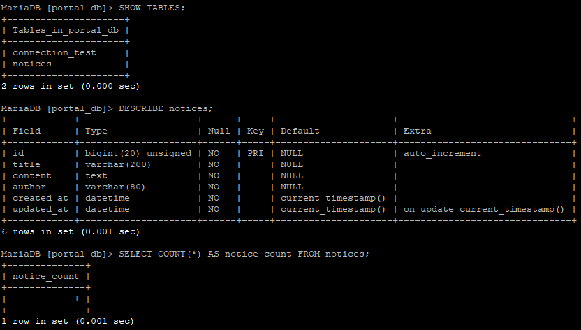

---

## 4. WEB01/WEB02 MariaDB 공통 데이터 검증

### 4.1 WEB01에서 DB01 원격 접속

WEB01에서 실행하였다.

```bash
mariadb --default-character-set=utf8mb4 \
  -h 192.168.100.31 \
  -u portal_app -p portal_db
```

접속 후 다음 SQL을 실행하였다.

```sql
SELECT CURRENT_USER(), DATABASE();
```

확인 결과:

```text
CURRENT_USER(): portal_app@192.168.100.21
DATABASE():     portal_db
```

WEB01에 할당된 MariaDB 애플리케이션 계정으로 접속하였다.

### 4.2 WEB01에서 테스트 데이터 등록

```sql
INSERT INTO notices (title, content, author)
VALUES (
    '사내 업무 포털 오픈 안내',
    '11단원 WEB01에서 등록한 공지사항 테스트 데이터입니다.',
    'sysadmin'
);
```

실제 결과:

```text
Query OK, 1 row affected
```

등록 데이터 확인:

```sql
SELECT id, title, author
FROM notices
ORDER BY id;

SELECT id, content
FROM notices;
```

| ID | 제목 | 작성자 |
|---|---|---|
| 1 | 사내 업무 포털 오픈 안내 | sysadmin |

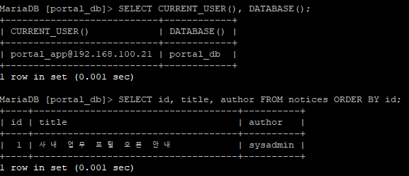

### 4.3 WEB02에서 동일한 데이터 조회

WEB02에서 실행하였다.

```bash
mariadb --default-character-set=utf8mb4 \
  -h 192.168.100.31 \
  -u portal_app -p portal_db
```

계정 확인:

```sql
SELECT CURRENT_USER(), DATABASE();
```

실제 결과:

```text
CURRENT_USER(): portal_app@192.168.100.22
DATABASE():     portal_db
```

공지사항 조회:

```sql
SELECT id, title, content, author
FROM notices
ORDER BY id;
```

WEB01에서 등록한 ID 1번 공지사항을 WEB02에서도 동일하게 조회하였다.

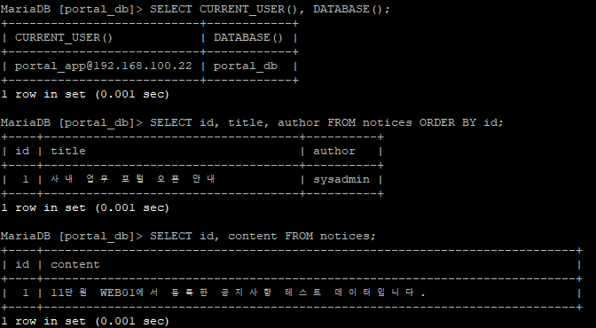

**WEB01에서 등록한 데이터를 WEB02에서도 조회함으로써 두 웹 서버의 공통 DB 연동을 확인하였다.**

---

## 5. WEB01 PHP 업무 포털 구성

### 5.1 Apache 및 PHP 실행 환경 확인

WEB01에서 실행하였다.

```bash
sudo systemctl is-active httpd

sudo systemctl is-active php-fpm

php -m | grep -Ei 'PDO|pdo_mysql'
```

실제 결과:

```text
active
active
PDO
pdo_mysql
pdo_sqlite
```

Apache, PHP-FPM 및 MariaDB 연결용 PHP 확장이 정상적으로 구성되어 있었다.

### 5.2 비공개 DB 설정 파일 확인

10단원에서 구성한 파일을 재사용하였다.

```bash
ls -ldZ /var/www/private

sudo ls -lZ /var/www/private/db-config.php
```

확인 결과:

| 항목 | 설정 |
|---|---|
| 디렉터리 | /var/www/private |
| 디렉터리 소유권 | root:apache |
| 디렉터리 권한 | 750 |
| 설정 파일 | db-config.php |
| 설정 파일 권한 | 640 |
| SELinux 유형 | httpd_sys_content_t |

DB 접속 비밀번호는 Apache의 공개 DocumentRoot 밖에 저장하였다.

### 5.3 포털 파일 구성

포털 경로:

```text
/var/www/html/portal/
```

최종 파일 구성:

```text
/var/www/
├── html/
│   ├── index.html
│   └── portal/
│       ├── index.php
│       ├── view.php
│       ├── create.php
│       ├── edit.php
│       └── delete.php
└── private/
    └── db-config.php
```

| 파일 | 역할 |
|---|---|
| index.php | 공지사항 목록 |
| view.php | 공지사항 상세 |
| create.php | 공지사항 등록 |
| edit.php | 공지사항 수정 |
| delete.php | 공지사항 삭제 |

PHP PDO 기반 CRUD 예제 코드를 적용하였으며, WEB01에서 각 기능의 실행과 DB 반영 결과를 검증하였다.

### 5.4 PHP PDO 연결 구조

```php
$config = require '/var/www/private/db-config.php';

$dsn = "mysql:host={$config['host']};dbname={$config['database']};charset=utf8mb4";

$pdo = new PDO(
    $dsn,
    $config['username'],
    $config['password'],
    [
        PDO::ATTR_ERRMODE => PDO::ERRMODE_EXCEPTION,
        PDO::ATTR_DEFAULT_FETCH_MODE => PDO::FETCH_ASSOC,
    ]
);
```

PHP는 비공개 설정 파일에서 접속 정보를 읽고 PDO를 통해 DB01의 `portal_db`에 연결한다.

실제 비밀번호와 서버별 비공개 설정 파일 원본은 공개 GitHub 저장소에 포함하지 않는다.

### 5.5 HTML 출력 이스케이프

DB 조회 결과를 HTML로 출력할 때 다음 함수를 적용하였다.

```php
function e(string $value): string
{
    return htmlspecialchars(
        $value,
        ENT_QUOTES | ENT_SUBSTITUTE,
        'UTF-8'
    );
}
```

사용자 입력값과 DB 조회 데이터를 HTML에 출력할 때 특수문자를 처리하기 위한 목적이다.

---

## 6. WEB01 공지사항 조회(Read) 구현

### 6.1 목록 조회

`index.php`에서 다음 SQL을 사용하였다.

```sql
SELECT id, title, author, created_at
FROM notices
ORDER BY id DESC;
```

조회 결과는 PHP에서 HTML 테이블로 출력하였다.

브라우저 주소:

```text
http://192.168.100.21/portal/index.php
```

등록된 ID 1번 공지사항이 정상적으로 표시되었다.

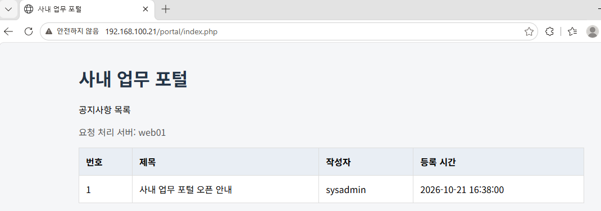

### 6.2 상세 조회

`view.php`에서는 URL의 ID를 확인하여 해당 공지사항을 조회하였다.

```sql
SELECT id, title, content, author, created_at, updated_at
FROM notices
WHERE id = ?;
```

PHP Prepared Statement로 ID를 전달하도록 구성하였다.

```php
$stmt = $pdo->prepare(
    "SELECT id, title, content, author, created_at, updated_at
     FROM notices
     WHERE id = ?"
);

$stmt->execute([$id]);

$notice = $stmt->fetch();
```

### 6.3 문법 및 HTTP 응답 검증

WEB01에서 실행하였다.

```bash
php -l /var/www/html/portal/index.php

php -l /var/www/html/portal/view.php
```

두 PHP 파일에서 문법 오류가 없음을 확인하였다.

정상 ID:

```bash
curl -s -o /dev/null -w '%{http_code}\n' \
  'http://127.0.0.1/portal/view.php?id=1'
```

실제 결과:

```text
200
```

존재하지 않는 ID:

```bash
curl -s -o /dev/null -w '%{http_code}\n' \
  'http://127.0.0.1/portal/view.php?id=99999'
```

실제 결과:

```text
404
```

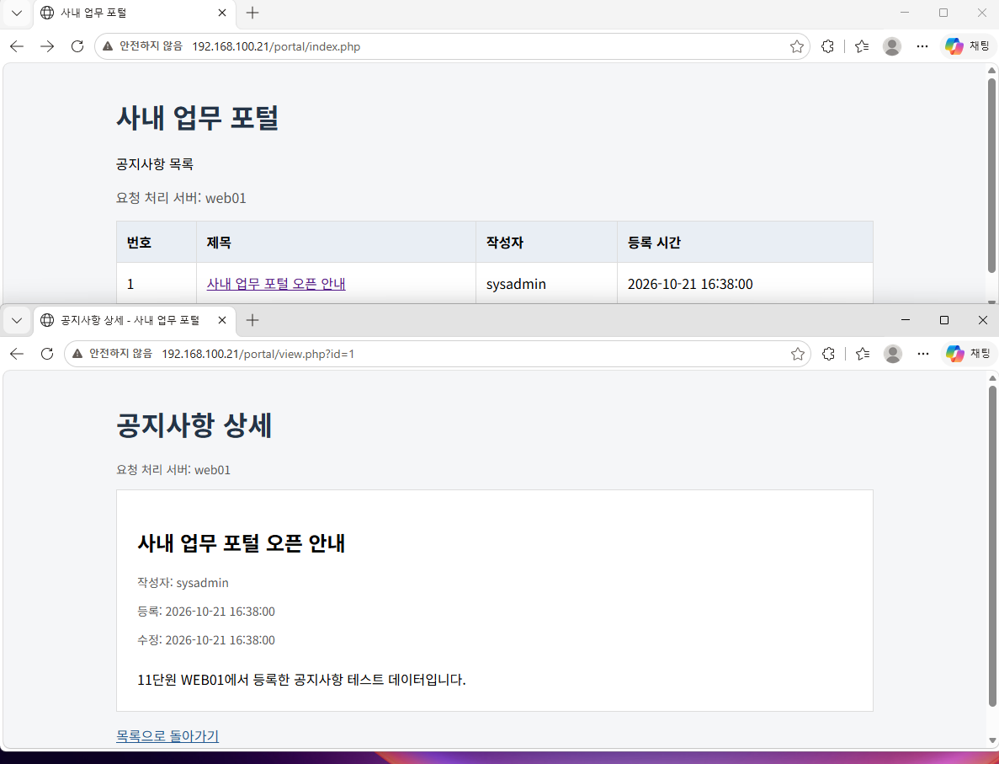

정상 데이터 조회와 존재하지 않는 공지사항에 대한 HTTP 404 처리를 확인하였다.

---

## 7. WEB01 공지사항 등록(Create) 구현

### 7.1 등록 페이지 구성

WEB01에서 다음 파일을 구성하였다.

```bash
sudo vi /var/www/html/portal/create.php
```

`index.php`에는 신규 공지사항 등록 링크를 추가하였다.

등록 폼은 제목, 작성자, 본문을 입력받고 POST 요청으로 데이터를 전달하도록 구성하였다.

### 7.2 INSERT 처리

주요 SQL:

```sql
INSERT INTO notices (title, content, author)
VALUES (?, ?, ?);
```

PHP에서는 Prepared Statement를 이용하였다.

```php
$stmt = $pdo->prepare(
    "INSERT INTO notices (title, content, author)
     VALUES (?, ?, ?)"
);

$stmt->execute([$title, $content, $author]);
```

등록 성공 후 생성된 ID를 이용해 상세 페이지로 이동하도록 구성하였다.

### 7.3 입력값 및 요청 검증

등록 기능에 다음 처리를 적용하였다.

- 제목, 작성자, 본문 입력값 검증
- Prepared Statement를 이용한 INSERT
- HTML 출력 이스케이프
- PHP 세션 기반 CSRF 토큰 검증
- 등록 성공 후 상세 페이지로 이동

CSRF 토큰은 PHP 세션에 저장하여 POST 요청 시 전달된 값과 비교하도록 구성하였다.

### 7.4 WEB01 등록 결과 확인

등록한 테스트 데이터:

| 항목 | 값 |
|---|---|
| 제목 | 서버 정기 점검 안내 |
| 작성자 | sysadmin |
| 본문 | 11단원 WEB01 PHP 등록 기능 테스트 |

등록 후 ID 2번 공지사항의 상세 페이지가 표시되었다.

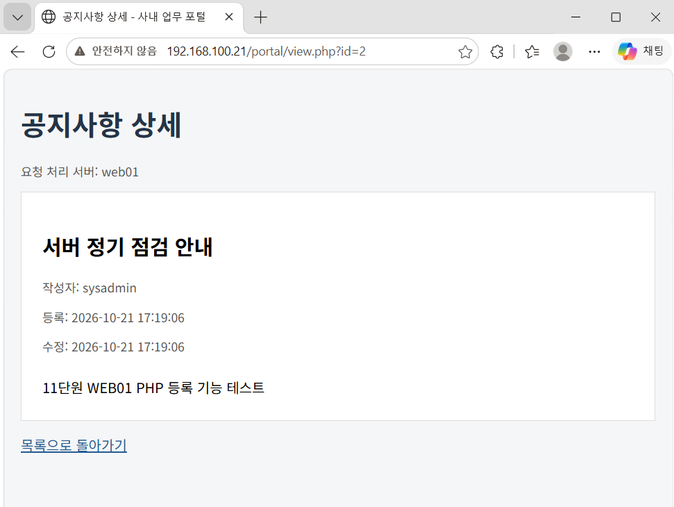

목록에는 기존 ID 1번과 신규 ID 2번이 함께 나타났다.

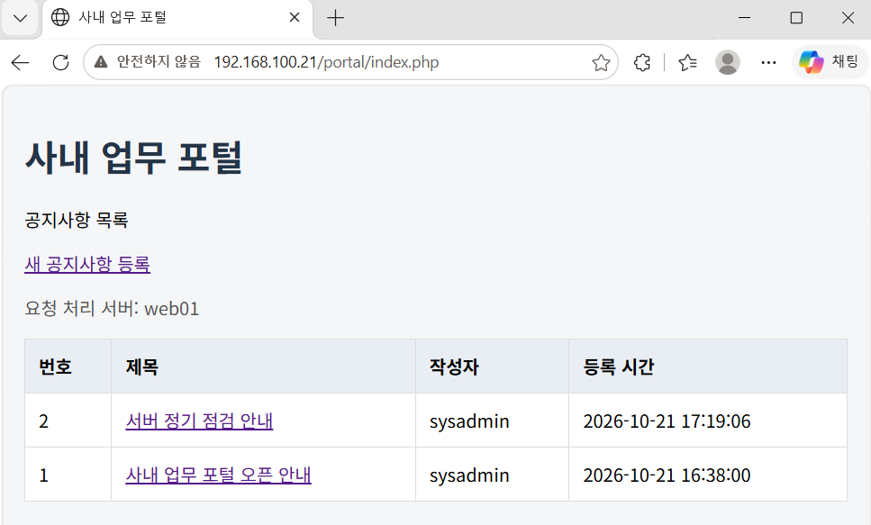

**WEB01 PHP의 등록 기능이 DB01 MariaDB에 데이터를 저장함을 확인하였다.**

---

## 8. WEB01 공지사항 수정(Update) 구현

### 8.1 수정 페이지 구성

```bash
sudo vi /var/www/html/portal/edit.php
```

`view.php`에 수정 페이지 링크를 추가하였다.

`edit.php`에서는 기존 데이터를 조회하여 입력란에 표시하고, POST 요청을 통해 변경 사항을 저장하도록 구성하였다.

### 8.2 UPDATE 처리

```sql
UPDATE notices
SET title = ?, content = ?, author = ?
WHERE id = ?;
```

Prepared Statement를 통해 변경할 값과 대상 ID를 전달하였다.

`WHERE id = ?` 조건을 사용하여 지정한 공지사항만 수정하도록 구성하였다.

### 8.3 WEB01 수정 결과

ID 2번을 다음 내용으로 수정하였다.

| 항목 | 수정 결과 |
|---|---|
| 제목 | 서버 정기 점검 일정 변경 안내 |
| 작성자 | sysadmin |
| 본문 | 11단원 WEB01 PHP 수정 기능 테스트 완료입니다. |

브라우저에서 수정된 제목과 본문을 확인하였다.

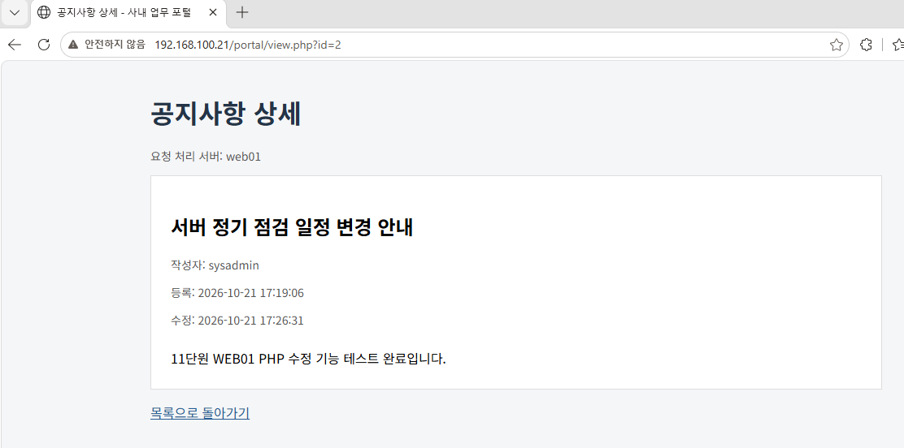

### 8.4 DB01 수정 검증

```sql
SELECT id, title, content, created_at, updated_at
FROM notices
WHERE id = 2\G
```

실제 결과:

```text
id: 2
title: 서버 정기 점검 일정 변경 안내
content: 11단원 WEB01 PHP 수정 기능 테스트 완료입니다.
created_at: 2026-10-21 17:19:06
updated_at: 2026-10-21 17:26:31
```

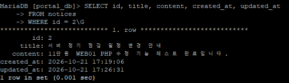

등록 시간은 유지되고 수정 시간이 갱신되었다.

---

## 9. WEB01 공지사항 삭제(Delete) 구현

### 9.1 삭제 페이지 구성

```bash
sudo vi /var/www/html/portal/delete.php
```

상세 페이지에서 삭제 링크를 클릭하면 삭제 확인 화면으로 이동하도록 구성하였다.

삭제 확인 페이지는 GET 요청으로 표시하고, 실제 데이터 삭제는 CSRF 토큰을 검증한 POST 요청에서만 처리하도록 구성하였다.

### 9.2 DELETE 처리

```sql
DELETE FROM notices
WHERE id = ?;
```

Prepared Statement를 사용하여 특정 ID의 공지사항만 삭제하도록 구성하였다.

### 9.3 HTTP 요청 검증

WEB01에서 실행하였다.

```bash
# 정상 공지사항
curl -s -o /dev/null -w '%{http_code}\n' \
  'http://127.0.0.1/portal/delete.php?id=2'

# 존재하지 않는 공지사항
curl -s -o /dev/null -w '%{http_code}\n' \
  'http://127.0.0.1/portal/delete.php?id=99999'

# 잘못된 ID
curl -s -o /dev/null -w '%{http_code}\n' \
  'http://127.0.0.1/portal/delete.php?id=abc'

# CSRF 토큰 없는 POST
curl -s -o /dev/null -w '%{http_code}\n' \
  -X POST 'http://127.0.0.1/portal/delete.php?id=2'
```

실제 결과:

```text
200
404
400
403
```

CSRF 토큰이 없는 POST 요청이 HTTP 403으로 거부됨을 확인하였다.

### 9.4 WEB01 삭제 결과

ID 2번 삭제 확인 화면:

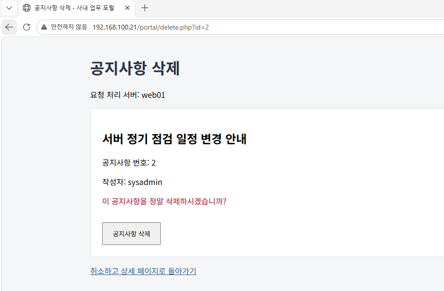

삭제 후 목록에는 ID 1번만 표시되었다.

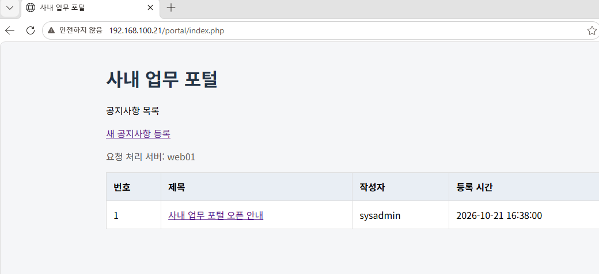

DB01에서 실행하였다.

```sql
SELECT id, title FROM notices ORDER BY id;

SELECT COUNT(*) AS remaining_id_2
FROM notices
WHERE id = 2;

SELECT COUNT(*) AS total_notices
FROM notices;
```

실제 결과:

```text
remaining_id_2 = 0
total_notices  = 1
```

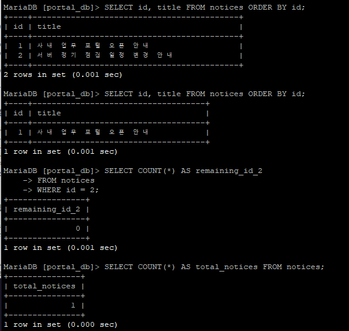

**WEB01의 등록·조회·수정·삭제 기능을 모두 검증하였다.**

---

## 10. WEB02 PHP 포털 배포

### 10.1 WEB02 기존 서비스 확인

WEB02에서 실행하였다.

```bash
sudo systemctl is-active httpd

sudo systemctl is-active php-fpm

php -v

php -m | grep -Ei 'PDO|pdo_mysql'

getenforce

getsebool httpd_can_network_connect_db
```

실제 확인 결과:

| 항목 | 결과 |
|---|---|
| Apache | active |
| PHP-FPM | active |
| PHP | 8.0.30 |
| PDO / pdo_mysql | 확인 |
| SELinux | Enforcing |
| httpd_can_network_connect_db | on |

DB 접속 설정 파일도 확인하였다.

```bash
ls -ldZ /var/www/private

sudo ls -lZ /var/www/private/db-config.php
```

WEB02 전용 DB 설정 파일이 유지되고 있음을 확인하였다.

### 10.2 임시 배포 디렉터리 준비

WEB02에서 실행하였다.

```bash
mkdir -p ~/portal-stage
```

웹 공개 디렉터리에 바로 복사하지 않고 임시 배포 디렉터리에 파일을 먼저 전달하였다.

### 10.3 WEB01에서 SCP 전송

WEB01에서 실행하였다.

```bash
scp /var/www/html/portal/{index,view,create,edit,delete}.php \
  sysadmin@192.168.100.22:/home/sysadmin/portal-stage/
```

실제 전송 결과:

```text
index.php   100%
view.php    100%
create.php  100%
edit.php    100%
delete.php  100%
```

PHP 파일 5개의 전송에 성공하였다.

### 10.4 WEB02 파일 확인 및 배포

WEB02에서 파일을 확인하였다.

```bash
ls -lh ~/portal-stage/
```

PHP 문법 검사에 사용한 명령어:

```bash
for file in ~/portal-stage/*.php; do
    php -l "$file"
done
```

배포 대상 디렉터리 생성:

```bash
sudo install -d -o root -g apache -m 755 \
  /var/www/html/portal
```

PHP 파일 배포:

```bash
sudo install -o root -g apache -m 644 \
  ~/portal-stage/*.php \
  /var/www/html/portal/
```

SELinux 컨텍스트 복원:

```bash
sudo restorecon -Rv /var/www/html/portal
```

파일 상태 확인:

```bash
ls -lZ /var/www/html/portal/
```

실제 확인 결과:

| 항목 | 결과 |
|---|---|
| PHP 파일 수 | 5개 |
| 소유권 | root:apache |
| 권한 | 644 |
| SELinux 유형 | httpd_sys_content_t |

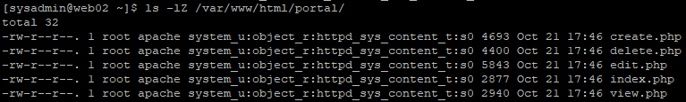

WEB01과 WEB02는 동일한 PHP 파일을 사용하지만, DB 접속 비밀번호가 포함된 `/var/www/private/db-config.php`는 서버별로 유지하였다.
---

## 11. WEB02 CRUD 및 공통 DB 검증

### 11.1 WEB02 공지사항 조회

Windows 브라우저에서 접속하였다.

```text
http://192.168.100.22/portal/index.php
```

화면에서 다음 내용을 확인하였다.

```text
사내 업무 포털
요청 처리 서버: web02
ID 1: 사내 업무 포털 오픈 안내
```

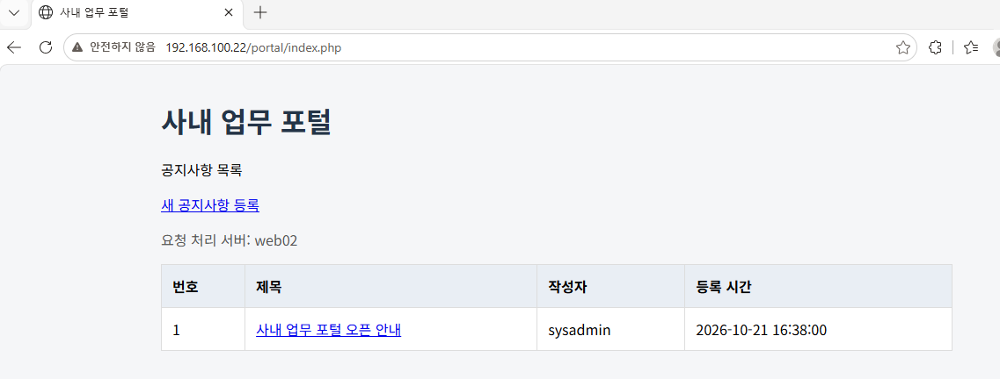

WEB02의 PHP 애플리케이션이 DB01의 공통 데이터를 조회하였다.

### 11.2 WEB02 공지사항 등록

등록한 데이터:

| 항목 | 값 |
|---|---|
| 제목 | WEB02 포털 등록 검증 |
| 작성자 | sysadmin |
| 본문 | 11단원 WEB02 PHP에서 등록한 공통 DB 검증 데이터입니다. |

DB01에서 확인하였다.

```sql
SELECT id, title, author, created_at
FROM notices
ORDER BY id;
```

실제 결과:

| id | title | author | created_at |
|---|---|---|---|
| 1 | 사내 업무 포털 오픈 안내 | sysadmin | 2026-10-21 16:38:00 |
| 3 | WEB02 포털 등록 검증 | sysadmin | 2026-10-21 17:55:35 |

WEB02에서 등록한 신규 공지사항이 DB01에 저장되었다.

### 11.3 WEB02 공지사항 수정

ID 3번을 다음과 같이 수정하였다.

| 항목 | 수정 결과 |
|---|---|
| 제목 | WEB02 포털 수정 검증 완료 |
| 본문 | 11단원 WEB02 PHP UPDATE 기능 검증에 성공했습니다. |

브라우저 결과:

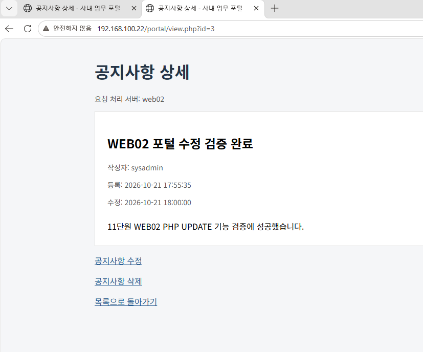

DB01에서 실행하였다.

```sql
SELECT id, title, content, created_at, updated_at
FROM notices
WHERE id = 3\G
```

실제 결과:

```text
id: 3
title: WEB02 포털 수정 검증 완료
content: 11단원 WEB02 PHP UPDATE 기능 검증에 성공했습니다.
created_at: 2026-10-21 17:55:35
updated_at: 2026-10-21 18:00:00
```

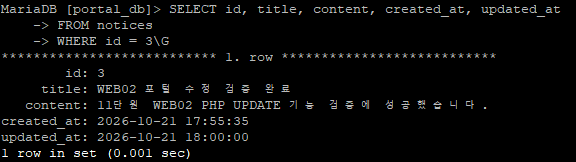

WEB02에서 수정한 데이터가 DB01에 반영되었음을 확인하였다.

### 11.4 WEB02 공지사항 삭제

WEB02에서 ID 3번 공지사항의 삭제 확인 페이지를 열었다.

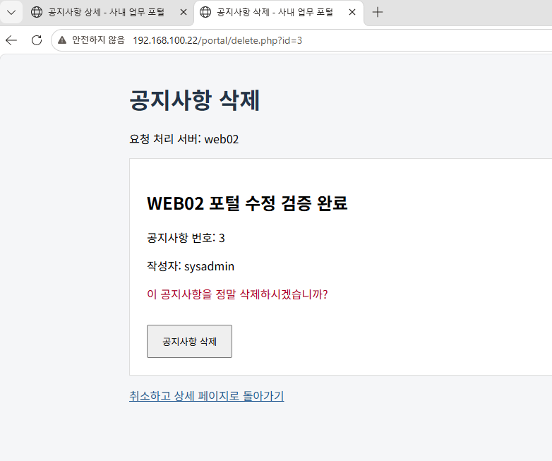

삭제 후 WEB02 포털 목록에는 ID 1번만 표시되었다.

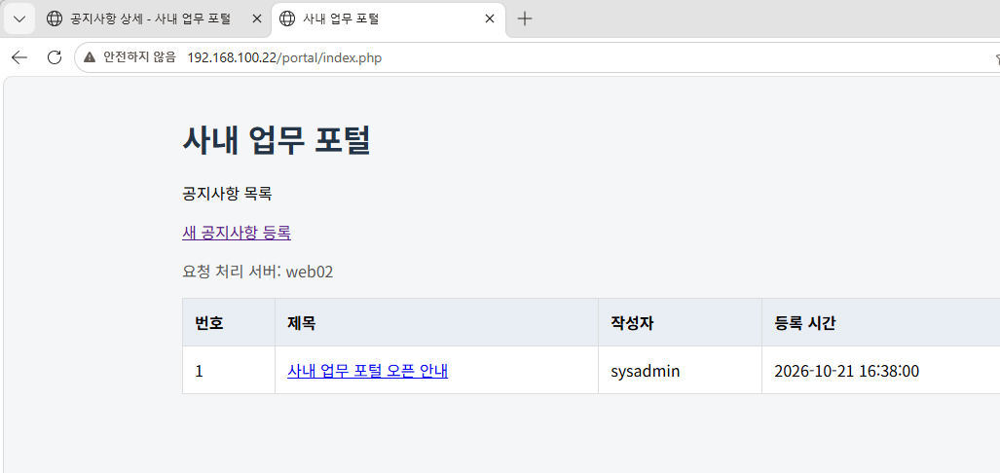

DB01에서 실행하였다.

```sql
SELECT id, title FROM notices ORDER BY id;

SELECT COUNT(*) AS remaining_id_3
FROM notices
WHERE id = 3;

SELECT COUNT(*) AS total_notices
FROM notices;
```

실제 결과:

```text
remaining_id_3 = 0
total_notices  = 1
```

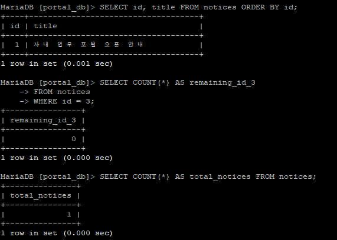

**WEB02에서도 CRUD 기능의 정상 동작과 DB01 데이터 반영을 검증하였다.**

---

## 12. HAProxy Round Robin 통합 검증

### 12.1 HAProxy 서비스 확인

LB01에서 실행하였다.

```bash
sudo systemctl is-active haproxy

sudo haproxy -c -f /etc/haproxy/haproxy.cfg
```

실제 결과:

```text
active
Configuration file is valid
```

### 12.2 초기 HAProxy 구성

기존 포털 설정:

```haproxy
frontend portal_frontend
    bind 192.168.100.10:80
    default_backend portal_backend

backend portal_backend
    balance roundrobin
    option httpchk GET /

    server web01 192.168.100.21:80 check
    server web02 192.168.100.22:80 check
```

`balance roundrobin` 설정을 통해 두 웹 서버로 HTTP 요청을 분산하였다.

### 12.3 Round Robin 검증

LB01에서 실행하였다.

```bash
for i in {1..6}; do
    curl -sS http://192.168.100.10/portal/index.php \
    | grep -oE 'web0[12]' | head -n 1
done
```

실제 결과 중 하나:

```text
web02
web01
web02
web01
web02
web01
```

WEB01과 WEB02가 교대로 요청에 응답하였다.

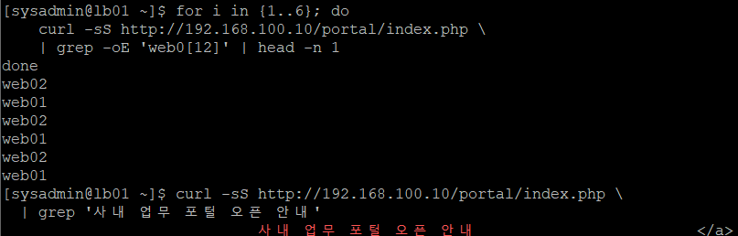

### 12.4 HAProxy 경유 포털 조회

LB01에서 실행하였다.

```bash
curl -sS http://192.168.100.10/portal/index.php \
  | grep '사내 업무 포털 오픈 안내'
```

HTTP 응답에서 기존 공지사항 제목을 확인하였다.

Windows 브라우저에서도 접속하였다.

```text
http://192.168.100.10/portal/index.php
```

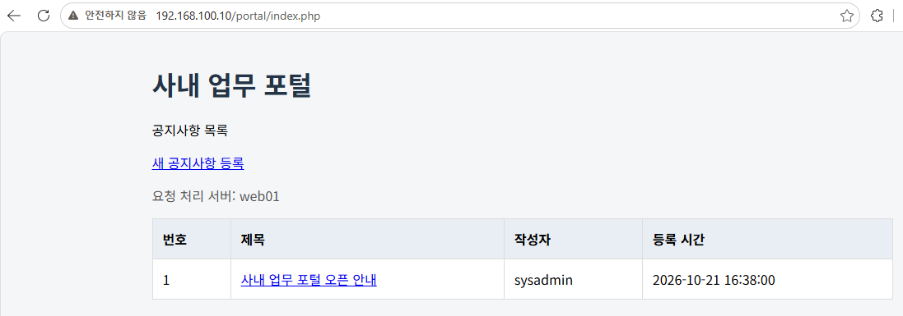

HAProxy를 경유하여 웹 애플리케이션을 실행하고 DB01에 저장된 공지사항을 조회하였다.

---

## 13. HAProxy Sticky Session 구성 및 검증

### 13.1 구성 배경

기존 Round Robin 방식에서는 연속된 HTTP 요청이 서로 다른 웹 서버로 전달될 수 있다.

이번 포털의 등록·수정·삭제 기능은 PHP 세션에 CSRF 토큰을 저장한다.

따라서 등록 폼을 제공한 서버와 등록 POST 요청을 처리한 서버가 서로 다르면 로컬 PHP 세션 정보가 일치하지 않을 수 있다.

이러한 구조를 고려하여 HAProxy에 **쿠키 기반 Sticky Session**을 적용하였다.

이번 실습에서 확인한 것은 정상 백엔드 상태에서의 쿠키 기반 서버 고정이다. 서버 장애 시 PHP 세션 복구는 검증하지 않았다.

### 13.2 설정 백업

LB01에서 실행하였다.

```bash
sudo cp -a /etc/haproxy/haproxy.cfg \
  /etc/haproxy/haproxy.cfg.bak-ch11
```

### 13.3 HAProxy 설정 변경

```bash
sudo vi /etc/haproxy/haproxy.cfg
```

최종 적용한 설정:

```haproxy
frontend portal_frontend
    bind 192.168.100.10:80
    default_backend portal_backend

backend portal_backend
    balance roundrobin
    option httpchk GET /

    cookie SRV insert indirect nocache httponly

    server web01 192.168.100.21:80 check cookie web01
    server web02 192.168.100.22:80 check cookie web02
```

주요 설정:

| 설정 | 역할 |
|---|---|
| balance roundrobin | 초기 요청 분산 |
| cookie SRV | HAProxy 서버 고정 쿠키 이름 |
| insert | 응답에 쿠키 삽입 |
| indirect | HAProxy 고정 쿠키를 백엔드에 전달하지 않도록 처리 |
| nocache | 쿠키 삽입 응답의 캐싱 문제 완화 |
| httponly | JavaScript의 쿠키 접근 제한 |
| cookie web01 | WEB01을 나타내는 쿠키 값 |
| cookie web02 | WEB02를 나타내는 쿠키 값 |

### 13.4 설정 문법 검사 및 적용

LB01에서 실행하였다.

```bash
sudo haproxy -c -f /etc/haproxy/haproxy.cfg
```

실제 결과:

```text
Configuration file is valid
```

설정을 반영하였다.

```bash
sudo systemctl reload haproxy

sudo systemctl is-active haproxy
```

실제 결과:

```text
active
```

### 13.5 쿠키 없는 Round Robin 확인

```bash
for i in {1..6}; do
    curl -sS http://192.168.100.10/portal/index.php \
    | grep -oE 'web0[12]' | head -n 1
done
```

실제 결과:

```text
web01
web02
web01
web02
web01
web02
```

쿠키를 저장하지 않은 독립적인 요청에서는 Round Robin이 유지되었다.

### 13.6 쿠키 기반 Sticky Session 검증

LB01에서 실행하였다.

```bash
curl -sS \
  -c /tmp/portal-sticky.cookies \
  -b /tmp/portal-sticky.cookies \
  http://192.168.100.10/portal/create.php \
  | grep -oE 'web0[12]' | head -n 1
```

최초 결과:

```text
web01
```

이후 동일한 쿠키를 사용하여 반복 요청하였다.

```bash
for i in {1..6}; do
    curl -sS \
      -b /tmp/portal-sticky.cookies \
      -c /tmp/portal-sticky.cookies \
      http://192.168.100.10/portal/create.php \
    | grep -oE 'web0[12]' | head -n 1
done
```

실제 결과:

```text
web01
web01
web01
web01
web01
web01
```

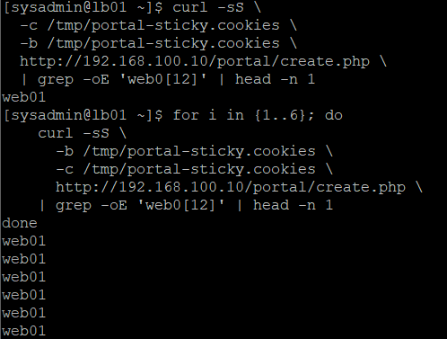

쿠키 없는 요청에서는 WEB01/WEB02가 교대로 응답했고, 동일한 쿠키를 사용한 요청에서는 WEB01이 연속해서 응답하였다.

**HAProxy 쿠키 기반 서버 고정이 정상 동작함을 확인하였다.**

---

## 14. HAProxy 경유 CRUD 통합 검증

### 14.1 WEB01/WEB02/HAProxy 공통 데이터 확인

다음 세 주소에서 포털에 접속하였다.

```text
http://192.168.100.21/portal/index.php
http://192.168.100.22/portal/index.php
http://192.168.100.10/portal/index.php
```

세 경로에서 동일한 공지사항 목록을 확인하였다.

WEB01과 WEB02에서 각각 다음 명령어로도 검증하였다.

WEB01:

```bash
curl -sS http://192.168.100.21/portal/index.php \
  | grep 'HAProxy 통합 CRUD 검증'
```

WEB02:

```bash
curl -sS http://192.168.100.22/portal/index.php \
  | grep 'HAProxy 통합 CRUD 검증'
```

두 서버에서 같은 공지사항 제목이 출력되었다.

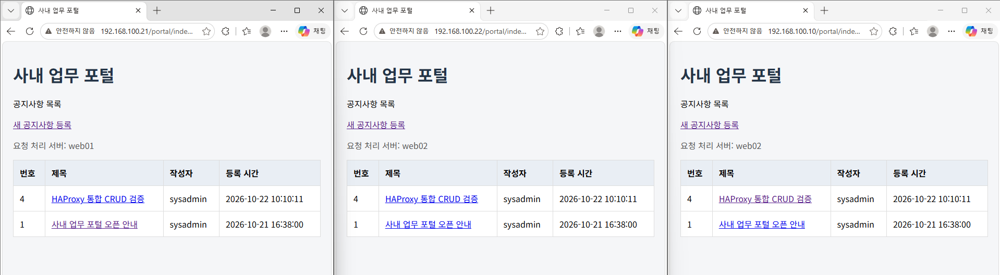

### 14.2 HAProxy 경유 공지사항 등록(Create)

Windows 브라우저에서 접속하였다.

```text
http://192.168.100.10/portal/create.php
```

등록한 데이터:

| 항목 | 값 |
|---|---|
| 제목 | HAProxy 통합 CRUD 검증 |
| 작성자 | sysadmin |
| 본문 | 11단원 HAProxy Sticky Session 기반 PHP CREATE 기능 검증입니다. |

등록 후 ID 4번 공지사항의 상세 페이지가 표시되었다.

```text
http://192.168.100.10/portal/view.php?id=4
```

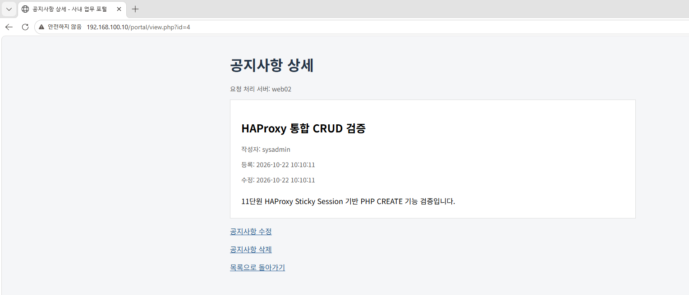

DB01에서 확인하였다.

```sql
SELECT id, title, author, created_at
FROM notices
ORDER BY id DESC;
```

실제 결과:

| id | title | author | created_at |
|---|---|---|---|
| 4 | HAProxy 통합 CRUD 검증 | sysadmin | 2026-10-22 10:10:11 |
| 1 | 사내 업무 포털 오픈 안내 | sysadmin | 2026-10-21 16:38:00 |

HAProxy 경유 등록 요청이 DB01에 반영되었다.

### 14.3 HAProxy 경유 공지사항 수정(Update)

Windows 브라우저에서 접속하였다.

```text
http://192.168.100.10/portal/edit.php?id=4
```

수정한 데이터:

| 항목 | 변경된 값 |
|---|---|
| 제목 | HAProxy 통합 UPDATE 검증 완료 |
| 작성자 | sysadmin |
| 본문 | 11단원 HAProxy Sticky Session 기반 PHP UPDATE 기능 검증에 성공했습니다. |

수정 후 상세 페이지에서 변경된 내용을 확인하였다.

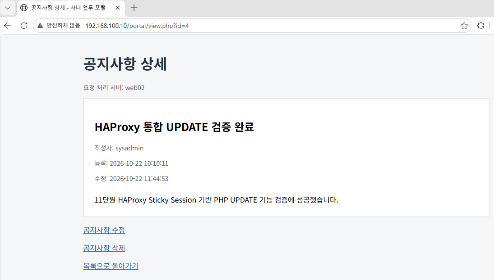

DB01에서 실행하였다.

```sql
SELECT id, title, content, created_at, updated_at
FROM notices
WHERE id = 4\G
```

실제 결과:

```text
id: 4
title: HAProxy 통합 UPDATE 검증 완료
content: 11단원 HAProxy Sticky Session 기반 PHP UPDATE 기능 검증에 성공했습니다.
created_at: 2026-10-22 10:10:11
updated_at: 2026-10-22 11:44:53
```

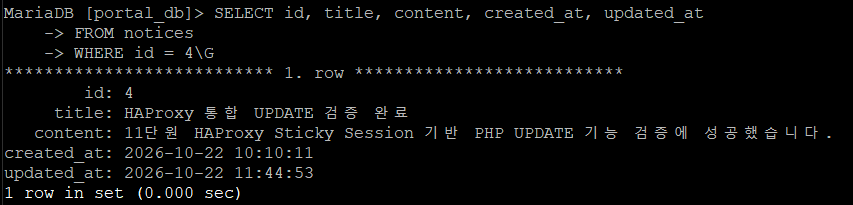

최초 등록 시간은 유지되고 마지막 수정 시간만 갱신되었다.

### 14.4 HAProxy 경유 공지사항 삭제(Delete)

HAProxy 주소에서 ID 4번 공지사항의 삭제 작업을 진행하였다.

삭제 이후 상세 페이지에 접속했을 때 공지사항을 찾을 수 없다는 메시지가 출력되었다.

```text
http://192.168.100.10/portal/view.php?id=4
```

HAProxy 포털 목록에서 ID 4번이 사라지고 ID 1번만 남아 있음을 확인하였다.

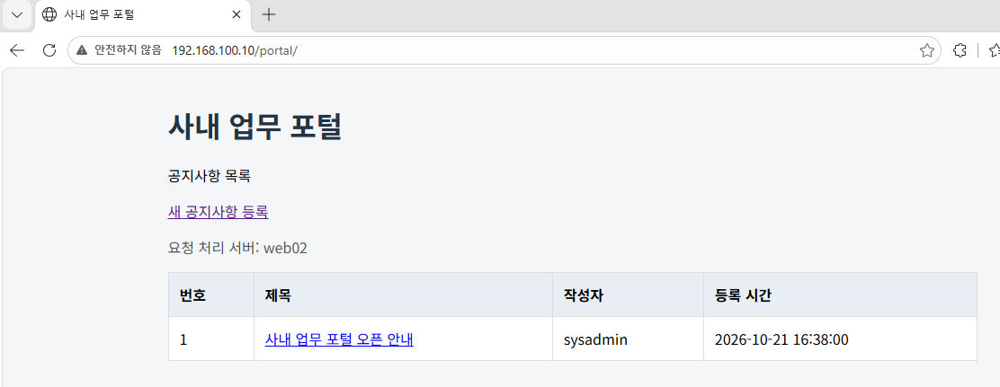

DB01에서 실행하였다.

```sql
SELECT id, title FROM notices ORDER BY id;

SELECT COUNT(*) AS remaining_id_4
FROM notices
WHERE id = 4;

SELECT COUNT(*) AS total_notices
FROM notices;
```

실제 결과:

```text
remaining_id_4 = 0
total_notices  = 1
```

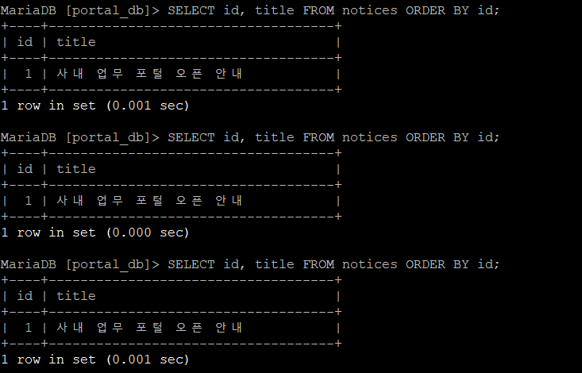

ID 4번은 삭제되었으며, 기존 ID 1번은 유지되었다.

**HAProxy 경유 등록·조회·수정·삭제의 결과가 공통 MariaDB에 정상 반영됨을 확인하였다.**

---

## 15. 최종 HTTP 상태 코드 검증

### 15.1 검증 목적

HAProxy 경유 CRUD 실습 이후 삭제된 공지사항과 기존 공지사항이 올바른 HTTP 상태 코드를 반환하는지 확인하였다.

실행 서버: LB01

### 15.2 삭제된 공지사항 조회

```bash
curl -sS -o /dev/null -w '%{http_code}\n' \
  'http://192.168.100.10/portal/view.php?id=4'
```

실제 결과:

```text
404
```

ID 4번 공지사항이 삭제되어 더 이상 조회되지 않았다.

### 15.3 기존 공지사항 조회

```bash
curl -sS -o /dev/null -w '%{http_code}\n' \
  'http://192.168.100.10/portal/view.php?id=1'
```

실제 결과:

```text
200
```

기존 ID 1번 공지사항은 정상적으로 조회되었다.

### 15.4 포털 목록 조회

```bash
curl -sS -o /dev/null -w '%{http_code}\n' \
  'http://192.168.100.10/portal/index.php'
```

실제 결과:

```text
200
```

### 15.5 최종 HTTP 검증 결과

| 요청 대상 | HTTP 코드 | 결과 |
|---|---|---|
| 삭제된 공지사항 ID 4 | 404 | 정상 |
| 기존 공지사항 ID 1 | 200 | 정상 |
| 포털 목록 페이지 | 200 | 정상 |

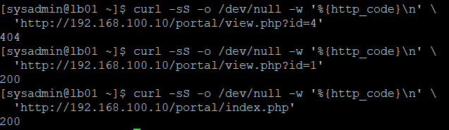

**HAProxy 경유 CRUD 작업 이후에도 기존 공지사항 조회 및 목록 서비스가 정상 유지됨을 확인하였다.**

---

## 16. 보안 설정 및 운영상 고려 사항

### 16.1 MariaDB 계정 최소 권한

WEB01과 WEB02의 `portal_app` 계정에는 다음 권한이 부여되어 있었다.

```text
SELECT
INSERT
UPDATE
DELETE
```

테이블 생성 및 계정 관리 작업은 DB01 관리자 계정으로 구분하여 수행하였다.

### 16.2 DB 인증 정보 분리

DB 접속 정보는 Apache 공개 DocumentRoot 밖에 있는 다음 파일에서 관리하였다.

```text
/var/www/private/db-config.php
```

파일 권한은 `640`, 소유권은 `root:apache`로 유지하였다.

WEB01과 WEB02의 DB 인증 정보가 서로 다르므로 PHP 파일 배포 시 비공개 설정 파일은 복사하지 않았다.

### 16.3 SELinux Enforcing 유지

WEB01과 WEB02에서 SELinux `Enforcing`을 유지하였다.

```bash
getenforce

getsebool httpd_can_network_connect_db
```

확인 결과:

```text
Enforcing
httpd_can_network_connect_db --> on
```

PHP 파일은 `httpd_sys_content_t` 유형이 적용된 상태로 배포하였다.

### 16.4 애플리케이션 기본 보안

PHP CRUD 예제에 다음 처리를 적용하였다.

- PDO Prepared Statement를 이용한 SQL 실행
- `htmlspecialchars()` 기반 HTML 출력 이스케이프
- 입력값 검증
- POST 기반 등록·수정·삭제 처리
- PHP 세션 기반 CSRF 토큰 검증

이러한 조치는 기본적인 입력 처리와 요청 위조 위험을 줄이기 위한 것으로, 사용자 인증 및 운영 수준의 보안을 모두 대체하지는 않는다.

### 16.5 Sticky Session의 적용 범위와 한계

HAProxy 쿠키 기반 Sticky Session으로 동일 클라이언트의 요청이 특정 웹 서버로 유지되는 것을 확인하였다.

하지만 WEB01과 WEB02의 PHP 세션 저장소는 별도로 존재한다.

따라서 특정 웹 서버에서 장애가 발생하면 다른 웹 서버로 요청이 전달될 수 있어도, 기존 PHP 세션 데이터가 자동 이전되지는 않는다.

이번 실습에서는 **정상 백엔드 환경의 Round Robin, Sticky Session 및 CRUD 동작을 검증**하였다.

다음 항목은 이번 단원의 검증 범위에 포함하지 않았다.

- WEB 서버 장애 발생 시 PHP 세션 자동 복구
- 공유 세션 저장소 구성
- HTTPS 및 Secure 쿠키 적용
- 로그인 및 사용자별 권한 관리
- 운영 환경 수준의 접근 제어 및 감사 로그

또한 HAProxy의 `option httpchk GET /`는 웹 서버 루트 경로를 확인하는 방식으로, PHP CRUD 기능과 DB 연결 상태까지 검사하는 애플리케이션 전용 헬스 체크는 아니다.

현재 구성은 내부 실습망에서 웹 서비스의 실행 흐름과 서버 간 연동을 검증하기 위한 환경이다.

---

## 17. 실습 최종 검증 결과

| 검증 항목 | 결과 |
|---|---|
| DB01 MariaDB 서비스 | 정상 |
| notices 테이블 생성 | 성공 |
| WEB01/WEB02 DB 계정 및 CRUD 권한 | 정상 |
| WEB01 공지사항 조회 | 성공 |
| WEB01 공지사항 등록 | 성공 |
| WEB01 공지사항 수정 | 성공 |
| WEB01 공지사항 삭제 | 성공 |
| WEB02 PHP 파일 5개 배포 | 성공 |
| WEB02 파일 권한 및 SELinux 확인 | 정상 |
| WEB02 공지사항 조회 | 성공 |
| WEB02 공지사항 등록 | 성공 |
| WEB02 공지사항 수정 | 성공 |
| WEB02 공지사항 삭제 | 성공 |
| WEB01/WEB02 공통 MariaDB 사용 | 검증 완료 |
| HAProxy Round Robin | 정상 |
| HAProxy 설정 문법 검사 | 정상 |
| HAProxy 쿠키 기반 Sticky Session | 정상 |
| HAProxy 경유 공지사항 등록 | 성공 |
| HAProxy 경유 공지사항 조회 | 성공 |
| HAProxy 경유 공지사항 수정 | 성공 |
| HAProxy 경유 공지사항 삭제 | 성공 |
| 삭제된 공지사항 상세 조회 | HTTP 404 |
| 기존 공지사항 상세 조회 | HTTP 200 |
| 포털 목록 조회 | HTTP 200 |

### 17.1 최종 MariaDB 데이터 상태

CRUD 기능 검증을 위해 등록한 ID 2, 3, 4번 공지사항은 각 실습에서 삭제하였다.

최종적으로 다음 데이터가 유지되었다.

| ID | 제목 | 작성자 |
|---|---|---|
| 1 | 사내 업무 포털 오픈 안내 | sysadmin |

확인 결과:

```text
remaining_id_4 = 0
total_notices  = 1
```

### 17.2 최종 결과

WEB01과 WEB02에 동일한 PHP 업무 포털을 구성하고, DB01 공통 MariaDB를 통한 CRUD 기능을 검증하였다.

HAProxy를 경유한 요청 분산과 Sticky Session 동작을 확인하고, 공지사항 등록·조회·수정·삭제 결과를 HTTP 응답 및 MariaDB 조회 결과로 검증하였다.

**11단원 실습 최종 결과: 완료**

---

## 18. 배운 점

### 18.1 웹 애플리케이션과 데이터베이스 연동

PHP 애플리케이션은 PDO를 이용해 MariaDB에 연결하고 SQL을 실행한다.

MariaDB CLI에서 직접 SQL을 실행하는 것과 웹 애플리케이션을 통해 데이터를 처리하는 방식의 차이를 확인하였다.

### 18.2 공통 DB 기반 다중 웹 서버

WEB01과 WEB02는 독립된 웹 서버이지만 동일한 DB01 MariaDB를 사용한다.

따라서 한 웹 서버에서 등록한 데이터를 다른 웹 서버에서도 조회할 수 있었다.

### 18.3 서버 간 애플리케이션 배포

SCP를 이용해 WEB01의 PHP 파일을 WEB02에 전달하였다.

배포 전후 파일 구성, 소유권, 접근 권한 및 SELinux 컨텍스트를 확인하였다.

다음 단원에서는 이 수동 배포 과정을 rsync 기반 동기화 방식으로 개선할 예정이다.

### 18.4 로드밸런싱과 세션 처리

Round Robin은 HTTP 요청을 여러 웹 서버로 분산하지만, PHP 세션을 사용하는 애플리케이션에서는 연속 요청이 같은 서버에 전달되어야 할 수 있다.

HAProxy의 쿠키 기반 Sticky Session을 적용하고 반복 요청을 통해 동일 서버 연결을 검증하였다.

### 18.5 실제 데이터와 HTTP 응답을 이용한 검증

브라우저에 화면이 출력되는 것만으로는 DB 작업의 결과를 충분히 확인하기 어렵다.

따라서 CRUD 작업 후 MariaDB의 `SELECT`, `COUNT(*)` 결과를 확인하고, HAProxy 경유 HTTP 응답 코드까지 검증하였다.

### 18.6 시스템 엔지니어 관점의 웹 서비스 운영

이번 실습에서는 PHP CRUD 예제 코드를 이용해 실제 웹 서비스와 유사한 요청 처리 구조를 구성하였다.

이를 통해 Apache/PHP 실행 환경, DB 연결, 웹 서버 간 파일 배포, 접근 권한, SELinux, HAProxy 로드밸런싱 및 세션 처리의 관계를 확인하였다.

---

## 19. 관련 문서

이번 단원은 앞선 Apache/PHP, MariaDB 및 HAProxy 구축 실습을 기반으로 진행하였다.

| 단원 | 관련 실습 | 연관 내용 |
|---|---|---|
| 05 | [WEB01 Apache 웹 서버 구축 및 HTTP 검증](05-web01-apache.md) | WEB01의 HTTP 서비스 실행 환경 |
| 06 | [WEB02 Apache 웹 서버 구축 및 HTTP 검증](06-web02-apache.md) | WEB02의 HTTP 서비스 실행 환경 |
| 07 | [LB01 HAProxy 설치 및 로드밸런싱 구성](07-haproxy.md) | WEB01/WEB02 HTTP 요청 분산 |
| 08 | [HAProxy 장애 전환 및 복구 검증](08-haproxy-failover.md) | 기존 백엔드 헬스 체크 및 장애 전환 실습 |
| 09 | [DB01 MariaDB 설치 및 연동 검증](09-mariadb.md) | MariaDB 원격 접속, 계정 및 권한 |
| 10 | [WEB01/WEB02 PHP 설치 및 MariaDB 연동 검증](10-php-mariadb.md) | PHP 실행 환경, PDO, DB 접속 설정 파일 |

기존 인프라의 상세 구축 과정은 각 단원에 기록하였으며, 이번 단원에서는 웹 애플리케이션 배포와 CRUD 통합 검증을 중심으로 정리하였다.

---

## 20. 다음 실습

**12단원: rsync 기반 웹 애플리케이션 배포 및 동기화**

11단원에서는 SCP를 이용하여 WEB01의 PHP 애플리케이션 파일을 WEB02로 수동 배포하였다.

12단원에서는 rsync를 이용하여 웹 서버 간 파일 동기화 방식을 구성하고 검증할 예정이다.

예정 작업:

1. WEB01/WEB02 웹 애플리케이션 파일 구조 확인
2. rsync 설치 및 주요 옵션 확인
3. WEB01에서 WEB02로 PHP 파일 동기화
4. 변경된 파일만 전송되는 동작 검증
5. 파일 소유권, 권한 및 SELinux 컨텍스트 확인
6. DB 인증 정보 등 비공개 파일 동기화 제외
7. 동기화 이후 HAProxy 경유 서비스 정상 동작 확인
8. 배포 및 동기화 결과 문서화
