# 12. rsync 기반 웹 애플리케이션 배포 및 동기화

## 1. 실습 개요

### 실습 목적

11단원에서는 WEB01에 구축한 PHP 업무 포털을 WEB02에 `scp`로 복사하여 동일한 애플리케이션을 구성했다.

이번 실습에서는 `rsync`를 사용하여 웹 서버 간 파일 동기화와 배포 전 검증 절차를 학습했다.

주요 실습 내용은 다음과 같다.

- WEB01과 WEB02의 기존 PHP 파일 비교
- rsync 설치 및 SSH 기반 원격 동기화
- Dry Run을 통한 변경 사항 사전 확인
- 최초 파일 동기화 및 SHA256 무결성 검증
- 변경된 파일만 전송하는 증분 동기화
- 스테이징 디렉터리를 활용한 배포 후보 파일 관리
- 기존 포털 백업 및 접근 권한 보호
- 파일 소유권, 권한, SELinux 컨텍스트 확인
- WEB02 및 HAProxy 경유 HTTP 정상 동작 검증

실제 서비스에 영향을 주지 않도록 증분 동기화 실습은 별도의 테스트 디렉터리에서 수행했다.

최종적으로 스테이징 파일과 기존 운영 파일이 동일함을 확인하여 불필요한 운영 파일 덮어쓰기를 수행하지 않았다.

---

## 2. 실습 환경

### 2.1 서버 구성

| 서버 | IP 주소 | 역할 |
|---|---|---|
| LB01 | `192.168.100.10` | HAProxy 로드 밸런서 |
| WEB01 | `192.168.100.21` | PHP 애플리케이션 원본 서버 |
| WEB02 | `192.168.100.22` | PHP 애플리케이션 배포 대상 서버 |
| DB01 | `192.168.100.31` | MariaDB 공통 데이터베이스 |

- 운영체제: Rocky Linux 9.8
- 웹 서버: Apache HTTP Server
- 애플리케이션: PHP 기반 공지사항 CRUD 포털
- 파일 전송 방식: rsync over SSH
- rsync 버전: 3.2.7
- SELinux: Enforcing

### 2.2 주요 디렉터리

| 구분 | 서버 | 경로 |
|---|---|---|
| 실제 포털 원본 | WEB01 | `/var/www/html/portal/` |
| 실제 포털 서비스 | WEB02 | `/var/www/html/portal/` |
| rsync 테스트 원본 | WEB01 | `/home/sysadmin/rsync-lab/source/` |
| rsync 테스트 대상 | WEB02 | `/home/sysadmin/rsync-lab/dest/` |
| 배포 스테이징 | WEB02 | `/home/sysadmin/portal-deploy-stage/` |
| 보안 백업 | WEB02 | `/var/backups/portal-ch12/portal/` |

### 2.3 동기화 대상 파일

```text
portal/
├── create.php
├── delete.php
├── edit.php
├── index.php
└── view.php
```

이번 실습에서는 PHP 애플리케이션 파일 5개만 동기화했다.

DB 접속 정보가 저장된 `/var/www/private/db-config.php`는 전송 대상에 포함하지 않았다.

---

## 3. 기존 WEB01·WEB02 포털 파일 비교

먼저 두 웹 서버의 기존 파일 상태와 rsync 설치 여부를 확인했다.

### 3.1 실행 명령어

WEB01과 WEB02에서 각각 실행했다.

```bash
hostname
rpm -q rsync
ls -lZ /var/www/html/portal/
sha256sum /var/www/html/portal/*.php
```

### 3.2 확인 결과

- 두 서버 모두 초기에는 rsync가 설치되어 있지 않았다.
- PHP 파일 5개가 양쪽 서버에 존재했다.
- PHP 파일의 SHA256 해시가 5개 모두 일치했다.
- 파일 권한은 모두 `644`였다.
- SELinux 유형은 `httpd_sys_content_t`였다.
- WEB01 일부 파일의 소유 그룹은 `root`, WEB02 파일의 소유 그룹은 모두 `apache`였다.
- 파일 내용은 동일하지만 수정 시각과 일부 소유 그룹에는 차이가 있었다.

SHA256 해시가 모두 일치했으므로 기존 포털 파일의 내용이 동일함을 확인했다.

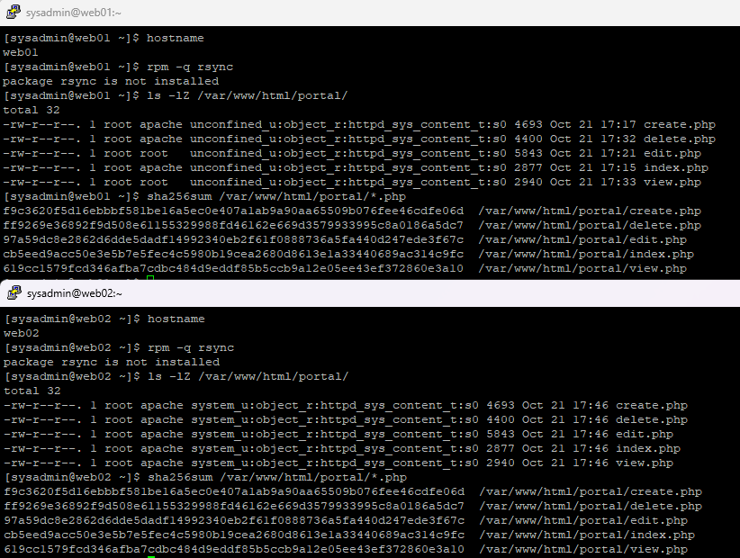

---

## 4. rsync 설치 및 버전 확인

rsync는 송신 측과 수신 측 양쪽에 모두 설치되어 있어야 하므로 WEB01과 WEB02 모두에 설치했다.

```bash
sudo dnf install -y rsync
```

설치 후 패키지와 버전을 확인했다.

```bash
rpm -q rsync
rsync --version | head -n 1
```

실제 확인 결과:

```text
rsync-3.2.7-1.el9_8.x86_64
rsync  version 3.2.7  protocol version 31
```

WEB01과 WEB02 모두 rsync 3.2.7이 정상적으로 설치되었다.

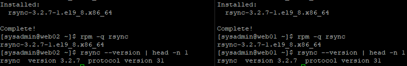

---

## 5. 기존 포털 파일의 체크섬 기반 Dry Run

### 5.1 실행 명령어

WEB01에서 실행했다.

```bash
rsync -rcni --stats -e ssh \
  /var/www/html/portal/ \
  sysadmin@192.168.100.22:/var/www/html/portal/
```

명령어 구조:

```text
rsync [옵션] [원본 경로] [대상 경로]
```

이번 명령어의 원본은 WEB01이고 대상은 WEB02이다.

### 5.2 주요 옵션

| 옵션 | 의미 |
|---|---|
| `-r` | 하위 디렉터리까지 재귀적으로 처리 |
| `-c` | 체크섬 기반 파일 내용 비교 |
| `-n` | Dry Run, 실제 파일 변경 없음 |
| `-i` | 변경 대상 및 변경 유형 표시 |
| `--stats` | 비교 및 전송 통계 출력 |
| `-e ssh` | SSH를 이용한 원격 연결 |

일반적인 rsync는 파일 크기와 수정 시각을 기준으로 변경 여부를 판단한다.

이번에는 두 서버의 파일 내용이 동일하지만 수정 시각이 달랐으므로 `-c` 옵션으로 내용을 비교했다. `-c`를 사용하지 않으면 수정 시각 차이만으로 "변경됨"으로 판단될 수 있다.

### 5.3 실행 결과

```text
Number of files: 6 (reg: 5, dir: 1)
Number of created files: 0
Number of deleted files: 0
Number of regular files transferred: 0
Total file size: 20,753 bytes
Total transferred file size: 0 bytes
```

PHP 파일 5개 모두 체크섬 기준으로 동일하여 전송할 파일이 없음을 확인했다.

`-n` 옵션을 사용했으므로 실제 포털 파일에는 변경이 발생하지 않았다.

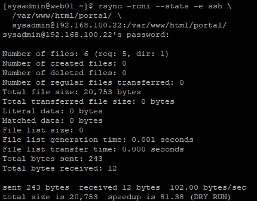

---

## 6. 테스트용 rsync 동기화 환경 구성

실제 웹 서비스 파일을 수정하지 않고 rsync 동작을 검증하기 위해 별도의 테스트 디렉터리를 준비했다.

### 6.1 WEB01 테스트 원본 생성

WEB01에서 실행했다.

```bash
mkdir -p ~/rsync-lab/source
cp /var/www/html/portal/*.php ~/rsync-lab/source/
ls -lh ~/rsync-lab/source/
```

### 6.2 WEB02 테스트 대상 생성

WEB02에서 실행했다.

```bash
mkdir -p ~/rsync-lab/dest
ls -la ~/rsync-lab/dest/
```

최초 동기화 전 WEB02의 대상 디렉터리는 비어 있었다.

### 6.3 최초 동기화 Dry Run

WEB01에서 실행했다.

```bash
rsync -avhni --stats -e ssh \
  ~/rsync-lab/source/ \
  sysadmin@192.168.100.22:/home/sysadmin/rsync-lab/dest/
```

주요 옵션:

| 옵션 | 의미 |
|---|---|
| `-a` | Archive 모드, 주요 파일 속성 유지 |
| `-v` | 상세 출력 |
| `-h` | 읽기 쉬운 크기 단위로 출력 |
| `-n` | 실제 전송 없이 미리 확인 |
| `-i` | 변경 내역 표시 |

실제 출력:

```text
<f+++++++++ create.php
<f+++++++++ delete.php
<f+++++++++ edit.php
<f+++++++++ index.php
<f+++++++++ view.php

Number of created files: 5 (reg: 5)
Number of regular files transferred: 5
Total transferred file size: 20.75K bytes
```

`-i` 옵션의 출력 형식은 다음과 같이 해석한다.

| 표시 | 의미 |
|---|---|
| `<` | 로컬(원본)에서 원격(대상)으로 전송 |
| `f` | 일반 파일 |
| `+++++++++` | 대상에 새로 생성되는 파일 |

WEB02의 대상 디렉터리가 비어 있었기 때문에 PHP 파일 5개 모두 생성 예정으로 표시되었다.

이 단계에서는 Dry Run만 수행했으므로 실제 파일은 전송되지 않았다.

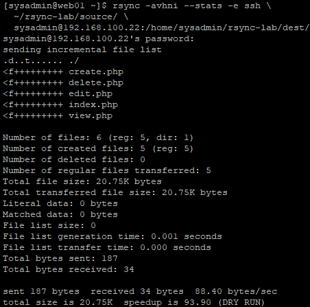

---

## 7. 최초 rsync 동기화 및 무결성 검증

### 7.1 실제 파일 동기화

WEB01에서 Dry Run 옵션인 `-n`을 제거하여 실행했다.

```bash
rsync -avhi --stats -e ssh \
  ~/rsync-lab/source/ \
  sysadmin@192.168.100.22:/home/sysadmin/rsync-lab/dest/
```

실제 결과:

```text
Number of created files: 5 (reg: 5)
Number of regular files transferred: 5
Total transferred file size: 20.75K bytes
Literal data: 20.75K bytes
```

WEB01의 PHP 파일 5개가 WEB02의 테스트 디렉터리로 정상 전송되었다.

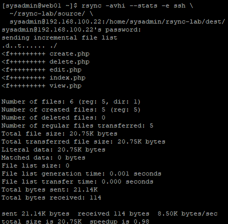

### 7.2 WEB02 파일 및 SHA256 검증

WEB02에서 실행했다.

```bash
ls -lh ~/rsync-lab/dest/
sha256sum ~/rsync-lab/dest/*.php
```

검증 결과:

- PHP 파일 5개 생성 확인
- WEB01 원본과 WEB02 대상의 SHA256 해시 일치
- 파일 내용의 무결성 확인

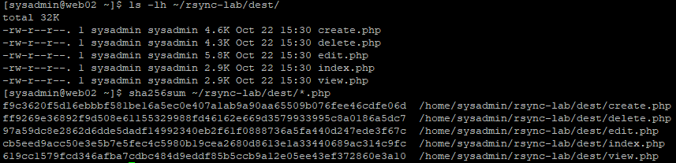

### 7.3 재실행 시 변경 사항 확인

WEB01에서 같은 파일을 대상으로 다시 Dry Run을 실행했다.

```bash
rsync -avhni --stats -e ssh \
  ~/rsync-lab/source/ \
  sysadmin@192.168.100.22:/home/sysadmin/rsync-lab/dest/
```

실제 결과:

```text
Number of created files: 0
Number of regular files transferred: 0
Total transferred file size: 0 bytes
```

최초 전송 이후 변경된 파일이 없으므로 추가 전송 대상이 없었다.

이를 통해 이미 동기화된 파일은 변경 사항이 없으면 다시 전송되지 않는 것을 확인했다.

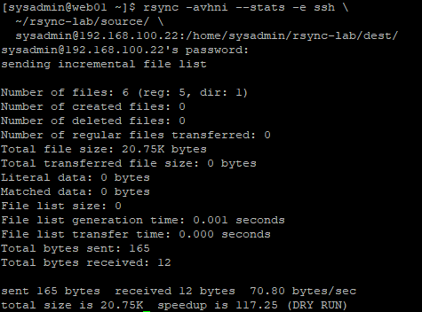

---

## 8. 변경된 파일만 전송하는 증분 동기화

### 8.1 테스트용 index.php 수정

WEB01의 테스트 디렉터리에 있는 `index.php` 끝에 줄바꿈 문자를 추가했다.

```bash
printf '\n' >> ~/rsync-lab/source/index.php
```

실제 웹 서비스 파일인 `/var/www/html/portal/index.php`는 수정하지 않았다.

### 8.2 변경 파일 Dry Run

WEB01에서 실행했다.

```bash
rsync -avn ~/rsync-lab/source/ sysadmin@192.168.100.22:rsync-lab/dest/
```

원격 경로를 `rsync-lab/dest/`처럼 상대 경로로 지정하면 SSH 로그인 계정(`sysadmin`)의 홈 디렉터리 기준으로 해석된다. 따라서 앞에서 사용한 `/home/sysadmin/rsync-lab/dest/`와 같은 위치를 가리킨다.

실제 결과:

```text
sending incremental file list
index.php

total size is 20,754
(DRY RUN)
```

기존 전체 파일 크기 `20,753 bytes`에서 `1 byte`가 증가했다.

PHP 파일 5개 중 변경된 `index.php`만 전송 대상으로 표시되었다.

이 단계 역시 Dry Run이므로 실제로는 전송되지 않았다.

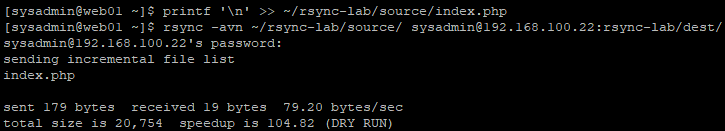

### 8.3 실제 증분 동기화 검증

실제 전송 검증을 위해 WEB01의 테스트용 `index.php`에 주석을 한 줄 더 추가했다.

```bash
echo '// rsync incremental test' >> ~/rsync-lab/source/index.php
```

> 이 줄은 `index.php` 끝에 그대로 덧붙였기 때문에 PHP 파일 끝의 `?>` 뒤에 위치하면 주석이 아니라 화면 출력 텍스트로 처리될 수 있다. 테스트 디렉터리에서만 사용한 파일이므로 문제가 없지만, 운영 포털에는 반영하면 안 되는 파일이다.

Dry Run으로 변경 파일을 다시 확인했다.

```bash
rsync -avn ~/rsync-lab/source/ sysadmin@192.168.100.22:rsync-lab/dest/
```

이후 실제 동기화를 실행했다. 8.1의 줄바꿈과 8.3의 주석 추가가 모두 이 전송에 함께 반영되었다.

```bash
rsync -av ~/rsync-lab/source/ sysadmin@192.168.100.22:rsync-lab/dest/
```

실제 결과:

```text
sending incremental file list
index.php

total size is 20,780
```

전체 PHP 파일 5개 중 `index.php`만 전송 대상으로 표시되었다.

나머지 4개 파일은 변경 사항이 없어 다시 전송되지 않았다.

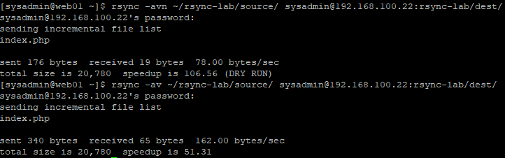

### 8.4 SHA256 해시 검증

WEB01에서 실행했다.

```bash
sha256sum ~/rsync-lab/source/index.php
```

WEB02에서 실행했다.

```bash
sha256sum ~/rsync-lab/dest/index.php
```

두 서버의 `index.php` SHA256 해시가 동일함을 확인했다.

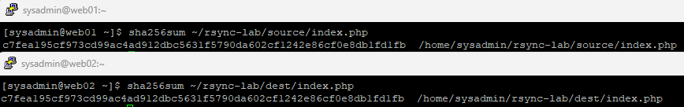

### 8.5 최종 Dry Run

WEB01에서 다시 실행했다.

```bash
rsync -avn ~/rsync-lab/source/ sysadmin@192.168.100.22:rsync-lab/dest/
```

실제 결과:

```text
sending incremental file list

total size is 20,780
(DRY RUN)
```

변경된 파일명이 출력되지 않았다.

따라서 WEB01과 WEB02의 테스트 파일이 최종적으로 동기화된 것을 확인했다.

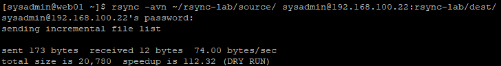

---

## 9. 테스트 파일과 실제 웹 서비스 파일의 권한 비교

WEB02에서 테스트 디렉터리와 실제 포털 디렉터리를 비교했다.

```bash
ls -lZ ~/rsync-lab/dest/
ls -lZ /var/www/html/portal/
getenforce
```

확인 결과:

| 항목 | 테스트 디렉터리 | 실제 포털 디렉터리 |
|---|---|---|
| 소유자 | `sysadmin` | `root` |
| 그룹 | `sysadmin` | `apache` |
| 파일 권한 | `644` | `644` |
| SELinux 유형 | `user_home_t` | `httpd_sys_content_t` |

SELinux 상태:

```text
Enforcing
```

rsync로 파일을 정상 전송하더라도, 실제 웹 서버에서 해당 파일을 제공하기 위해서는 소유권·권한·SELinux 컨텍스트를 함께 검토해야 한다.

일반 계정으로 전송한 파일은 소유자가 해당 계정이 되고, 홈 디렉터리 아래에서는 `user_home_t` 컨텍스트가 적용된다. 이 상태의 파일을 `/var/www/html/` 아래로 단순 복사·이동하면 컨텍스트 문제로 Apache가 접근하지 못할 수 있다.

특히 테스트용 `index.php`에는 증분 동기화 검증을 위한 내용이 추가되어 있었으므로 운영 중인 포털에 그대로 반영하지 않았다.

---

## 10. 실제 포털 원본을 이용한 스테이징 배포

실제 배포 상황을 가정하여 WEB01의 정상 포털 파일을 WEB02의 스테이징 디렉터리로 전송했다.

### 10.1 WEB02 스테이징 디렉터리 준비

WEB02에서 실행했다.

```bash
mkdir -p ~/portal-deploy-stage
```

### 10.2 WEB01 배포 전 Dry Run

WEB01에서 실행했다.

```bash
rsync -avn /var/www/html/portal/ sysadmin@192.168.100.22:portal-deploy-stage/
```

실제 결과:

```text
sending incremental file list
./
create.php
delete.php
edit.php
index.php
view.php

total size is 20,753
(DRY RUN)
```

PHP 파일 5개가 전송 대상으로 확인되었다.

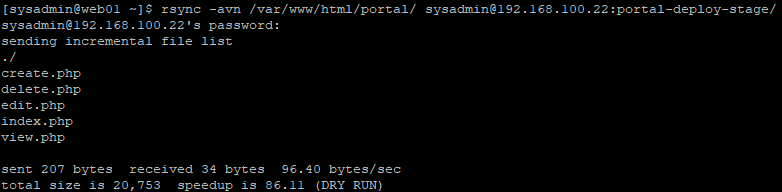

### 10.3 실제 스테이징 파일 전송

WEB01에서 실행했다.

```bash
rsync -av /var/www/html/portal/ sysadmin@192.168.100.22:portal-deploy-stage/
```

WEB02에서 전송 결과를 확인했다.

```bash
ls -l ~/portal-deploy-stage/
sha256sum ~/portal-deploy-stage/*.php
```

WEB01에서도 원본 파일의 해시값을 확인했다.

```bash
sha256sum /var/www/html/portal/*.php
```

검증 결과:

- WEB01 → WEB02 PHP 파일 5개 전송 성공
- 전체 파일 크기 `20,753 bytes`
- WEB01 원본과 WEB02 스테이징 파일의 SHA256 해시 모두 일치
- 실제 웹 서비스 디렉터리는 변경하지 않음

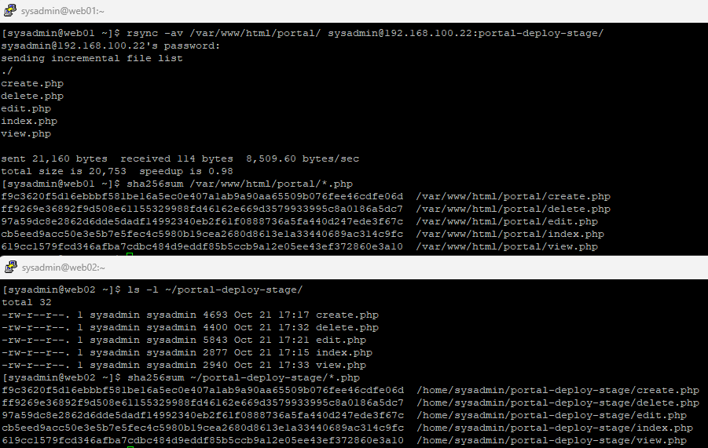

---

## 11. WEB02 기존 포털 백업 및 보안 설정

실제 운영 파일 변경 가능성에 대비해 WEB02의 기존 포털을 백업했다.

### 11.1 기존 포털 백업

WEB02에서 실행했다.

```bash
sudo cp -a /var/www/html/portal /var/www/html/portal.bak-ch12
```

`cp -a`를 사용하여 디렉터리와 주요 파일 속성을 유지한 상태로 백업했다.

> 이번 실습에서는 백업을 먼저 웹 서비스 영역(`/var/www/html/`) 아래에 만든 뒤 이동했다. 이 방식은 이동 전까지 `portal.bak-ch12` 경로가 Apache를 통해 노출될 수 있다. 다음에는 처음부터 `/var/backups/` 아래에 백업을 생성하는 방식이 더 안전하다. (15.5 참고)

### 11.2 웹 서비스 영역 밖으로 백업 이동

백업 파일이 Apache의 웹 서비스 영역 아래에 남지 않도록 `/var/backups/`로 이동했다.

```bash
sudo mkdir -p /var/backups/portal-ch12
sudo chmod 700 /var/backups/portal-ch12

sudo mv /var/www/html/portal.bak-ch12 \
  /var/backups/portal-ch12/portal

sudo chmod -R go-rwx /var/backups/portal-ch12/portal
sudo restorecon -RFv /var/backups/portal-ch12/portal
```

이 과정은 백업본을 대상으로 수행했으며, 실제 운영 디렉터리인 `/var/www/html/portal/`은 변경하지 않았다.

### 11.3 백업 접근 권한 확인

WEB02에서 실행했다.

```bash
sudo ls -ld /var/backups/portal-ch12/portal
sudo ls -lZ /var/backups/portal-ch12/portal/
ls -ld /var/www/html/portal.bak-ch12
```

실제 확인 결과:

```text
drwx------. 2 root apache ... /var/backups/portal-ch12/portal
```

PHP 파일 권한:

```text
-rw-------. 1 root apache ... create.php
-rw-------. 1 root apache ... delete.php
-rw-------. 1 root apache ... edit.php
-rw-------. 1 root apache ... index.php
-rw-------. 1 root apache ... view.php
```

SELinux 유형:

```text
system_u:object_r:var_t:s0
```

웹 서비스 영역의 기존 백업 디렉터리는 더 이상 존재하지 않았다.

```text
ls: cannot access '/var/www/html/portal.bak-ch12': No such file or directory
```

최종 확인 결과:

| 검증 항목 | 결과 |
|---|---|
| 백업 위치 | `/var/backups/portal-ch12/portal/` |
| 백업 디렉터리 권한 | `700` |
| PHP 파일 권한 | `600` |
| 파일 소유자 | `root` |
| SELinux 유형 | `var_t` |
| 웹 서비스 영역의 백업 잔존 여부 | 없음 |

백업 파일을 웹 서비스 영역과 분리하고 접근 권한을 제한했다.

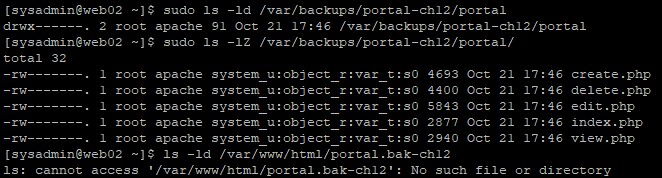

---

## 12. 스테이징 파일과 실제 포털 파일 비교

WEB02에서 스테이징 파일과 기존 서비스 파일을 비교했다.

```bash
sudo diff -qr \
  /home/sysadmin/portal-deploy-stage/ \
  /var/www/html/portal/

echo "diff exit code: $?"
```

주요 옵션:

| 옵션 | 의미 |
|---|---|
| `-q` | 파일 내용 차이를 간단히 표시 |
| `-r` | 하위 디렉터리까지 재귀 비교 |

종료 코드:

| 코드 | 의미 |
|---|---|
| `0` | 차이 없음 |
| `1` | 차이 존재 |
| `2` | 비교 중 오류 발생 |

실제 결과:

```text
diff exit code: 0
```

WEB02의 스테이징 파일과 실제 포털 파일의 파일 목록과 내용이 동일함을 확인했다. (`diff`는 소유자·권한·SELinux 컨텍스트 같은 메타데이터는 비교하지 않는다.)

이에 따라 운영 중인 PHP 파일을 다시 덮어쓰지 않았다.

**이번 실습에서 실제 수행한 배포 작업은 스테이징 디렉터리까지의 파일 전송이다. 운영 경로에 새로운 변경 파일을 반영하는 작업은 수행하지 않았다.**

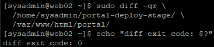

---

## 13. 파일 권한 및 SELinux 최종 확인

WEB02의 실제 포털 파일 상태를 다시 점검했다.

```bash
ls -lZ /var/www/html/portal/
```

실제 확인 결과:

```text
-rw-r--r--. 1 root apache ... httpd_sys_content_t ... create.php
-rw-r--r--. 1 root apache ... httpd_sys_content_t ... delete.php
-rw-r--r--. 1 root apache ... httpd_sys_content_t ... edit.php
-rw-r--r--. 1 root apache ... httpd_sys_content_t ... index.php
-rw-r--r--. 1 root apache ... httpd_sys_content_t ... view.php
```

최종 파일 상태:

- 소유자: `root`
- 그룹: `apache`
- 파일 권한: `644`
- SELinux 유형: `httpd_sys_content_t`

스테이징 디렉터리는 일반 사용자 계정으로 파일을 전송하는 공간이고, 실제 웹 디렉터리는 Apache가 서비스하는 공간이므로 서로 다른 소유권과 SELinux 설정을 사용했다.

---

## 14. WEB02 및 HAProxy 경유 HTTP 검증

파일 비교 및 권한 점검 후 웹 서비스 정상 동작을 확인했다.

### 14.1 WEB02 포털 메인 페이지

```bash
curl -s -o /dev/null \
  -w 'WEB02 Portal: %{http_code}\n' \
  http://192.168.100.22/portal/index.php
```

실제 결과:

```text
WEB02 Portal: 200
```

### 14.2 WEB02 공지사항 상세 페이지

```bash
curl -s -o /dev/null \
  -w 'WEB02 Notice: %{http_code}\n' \
  'http://192.168.100.22/portal/view.php?id=1'
```

실제 결과:

```text
WEB02 Notice: 200
```

기존 공지사항 상세 조회 페이지가 정상적으로 응답함을 확인했다.

### 14.3 HAProxy 경유 포털 접속

```bash
curl -s -o /dev/null \
  -w 'HAProxy Portal: %{http_code}\n' \
  http://192.168.100.10/portal/index.php
```

실제 결과:

```text
HAProxy Portal: 200
```

### 14.4 최종 HTTP 응답

```text
WEB02 Portal: 200
WEB02 Notice: 200
HAProxy Portal: 200
```

WEB02 직접 접속과 HAProxy를 통한 포털 접속이 모두 정상적으로 응답했다.

이번 검증은 HTTP 정상 응답 확인을 대상으로 했으며, 장애 전환이나 PHP 세션 복구를 새로 시험한 것은 아니다.

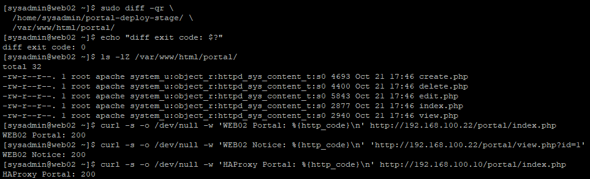

---

## 15. 운영 환경에서 고려할 사항

### 15.1 배포 전 Dry Run

실제 파일을 변경하기 전에 Dry Run으로 전송 대상을 확인해야 한다.

```bash
rsync -avn /source/ user@server:/destination/
```

파일 전송 전에 원본 경로, 대상 서버, 변경 파일 목록을 검토하여 예상하지 못한 변경을 방지할 수 있다.

### 15.2 경로 끝의 `/` 와 `--delete` 옵션 주의

원본 경로 끝에 `/`가 있으면 디렉터리 **내용물**이, 없으면 디렉터리 **자체**가 대상에 복사된다.

```text
rsync -av /var/www/html/portal/ dest/   → dest/create.php ...
rsync -av /var/www/html/portal  dest/   → dest/portal/create.php ...
```

`--delete` 옵션은 대상 디렉터리에만 존재하는 파일을 삭제할 수 있다.

원본이나 대상 경로를 잘못 지정하면 필요한 파일이 삭제될 위험이 있으므로, 반드시 `-n`으로 먼저 확인한 뒤 신중하게 사용해야 한다.

이번 실습에서는 `--delete`를 사용하지 않았다.

### 15.3 민감 정보 동기화 제외

PHP 파일을 전송하더라도 DB 접속 비밀번호나 서버별 설정 파일까지 무조건 함께 복사해서는 안 된다.

이번 실습에서는 `/var/www/html/portal/`만 동기화하여 `/var/www/private/db-config.php`를 대상에서 제외했다.

디렉터리 안에 제외해야 할 파일이 섞여 있다면 `--exclude` 옵션으로 명시적으로 제외할 수 있다.

```bash
rsync -av --exclude='*.bak' --exclude='db-config.php' /src/ user@server:/dest/
```

### 15.4 파일 권한 및 SELinux 관리

원격 서버에 파일을 전송한 뒤에는 파일 소유권, 그룹, 권한, SELinux 컨텍스트를 확인해야 한다.

```bash
ls -lZ /var/www/html/portal/
getenforce
```

실제 운영 경로에 변경 파일을 반영할 경우에는 해당 서비스에 맞는 권한과 SELinux 컨텍스트를 적용하는 별도의 배포 절차가 필요하다.

### 15.5 스테이징 및 백업 활용

운영 파일을 직접 수정하기보다 별도 스테이징 디렉터리에서 배포 후보를 검증하는 것이 안전하다.

실제 변경 작업 전에는 기존 파일을 백업하고, 백업본은 외부에 노출되지 않는 위치에 보관해야 한다.

이번 실습처럼 웹 서비스 영역에 백업을 만든 뒤 옮기는 방식보다, 처음부터 웹 서비스 영역 밖에 생성하는 방식이 더 안전하다.

```bash
sudo mkdir -p /var/backups/portal-ch12
sudo chmod 700 /var/backups/portal-ch12
sudo cp -a /var/www/html/portal /var/backups/portal-ch12/portal
sudo chmod -R go-rwx /var/backups/portal-ch12/portal
sudo restorecon -RFv /var/backups/portal-ch12/portal
```

### 15.6 불필요한 재배포 방지

배포 후보와 운영 파일이 동일한 경우에는 굳이 운영 파일을 덮어쓸 필요가 없다.

이번 실습에서는 `diff -qr`의 종료 코드가 `0`임을 확인하고 운영 파일을 유지했다.

### 15.7 SSH 접근 보안

rsync는 SSH를 통해 원격 파일을 전송할 수 있다.

운영 환경에서는 SSH 호스트 키 확인, 계정별 권한 제한, 적절한 인증 방식(키 기반 인증 등), 접근 통제 등을 함께 고려해야 한다.

### 15.8 실습 파일 정리

실습에 사용한 테스트 디렉터리(`~/rsync-lab/`)에는 검증용으로 수정한 `index.php`가 남아 있고, 스테이징 디렉터리에는 포털 소스 사본이 남아 있다.

실습이 끝나면 더 이상 필요하지 않은 파일은 정리하는 것이 좋다.

---

## 16. 실습 최종 검증 결과

| 항목 | 검증 내용 | 결과 |
|---|---|---|
| rsync 설치 | WEB01·WEB02 rsync 3.2.7 | 성공 |
| 기존 파일 비교 | PHP 파일 5개 SHA256 일치 | 성공 |
| 최초 Dry Run | 신규 생성 예정 파일 5개 | 성공 |
| 최초 실제 동기화 | PHP 파일 5개 전송 | 성공 |
| 최초 무결성 검증 | 전송 후 SHA256 일치 | 성공 |
| 재실행 검증 | 변경 파일 0개 | 성공 |
| 증분 Dry Run | `index.php` 1개 감지 | 성공 |
| 증분 실제 동기화 | `index.php`만 전송 | 성공 |
| 증분 무결성 검증 | WEB01·WEB02 SHA256 일치 | 성공 |
| 스테이징 배포 | 실제 포털 원본 5개 전송 | 성공 |
| 백업 보호 | `/var/backups` 이동 및 접근 권한 적용 | 성공 |
| 운영 파일 비교 | `diff exit code: 0` | 성공 |
| 운영 파일 권한 | `root:apache`, `644` | 정상 |
| 운영 SELinux 유형 | `httpd_sys_content_t` | 정상 |
| WEB02 포털 메인 | HTTP 200 | 성공 |
| WEB02 공지사항 상세 | HTTP 200 | 성공 |
| HAProxy 경유 포털 | HTTP 200 | 성공 |

### 최종 결과

rsync를 사용하여 WEB01과 WEB02 사이의 최초 파일 동기화 및 증분 동기화 동작을 검증했다.

PHP 파일 5개를 전송한 뒤 변경된 파일 1개만 재전송되는 것을 확인했으며, SHA256 해시 비교로 파일 무결성을 검증했다.

실제 포털 원본 파일을 별도의 스테이징 디렉터리로 전송하고, 기존 포털 백업과 접근 권한 보호 작업도 수행했다.

스테이징 파일과 운영 파일이 동일함을 확인한 후 불필요한 운영 파일 변경을 생략했으며, 최종적으로 WEB02 및 HAProxy 경유 HTTP 200 응답을 확인했다.

이번 단원에서 검증한 범위는 **rsync 기반 파일 동기화, 스테이징 배포 준비, 안전한 변경 전 검증**이다.

자동 배포 시스템이나 무중단 배포, 새로운 애플리케이션 변경 사항의 운영 반영까지 구현한 것은 아니다.

---

## 17. 배운 점

### 17.1 scp와 rsync의 차이

11단원에서는 `scp`를 통해 PHP 파일을 WEB02에 복사했다.

이번 단원에서는 rsync가 변경된 파일을 선택적으로 동기화할 수 있다는 특징을 확인했다.

특히 PHP 파일 5개 중 `index.php` 하나만 수정한 뒤, 해당 파일만 전송되는 과정을 직접 검증했다.

### 17.2 Dry Run을 통한 사전 검증

`-n` 옵션을 사용하면 실제 파일을 변경하지 않고 전송 대상을 미리 확인할 수 있다.

운영 환경에서는 변경 작업을 바로 실행하기보다 작업 대상과 영향을 먼저 확인하는 절차가 중요하다는 점을 배웠다.

### 17.3 파일 전송과 서비스 검증의 차이

rsync로 파일을 정상 전송했다고 해서 서비스 검증까지 완료된 것은 아니다.

파일 소유권, 접근 권한, SELinux 컨텍스트와 실제 HTTP 응답까지 확인해야 한다.

### 17.4 백업과 스테이징의 필요성

운영 파일을 변경하기 전에 백업을 확보하고, 스테이징 디렉터리에서 배포 후보를 먼저 검증하는 절차를 학습했다.

또한 백업 파일을 웹 서비스 영역 밖으로 이동하고 접근 권한을 제한하는 이유를 이해했다.

### 17.5 불필요한 변경을 줄이는 운영 판단

이번 실습에서는 스테이징 파일과 실제 운영 파일이 동일하다는 결과를 확인했다.

따라서 운영 파일을 무조건 덮어쓰는 대신 변경이 필요하지 않다고 판단했다.

시스템 엔지니어는 단순히 명령어를 실행하는 것뿐 아니라 서비스 안정성을 고려해 변경 여부를 결정해야 한다는 점을 배웠다.

---

## 18. 관련 문서

- [11단원 — PHP + MariaDB 기반 사내 업무 포털 CRUD 구현 및 HAProxy 통합 검증](./11-php-portal-crud.md)
- [프로젝트 메인 README](../README.md)

---

## 19. 다음 실습

**13단원: NAS01 서버 구축 및 네트워크 구성**

기존 [프로젝트 계획](../README.md#phase-4-raid--lvm--nfs-스토리지)에 따라 NAS01 서버를 구축하고 네트워크 구성을 검증할 예정이다.
