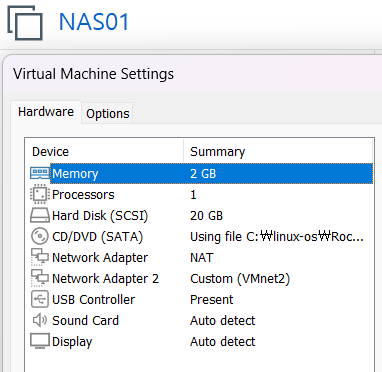
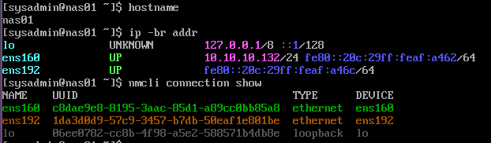
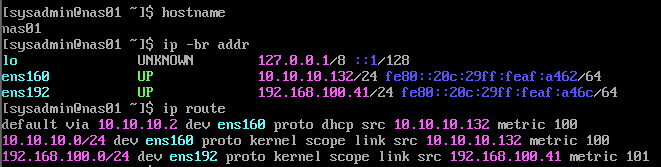
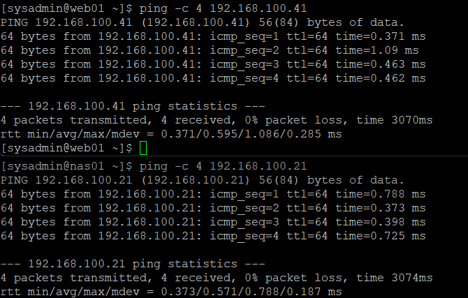
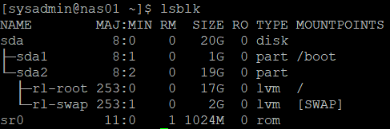
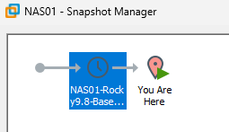

# 13. NAS01 서버 구축 및 네트워크 구성

## 1. 실습 개요

### 실습 목적

기존 Rocky Linux 인프라에 RAID, LVM, NFS 공유 스토리지를 위한 NAS01 서버를 추가하였다.

기존 서버와 동일한 VMware 네트워크 구조를 적용하고, 서버 간 통신을 검증하였다.

주요 실습 내용:

- NAS01 가상머신 생성 및 Rocky Linux 9.8 설치
- NAT / Host-only 네트워크 구성 및 고정 IP 설정
- WEB01 ↔ NAS01 양방향 통신 검증
- SSH 서비스 및 firewalld 상태 확인
- OS 디스크와 기본 LVM 구성 확인
- RAID 구성 전 VMware 기준 스냅샷 생성

관련 문서:

- [01단원 — VMware 가상 네트워크 구축](./01-network.md)
- [02단원 — WEB01 서버 구축 및 검증](./02-web01.md)
- [04단원 — LB01 서버 구축 및 검증](./04-lb01.md)

---

## 2. NAS01 서버 구성

### 2.1 가상머신 사양

| 항목 | 구성 |
|---|---|
| 가상화 | VMware Workstation |
| 운영체제 | Rocky Linux 9.8 |
| 호스트명 | `nas01` |
| CPU | 1 Processor |
| 메모리 | 2GB |
| OS 디스크 | 20GB (SCSI) |
| Network Adapter 1 | NAT (VMnet8) |
| Network Adapter 2 | Host-only (VMnet2) |
| 관리 계정 | `sysadmin` |



### 2.2 네트워크 구성

| 인터페이스 | 역할 | 주소 |
|---|---|---|
| `ens160` | NAT / 외부 통신 | `10.10.10.132/24` |
| `ens192` | Host-only / 내부 통신 | `192.168.100.41/24` |

NAS01은 기존 내부 네트워크 `192.168.100.0/24`에 연결되며, 향후 WEB01/WEB02의 NFS 서버로 사용할 예정이다.

---

## 3. 초기 네트워크 확인 및 고정 IP 설정

### 3.1 설치 직후 네트워크 상태

Rocky Linux 설치 후 NAS01에서 실행하였다.

```bash
hostname
ip -br addr
nmcli connection show
```

결과:

```text
nas01

ens160    UP    10.10.10.132/24
ens192    UP
```

- `ens160`: NAT 인터페이스, DHCP로 IPv4 주소 할당
- `ens192`: Host-only 인터페이스, 초기 IPv4 주소 미설정



### 3.2 Host-only 고정 IP 설정

NAS01의 내부 고정 IP를 `192.168.100.41/24`로 구성하였다.

해당 구성을 적용하는 NetworkManager 명령어:

```bash
sudo nmcli connection modify ens192 \
  ipv4.method manual \
  ipv4.addresses 192.168.100.41/24 \
  ipv4.never-default yes

sudo nmcli connection up ens192
```

Host-only 인터페이스는 기본 게이트웨이로 사용하지 않고, 외부 통신 경로는 기존 NAT 인터페이스에서 유지하도록 구성하였다.

### 3.3 IP 및 라우팅 검증

```bash
hostname
ip -br addr
ip route
```

실제 확인 결과:

```text
nas01

ens160    UP    10.10.10.132/24
ens192    UP    192.168.100.41/24
```

라우팅 테이블:

```text
default via 10.10.10.2 dev ens160 proto dhcp src 10.10.10.132 metric 100
10.10.10.0/24 dev ens160 proto kernel scope link src 10.10.10.132 metric 100
192.168.100.0/24 dev ens192 proto kernel scope link src 192.168.100.41 metric 101
```

검증 결과:

- NAT IP 정상 할당
- Host-only 고정 IP `192.168.100.41/24` 정상 적용
- 기본 게이트웨이 `10.10.10.2`가 `ens160`에 설정됨
- 내부 네트워크 경로가 `ens192`에 설정됨



---

## 4. WEB01 ↔ NAS01 네트워크 통신 검증

NAS01과 기존 WEB01 사이의 Host-only 네트워크 연결을 확인하였다.

### 4.1 WEB01 → NAS01

WEB01에서 실행:

```bash
ping -c 4 192.168.100.41
```

실제 결과:

```text
4 packets transmitted, 4 received, 0% packet loss
```

### 4.2 NAS01 → WEB01

NAS01에서 실행:

```bash
ping -c 4 192.168.100.21
```

실제 결과:

```text
4 packets transmitted, 4 received, 0% packet loss
```

### 4.3 검증 결과

| 출발지 | 목적지 | 결과 |
|---|---|---|
| WEB01 `192.168.100.21` | NAS01 `192.168.100.41` | 성공 |
| NAS01 `192.168.100.41` | WEB01 `192.168.100.21` | 성공 |

양방향 모두 패킷 손실률 `0%`를 확인하였다.



이를 통해 향후 WEB01과 NAS01 간 NFS 연동을 위한 기본 IP 네트워크 연결을 확인하였다.

---

## 5. SSH 서비스 및 방화벽 상태 확인

### 5.1 SSH 서비스 확인

NAS01에서 실행:

```bash
systemctl is-active sshd
systemctl is-enabled sshd
```

결과:

```text
active
enabled
```

SSH 서비스가 실행 중이며 부팅 시 자동 시작되도록 설정된 상태이다.

### 5.2 firewalld 확인

```bash
sudo firewall-cmd --state
sudo firewall-cmd --list-services
```

실제 결과:

```text
running
cockpit dhcpv6-client ssh
```

방화벽이 실행 중이며 `ssh` 서비스가 허용되어 있음을 확인하였다.

---

## 6. OS 디스크 및 LVM 구성 확인

### 6.1 디스크 확인

NAS01에서 실행:

```bash
lsblk
```

파일시스템 종류를 포함한 확인 결과:

```text
NAME         SIZE TYPE FSTYPE      MOUNTPOINTS
sda           20G disk
├─sda1         1G part xfs         /boot
└─sda2        19G part LVM2_member
  ├─rl-root   17G lvm  xfs         /
  └─rl-swap    2G lvm  swap        [SWAP]
sr0         1024M rom
```

### 6.2 디스크 구성 분석

| 장치 | 용량 | 용도 |
|---|---|---|
| `/dev/sda` | 20GB | OS 디스크 |
| `/dev/sda1` | 1GB | `/boot`, XFS |
| `/dev/sda2` | 19GB | LVM 물리 볼륨 영역 |
| `rl-root` | 17GB | 루트 파일시스템 `/` |
| `rl-swap` | 2GB | SWAP |

Rocky Linux 설치 과정에서 OS 디스크에 LVM이 구성된 것을 확인하였다.

기존 OS 영역은 유지하며 향후 RAID 및 공유 스토리지 실습에는 별도의 디스크를 추가하여 사용한다.



### 6.3 RAID 실습을 위한 디스크 계획

14단원에서 다음 디스크를 추가할 예정이다.

| 디스크 | 용량 | 용도 |
|---|---|---|
| 기존 OS 디스크 | 20GB | Rocky Linux 운영체제 |
| 신규 데이터 디스크 1 | 10GB | RAID 1 |
| 신규 데이터 디스크 2 | 10GB | RAID 1 |

10GB 디스크 2개로 소프트웨어 RAID 1을 구성할 계획이다.

기존 OS 디스크인 `/dev/sda`는 RAID 대상에서 제외한다.

---

## 7. VMware 기준 스냅샷 생성

### 7.1 스냅샷 생성

NAS01의 기본 구성이 완료된 상태를 보존하기 위해 VMware 스냅샷을 생성하였다.

NAS01 정상 종료:

```bash
sudo shutdown -h now
```

VMware Workstation의 Snapshot Manager에서 스냅샷 생성:

```text
NAS01-Rocky9.8-Baseline
```



### 7.2 스냅샷 생성 목적

RAID 실습 이전의 정상 상태를 기준점으로 확보하였다.

- Rocky Linux 9.8 설치 완료
- 고정 IP 및 내부 네트워크 검증 완료
- SSH 및 방화벽 기본 점검 완료
- OS 디스크 구성 확인 완료
- RAID용 신규 디스크 추가 전 상태 보존

VMware 스냅샷은 실습 중 이전 상태로 복귀하기 위한 수단이며, 별도 백업을 완전히 대체하지는 않는다.

---

## 8. 실습 최종 검증 결과

| 검증 항목 | 실제 결과 | 상태 |
|---|---|---|
| NAS01 가상머신 | CPU 1개, RAM 2GB, OS 20GB | 완료 |
| Rocky Linux 9.8 설치 | 호스트명 `nas01` | 완료 |
| NAT 인터페이스 | `ens160`, `10.10.10.132/24` | 정상 |
| Host-only 인터페이스 | `ens192`, `192.168.100.41/24` | 정상 |
| 기본 게이트웨이 | `10.10.10.2` / `ens160` | 정상 |
| WEB01 → NAS01 Ping | 4/4 성공 | 정상 |
| NAS01 → WEB01 Ping | 4/4 성공 | 정상 |
| Windows → NAS01 SSH | `sysadmin` 로그인 | 정상 |
| SSH 서비스 | active / enabled | 정상 |
| firewalld | running, ssh 허용 | 정상 |
| OS 디스크 | 20GB, XFS 및 LVM | 정상 |
| VMware 스냅샷 | `NAS01-Rocky9.8-Baseline` | 완료 |

### 최종 결과

Rocky Linux 9.8 기반 NAS01 서버를 구축하고 내부 고정 IP `192.168.100.41`을 설정하였다.

기존 WEB01과의 양방향 Ping, Windows SSH 원격 접속, SSH 서비스 및 방화벽 상태를 검증하였다.

OS 디스크 구조를 확인하고 RAID 실습 전 기준 스냅샷을 생성하였다.

---

## 9. 배운 점 및 운영 시 고려사항

### 9.1 기존 인프라에 신규 서버 추가

기존 NAT/Host-only 네트워크 설계를 재사용하여 NAS01을 추가하였다.

서버 역할과 IP 할당 계획을 유지하면서 신규 서버를 기존 인프라에 연결하는 과정을 학습하였다.

### 9.2 설정 후 실제 연결 검증

고정 IP 설정 후 `ip route`로 경로를 확인하고 WEB01과 양방향 통신을 검증하였다.

이는 향후 NFS 클라이언트 연결 이전에 확인해야 하는 기본 네트워크 조건이다.

### 9.3 OS 디스크와 데이터 디스크 분리

NAS01의 OS 디스크에는 이미 LVM이 적용되어 있으므로 RAID 실습 대상과 명확히 구분해야 한다.

신규 디스크 추가 후에는 장치명을 다시 확인하여 잘못된 디스크 초기화를 방지해야 한다.

### 9.4 변경 전 기준점 확보

디스크 및 파일시스템 관련 작업에 앞서 VMware 스냅샷을 생성하였다.

향후 RAID 실습 중 복구가 필요할 경우 스냅샷의 생성 시점과 복원 범위를 고려해야 한다.

---

## 10. 다음 실습

**14단원: RAID 구성, 디스크 장애 및 복구 검증**

NAS01에 10GB 가상 디스크 2개를 추가하고 `mdadm`을 이용해 소프트웨어 RAID 1을 구성할 예정이다.

주요 예정 작업:

1. 신규 디스크 인식 및 장치명 확인
2. RAID 1 생성 및 상태 검증
3. 테스트 데이터 무결성 확인
4. 디스크 장애 재현
5. 장애 디스크 교체 및 RAID 재동기화
6. 복구 후 데이터 보존 여부 확인


