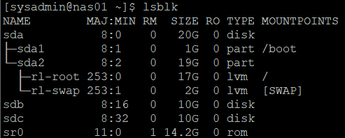
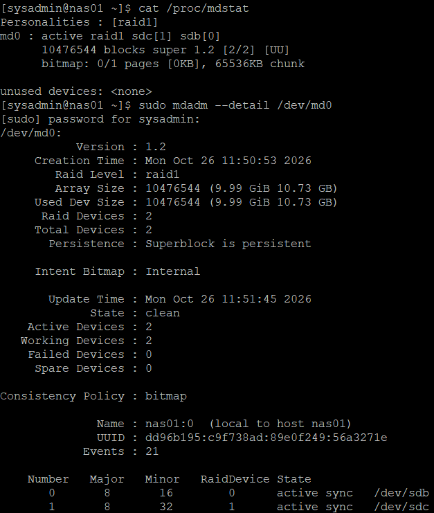
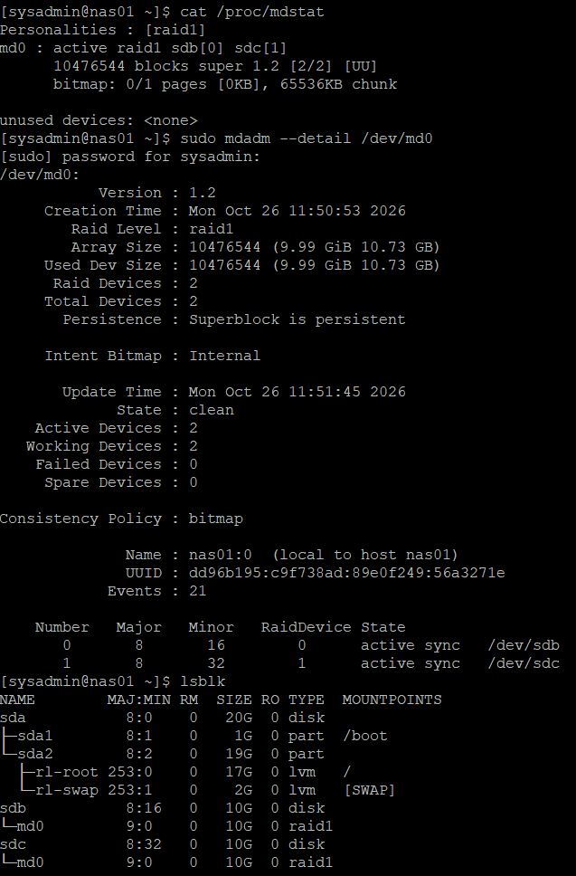
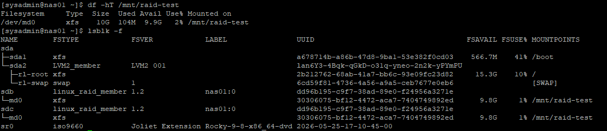
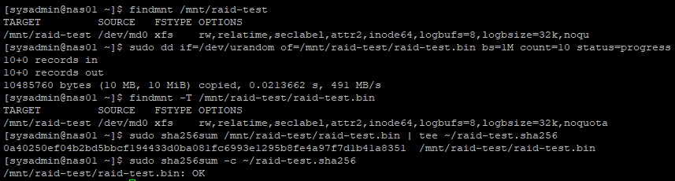
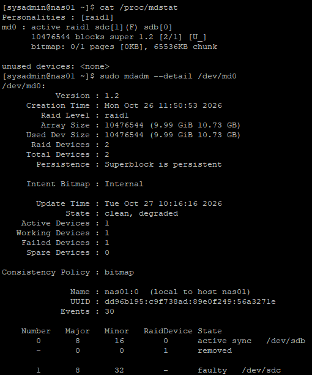
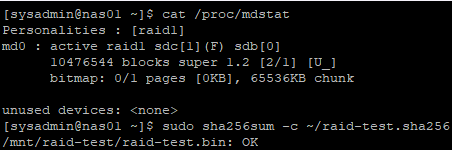
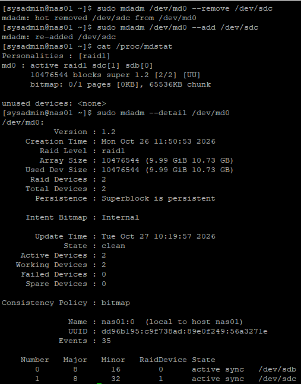
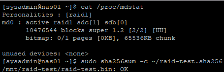

# 14. RAID 구성, 디스크 장애 및 복구 검증

## 1. 실습 개요

### 실습 목적

13단원에서 구축한 NAS01 서버에 데이터 디스크 2개를 추가하고, `mdadm`을 사용하여 RAID 1을 구성하였다.

RAID 생성 후 재부팅 시 배열이 정상적으로 인식되는지 확인하고, 데이터를 저장한 뒤 디스크 장애 및 복구 상황에서 데이터 무결성이 유지되는지 검증하였다.

주요 실습 내용:

- NAS01에 10GB 가상 디스크 2개 추가
- `mdadm` 설치 및 RAID 1 구성
- RAID 상태 및 구성 정보 확인
- `/etc/mdadm.conf` 설정 및 재부팅 후 RAID 인식 검증
- XFS 파일시스템 생성 및 마운트
- 테스트 파일 생성 및 SHA256 무결성 검증
- RAID 구성원 디스크 장애 시뮬레이션
- 장애 상태에서 데이터 무결성 검증
- 장애 디스크 제거 및 재추가
- RAID 복구 및 최종 데이터 무결성 검증

이번 실습에서는 실제 가상 디스크를 교체하지 않고, `mdadm`을 이용하여 **논리적인 디스크 장애 및 복구**를 검증하였다.

관련 문서:

- [13단원 — NAS01 서버 구축 및 네트워크 구성](./13-nas01.md)

---

## 2. 실습 환경 및 RAID 구성

### 2.1 서버 환경

| 항목 | 구성 |
|---|---|
| 가상화 | VMware Workstation |
| 운영체제 | Rocky Linux 9.8 |
| 서버 | NAS01 |
| 내부 IP | `192.168.100.41` |
| RAID 관리 도구 | `mdadm` |
| RAID Level | RAID 1 |
| RAID 장치 | `/dev/md0` |
| 파일시스템 | XFS |
| 테스트 마운트 경로 | `/mnt/raid-test` |

### 2.2 디스크 구성

| 디스크 | 용량 | 용도 |
|---|---|---|
| `/dev/sda` | 20GB | Rocky Linux OS |
| `/dev/sdb` | 10GB | RAID 1 구성원 |
| `/dev/sdc` | 10GB | RAID 1 구성원 |

기존 OS 디스크인 `/dev/sda`는 변경하지 않고, 추가한 두 데이터 디스크를 RAID 1 구성에 사용하였다.

RAID 1은 미러링 방식이므로 사용 가능 용량은 약 10GB이다.

### 2.3 신규 디스크 인식 확인

NAS01에 10GB SCSI 가상 디스크 2개를 추가한 후 확인하였다.

```bash
lsblk
```

주요 결과:

```text
NAME        SIZE TYPE MOUNTPOINTS
sda          20G disk
├─sda1        1G part /boot
└─sda2       19G part
  ├─rl-root  17G lvm  /
  └─rl-swap   2G lvm  [SWAP]
sdb          10G disk
sdc          10G disk
```

`/dev/sdb`, `/dev/sdc`가 각각 10GB 디스크로 인식된 것을 확인하였다.

```bash
lsblk -f
sudo wipefs -n /dev/sdb /dev/sdc
```

`lsblk -f`에서 두 신규 디스크에 파일시스템이 없는 것을 확인하였다.

`wipefs -n`에서도 기존 파일시스템 또는 RAID 서명이 출력되지 않아 신규 RAID 구성 대상으로 사용하였다.



---

## 3. mdadm 설치 및 RAID 1 생성

### 3.1 mdadm 설치

NAS01에서 실행:

```bash
sudo dnf install -y mdadm
```

설치 결과:

```text
Installed:
  mdadm-4.4-4.el9_8.2.x86_64

Complete!
```

버전 확인:

```bash
mdadm --version
```

결과:

```text
mdadm - v4.4 - 2024-11-07 - 4
```

### 3.2 RAID 1 생성

두 신규 디스크를 이용하여 RAID 1 배열을 생성하였다.

```bash
sudo mdadm --create /dev/md0 --level=1 --raid-devices=2 /dev/sdb /dev/sdc
```

| 옵션 | 설명 |
|---|---|
| `--create /dev/md0` | RAID 배열 생성 |
| `--level=1` | RAID 1 설정 |
| `--raid-devices=2` | RAID 구성 디스크 2개 지정 |
| `/dev/sdb /dev/sdc` | RAID 구성원 디스크 |

### 3.3 RAID 생성 결과 확인

```bash
cat /proc/mdstat
sudo mdadm --detail /dev/md0
```

주요 결과:

```text
md0 : active raid1 sdc[1] sdb[0]
      10476544 blocks super 1.2 [2/2] [UU]
```

RAID 상세 정보:

```text
Raid Level : raid1
Array Size : 10476544 (9.99 GiB 10.73 GB)
Raid Devices : 2
Total Devices : 2

State : clean
Active Devices : 2
Working Devices : 2
Failed Devices : 0
Spare Devices : 0
```

구성원 상태:

```text
Number   RaidDevice State
0        0          active sync   /dev/sdb
1        1          active sync   /dev/sdc
```

`[UU]`는 두 RAID 구성원이 모두 정상적으로 동작한다는 의미이다.

`State : clean` 및 `Failed Devices : 0`을 통해 RAID 배열의 정상 상태를 확인하였다.



---

## 4. RAID 구성 정보 저장 및 재부팅 검증

### 4.1 RAID 구성 정보 확인

```bash
sudo mdadm --detail --scan
```

실제 결과:

```text
ARRAY /dev/md0 metadata=1.2 UUID=dd96b195:c9f738ad:89e0f249:56a3271e
```

### 4.2 mdadm 설정 파일 생성

최초 확인 시 `/etc/mdadm.conf` 파일이 존재하지 않아 RAID 배열 정보를 저장하였다.

```bash
sudo mdadm --detail --scan | sudo tee /etc/mdadm.conf
```

저장 결과 확인:

```bash
sudo cat /etc/mdadm.conf
```

```text
ARRAY /dev/md0 metadata=1.2 UUID=dd96b195:c9f738ad:89e0f249:56a3271e
```

설정 파일에 RAID 장치 및 UUID가 정상적으로 저장되었다.

### 4.3 재부팅 후 RAID 인식 검증

```bash
sudo reboot
```

재부팅 후 NAS01에 다시 접속하여 확인하였다.

```bash
cat /proc/mdstat
sudo mdadm --detail /dev/md0
lsblk
```

주요 결과:

```text
md0 : active raid1 sdb[0] sdc[1]
      10476544 blocks super 1.2 [2/2] [UU]
```

```text
State : clean
Active Devices : 2
Working Devices : 2
Failed Devices : 0
```

`lsblk`에서도 다음과 같이 RAID 1 배열이 표시되었다.

```text
sdb    10G disk
└─md0  10G raid1

sdc    10G disk
└─md0  10G raid1
```

재부팅 이후에도 `/dev/md0`가 정상적으로 인식되고 RAID 구성원 2개가 유지되는 것을 검증하였다.



---

## 5. XFS 파일시스템 생성 및 마운트

### 5.1 XFS 파일시스템 생성

RAID1에 데이터를 저장하기 위해 `/dev/md0`에 XFS 파일시스템을 생성하였다.

```bash
sudo mkfs.xfs /dev/md0
```


### 5.2 마운트 디렉터리 생성

```bash
sudo mkdir -p /mnt/raid-test
```

### 5.3 RAID 장치 마운트

```bash
sudo mount /dev/md0 /mnt/raid-test
```

### 5.4 파일시스템 확인

```bash
df -hT /mnt/raid-test
lsblk -f
```

결과:

```text
Filesystem  Type  Size  Used  Avail  Use%  Mounted on
/dev/md0    xfs    10G  104M  9.9G    2%  /mnt/raid-test
```

`lsblk -f`에서도 `/dev/sdb`, `/dev/sdc`가 RAID 구성원으로 표시되고, `/dev/md0`에 XFS 파일시스템이 생성된 것을 확인하였다.



---

## 6. 테스트 데이터 생성 및 무결성 검증

### 6.1 RAID 마운트 확인

테스트 데이터를 생성하기 전에 저장 위치가 RAID 장치인지 확인하였다.

```bash
findmnt /mnt/raid-test
```

확인 결과:

```text
TARGET         SOURCE   FSTYPE OPTIONS
/mnt/raid-test /dev/md0 xfs    rw,...
```

`/mnt/raid-test`의 실제 파일시스템이 `/dev/md0`임을 확인하였다.

### 6.2 테스트 파일 생성

RAID에 10MiB 크기의 임의 데이터 파일을 생성하였다.

```bash
sudo dd if=/dev/urandom of=/mnt/raid-test/raid-test.bin bs=1M count=10 status=progress
```

실제 결과:

```text
10+0 records in
10+0 records out
10485760 bytes (10 MB, 10 MiB) copied
```

주요 옵션:

| 옵션 | 의미 |
|---|---|
| `if=/dev/urandom` | 임의 데이터 입력 |
| `of=.../raid-test.bin` | 테스트 파일 저장 경로 |
| `bs=1M` | 블록당 1MiB |
| `count=10` | 10개 블록 기록 |
| `status=progress` | 진행 상황 표시 |

디스크 기록 반영:

```bash
sync
```

### 6.3 테스트 파일 저장 위치 검증

```bash
findmnt -T /mnt/raid-test/raid-test.bin
```

실제 확인 결과:

```text
TARGET         SOURCE   FSTYPE OPTIONS
/mnt/raid-test /dev/md0 xfs    rw,...
```

테스트 파일이 OS 디스크가 아닌 RAID 장치 `/dev/md0`에 저장된 것을 확인하였다.

### 6.4 SHA256 기준값 저장

장애 전 데이터 무결성을 비교하기 위해 SHA256 체크섬을 생성하였다.

```bash
sudo sha256sum /mnt/raid-test/raid-test.bin | tee ~/raid-test.sha256
```

체크섬 파일은 RAID 외부인 `sysadmin` 사용자의 홈 디렉터리에 저장하였다.

이를 통해 RAID 장애 상태에서도 기준 체크섬을 참조할 수 있도록 하였다.

### 6.5 무결성 확인

```bash
sudo sha256sum -c ~/raid-test.sha256
```

실제 결과:

```text
/mnt/raid-test/raid-test.bin: OK
```

테스트 파일의 SHA256 해시값이 저장된 기준값과 일치하는 것을 확인하였다.



---

## 7. RAID 1 디스크 장애 시뮬레이션

### 7.1 장애 대상

정상적으로 동작 중인 RAID 구성원 중 `/dev/sdc`를 장애 처리하였다.

| 디스크 | 장애 시뮬레이션 |
|---|---|
| `/dev/sdb` | 정상 유지 |
| `/dev/sdc` | 장애 처리 대상 |

### 7.2 디스크 장애 처리

```bash
sudo mdadm /dev/md0 --fail /dev/sdc
```

`--fail` 옵션을 이용하여 RAID 배열에서 `/dev/sdc`를 실패 상태로 표시하였다.

### 7.3 장애 상태 확인

```bash
cat /proc/mdstat
sudo mdadm --detail /dev/md0
```

실제 결과:

```text
md0 : active raid1 sdc[1](F) sdb[0]
      10476544 blocks super 1.2 [2/1] [U_]
```

RAID 상세 상태:

```text
State : clean, degraded
Active Devices : 1
Working Devices : 1
Failed Devices : 1
Spare Devices : 0
```

구성원 상태:

```text
RaidDevice State
0          active sync   /dev/sdb
1          removed
-          faulty        /dev/sdc
```

`[U_]`는 두 RAID 구성원 중 하나만 정상 동작하는 상태이다.

`clean, degraded`는 RAID 배열이 동작 중이지만 디스크 이중화가 상실된 상태를 의미한다.



---

## 8. 장애 상태 데이터 무결성 검증

RAID 1 구성원 하나가 장애 상태인 상황에서 데이터 접근과 무결성을 확인하였다.

### 8.1 RAID 상태 확인

```bash
cat /proc/mdstat
```

확인 결과:

```text
[2/1] [U_]
```

정상 구성원 1개만 남아 있는 상태이다.

### 8.2 SHA256 무결성 검사

```bash
sudo sha256sum -c ~/raid-test.sha256
```

실제 결과:

```text
/mnt/raid-test/raid-test.bin: OK
```

장애 전 생성한 테스트 파일의 SHA256 체크섬과 동일한 결과를 확인하였다.

이를 통해 RAID 1 구성원 하나가 실패한 상태에서도 남은 디스크를 통해 테스트 파일을 정상적으로 읽을 수 있음을 검증하였다.



---

## 9. RAID 장애 디스크 제거 및 복구

### 9.1 장애 디스크 제거

장애 처리한 `/dev/sdc`를 RAID에서 제거하였다.

```bash
sudo mdadm /dev/md0 --remove /dev/sdc
```

출력:

```text
mdadm: hot removed /dev/sdc from /dev/md0
```

제거 후 RAID에는 `/dev/sdb`만 정상 구성원으로 남았다.

이때 RAID 배열은 `[U_]` 상태를 유지하며, 제거된 구성원은 실패 디스크 목록에서 제외된다.

### 9.2 디스크 재추가

같은 가상 디스크를 다시 RAID 배열에 추가하였다.

```bash
sudo mdadm /dev/md0 --add /dev/sdc
```

출력:

```text
mdadm: added /dev/sdc
```

실제 물리 디스크 교체가 아니라, 장애 처리했던 구성원을 제거한 후 다시 추가하는 방식이다.

### 9.3 RAID 재동기화 및 복구 확인

```bash
cat /proc/mdstat
sudo mdadm --detail /dev/md0
```

실제 결과:

```text
md0 : active raid1 sdc[1] sdb[0]
      10476544 blocks super 1.2 [2/2] [UU]
```

RAID 상세 상태:

```text
State : clean
Active Devices : 2
Working Devices : 2
Failed Devices : 0
Spare Devices : 0
```

구성원 상태:

```text
RaidDevice State
0          active sync   /dev/sdb
1          active sync   /dev/sdc
```

디스크 재추가 이후 두 RAID 구성원이 정상 상태로 복구된 것을 확인하였다.

복구 과정의 중간 재동기화 진행률은 별도로 캡처하지 않았으며, 최종 `clean` 및 `[UU]` 상태를 기준으로 복구 완료를 검증하였다.



---

## 10. 복구 후 최종 데이터 무결성 검증

RAID 구성원이 모두 정상 상태로 복구된 후 테스트 파일의 무결성을 다시 검증하였다.

### 10.1 RAID 상태 확인

```bash
cat /proc/mdstat
```

결과:

```text
md0 : active raid1 sdc[1] sdb[0]
      10476544 blocks super 1.2 [2/2] [UU]
```

RAID 상태가 `[UU]`로 정상 복구된 것을 확인하였다.

### 10.2 SHA256 최종 검증

```bash
sudo sha256sum -c ~/raid-test.sha256
```

실제 결과:

```text
/mnt/raid-test/raid-test.bin: OK
```

장애 전 생성한 기준 체크섬과 복구 후 테스트 파일의 SHA256 값이 일치하였다.

따라서 이번 실습에서 구성한 RAID 1이 논리적 디스크 장애와 복구 이후에도 테스트 데이터의 무결성을 유지한 것을 확인하였다.



---

## 11. 실습 최종 검증 결과

| 검증 항목 | 실제 결과 | 상태 |
|---|---|---|
| 신규 디스크 인식 | `/dev/sdb`, `/dev/sdc`, 각 10GB | 완료 |
| mdadm 설치 | v4.4 | 완료 |
| RAID 1 생성 | `/dev/md0` | 완료 |
| RAID 정상 상태 | `[UU]`, `clean` | 성공 |
| mdadm 구성 정보 저장 | `/etc/mdadm.conf` | 완료 |
| 재부팅 후 RAID 인식 | `/dev/md0`, `[UU]` | 성공 |
| XFS 파일시스템 | `/dev/md0` | 완료 |
| 마운트 경로 | `/mnt/raid-test` | 성공 |
| 테스트 파일 저장 | 10MiB | 성공 |
| RAID 실제 저장 위치 | `findmnt`로 `/dev/md0` 확인 | 성공 |
| 장애 전 무결성 | SHA256 `OK` | 성공 |
| `/dev/sdc` 장애 처리 | `[U_]`, `clean, degraded` | 성공 |
| 장애 상태 무결성 | SHA256 `OK` | 성공 |
| 장애 디스크 제거 | `/dev/sdc` | 성공 |
| 장애 디스크 재추가 | `/dev/sdc` | 성공 |
| RAID 정상 복구 | `[UU]`, `clean` | 성공 |
| 복구 후 무결성 | SHA256 `OK` | 성공 |

### 최종 결과

NAS01에 10GB 가상 디스크 2개를 추가하고 `mdadm`을 이용하여 RAID 1을 구성하였다.

RAID 장치에 XFS 파일시스템을 생성하여 테스트 데이터를 저장하고, 실제 저장 위치와 SHA256 무결성을 검증하였다.

이후 `/dev/sdc`에 논리적 장애를 발생시켜 RAID가 저하 상태로 전환되는 것을 확인하였다.

장애 상태에서도 테스트 데이터의 SHA256 값이 유지되었으며, 디스크 제거 및 재추가 후 RAID 배열이 `[UU]`, `clean` 상태로 복구되었다.

최종적으로 복구 이후에도 테스트 파일의 무결성이 유지되는 것을 확인하였다.

---

## 12. 배운 점 및 운영 시 고려사항

### 12.1 RAID 1의 장애 대응

RAID 1은 두 디스크에 동일한 데이터를 저장하기 때문에 구성원 하나가 장애 상태가 되어도 남은 디스크로 데이터를 읽을 수 있다.

이번 실습에서는 RAID 상태가 `[UU]`에서 `[U_]`로 변경되는 것을 확인하고, 장애 상태에서도 테스트 파일의 SHA256 값이 일치하는 것을 검증하였다.

RAID 1은 디스크 하나의 장애에 대응할 수 있지만 별도의 백업을 대체하지는 않는다.

### 12.2 RAID 상태 모니터링

RAID의 정상 여부는 다음 명령어로 확인하였다.

```bash
cat /proc/mdstat
sudo mdadm --detail /dev/md0
```

`[UU]`, `[U_]`, `clean`, `degraded`, `Failed Devices` 등의 정보를 통해 디스크 장애 여부를 판단할 수 있다는 점을 학습하였다.

### 12.3 RAID 배열과 파일시스템의 구분

RAID 배열이 정상적으로 인식되는 것과 파일시스템이 실제 마운트되는 것은 별도의 과정이다.

따라서 RAID에 테스트 파일을 기록할 때는 다음 명령어로 저장 위치를 확인하였다.

```bash
findmnt /mnt/raid-test
findmnt -T /mnt/raid-test/raid-test.bin
```

이번 실습에서는 RAID 장치에 파일이 실제로 저장된 상태임을 검증한 후 장애 시뮬레이션을 진행하였다.

### 12.4 데이터 무결성 검증

RAID가 `[UU]` 상태로 복구되었다는 사실만으로 파일 내용이 변경되지 않았음을 직접 증명할 수는 없다.

따라서 장애 전후에 동일한 체크섬 파일을 사용하여 SHA256 무결성을 검증하였다.

이를 통해 RAID 상태 검증과 데이터 무결성 검증을 구분하는 방법을 학습하였다.

### 12.5 운영 환경에서의 디스크 복구

이번 실습에서는 기존 `/dev/sdc`를 논리적으로 실패 처리하고 다시 추가하였다.

실제 운영 환경에서는 장애 원인 및 디스크 상태를 확인하고, 필요한 경우 고장 난 디스크를 새 디스크로 교체한 후 재동기화를 수행해야 한다.

또한 RAID 장애 상태에서는 데이터 중복성이 없으므로 추가 디스크 장애에 대비한 신속한 대응이 중요하다.

---

## 13. 다음 실습

**15단원: LVM 논리 볼륨 구성 및 용량 확장**

14단원에서는 NAS01에 RAID 1을 구성하고 디스크 장애 및 복구 상황에서 데이터 무결성을 검증하였다.

15단원에서는 현재 RAID 장치 `/dev/md0`를 기반으로 LVM을 구성할 예정이다.

주요 예정 작업:

1. 기존 RAID 테스트 데이터 및 마운트 상태 확인
2. 테스트용 XFS 파일시스템 정리
3. RAID 장치를 LVM Physical Volume(PV)으로 구성
4. Volume Group(VG) 생성
5. Logical Volume(LV) 생성
6. 파일시스템 생성 및 마운트
7. 논리 볼륨 용량 확장 실습
8. 확장 후 파일시스템 및 데이터 검증

현재 `/dev/md0`에는 XFS 파일시스템과 테스트 데이터가 존재하므로, 15단원에서 LVM으로 전환하기 전 해당 데이터의 보존 필요 여부와 마운트 상태를 확인한다.

기존 OS 디스크 `/dev/sda`는 변경하지 않고 RAID 데이터 영역만 대상으로 작업할 예정이다.

