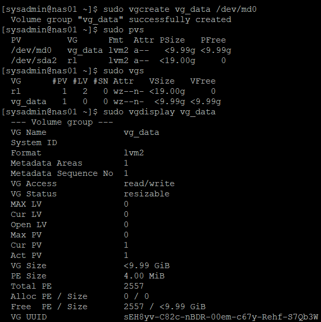
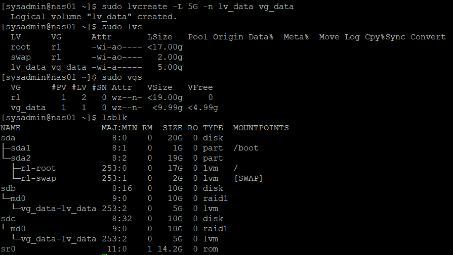
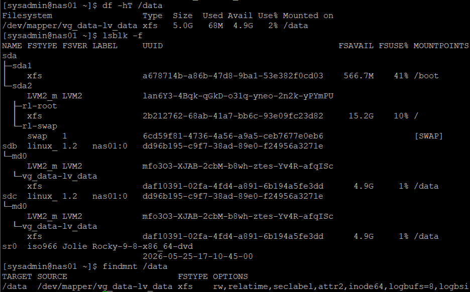
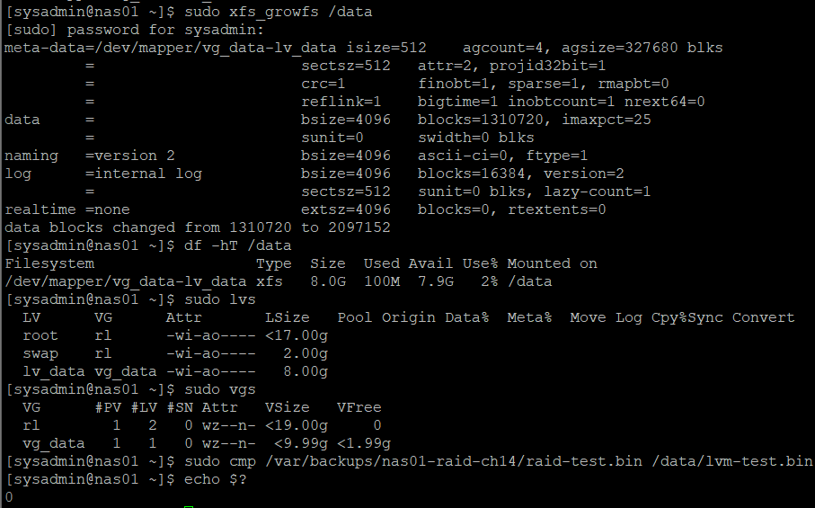
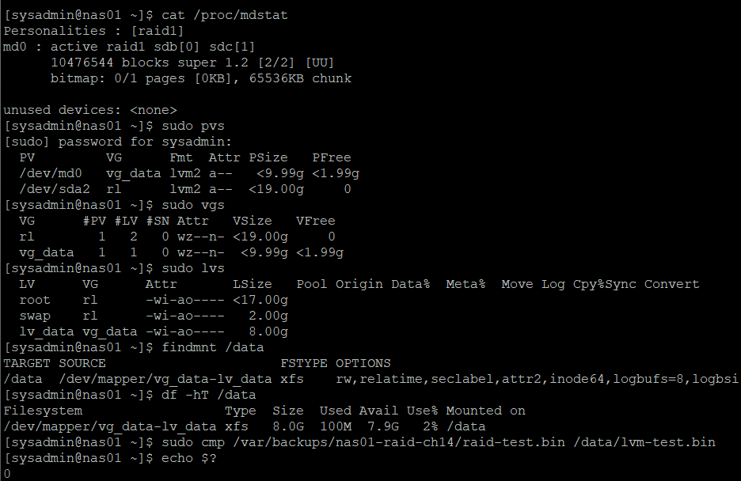

# 15. LVM 논리 볼륨 구성 및 용량 확장

## 1. 실습 개요

### 실습 목적

14단원에서 구성한 NAS01의 RAID 1 장치 `/dev/md0`를 기반으로 LVM(Logical Volume Manager)을 구성하였다.

RAID 장치를 물리 볼륨(PV) -> 볼륨 그룹(VG) -> 논리 볼륨(LV)으로 생성하고, XFS 파일시스템을 마운트하여 데이터 저장 공간으로 활용하였다.

논리 볼륨과 파일시스템의 용량을 5GiB에서 8GiB로 확장하고, 데이터 무결성과 재부팅 후 자동 마운트를 검증하였다.

주요 실습 내용:

- 기존 RAID 1 상태 및 테스트 데이터 확인
- RAID 테스트 데이터 백업 및 무결성 검증
- 기존 XFS 파일시스템 마운트 해제 및 LVM 전환
- RAID 장치를 LVM PV로 구성
- VG 및 5GiB LV 생성
- XFS 파일시스템 생성 및 `/data` 마운트
- 테스트 파일 저장 및 무결성 검증
- LV 용량 5GiB → 8GiB 확장
- XFS 파일시스템 온라인 확장
- `/etc/fstab` 자동 마운트 등록
- 재부팅 후 RAID·LVM·데이터 무결성 최종 검증

관련 문서:

- [13단원 — NAS01 서버 구축 및 네트워크 구성](./13-nas01.md)
- [14단원 — RAID 구성, 디스크 장애 및 복구 검증](./14-raid.md)

---

## 2. 실습 환경 및 스토리지 구성

### 2.1 서버 환경

| 항목 | 구성 |
|---|---|
| 가상화 | VMware Workstation |
| 운영체제 | Rocky Linux 9.8 |
| 서버 | NAS01 |
| 내부 IP | `192.168.100.41` |
| RAID Level | RAID 1 |
| RAID 장치 | `/dev/md0` |
| RAID 사용 가능 용량 | 약 9.99GiB |
| LVM PV | `/dev/md0` |
| VG | `vg_data` |
| LV | `lv_data` |
| 파일시스템 | XFS |
| 마운트 경로 | `/data` |

### 2.2 디스크 구성

| 디스크 | 용량 | 용도 |
|---|---|---|
| `/dev/sda` | 20GB | Rocky Linux OS |
| `/dev/sdb` | 10GB | RAID 1 구성원 |
| `/dev/sdc` | 10GB | RAID 1 구성원 |

기존 OS 디스크 `/dev/sda`는 변경하지 않고, 14단원에서 생성한 RAID 1 장치 `/dev/md0`만 LVM 구성 대상으로 사용하였다.

### 2.3 목표 스토리지 구조

```text
/dev/sdb (10GB) ─┐
                 ├── RAID 1 (/dev/md0, 약 10GiB)
/dev/sdc (10GB) ─┘
                         │
                    PV (/dev/md0)
                         │
                    VG (vg_data)
                         │
                    LV (lv_data)
                         │
                   초기 5GiB
                         │
                   확장 8GiB
                         │
                       XFS
                         │
                      /data
```

LVM의 용량 확장 실습을 위해 전체 VG 용량을 처음부터 모두 할당하지 않고, LV를 5GiB로 생성한 뒤 8GiB로 확장하는 방식을 사용하였다.

---

## 3. 기존 RAID 상태 확인 및 데이터 백업

### 3.1 RAID 상태 확인

```bash
cat /proc/mdstat
```

실제 결과:

```text
md0 : active raid1 sdc[1] sdb[0]
      10476544 blocks super 1.2 [2/2] [UU]
```

RAID 1 구성원 2개가 모두 정상 상태임을 확인하였다.

### 3.2 기존 XFS 마운트 확인

```bash
findmnt /mnt/raid-test
lsblk -f
```

주요 결과:

```text
TARGET         SOURCE   FSTYPE
/mnt/raid-test /dev/md0 xfs
```

14단원에서 생성한 XFS 파일시스템이 `/dev/md0`에 존재하며 `/mnt/raid-test`에 마운트된 것을 확인하였다.

### 3.3 기존 테스트 데이터 무결성 확인

```bash
sudo sha256sum -c ~/raid-test.sha256
```

실제 결과:

```text
/mnt/raid-test/raid-test.bin: OK
```

LVM으로 전환하기 전 기존 RAID 테스트 데이터가 정상적으로 유지되고 있음을 확인하였다.

### 3.4 테스트 데이터 백업

기존 파일시스템을 교체하기 전에 OS 디스크의 백업 디렉터리에 테스트 파일을 복사하였다.

```bash
sudo mkdir -p /var/backups/nas01-raid-ch14

sudo cp -a /mnt/raid-test/raid-test.bin /var/backups/nas01-raid-ch14/
```

원본과 백업 파일 비교:

```bash
sudo cmp /mnt/raid-test/raid-test.bin /var/backups/nas01-raid-ch14/raid-test.bin
echo $?
```

실제 결과:

```text
0
```

백업 파일 확인:

```bash
sudo ls -lh /var/backups/nas01-raid-ch14/
```

주요 결과:

```text
-rw-r--r--. 1 root root 10M Oct 27 10:11 raid-test.bin
```

`cmp` 종료 코드 `0`을 통해 원본과 백업 파일의 내용이 일치함을 확인하였다.

---

## 4. 기존 파일시스템 정리 및 PV 생성

### 4.1 RAID 테스트 파일시스템 마운트 해제

```bash
sudo umount /mnt/raid-test
```

마운트 해제 확인:

```bash
findmnt /mnt/raid-test
lsblk -f
```

`findmnt`에서 출력이 없고 `lsblk -f`에서 `/dev/md0`의 마운트 경로가 비어 있음을 확인하였다.

### 4.2 기존 XFS 서명 정리

기존 `/dev/md0`의 XFS 파일시스템을 LVM 구성으로 전환하기 위해 파일시스템 서명을 정리하는 절차를 진행하였다.

사용 명령어:

```bash
sudo wipefs -n /dev/md0
sudo wipefs -a /dev/md0
```

- `wipefs -n`: 파일시스템 서명 확인
- `wipefs -a`: 대상 장치의 파일시스템 서명 제거

기존 데이터는 사전에 OS 디스크로 백업하고 무결성을 확인하였다.

이 작업의 대상은 RAID 장치 `/dev/md0`이며, RAID 구성원 `/dev/sdb`, `/dev/sdc`와 OS 디스크 `/dev/sda`는 직접 변경하지 않았다.

### 4.3 LVM PV 생성

```bash
sudo pvcreate /dev/md0
```

실제 결과:

```text
Physical volume "/dev/md0" successfully created.
```

PV 상태 확인:

```bash
sudo pvs
sudo pvdisplay /dev/md0
```

주요 결과:

```text
PV          VG   Fmt   PSize   PFree
/dev/md0         lvm2  9.99g   9.99g
/dev/sda2   rl   lvm2 <19.00g      0
```

`/dev/md0`가 약 9.99GiB 크기의 LVM 물리 볼륨으로 생성되었다.

`/dev/sda2`는 기존 Rocky Linux OS에서 사용하는 PV이며 이번 데이터용 LVM 구성과 분리되어 있다.

---

## 5. Volume Group(VG) 생성

### 5.1 VG 생성

RAID 기반 PV를 이용해 `vg_data` 볼륨 그룹을 생성하였다.

```bash
sudo vgcreate vg_data /dev/md0
```

실제 결과:

```text
Volume group "vg_data" successfully created
```

### 5.2 VG 생성 검증

```bash
sudo pvs
sudo vgs
sudo vgdisplay vg_data
```

주요 결과:

```text
PV         VG      Fmt   PSize   PFree
/dev/md0   vg_data lvm2  <9.99g <9.99g
/dev/sda2  rl      lvm2 <19.00g      0
```

```text
VG      #PV #LV   VSize   VFree
rl        1   2  <19.00g      0
vg_data   1   0   <9.99g <9.99g
```

`vgdisplay vg_data` 주요 정보:

```text
VG Name               vg_data
VG Access             read/write
VG Status             resizable
Cur PV                1
Act PV                1
VG Size               <9.99 GiB
PE Size               4.00 MiB
Total PE              2557
Free PE / Size        2557 / <9.99 GiB
```

`/dev/md0`가 `vg_data`에 정상적으로 소속되었으며, 아직 LV를 생성하지 않아 전체 공간이 여유 공간으로 남아 있는 것을 확인하였다.



---

## 6. Logical Volume(LV) 생성

### 6.1 LV 생성

`vg_data`에서 5GiB 논리 볼륨 `lv_data`를 생성하였다.

```bash
sudo lvcreate -L 5G -n lv_data vg_data
```

실제 결과:

```text
Logical volume "lv_data" created.
```

| 옵션 | 설명 |
|---|---|
| `-L 5G` | 논리 볼륨의 용량을 5GiB로 설정 |
| `-n lv_data` | LV 이름 지정 |
| `vg_data` | LV를 생성할 VG |

### 6.2 LV 생성 결과 검증

```bash
sudo lvs
sudo vgs
lsblk
```

주요 결과:

```text
LV      VG      LSize
root    rl     <17.00g
swap    rl       2.00g
lv_data vg_data  5.00g
```

```text
VG      #PV #LV   VSize   VFree
rl        1   2  <19.00g      0
vg_data   1   1   <9.99g <4.99g
```

`lsblk`에서 확인한 주요 구조:

```text
sdb                  10G disk
└─md0                10G raid1
  └─vg_data-lv_data   5G lvm

sdc                  10G disk
└─md0                10G raid1
  └─vg_data-lv_data   5G lvm
```

5GiB LV가 정상적으로 생성되었고 VG에 약 4.99GiB의 여유 공간이 남아 있음을 확인하였다.

남은 용량은 이후 LV 확장 실습에 사용한다.



---

## 7. XFS 파일시스템 생성 및 마운트

### 7.1 XFS 파일시스템 생성

생성한 LV에 XFS 파일시스템을 구성하였다.

```bash
sudo mkfs.xfs /dev/vg_data/lv_data
```

이번 실습에서는 RAID 장치 `/dev/md0`에 직접 파일시스템을 생성하는 것이 아니라, 그 위에 구성한 LVM 논리 볼륨에 XFS를 생성하였다.

### 7.2 마운트 디렉터리 생성

```bash
sudo mkdir -p /data
```

### 7.3 LV 마운트

```bash
sudo mount /dev/vg_data/lv_data /data
```

### 7.4 파일시스템 및 마운트 검증

```bash
df -hT /data
lsblk -f
findmnt /data
```

`df -hT` 실제 결과:

```text
Filesystem                  Type  Size  Used Avail Use% Mounted on
/dev/mapper/vg_data-lv_data xfs   5.0G   68M  4.9G   2% /data
```

`findmnt` 주요 결과:

```text
TARGET SOURCE                      FSTYPE
/data  /dev/mapper/vg_data-lv_data xfs
```

`lsblk -f`에서 확인한 구조:

```text
sdb  linux_raid_member
└─md0  LVM2_member
  └─vg_data-lv_data  xfs  /data

sdc  linux_raid_member
└─md0  LVM2_member
  └─vg_data-lv_data  xfs  /data
```

RAID 1 → LVM → XFS 구조가 정상적으로 연결되었으며 `/data`에 약 5GiB 파일시스템이 마운트된 것을 확인하였다.



---

## 8. LV 확장 전 테스트 데이터 검증

### 8.1 테스트 파일 저장

14단원에서 백업한 10MiB 파일을 신규 LVM 파일시스템에 복사하였다.

```bash
sudo cp -a /var/backups/nas01-raid-ch14/raid-test.bin /data/lvm-test.bin
```

### 8.2 파일 내용 비교

```bash
sudo cmp /var/backups/nas01-raid-ch14/raid-test.bin /data/lvm-test.bin
echo $?
```

실제 결과:

```text
0
```

### 8.3 파일 저장 위치 확인

```bash
findmnt -T /data/lvm-test.bin
df -hT /data
sudo ls -lh /data/
```

주요 결과:

```text
TARGET SOURCE                      FSTYPE
/data  /dev/mapper/vg_data-lv_data xfs
```

```text
Filesystem                  Type  Size  Used Avail Use% Mounted on
/dev/mapper/vg_data-lv_data xfs   5.0G   78M  4.9G   2% /data
```

```text
-rw-r--r--. 1 root root 10M Oct 27 10:11 lvm-test.bin
```

테스트 파일이 실제 LVM 파일시스템에 저장되었으며 원본과 내용이 일치함을 확인하였다.

---

## 9. LVM 논리 볼륨 용량 확장

### 9.1 확장 전 상태

현재 LV 용량과 VG 여유 공간을 확인하였다.

```bash
sudo lvs
sudo vgs
```

확장 전 결과:

```text
LV      VG      LSize
lv_data vg_data  5.00g
```

```text
VG      VSize   VFree
vg_data <9.99g <4.99g
```

### 9.2 LV 용량 확장

VG의 여유 공간 중 3GiB를 사용하여 LV를 5GiB에서 8GiB로 확장하였다.

```bash
sudo lvextend -L 8G /dev/vg_data/lv_data
```

실제 결과:

```text
Size of logical volume vg_data/lv_data changed from 5.00 GiB (1280 extents) to 8.00 GiB (2048 extents).
Logical volume vg_data/lv_data successfully resized.
```

`-L 8G`는 추가할 용량이 아니라 확장 후 LV의 전체 용량을 의미한다.

### 9.3 LV 확장 후 상태 확인

```bash
sudo lvs
sudo vgs
df -hT /data
```

주요 결과:

```text
LV      VG      LSize
lv_data vg_data  8.00g
```

```text
VG      VSize   VFree
vg_data <9.99g <1.99g
```

이 시점에 파일시스템 용량은 아직 5GiB로 표시되었다.

```text
Filesystem                  Type  Size  Used Avail Use% Mounted on
/dev/mapper/vg_data-lv_data xfs   5.0G   78M  4.9G   2% /data
```

LV의 블록 장치 용량은 8GiB로 증가했지만 XFS 파일시스템은 아직 기존 크기를 유지하고 있음을 확인하였다.

---

## 10. XFS 파일시스템 온라인 확장

### 10.1 XFS 확장

마운트된 `/data`에 대해 XFS 파일시스템 확장을 수행하였다.

```bash
sudo xfs_growfs /data
```

실제 결과 중 주요 내용:

```text
data blocks changed from 1310720 to 2097152
```

XFS는 온라인 확장을 지원하므로 `/data`를 마운트 해제하지 않고 파일시스템을 확장하였다.

### 10.2 확장 후 용량 확인

```bash
df -hT /data
sudo lvs
sudo vgs
```

실제 결과:

```text
Filesystem                  Type  Size  Used Avail Use% Mounted on
/dev/mapper/vg_data-lv_data xfs   8.0G  100M  7.9G   2% /data
```

```text
LV      VG      LSize
lv_data vg_data  8.00g
```

```text
VG      VSize   VFree
vg_data <9.99g <1.99g
```

LV와 XFS 파일시스템의 용량이 모두 8GiB로 확장된 것을 확인하였다.

### 10.3 확장 후 데이터 무결성 검증

```bash
sudo cmp /var/backups/nas01-raid-ch14/raid-test.bin /data/lvm-test.bin
echo $?
```

실제 결과:

```text
0
```

LV 및 XFS 확장 이후에도 테스트 파일이 원본과 바이트 단위로 일치함을 확인하였다.

이번 실습을 통해 **LV 확장과 파일시스템 확장이 서로 구분되는 작업**임을 확인하였다.



---

## 11. /etc/fstab 자동 마운트 설정

### 11.1 파일시스템 UUID 확인

재부팅 후에도 `/data`가 자동으로 마운트되도록 XFS UUID를 확인하였다.

```bash
sudo blkid /dev/vg_data/lv_data
```

실제 결과:

```text
/dev/vg_data/lv_data: UUID="daf10391-02fa-4fd4-a891-6b194a5fe3dd" TYPE="xfs"
```

### 11.2 기존 설정 백업

```bash
sudo cat /etc/fstab
sudo cp -a /etc/fstab /etc/fstab.bak
```

기존 OS 루트, `/boot`, swap 설정은 유지하고 데이터용 XFS 마운트 항목만 추가하였다.

### 11.3 자동 마운트 설정 추가

```bash
sudo vi /etc/fstab
```

추가한 설정:

```fstab
UUID=daf10391-02fa-4fd4-a891-6b194a5fe3dd /data xfs defaults 0 0
```

| 항목 | 설정 |
|---|---|
| 장치 | XFS 파일시스템 UUID |
| 마운트 경로 | `/data` |
| 파일시스템 | `xfs` |
| 마운트 옵션 | `defaults` |
| dump | `0` |
| fsck 검사 순서 | `0` |

### 11.4 설정 검증

```bash
sudo systemctl daemon-reload
sudo findmnt --verify
```

실제 결과:

```text
Success, no errors or warnings detected
```

`/etc/fstab` 설정에서 문법 오류와 경고가 없음을 확인하였다.

### 11.5 fstab 기반 마운트 검증

현재 마운트를 해제한 뒤 `/etc/fstab` 설정만으로 다시 마운트하였다.

```bash
sudo umount /data
sudo mount /data
```

장치 경로 없이 `/data`만 지정하여 자동 마운트 설정을 확인하였다.

```bash
findmnt /data
df -hT /data
```

실제 결과:

```text
TARGET SOURCE                      FSTYPE
/data  /dev/mapper/vg_data-lv_data xfs
```

```text
Filesystem                  Type  Size  Used Avail Use% Mounted on
/dev/mapper/vg_data-lv_data xfs   8.0G  100M  7.9G   2% /data
```

데이터 무결성 확인:

```bash
sudo cmp /var/backups/nas01-raid-ch14/raid-test.bin /data/lvm-test.bin
echo $?
```

실제 결과:

```text
0
```

`/etc/fstab`에 등록된 파일시스템이 정상적으로 마운트되며 테스트 데이터도 유지됨을 확인하였다.

---

## 12. 재부팅 후 RAID 및 LVM 유지 검증

### 12.1 NAS01 재부팅

```bash
sudo reboot
```

재부팅 이후 NAS01에 다시 접속하여 RAID, LVM, 마운트 상태 및 데이터 무결성을 검증하였다.

### 12.2 RAID 상태 확인

```bash
cat /proc/mdstat
```

실제 결과:

```text
md0 : active raid1 sdb[0] sdc[1]
      10476544 blocks super 1.2 [2/2] [UU]
```

RAID 1 구성원 2개가 정상적으로 유지됨을 확인하였다.

### 12.3 LVM 상태 확인

```bash
sudo pvs
sudo vgs
sudo lvs
```

주요 결과:

```text
PV         VG      PSize   PFree
/dev/md0   vg_data <9.99g <1.99g
/dev/sda2  rl      <19.00g     0
```

```text
VG      #PV #LV   VSize   VFree
rl        1   2  <19.00g      0
vg_data   1   1   <9.99g <1.99g
```

```text
LV      VG      LSize
root    rl     <17.00g
swap    rl       2.00g
lv_data vg_data  8.00g
```

`vg_data`와 `lv_data`가 정상적으로 인식되었으며 확장된 8GiB 용량이 유지되었다.

### 12.4 자동 마운트 확인

재부팅 후 별도의 `mount` 명령어를 실행하지 않고 상태를 확인하였다.

```bash
findmnt /data
df -hT /data
```

실제 결과:

```text
TARGET SOURCE                      FSTYPE
/data  /dev/mapper/vg_data-lv_data xfs
```

```text
Filesystem                  Type  Size  Used Avail Use% Mounted on
/dev/mapper/vg_data-lv_data xfs   8.0G  100M  7.9G   2% /data
```

`/etc/fstab` 설정을 통해 재부팅 후에도 `/data`가 XFS 파일시스템으로 자동 마운트되는 것을 확인하였다.

### 12.5 데이터 무결성 최종 검증

```bash
sudo cmp /var/backups/nas01-raid-ch14/raid-test.bin /data/lvm-test.bin
echo $?
```

실제 결과:

```text
0
```

재부팅 이후에도 테스트 파일이 원본과 일치함을 확인하였다.



---

## 13. 실습 최종 검증 결과

| 검증 항목 | 실제 결과 | 상태 |
|---|---|---|
| RAID 1 정상 여부 | `[2/2] [UU]` | 성공 |
| 기존 테스트 파일 백업 | 10MiB | 완료 |
| 백업 파일 무결성 | `cmp` 결과 `0` | 성공 |
| RAID 테스트 마운트 해제 | `/mnt/raid-test` | 완료 |
| PV 생성 | `/dev/md0` | 성공 |
| VG 생성 | `vg_data`, 약 9.99GiB | 성공 |
| LV 생성 | `lv_data`, 5GiB | 성공 |
| XFS 파일시스템 생성 | `/dev/vg_data/lv_data` | 성공 |
| 초기 마운트 | `/data`, 5GiB | 성공 |
| LV 용량 확장 | 5GiB → 8GiB | 성공 |
| XFS 온라인 확장 | 5GiB → 8GiB | 성공 |
| 확장 후 데이터 무결성 | `cmp` 결과 `0` | 성공 |
| VG 잔여 용량 | 약 1.99GiB | 확인 |
| `/etc/fstab` 설정 | XFS UUID 기반 | 완료 |
| fstab 문법 검증 | 오류·경고 없음 | 성공 |
| fstab 기반 재마운트 | `/data` | 성공 |
| 재부팅 후 RAID 유지 | `[UU]` | 성공 |
| 재부팅 후 LV 용량 유지 | 8GiB | 성공 |
| 재부팅 후 자동 마운트 | `/data` | 성공 |
| 재부팅 후 데이터 무결성 | `cmp` 결과 `0` | 성공 |

### 최종 결과

NAS01에 구성한 RAID 1 장치 `/dev/md0`를 기반으로 LVM을 구성하였다.

RAID 테스트 데이터를 백업하고 기존 파일시스템을 정리한 뒤 PV와 VG를 생성하였다.

이후 5GiB 크기의 LV를 생성하여 XFS 파일시스템을 구성하고 `/data`에 마운트하였다.

VG의 남은 공간을 이용해 LV를 5GiB에서 8GiB로 확장했으며, `xfs_growfs`를 통해 XFS 파일시스템도 온라인으로 확장하였다.

확장 전후 테스트 데이터의 내용이 유지됨을 확인하였고, `/etc/fstab`에 UUID 기반 자동 마운트를 설정하였다.

최종적으로 재부팅 후에도 RAID 1, LVM, XFS 파일시스템 및 테스트 데이터가 정상적으로 유지되는 것을 검증하였다.

**15단원 실습 최종 결과: 완료**

---

## 14. 배운 점 및 운영 시 고려사항

### 14.1 RAID와 LVM의 역할 구분

RAID 1은 디스크 장애에 대비한 미러링 구성을 제공하고, LVM은 RAID 장치의 저장 공간을 논리적으로 관리한다.

이번 실습에서는 RAID 1로 구성한 `/dev/md0`를 LVM PV로 사용하여 데이터 저장 공간의 안정성과 관리 편의성을 함께 확보하였다.

### 14.2 PV, VG, LV 구성

LVM은 물리 볼륨(PV), 볼륨 그룹(VG), 논리 볼륨(LV)의 계층으로 구성된다.

이번 실습에서는 `/dev/md0`를 PV로 등록하고, `vg_data`에서 `lv_data`를 생성하였다.

VG의 여유 공간을 남겨 두어 추가 디스크 없이도 기존 LV의 용량을 확장할 수 있음을 확인하였다.

### 14.3 LV와 파일시스템 확장의 차이

`lvextend`로 LV를 8GiB까지 확장해도 XFS 파일시스템은 기존 5GiB 크기를 유지하였다.

이후 `xfs_growfs /data`를 실행하여 실제 파일시스템 크기를 8GiB로 확장하였다.

따라서 저장 공간 확장 작업에서는 **블록 장치 용량과 파일시스템 용량을 각각 검증해야 한다**는 점을 확인하였다.

### 14.4 데이터 무결성 검증

스토리지 구조를 변경하거나 파일시스템을 확장할 때는 기존 데이터를 백업하고, 작업 후 데이터가 변경되지 않았는지 확인해야 한다.

이번 실습에서는 RAID 테스트 파일을 OS 디스크에 백업하고 `cmp`를 사용하여 확장 전후 및 재부팅 후 데이터 무결성을 검증하였다.

### 14.5 파일시스템 자동 마운트

`/etc/fstab`에 XFS UUID를 등록하고 `findmnt --verify`로 설정을 검증하였다.

재부팅 이후에도 `/data`가 자동으로 마운트되었으며, LV 용량과 파일 내용이 그대로 유지됨을 확인하였다.

---

## 15. 다음 실습

**16단원: NAS01 NFS 공유 스토리지 구축**

15단원에서 RAID 1 위에 LVM을 구성하고 8GiB XFS 파일시스템을 `/data`에 마운트하였다.

16단원에서는 해당 스토리지를 기반으로 NFS 공유 디렉터리를 구성할 예정이다.

주요 예정 작업:

1. NAS01 NFS 서버 패키지 설치
2. `/data` 기반 NFS 공유 디렉터리 생성
3. NFS 공유 경로 및 접근 권한 설정
4. `/etc/exports` 설정
5. NFS 서비스 및 방화벽 설정
6. 공유 설정 적용 및 상태 검증
7. NFS 서비스 재시작 및 유지 검증

다음 단원에서는 WEB01과 WEB02가 사용할 공유 스토리지의 서버 측 환경을 구성하고, 17단원에서 클라이언트 마운트 및 파일 권한을 검증할 예정이다.


