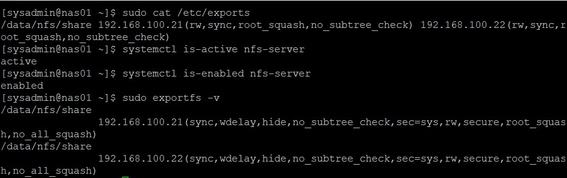
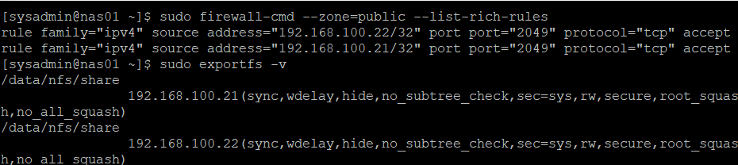
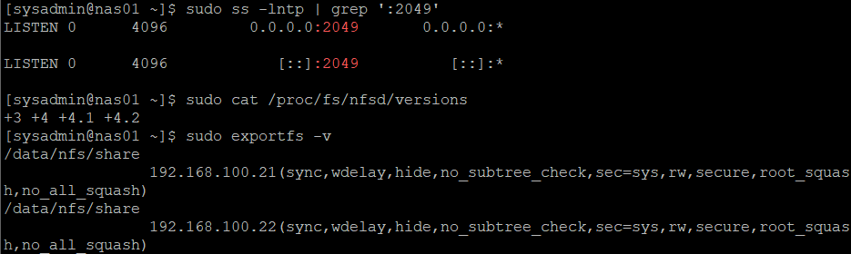
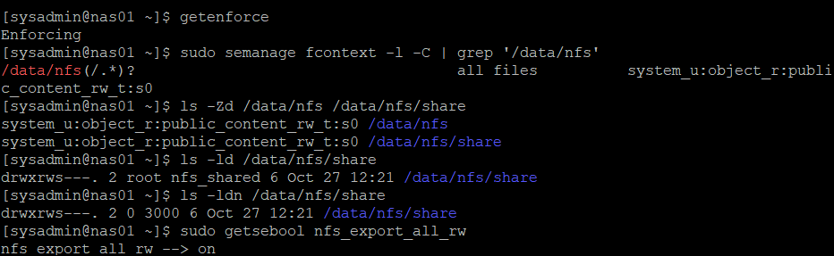
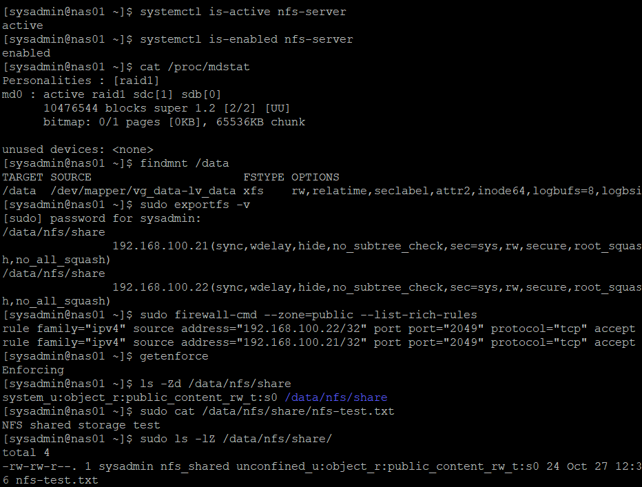

# 16. NAS01 NFS 공유 스토리지 구축

## 1. 실습 개요

### 실습 목적

15단원에서 구성한 NAS01의 RAID 1 + LVM + XFS 저장 공간을 이용하여 NFS를 구축하였다.

`/data/nfs/share` 디렉터리를 NFS로 구축하고, WEB01과 WEB02의 접근 대상 및 TCP 2049 방화벽 규칙을 설정하였다.

공용 그룹의 GID, SetGID 디렉터리 권한, SELinux 레이블을 적용하고 NAS01 재부팅 후 설정과 테스트 파일이 유지되는지 검증하였다.

주요 실습 내용:

- 기존 RAID 1 + LVM 스토리지 상태 확인
- `nfs-utils` 설치 및 NFS 서버 활성화
- `/data/nfs/share` 공유 디렉터리 구성
- `/etc/exports`에 WEB01·WEB02 공유 설정
- firewalld에서 두 서버의 TCP 2049 접근 허용
- NFS 포트, 프로토콜 버전 및 export 상태 검증
- 공유 그룹(GID 3000) 및 SetGID 권한 설정
- SELinux 공유 레이블 설정 및 영구 규칙 검증
- NAS01 로컬 파일 생성·그룹 상속·읽기 검증
- 재부팅 후 NFS, RAID, 마운트, 권한 및 테스트 파일 유지 검증

관련 문서:

- [14단원 — RAID 구성, 디스크 장애 및 복구 검증](./14-raid.md)
- [15단원 — LVM 논리 볼륨 구성 및 용량 확장](./15-lvm.md)

---

## 2. 실습 환경 및 NFS 구성

### 2.1 서버 구성

| 서버 | 내부 IP | 역할 |
| --- | --- | --- |
| NAS01 | `192.168.100.41` | NFS 서버 |
| WEB01 | `192.168.100.21` | NFS 클라이언트 예정 |
| WEB02 | `192.168.100.22` | NFS 클라이언트 예정 |

| 항목 | 설정 |
| --- | --- |
| 가상화 | VMware Workstation |
| 운영체제 | Rocky Linux 9.8 |
| 스토리지 | RAID 1(`/dev/md0`) → LVM(`vg_data/lv_data`) → XFS |
| LVM 파일시스템 용량 | 8GiB |
| 마운트 경로 | `/data` |
| NFS 공유 경로 | `/data/nfs/share` |
| 사용 예정 프로토콜 | NFSv4, TCP 2049 |
| 공유 그룹 | `nfs_shared` (GID `3000`) |
| SELinux | `Enforcing` |

### 2.2 스토리지 마운트 확인

NAS01에서 실행:

```bash
findmnt /data
df -hT /data
```

확인 결과:

```text
TARGET SOURCE                      FSTYPE
/data  /dev/mapper/vg_data-lv_data xfs
```

```text
Filesystem                  Type  Size  Used Avail Use% Mounted on
/dev/mapper/vg_data-lv_data xfs   8.0G  100M  7.9G   2% /data
```

기존 LVM 기반 XFS 파일시스템이 `/data`에 정상적으로 마운트되어 있음을 확인하였다.

---

## 3. NFS 패키지 설치 및 공유 디렉터리 준비

### 3.1 NFS 패키지 설치

```bash
sudo dnf install -y nfs-utils
rpm -q nfs-utils
systemctl status nfs-server --no-pager
```

패키지 확인 결과:

```text
nfs-utils-2.5.4-42.el9.x86_64
```

설치 직후 `nfs-server`는 `inactive (dead)` 상태였으며, 공유 설정을 작성한 후 서비스를 시작하였다.

### 3.2 NFS 공유 디렉터리 생성

```bash
sudo mkdir -p /data/nfs/share
sudo chown root:root /data/nfs/share
sudo chmod 755 /data/nfs/share
```

생성 및 저장 위치 확인:

```bash
ls -ld /data/nfs/share
findmnt -T /data/nfs/share
```

확인 결과:

```text
drwxr-xr-x. 2 root root 6 Oct 27 12:21 /data/nfs/share
```

`findmnt -T`에서 실제 파일시스템이 `/dev/mapper/vg_data-lv_data`로 표시되어 NFS 공유 경로가 RAID 1 + LVM 저장 영역에 위치함을 확인하였다.

공유 그룹의 쓰기 권한은 이후 별도로 설정하였다.

---

## 4. /etc/exports 공유 설정 및 NFS 서비스 활성화

### 4.1 기존 설정 확인 및 백업

```bash
sudo cat /etc/exports
sudo cp -a /etc/exports /etc/exports.bak
```

초기 `/etc/exports` 파일은 비어 있었다.

### 4.2 공유 대상 및 옵션 설정

```bash
sudo vi /etc/exports
```

추가한 설정:

```text
/data/nfs/share 192.168.100.21(rw,sync,root_squash,no_subtree_check) 192.168.100.22(rw,sync,root_squash,no_subtree_check)
```

| 옵션 | 의미 |
| --- | --- |
| `rw` | NFS 공유 정책에서 읽기·쓰기 허용 |
| `sync` | 쓰기 작업의 안정적 저장을 기다린 뒤 응답 |
| `root_squash` | 클라이언트 root 사용자 권한 매핑 제한 |
| `no_subtree_check` | 하위 디렉터리 검사 비활성화 |

WEB01(`192.168.100.21`)과 WEB02(`192.168.100.22`)를 공유 대상으로 설정하였다.

`rw`는 NFS export 수준의 설정이며, 실제 쓰기 성공 여부는 Linux 파일 권한, UID/GID 및 SELinux 정책의 영향을 받는다.

### 4.3 서비스 활성화 및 공유 적용

```bash
sudo systemctl enable --now nfs-server
systemctl is-active nfs-server
systemctl is-enabled nfs-server
sudo exportfs -rav
sudo exportfs -v
```

실제 서비스 확인 결과:

```text
active
enabled
```

공유 설정 적용 결과:

```text
exporting 192.168.100.21:/data/nfs/share
exporting 192.168.100.22:/data/nfs/share
```

`exportfs -v`에서 두 IP에 대해 `/data/nfs/share`가 `rw`, `sync`, `root_squash` 등으로 내보내진 것을 확인하였다.



---

## 5. firewalld 접근 제어 설정

### 5.1 기존 방화벽 상태 확인

```bash
sudo firewall-cmd --state
sudo firewall-cmd --get-active-zones
sudo firewall-cmd --list-all
```

확인 결과:

```text
running
```

```text
public
  interfaces: ens160 ens192
```

NAT와 Host-only 인터페이스 모두 `public` Zone에 속해 있었으며, NFS 포트에 대한 별도 허용 규칙은 없는 상태였다.

### 5.2 WEB01·WEB02에 TCP 2049 허용

```bash
sudo firewall-cmd --permanent --zone=public \
  --add-rich-rule='rule family="ipv4" source address="192.168.100.21/32" port port="2049" protocol="tcp" accept'

sudo firewall-cmd --permanent --zone=public \
  --add-rich-rule='rule family="ipv4" source address="192.168.100.22/32" port port="2049" protocol="tcp" accept'

sudo firewall-cmd --reload
```

### 5.3 방화벽 및 NFS 공유 대상 검증

```bash
sudo firewall-cmd --zone=public --list-rich-rules
sudo exportfs -v
```

방화벽 검증 결과:

```text
rule family="ipv4" source address="192.168.100.22/32" port port="2049" protocol="tcp" accept
rule family="ipv4" source address="192.168.100.21/32" port port="2049" protocol="tcp" accept
```

`/etc/exports`의 공유 대상 IP와 방화벽의 허용 IP가 일치함을 확인하였다.

**NFSv4의 TCP 2049 포트**를 기준으로 방화벽을 구성하였다.



---

## 6. NFS 포트 및 프로토콜 검증

### 6.1 NFS TCP 포트 확인

```bash
sudo ss -lntp | grep ':2049'
```

실제 결과:

```text
LISTEN 0 4096 0.0.0.0:2049 0.0.0.0:*
LISTEN 0 4096 [::]:2049    [::]:*
```

NAS01에서 IPv4 및 IPv6의 TCP 2049 포트가 `LISTEN` 상태임을 확인하였다.

### 6.2 NFS 프로토콜 버전 확인

```bash
sudo cat /proc/fs/nfsd/versions
```

실제 결과:

```text
+3 +4 +4.1 +4.2
```

NFSv3와 NFSv4 계열이 활성화되어 있음을 확인하였다. **클라이언트 연동 실습에서는 NFSv4를 사용할 예정**이며, 이 단계에서 NFSv3를 비활성화하지는 않았다.

### 6.3 공유 상태 재확인

```bash
sudo exportfs -v
```

WEB01과 WEB02에 대한 export 설정이 유지되어 있음을 확인하였다.



---

## 7. 공유 디렉터리 그룹 및 권한 설정

### 7.1 공유 그룹 생성

WEB01·WEB02에서도 동일한 숫자 GID로 권한을 일치시킬 수 있도록 NAS01에 공유 그룹을 생성하였다.

```bash
getent group 3000
sudo groupadd -g 3000 nfs_shared
getent group nfs_shared
```

실제 결과:

```text
nfs_shared:x:3000:
```

### 7.2 공유 디렉터리 그룹 및 SetGID 적용

```bash
sudo chown root:nfs_shared /data/nfs/share
sudo chmod 2770 /data/nfs/share
```

검증 명령어:

```bash
ls -ld /data/nfs/share
ls -ldn /data/nfs/share
```

실제 결과:

```text
drwxrws---. 2 root nfs_shared 6 Oct 27 12:21 /data/nfs/share
```

```text
drwxrws---. 2 0 3000 6 Oct 27 12:21 /data/nfs/share
```

`2770`의 SetGID 비트로 인해 해당 디렉터리 아래 새 파일 및 디렉터리는 부모 디렉터리의 그룹을 상속하도록 구성하였다.

---

## 8. SELinux 공유 레이블 설정

### 8.1 SELinux 상태 및 기존 레이블 확인

```bash
getenforce
ls -Zd /data /data/nfs /data/nfs/share
sudo getsebool -a | grep nfs
```

확인 결과:

```text
Enforcing
```

초기 `/data`, `/data/nfs`, `/data/nfs/share`의 SELinux 타입은 `unlabeled_t`였다.

NFS 관련 Boolean 중 `nfs_export_all_rw`와 `nfs_export_all_ro`는 `on` 상태였다.

### 8.2 기본 SELinux 레이블 복원

```bash
sudo restorecon -RFv /data
```

확인 결과, `/data`, `/data/nfs`, `/data/nfs/share` 및 테스트 파일의 타입이 `unlabeled_t`에서 `default_t`로 변경되었다.

### 8.3 공유 디렉터리 영구 레이블 규칙 등록

`semanage` 명령어가 설치되어 있지 않아 관련 도구를 설치하였다.

```bash
sudo dnf install -y policycoreutils-python-utils
```

NFS 공유 경로와 하위 디렉터리에 공유용 타입을 지정하였다.

```bash
sudo semanage fcontext -a -t public_content_rw_t '/data/nfs(/.*)?'
sudo restorecon -RFv /data/nfs
```

적용 결과:

```text
Relabeled /data/nfs from system_u:object_r:default_t:s0 to system_u:object_r:public_content_rw_t:s0
Relabeled /data/nfs/share from system_u:object_r:default_t:s0 to system_u:object_r:public_content_rw_t:s0
```

### 8.4 영구 규칙·현재 레이블·파일 권한 검증

```bash
getenforce
sudo semanage fcontext -l -C | grep '/data/nfs'
ls -Zd /data/nfs /data/nfs/share
ls -ld /data/nfs/share
ls -ldn /data/nfs/share
sudo getsebool nfs_export_all_rw
```

주요 결과:

```text
Enforcing
```

```text
/data/nfs(/.*)?  all files  system_u:object_r:public_content_rw_t:s0
```

```text
system_u:object_r:public_content_rw_t:s0 /data/nfs
system_u:object_r:public_content_rw_t:s0 /data/nfs/share
```

```text
drwxrws---. 2 root nfs_shared 6 Oct 27 12:21 /data/nfs/share
drwxrws---. 2 0 3000 6 Oct 27 12:21 /data/nfs/share
```

```text
nfs_export_all_rw --> on
```

SELinux를 `Enforcing`으로 유지하면서 NFS 공유 경로의 영구 레이블 규칙, 현재 레이블, 그룹 소유권 및 권한을 확인하였다.



---

## 9. NAS01 로컬 파일 생성 및 그룹 상속 검증

### 9.1 공유 그룹 권한으로 테스트 파일 생성

NAS01에서 그룹 GID `3000`을 적용한 사용자 권한으로 공유 경로에 파일을 생성하였다.

```bash
sudo runuser -u sysadmin -g nfs_shared -- \
  sh -c 'umask 0002; echo "NFS shared storage test" > /data/nfs/share/nfs-test.txt'
```

이 명령어는 `sysadmin`의 기본 그룹을 영구 변경하지 않고 테스트 명령에서만 `nfs_shared` 그룹을 사용하였다.

### 9.2 파일 내용 및 속성 검증

```bash
sudo cat /data/nfs/share/nfs-test.txt
sudo ls -l /data/nfs/share/
sudo ls -ln /data/nfs/share/
sudo ls -lZ /data/nfs/share/
```

파일 내용:

```text
NFS shared storage test
```

실제 파일 권한과 소유권:

```text
-rw-rw-r--. 1 sysadmin nfs_shared 24 Oct 27 12:36 nfs-test.txt
```

숫자 UID/GID:

```text
-rw-rw-r--. 1 1000 3000 24 Oct 27 12:36 nfs-test.txt
```

SELinux 타입:

```text
unconfined_u:object_r:public_content_rw_t:s0
```

공유 그룹 `nfs_shared`(GID 3000)가 상속되고 새 파일에 그룹 쓰기 권한이 부여된 것을 확인하였다.

### 9.3 공유 그룹 권한으로 읽기 확인

```bash
sudo runuser -u sysadmin -g nfs_shared -- \
  cat /data/nfs/share/nfs-test.txt
```

실제 결과:

```text
NFS shared storage test
```

---

## 10. 재부팅 후 NFS 설정 및 데이터 유지 검증

### 10.1 NAS01 재부팅

```bash
sudo reboot
```

재부팅 후 NAS01에 다시 접속하여 다음을 확인하였다.

### 10.2 NFS 서비스 및 RAID·LVM 상태

```bash
systemctl is-active nfs-server
systemctl is-enabled nfs-server
cat /proc/mdstat
findmnt /data
```

실제 결과:

```text
active
enabled
```

```text
md0 : active raid1 sdc[1] sdb[0]
      10476544 blocks super 1.2 [2/2] [UU]
```

```text
/data  /dev/mapper/vg_data-lv_data  xfs
```

재부팅 후에도 NFS 서비스가 실행되고 RAID 1 구성원 2개 및 LVM 파일시스템이 정상적으로 유지되었다.

### 10.3 NFS 공유 및 방화벽 규칙 유지 확인

```bash
sudo exportfs -v
sudo firewall-cmd --zone=public --list-rich-rules
```

`exportfs -v`에서 WEB01(`192.168.100.21`)과 WEB02(`192.168.100.22`)의 공유 설정이 유지되었다.

방화벽 규칙:

```text
rule family="ipv4" source address="192.168.100.22/32" port port="2049" protocol="tcp" accept
rule family="ipv4" source address="192.168.100.21/32" port port="2049" protocol="tcp" accept
```

### 10.4 SELinux 및 테스트 파일 유지 확인

```bash
getenforce
ls -Zd /data/nfs/share
sudo cat /data/nfs/share/nfs-test.txt
sudo ls -lZ /data/nfs/share/
```

주요 결과:

```text
Enforcing
```

```text
system_u:object_r:public_content_rw_t:s0 /data/nfs/share
```

```text
NFS shared storage test
```

```text
-rw-rw-r--. 1 sysadmin nfs_shared unconfined_u:object_r:public_content_rw_t:s0 24 Oct 27 12:36 nfs-test.txt
```

재부팅 후에도 SELinux 레이블, 공유 파일의 그룹 권한 및 테스트 파일 내용이 유지되었다.



---

## 11. 최종 검증 결과

| 검증 항목 | 실제 결과 | 상태 |
| --- | --- | --- |
| NAS01 스토리지 마운트 | `/data`, XFS 8GiB | 성공 |
| NFS 패키지 | `nfs-utils-2.5.4-42.el9.x86_64` | 설치 완료 |
| 공유 경로 | `/data/nfs/share` | 생성 완료 |
| `/etc/exports` | WEB01·WEB02 지정 | 적용 완료 |
| NFS 서비스 | `active`, `enabled` | 성공 |
| 방화벽 | 두 WEB IP에 TCP 2049 허용 | 적용 완료 |
| 서버 TCP 2049 포트 | IPv4·IPv6 `LISTEN` | 확인 |
| NFS 프로토콜 | `+3 +4 +4.1 +4.2` | 확인 |
| 공유 그룹 | `nfs_shared`, GID 3000 | 생성 완료 |
| 공유 디렉터리 | `root:nfs_shared`, `2770` | 적용 완료 |
| SELinux | `Enforcing` | 유지 |
| 공유 레이블 | `public_content_rw_t` | 적용 완료 |
| SELinux 영구 규칙 | `/data/nfs(/.*)?` | 등록 완료 |
| NAS01 로컬 파일 생성 | `nfs-test.txt` | 성공 |
| 신규 파일 그룹·권한 | GID 3000, `664` | 성공 |
| NAS01 공유 그룹 파일 읽기 | 테스트 문자열 출력 | 성공 |
| 재부팅 후 RAID 1 | `[UU]` | 정상 |
| 재부팅 후 NFS 서비스·export | 유지 | 성공 |
| 재부팅 후 방화벽·SELinux | 유지 | 성공 |
| 재부팅 후 테스트 파일 | 내용 및 권한 유지 | 성공 |
| WEB01·WEB02 실제 NFS 마운트 | 17단원에서 검증 예정 | 미진행 |

> 이후 WEB01·WEB02의 NFS 마운트, 파일 권한, 자동 마운트 및 Apache 연동 결과는 [17단원 — NFS 클라이언트 연동 및 파일 권한 검증](./17-nfs-client.md)에 기록하였다.

### 최종 결과

NAS01에 `nfs-utils`를 설치하고 RAID 1 + LVM + XFS 기반 `/data/nfs/share`를 NFS 공유 디렉터리로 구성하였다.

WEB01과 WEB02만 명시적인 export 대상으로 지정하고, firewalld에서 두 서버의 TCP 2049 접근을 허용하였다. 공유 그룹 `nfs_shared`(GID 3000)와 SetGID 권한을 적용하고 SELinux `Enforcing` 상태에서 영구 공유 레이블을 설정하였다.

NAS01에서 그룹 권한으로 테스트 파일을 생성하고 파일 내용, UID/GID, 권한 및 SELinux 레이블을 확인하였다. 재부팅 후에도 NFS 서비스, RAID 및 LVM 마운트, 공유 설정, 방화벽, SELinux, 테스트 파일이 유지됨을 검증하였다.

**16단원 결과: NAS01 NFS 서버 측 구성 및 로컬 검증 완료.**

---

## 12. 배운 점 및 운영 시 고려사항

### 12.1 NFS export와 파일 권한은 별도 설정

`/etc/exports`의 `rw`는 NFS 공유 정책에 대한 설정이다. 실제 파일 생성 여부에는 디렉터리 권한과 사용자의 UID/GID 등이 함께 영향을 미친다. 따라서 공통 그룹 GID를 정의하고 공유 디렉터리에 `2770`을 적용하였다.

### 12.2 root_squash 및 최소 허용 대상

클라이언트 root 계정에 과도한 권한을 부여하지 않도록 `root_squash`를 적용하고 WEB01·WEB02를 명시적인 공유 대상으로 지정하였다. firewalld에서도 두 IP에 대해서만 TCP 2049 허용 규칙을 추가하였다.

### 12.3 SELinux 보안 정책 유지

SELinux를 비활성화하지 않고 `semanage fcontext`와 `restorecon`으로 공유 경로의 레이블을 구성하였다. 재부팅 후에도 `public_content_rw_t` 타입이 유지됨을 확인하였다.

### 12.4 서비스 상태와 원격 클라이언트 검증은 구분

NFS 서버의 `active`, 포트 `LISTEN`, `exportfs -v`는 **서버 측 설정이 유효하다는 증거**다. WEB01·WEB02가 실제로 파일을 읽고 쓸 수 있는지는 원격 마운트 후 별도로 검증해야 한다.

또한 현재 NFSv3도 활성화되어 있으나 방화벽은 NFSv4의 TCP 2049 사용을 기준으로 구성하였다.

---

## 13. 다음 실습

**17단원: WEB01·WEB02 NFS 연동 및 파일 권한 검증**

진행 예정 작업:

1. WEB01·WEB02의 NFS 클라이언트 패키지 및 네트워크 확인
2. NAS01 공유 경로를 NFSv4로 마운트
3. 양쪽 WEB 서버에서 동일한 공유 파일 확인
4. UID/GID 및 웹 서비스 사용자 그룹 권한 검증
5. 파일 생성·수정·읽기와 SetGID 동작 검증
6. 클라이언트 SELinux 정책 및 자동 마운트 검증
7. 재부팅 및 장애 상황에서 접근 상태 확인

이 단계에서는 NFS 서버의 설정뿐 아니라 **클라이언트가 실제로 공유 데이터를 사용할 수 있는지** 확인할 예정이다.

