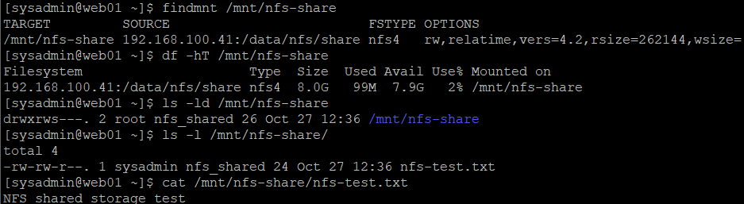
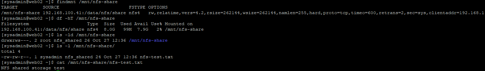
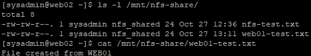
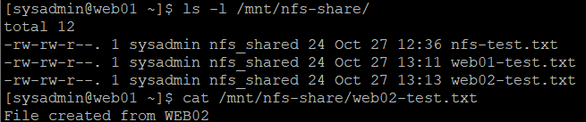
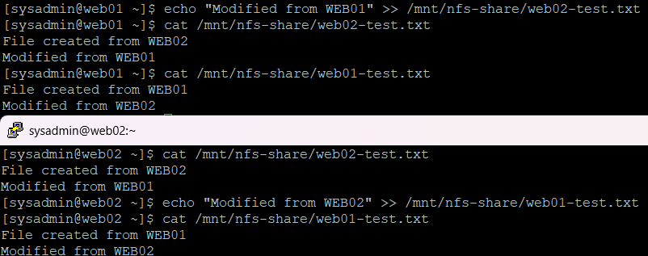
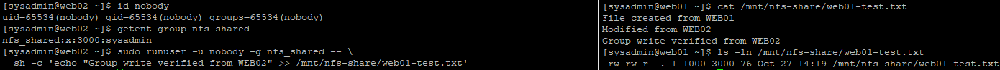
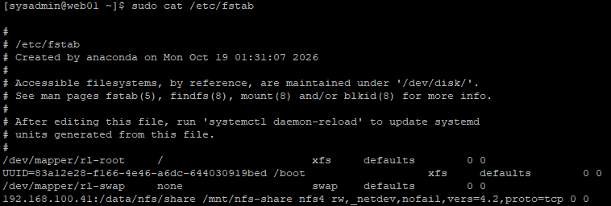
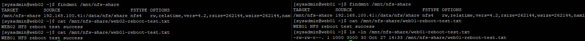
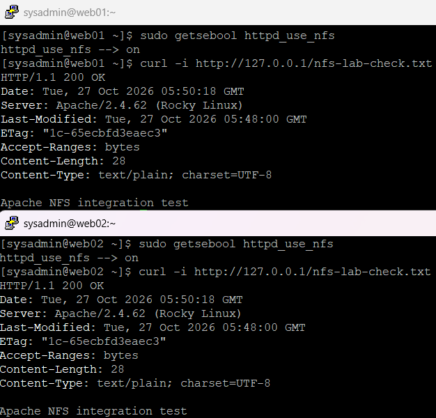

# 17. WEB01·WEB02 NFS 클라이언트 연동 및 파일 권한 검증

## 1. 실습 개요

### 1.1 실습 목적

16단원에서 구축한 NAS01의 RAID 1 + LVM + XFS 기반 NFS 공유 스토리지를 WEB01과 WEB02에 연결하였다.

두 웹 서버가 동일한 NFS 공유 디렉터리를 사용하도록 구성하고, 일반 사용자 및 Apache 서비스 계정의 파일 접근 권한을 검증하였다.

NFSv4.2 마운트, 양방향 파일 공유, 서로 다른 UID 간 그룹 쓰기 권한, 재부팅 후 자동 마운트, SELinux 및 Apache HTTP 연동까지 검증하였다.

### 1.2 주요 실습 내용

- WEB01·WEB02 네트워크 연결 및 NFS 클라이언트 패키지 확인
- 공유 그룹 `nfs_shared`(GID 3000) 구성
- NAS01 공유 스토리지 NFSv4.2 마운트
- WEB01·WEB02 공유 파일 읽기 검증
- 두 웹 서버 간 파일 생성 및 양방향 수정 검증
- 서로 다른 UID 사용자 간 GID 3000 쓰기 권한 검증
- `/etc/fstab`을 이용한 NFS 자동 마운트 설정
- 재부팅 후 자동 마운트 및 데이터 유지 검증
- Apache 실행 계정의 공유 그룹 설정
- SELinux `httpd_use_nfs` Boolean 활성화
- 실제 Apache 프로세스의 그룹 권한 확인
- Apache Alias를 통한 NFS 파일 HTTP 제공
- WEB01·WEB02 간 HTTP 교차 접근 검증

### 1.3 관련 문서

- [15단원 — LVM 논리 볼륨 구성 및 용량 확장](./15-lvm.md)
- [16단원 — NAS01 NFS 공유 스토리지 구축](./16-nfs-server.md)

---

## 2. 실습 환경 및 구성

### 2.1 서버 구성

| 서버 | Host-only IP | 역할 |
| --- | --- | --- |
| NAS01 | `192.168.100.41` | NFS 서버 및 공유 스토리지 |
| WEB01 | `192.168.100.21` | Apache 웹 서버 및 NFS 클라이언트 |
| WEB02 | `192.168.100.22` | Apache 웹 서버 및 NFS 클라이언트 |

### 2.2 NFS 구성 정보

| 항목 | 설정 |
| --- | --- |
| 가상화 환경 | VMware Workstation |
| 운영체제 | Rocky Linux 9.8 |
| NFS 서버 | NAS01 |
| 스토리지 구조 | RAID 1 → LVM → XFS |
| 공유 파일시스템 용량 | 8GiB |
| 서버 공유 경로 | `/data/nfs/share` |
| 클라이언트 마운트 경로 | `/mnt/nfs-share` |
| NFS 프로토콜 | NFSv4.2 |
| 네트워크 프로토콜 | TCP 2049 |
| 공유 그룹 | `nfs_shared` |
| 공유 그룹 GID | `3000` |
| Apache 실행 UID | `48` |
| Apache 기본 GID | `48` |
| SELinux | `Enforcing` |

### 2.3 NFS 공유 스토리지 구조

```text
NAS01 (192.168.100.41)
│
├── RAID 1 : /dev/md0
│
├── LVM
│   └── vg_data/lv_data
│
├── XFS
│   └── /data (8GiB)
│
└── NFS Export
    └── /data/nfs/share
              │
              │ NFSv4.2 / TCP 2049
              │
         ┌────┴─────┐
         │          │
         ▼          ▼
       WEB01      WEB02
  192.168.100.21  192.168.100.22
         │          │
  /mnt/nfs-share  /mnt/nfs-share
         │          │
       Apache     Apache
         │          │
        HTTP       HTTP
```

WEB01과 WEB02는 NAS01에 저장된 동일한 파일에 접근한다.

파일을 각 웹 서버의 로컬 디스크에 복사하지 않고 NFS 공유 스토리지를 통해 데이터를 공유하도록 구성하였다.

---

## 3. NFS 클라이언트 환경 확인 및 패키지 설치

### 3.1 WEB01 네트워크 확인

WEB01에서 실행:

```bash
ip -br addr
ping -c 4 192.168.100.41
```

**확인 결과:**

```text
lo      UNKNOWN  127.0.0.1/8 ::1/128
ens160  UP       10.10.10.128/24
ens192  UP       192.168.100.21/24
```

**NAS01 연결 확인 결과:**

```text
4 packets transmitted, 4 received, 0% packet loss
```

WEB01의 Host-only IP가 `192.168.100.21`로 설정되어 있으며 NAS01과 정상적으로 통신할 수 있음을 확인하였다.

### 3.2 WEB02 네트워크 확인

WEB02에서 실행:

```bash
ip -br addr
ping -c 4 192.168.100.41
```

**확인 결과:**

```text
lo      UNKNOWN  127.0.0.1/8 ::1/128
ens160  UP       10.10.10.129/24
ens192  UP       192.168.100.22/24
```

**NAS01 연결 확인 결과:**

```text
4 packets transmitted, 4 received, 0% packet loss
```

WEB02에서도 NAS01과의 네트워크 통신이 정상적으로 확인되었다.

### 3.3 NFS 클라이언트 패키지 설치

WEB01과 WEB02에서 각각 실행:

```bash
rpm -q nfs-utils
```

초기 확인 결과:

```text
package nfs-utils is not installed
```

NFS 클라이언트 패키지를 설치하였다.

```bash
sudo dnf install -y nfs-utils
```

설치 결과:

```text
Installed:
  nfs-utils-1:2.5.4-42.el9.x86_64

Complete!
```

두 서버 모두 NFS 공유 스토리지 마운트에 필요한 클라이언트 패키지가 설치되었다.

---

## 4. 공통 NFS 공유 그룹 구성

### 4.1 공통 GID 사용 목적

NAS01의 NFS 공유 디렉터리는 다음과 같이 구성되어 있다.

```text
drwxrws--- root nfs_shared /data/nfs/share
```

공유 디렉터리 권한은 `2770`, 공유 그룹의 GID는 `3000`이다.

WEB01과 WEB02에서도 동일한 숫자 GID를 사용하도록 구성하여 일반 사용자 계정이 그룹 권한으로 NFS 공유 디렉터리에 접근할 수 있도록 하였다.

### 4.2 WEB01 공유 그룹 설정

기존 GID 사용 여부 확인:

```bash
getent group 3000
```

기존에 GID 3000을 사용하는 그룹이 없음을 확인하였다.

그룹 생성 및 사용자 추가:

```bash
sudo groupadd -g 3000 nfs_shared
sudo usermod -aG nfs_shared sysadmin
```

설정 확인:

```bash
getent group nfs_shared
id sysadmin
```

**결과:**

```text
nfs_shared:x:3000:sysadmin
```

```text
uid=1000(sysadmin) gid=1000(sysadmin) groups=1000(sysadmin),10(wheel),3000(nfs_shared)
```

SSH 재접속 후 현재 세션에서도 그룹이 적용된 것을 확인하였다.

```bash
id
```

**결과:**

```text
uid=1000(sysadmin) gid=1000(sysadmin) groups=1000(sysadmin),10(wheel),3000(nfs_shared)
```

### 4.3 WEB02 공유 그룹 설정

WEB02에서도 GID 3000이 사용 중이지 않은 것을 확인하였다.

```bash
getent group 3000
```

그룹 생성 및 사용자 추가:

```bash
sudo groupadd -g 3000 nfs_shared
sudo usermod -aG nfs_shared sysadmin
```

SSH 재접속 후 그룹 적용 확인:

```bash
id
```

**결과:**

```text
uid=1000(sysadmin) gid=1000(sysadmin) groups=1000(sysadmin),10(wheel),3000(nfs_shared)
```

WEB01과 WEB02 모두 `sysadmin` 계정에 `nfs_shared` 그룹이 적용되었으며, 기존 `wheel` 그룹도 유지되었다.

---

## 5. WEB01 NFSv4.2 마운트 및 읽기 검증

### 5.1 마운트 디렉터리 생성

WEB01에서 실행:

```bash
sudo mkdir -p /mnt/nfs-share
```

### 5.2 NFSv4.2 마운트

```bash
sudo mount -t nfs4 -o vers=4.2,proto=tcp \
  192.168.100.41:/data/nfs/share /mnt/nfs-share
```

| 옵션 | 의미 |
| --- | --- |
| `-t nfs4` | NFSv4 파일시스템 사용 |
| `vers=4.2` | NFSv4.2 사용 |
| `proto=tcp` | TCP 통신 사용 |
| `192.168.100.41:/data/nfs/share` | NAS01 공유 경로 |
| `/mnt/nfs-share` | WEB01 마운트 경로 |

### 5.3 마운트 상태 확인

```bash
findmnt /mnt/nfs-share
df -hT /mnt/nfs-share
```

**마운트 결과:**

```text
TARGET          SOURCE                          FSTYPE  OPTIONS
/mnt/nfs-share  192.168.100.41:/data/nfs/share  nfs4    rw,relatime,vers=4.2,...
```

**파일시스템 용량 확인 결과:**

```text
Filesystem                      Type  Size  Used  Avail  Use%  Mounted on
192.168.100.41:/data/nfs/share  nfs4  8.0G   99M   7.9G    2%  /mnt/nfs-share
```

NAS01 공유 스토리지가 NFSv4.2로 마운트되었으며, 8GiB의 공유 공간이 확인되었다.

### 5.4 공유 파일 읽기 검증

```bash
ls -ld /mnt/nfs-share
ls -l /mnt/nfs-share/
cat /mnt/nfs-share/nfs-test.txt
```

**공유 디렉터리 권한:**

```text
drwxrws---. 2 root nfs_shared 26 Oct 27 12:36 /mnt/nfs-share
```

**파일 목록:**

```text
-rw-rw-r--. 1 sysadmin nfs_shared 24 Oct 27 12:36 nfs-test.txt
```

**파일 내용:**

```text
NFS shared storage test
```

NAS01에서 생성했던 `nfs-test.txt` 파일을 WEB01에서 정상적으로 읽었다.



---

## 6. WEB02 NFSv4.2 마운트 및 읽기 검증

### 6.1 마운트 디렉터리 생성

WEB02에서 실행:

```bash
sudo mkdir -p /mnt/nfs-share
```

### 6.2 NFSv4.2 마운트

```bash
sudo mount -t nfs4 -o vers=4.2,proto=tcp \
  192.168.100.41:/data/nfs/share /mnt/nfs-share
```

### 6.3 마운트 상태 확인

```bash
findmnt /mnt/nfs-share
df -hT /mnt/nfs-share
```

**마운트 결과:**

```text
TARGET          SOURCE                          FSTYPE  OPTIONS
/mnt/nfs-share  192.168.100.41:/data/nfs/share  nfs4    rw,relatime,vers=4.2,...
```

**파일시스템 용량:**

```text
Filesystem                      Type  Size  Used  Avail  Use%  Mounted on
192.168.100.41:/data/nfs/share  nfs4  8.0G   99M   7.9G    2%  /mnt/nfs-share
```

### 6.4 공유 파일 읽기 검증

```bash
ls -ld /mnt/nfs-share
ls -l /mnt/nfs-share/
cat /mnt/nfs-share/nfs-test.txt
```

**실제 디렉터리 권한:**

```text
drwxrws---. 2 root nfs_shared 26 Oct 27 12:36 /mnt/nfs-share
```

**파일 목록:**

```text
-rw-rw-r--. 1 sysadmin nfs_shared 24 Oct 27 12:36 nfs-test.txt
```

**파일 내용:**

```text
NFS shared storage test
```

WEB02에서도 NAS01의 공유 파일을 정상적으로 읽을 수 있음을 확인하였다.



### 검증 결과

WEB01과 WEB02 모두 NAS01의 동일한 NFS 공유 스토리지를 NFSv4.2로 마운트하고 테스트 파일을 읽는 데 성공하였다.

---

## 7. WEB01·WEB02 양방향 파일 공유 검증

### 7.1 WEB01에서 파일 생성

WEB01에서 실행:

```bash
umask 0002

echo "File created from WEB01" > /mnt/nfs-share/web01-test.txt
```

생성된 파일 확인:

```bash
cat /mnt/nfs-share/web01-test.txt
ls -l /mnt/nfs-share/web01-test.txt
ls -ln /mnt/nfs-share/web01-test.txt
```

**파일 내용:**

```text
File created from WEB01
```

**소유자 및 권한:**

```text
-rw-rw-r--. 1 sysadmin nfs_shared 24 Oct 27 13:11 /mnt/nfs-share/web01-test.txt
```

**숫자 UID/GID:**

```text
-rw-rw-r--. 1 1000 3000 24 Oct 27 13:11 /mnt/nfs-share/web01-test.txt
```

공유 디렉터리의 SetGID 설정에 따라 파일 그룹이 `nfs_shared`(GID 3000)로 지정되었다.

`umask 0002`를 사용하여 그룹 쓰기 권한이 포함된 `664` 권한으로 파일을 생성하였다.

### 7.2 WEB02에서 WEB01 파일 확인

WEB02에서 실행:

```bash
ls -l /mnt/nfs-share/
cat /mnt/nfs-share/web01-test.txt
```

**실제 파일 목록:**

```text
total 8
-rw-rw-r--. 1 sysadmin nfs_shared 24 Oct 27 12:36 nfs-test.txt
-rw-rw-r--. 1 sysadmin nfs_shared 24 Oct 27 13:11 web01-test.txt
```

**파일 내용:**

```text
File created from WEB01
```

WEB01에서 생성한 파일을 WEB02에서도 별도의 복사 작업 없이 읽을 수 있음을 확인하였다.



### 7.3 WEB02에서 파일 생성

WEB02에서 실행:

```bash
umask 0002

echo "File created from WEB02" > /mnt/nfs-share/web02-test.txt
```

파일 내용 및 권한 확인:

```bash
cat /mnt/nfs-share/web02-test.txt
ls -l /mnt/nfs-share/web02-test.txt
ls -ln /mnt/nfs-share/web02-test.txt
```

**파일 내용:**

```text
File created from WEB02
```

**파일 권한:**

```text
-rw-rw-r--. 1 sysadmin nfs_shared 24 Oct 27 13:13 /mnt/nfs-share/web02-test.txt
```

**숫자 UID/GID:**

```text
-rw-rw-r--. 1 1000 3000 24 Oct 27 13:13 /mnt/nfs-share/web02-test.txt
```

### 7.4 WEB01에서 WEB02 파일 확인

WEB01에서 실행:

```bash
ls -l /mnt/nfs-share/
cat /mnt/nfs-share/web02-test.txt
```

**파일 목록:**

```text
total 12
-rw-rw-r--. 1 sysadmin nfs_shared 24 Oct 27 12:36 nfs-test.txt
-rw-rw-r--. 1 sysadmin nfs_shared 24 Oct 27 13:11 web01-test.txt
-rw-rw-r--. 1 sysadmin nfs_shared 24 Oct 27 13:13 web02-test.txt
```

**파일 내용:**

```text
File created from WEB02
```

WEB02에서 생성한 파일을 WEB01에서도 정상적으로 읽을 수 있음을 확인하였다.



### 검증 결과

- WEB01 파일 생성: 성공
- WEB02에서 WEB01 파일 읽기: 성공
- WEB02 파일 생성: 성공
- WEB01에서 WEB02 파일 읽기: 성공
- 신규 파일의 GID 3000 그룹 상속: 정상
- 신규 파일 권한 `664`: 정상

---

## 8. 양방향 파일 수정 검증

### 8.1 WEB01에서 WEB02 파일 수정

WEB01에서 실행:

```bash
echo "Modified from WEB01" >> /mnt/nfs-share/web02-test.txt

cat /mnt/nfs-share/web02-test.txt
```

**결과:**

```text
File created from WEB02
Modified from WEB01
```

WEB02에서도 확인하였다.

```bash
cat /mnt/nfs-share/web02-test.txt
```

**결과:**

```text
File created from WEB02
Modified from WEB01
```

WEB01에서 수정한 내용이 WEB02에서도 동일하게 확인되었다.

### 8.2 WEB02에서 WEB01 파일 수정

WEB02에서 실행:

```bash
echo "Modified from WEB02" >> /mnt/nfs-share/web01-test.txt

cat /mnt/nfs-share/web01-test.txt
```

**결과:**

```text
File created from WEB01
Modified from WEB02
```

WEB01에서도 확인하였다.

```bash
cat /mnt/nfs-share/web01-test.txt
```

**결과:**

```text
File created from WEB01
Modified from WEB02
```

WEB02에서 수정한 내용도 WEB01에서 동일하게 확인되었다.



### 검증 결과

두 웹 서버에서 상대 서버가 생성한 파일을 수정한 후 변경 내용을 확인하는 데 성공하였다.

이를 통해 두 서버가 NAS01의 동일한 공유 파일을 읽고 수정할 수 있음을 검증하였다.

---

## 9. 서로 다른 UID 간 NFS 그룹 쓰기 권한 검증

### 9.1 검증 목적

기존 WEB01과 WEB02의 `sysadmin` 계정은 모두 UID `1000`이다.

따라서 앞선 파일 수정 테스트만으로는 소유자 권한에 의해 수정된 것인지, 그룹 권한에 의해 수정된 것인지 구분하기 어렵다.

이를 확인하기 위해 WEB02에서 UID가 다른 `nobody` 사용자를 사용하여 파일 쓰기 테스트를 수행하였다.

### 9.2 WEB02 테스트 사용자 및 그룹 확인

WEB02에서 실행:

```bash
id nobody
getent group nfs_shared
```

**실제 결과:**

```text
uid=65534(nobody) gid=65534(nobody) groups=65534(nobody)
```

```text
nfs_shared:x:3000:sysadmin
```

테스트 사용자 `nobody`의 UID는 `65534`이며, 수정 대상 파일의 소유자 UID는 `1000`이다.

### 9.3 다른 UID로 파일 수정

WEB02에서 실행:

```bash
sudo runuser -u nobody -g nfs_shared -- \
  sh -c 'echo "Group write verified from WEB02" >> /mnt/nfs-share/web01-test.txt'
```

이 명령어는 다음 권한으로 실행되었다.

| 항목 | 값 |
| --- | --- |
| 실행 사용자 | `nobody` |
| 실행 UID | `65534` |
| 실행 그룹 | `nfs_shared` |
| 실행 GID | `3000` |
| 파일 소유자 UID | `1000` |

`nobody` 계정의 그룹 구성을 영구적으로 변경하지 않고, 해당 명령어를 실행할 때만 GID 3000을 사용하였다.

### 9.4 WEB01에서 수정 결과 확인

WEB01에서 실행:

```bash
cat /mnt/nfs-share/web01-test.txt
ls -ln /mnt/nfs-share/web01-test.txt
```

**실제 파일 내용:**

```text
File created from WEB01
Modified from WEB02
Group write verified from WEB02
```

**실제 소유권 및 권한:**

```text
-rw-rw-r--. 1 1000 3000 76 Oct 27 14:19 /mnt/nfs-share/web01-test.txt
```

파일 소유자 UID가 `1000`인 상태에서 UID `65534`의 파일 수정이 성공하였다.

파일 소유 그룹 GID `3000`과 그룹 쓰기 권한이 정상적으로 적용되었음을 확인하였다.



### 검증 결과

- 테스트 실행 UID: `65534`
- 수정 대상 파일 UID: `1000`
- 테스트 실행 GID: `3000`
- 공유 파일 GID: `3000`
- 파일 권한: `664`
- 그룹 권한을 통한 파일 수정: 성공

이로써 동일 UID뿐 아니라 서로 다른 UID 사이에서도 공통 그룹을 통한 파일 쓰기가 가능한 것을 검증하였다.

---

## 10. /etc/fstab 기반 NFS 자동 마운트 구성

### 10.1 자동 마운트 설정 목적

초기에는 `mount` 명령어를 이용하여 NFS를 수동으로 마운트하였다.

서버 재부팅 후에도 NAS01의 공유 스토리지를 사용할 수 있도록 WEB01과 WEB02의 `/etc/fstab`에 NFS 마운트 정보를 등록하였다.

### 10.2 WEB01 fstab 설정

기존 설정 백업:

```bash
sudo cp -a /etc/fstab /etc/fstab.bak
```

fstab 편집:

```bash
sudo vi /etc/fstab
```

추가한 설정:

```fstab
192.168.100.41:/data/nfs/share /mnt/nfs-share nfs4 rw,_netdev,nofail,vers=4.2,proto=tcp 0 0
```

설정 내용 확인:

```bash
sudo cat /etc/fstab
```

**WEB01 fstab 주요 내용:**

```fstab
/dev/mapper/rl-root     /       xfs   defaults  0 0
UUID=83a12e28-f166-4e46-a6dc-644030919bed /boot xfs defaults 0 0
/dev/mapper/rl-swap     none    swap  defaults  0 0

192.168.100.41:/data/nfs/share /mnt/nfs-share nfs4 rw,_netdev,nofail,vers=4.2,proto=tcp 0 0
```

기존 루트 파일시스템과 부팅 관련 설정을 유지한 상태에서 NFS 항목을 추가하였다.



### 10.3 fstab 옵션 설명

| 옵션 | 의미 |
| --- | --- |
| `rw` | 읽기·쓰기 마운트 |
| `_netdev` | 네트워크 파일시스템으로 처리 |
| `nofail` | 마운트 실패를 부팅 필수 실패로 처리하지 않음 |
| `vers=4.2` | NFSv4.2 사용 |
| `proto=tcp` | TCP 통신 |
| `0 0` | dump 및 fsck 검사 제외 |

`nofail`은 NFS 마운트 실패 시 부팅을 계속할 수 있도록 하는 옵션이다.

### 10.4 WEB01 fstab 설정 검증

WEB01에서 실행:

```bash
sudo systemctl daemon-reload
sudo findmnt --verify --verbose
```

**결과:**

```text
/
   [ ] target exists
   [ ] source /dev/mapper/rl-root exists
   [ ] FS type is xfs

/boot
   [ ] target exists
   [ ] source /dev/sda1 exists
   [ ] FS type is xfs

none
   [ ] source /dev/mapper/rl-swap exists
   [ ] FS type is swap

/mnt/nfs-share
   [ ] target exists
   [ ] VFS options: rw
   [ ] FS options: vers=4.2,proto=tcp
   [ ] userspace options: _netdev,nofail
   [ ] do not check 192.168.100.41:/data/nfs/share source (pseudo/net)
   [ ] do not check 192.168.100.41:/data/nfs/share FS type (pseudo/net)

Success, no errors or warnings detected
```

기존 파일시스템과 신규 NFS 마운트 항목에서 오류 또는 경고가 발생하지 않았다.

### 10.5 WEB01 fstab 기반 재마운트

기존 NFS 마운트 해제:

```bash
sudo umount /mnt/nfs-share
findmnt /mnt/nfs-share
```

`findmnt`에서 출력이 없는 것을 확인하였다.

fstab 정보를 이용하여 다시 마운트하였다.

```bash
sudo mount /mnt/nfs-share
```

마운트 및 파일 확인:

```bash
findmnt /mnt/nfs-share
df -hT /mnt/nfs-share
cat /mnt/nfs-share/web01-test.txt
```

**마운트 결과:**

```text
/mnt/nfs-share 192.168.100.41:/data/nfs/share nfs4 rw,relatime,vers=4.2,...
```

**파일시스템 용량:**

```text
192.168.100.41:/data/nfs/share nfs4 8.0G 99M 7.9G 2% /mnt/nfs-share
```

**파일 내용:**

```text
File created from WEB01
Modified from WEB02
Group write verified from WEB02
```

fstab에 등록된 설정으로 NFS가 정상 마운트되었으며, 기존 파일 내용도 유지되었다.

### 10.6 WEB02 fstab 설정

WEB02에서 실행:

```bash
sudo cp -a /etc/fstab /etc/fstab.bak
sudo vi /etc/fstab
```

추가한 설정:

```fstab
192.168.100.41:/data/nfs/share /mnt/nfs-share nfs4 rw,_netdev,nofail,vers=4.2,proto=tcp 0 0
```

설정 확인:

```bash
sudo cat /etc/fstab
```

**WEB02 실제 주요 설정:**

```fstab
/dev/mapper/rl-root     /       xfs   defaults  0 0
UUID=95ab9bef-b97f-418c-867f-d28d38306873 /boot xfs defaults 0 0
/dev/mapper/rl-swap     none    swap  defaults  0 0

192.168.100.41:/data/nfs/share /mnt/nfs-share nfs4 rw,_netdev,nofail,vers=4.2,proto=tcp 0 0
```

WEB02에서도 기존 파일시스템 설정을 유지하고 NFS 항목을 추가하였다.

### 10.7 WEB02 fstab 설정 검증

```bash
sudo systemctl daemon-reload
sudo findmnt --verify --verbose
```

**주요 결과:**

```text
/mnt/nfs-share
   [ ] target exists
   [ ] VFS options: rw
   [ ] FS options: vers=4.2,proto=tcp
   [ ] userspace options: _netdev,nofail
   [ ] do not check 192.168.100.41:/data/nfs/share source (pseudo/net)
   [ ] do not check 192.168.100.41:/data/nfs/share FS type (pseudo/net)

Success, no errors or warnings detected
```

fstab에 등록한 NFS 항목이 정상적으로 검증되었다.

### 10.8 WEB02 fstab 기반 재마운트

WEB02에서 실행:

```bash
sudo umount /mnt/nfs-share
findmnt /mnt/nfs-share
```

기존 마운트 해제 후 fstab 설정으로 재마운트하였다.

```bash
sudo mount /mnt/nfs-share
```

재마운트 상태 확인:

```bash
findmnt /mnt/nfs-share
df -hT /mnt/nfs-share
```

**결과:**

```text
/mnt/nfs-share 192.168.100.41:/data/nfs/share nfs4 rw,relatime,vers=4.2,...
```

```text
192.168.100.41:/data/nfs/share nfs4 8.0G 99M 7.9G 2% /mnt/nfs-share
```

기존 파일 확인:

```bash
cat /mnt/nfs-share/web01-test.txt
cat /mnt/nfs-share/web02-test.txt
```

**WEB01 테스트 파일 결과:**

```text
File created from WEB01
Modified from WEB02
Group write verified from WEB02
```

**WEB02 테스트 파일 결과:**

```text
File created from WEB02
Modified from WEB01
```

WEB02에서도 fstab 기반 재마운트와 파일 읽기 검증이 성공하였다.

---

## 11. 재부팅 후 NFS 자동 마운트 및 데이터 유지 검증

### 11.1 WEB02 재부팅

WEB02에서 실행:

```bash
sudo reboot
```

WEB02 재부팅 후 SSH로 다시 접속하였다.

별도의 수동 `mount` 명령을 실행하지 않고 바로 확인하였다.

```bash
findmnt /mnt/nfs-share
df -hT /mnt/nfs-share
```

**마운트 결과:**

```text
/mnt/nfs-share 192.168.100.41:/data/nfs/share nfs4 rw,relatime,vers=4.2,...
```

**파일시스템 용량:**

```text
Filesystem                      Type  Size  Used  Avail  Use%  Mounted on
192.168.100.41:/data/nfs/share  nfs4  8.0G   99M   7.9G    2%  /mnt/nfs-share
```

재부팅 이후에도 NFS 공유 스토리지가 자동으로 마운트되었다.

### 11.2 WEB02 기존 파일 및 그룹 유지 확인

WEB02에서 실행:

```bash
cat /mnt/nfs-share/web01-test.txt
cat /mnt/nfs-share/web02-test.txt
id
```

**WEB01 테스트 파일 결과:**

```text
File created from WEB01
Modified from WEB02
Group write verified from WEB02
```

**WEB02 테스트 파일 결과:**

```text
File created from WEB02
Modified from WEB01
```

**사용자 그룹 확인 결과:**

```text
uid=1000(sysadmin) gid=1000(sysadmin) groups=1000(sysadmin),10(wheel),3000(nfs_shared)
```

재부팅 이후에도 공유 데이터와 GID 3000 그룹 권한이 유지되었다.

### 11.3 WEB02 재부팅 후 파일 생성 검증

WEB02에서 실행:

```bash
umask 0002

echo "WEB02 NFS reboot test success" > /mnt/nfs-share/web02-reboot-test.txt
```

내용 및 권한 확인:

```bash
cat /mnt/nfs-share/web02-reboot-test.txt
ls -ln /mnt/nfs-share/web02-reboot-test.txt
```

**결과:**

```text
WEB02 NFS reboot test success
```

```text
-rw-rw-r--. 1 1000 3000 30 Oct 27 14:30 /mnt/nfs-share/web02-reboot-test.txt
```

WEB02는 재부팅 후 자동으로 마운트된 NFS 공유 디렉터리에 일반 사용자 권한으로 파일을 생성할 수 있었다.

### 11.4 WEB01 재부팅

WEB01에서 실행:

```bash
sudo reboot
```

재부팅 후 SSH로 다시 접속하였다.

별도의 수동 마운트 없이 실행:

```bash
findmnt /mnt/nfs-share
df -hT /mnt/nfs-share
```

**마운트 결과:**

```text
/mnt/nfs-share 192.168.100.41:/data/nfs/share nfs4 rw,relatime,vers=4.2,...
```

**파일시스템 용량:**

```text
Filesystem                      Type  Size  Used  Avail  Use%  Mounted on
192.168.100.41:/data/nfs/share  nfs4  8.0G   99M   7.9G    2%  /mnt/nfs-share
```

WEB01에서도 재부팅 후 NFS 자동 마운트에 성공하였다.

### 11.5 WEB01 데이터 및 그룹 유지 확인

WEB01에서 실행:

```bash
cat /mnt/nfs-share/web01-test.txt
cat /mnt/nfs-share/web02-test.txt
cat /mnt/nfs-share/web02-reboot-test.txt
id
```

**WEB01 테스트 파일 확인 결과:**

```text
File created from WEB01
Modified from WEB02
Group write verified from WEB02
```

**WEB02 테스트 파일 확인 결과:**

```text
File created from WEB02
Modified from WEB01
```

**WEB02 재부팅 후 생성 파일 확인 결과:**

```text
WEB02 NFS reboot test success
```

**WEB01 사용자 그룹 확인 결과:**

```text
uid=1000(sysadmin) gid=1000(sysadmin) groups=1000(sysadmin),10(wheel),3000(nfs_shared) context=unconfined_u:unconfined_r:unconfined_t:s0-s0:c0.c1023
```

WEB01 재부팅 이후에도 기존 공유 데이터가 유지되었으며, WEB02가 재부팅 후 생성한 파일도 확인되었다.

또한 `sysadmin` 계정의 GID 3000 그룹 권한이 유지되었다.

### 11.6 WEB01 재부팅 후 파일 생성

WEB01에서 실행:

```bash
umask 0002

echo "WEB01 NFS reboot test success" > /mnt/nfs-share/web01-reboot-test.txt
```

파일 내용 및 권한 확인:

```bash
cat /mnt/nfs-share/web01-reboot-test.txt
ls -ln /mnt/nfs-share/web01-reboot-test.txt
```

**실제 결과:**

```text
WEB01 NFS reboot test success
```

```text
-rw-rw-r--. 1 1000 3000 30 Oct 27 14:33 /mnt/nfs-share/web01-reboot-test.txt
```

WEB01에서도 재부팅 후 NFS 공유 디렉터리에 정상적으로 파일을 생성하였다.

### 11.7 재부팅 후 상대 서버 파일 확인

WEB02에서 실행:

```bash
cat /mnt/nfs-share/web01-reboot-test.txt
```

**실제 결과:**

```text
WEB01 NFS reboot test success
```

WEB01에서도 WEB02가 생성한 재부팅 테스트 파일을 확인하였다.

```bash
cat /mnt/nfs-share/web02-reboot-test.txt
```

**실제 결과:**

```text
WEB02 NFS reboot test success
```

두 서버 모두 재부팅 이후 자동 마운트된 NFS 공유 스토리지를 이용하여 파일을 생성하고 상대 서버의 파일을 읽을 수 있었다.



### 검증 결과

| 검증 항목 | WEB01 | WEB02 |
| --- | --- | --- |
| 재부팅 후 NFS 자동 마운트 | 성공 | 성공 |
| NFSv4.2 사용 | 확인 | 확인 |
| 기존 공유 파일 유지 | 성공 | 성공 |
| GID 3000 그룹 유지 | 성공 | 성공 |
| 재부팅 후 파일 생성 | 성공 | 성공 |
| 생성 파일 권한 | 664 | 664 |
| 상대 서버 파일 읽기 | 성공 | 성공 |

---

## 12. Apache 실행 계정 및 SELinux NFS 접근 설정

### 12.1 Apache 및 SELinux 환경 확인

WEB01과 WEB02에서 각각 실행:

```bash
getenforce
rpm -q httpd
systemctl is-active httpd
getsebool httpd_use_nfs
ls -Zd /mnt/nfs-share
```

**두 서버의 초기 확인 결과:**

```text
Enforcing
httpd-2.4.62-13.el9_8.6.x86_64
active
httpd_use_nfs --> off
system_u:object_r:nfs_t:s0 /mnt/nfs-share
```

Apache가 설치되어 정상 실행 중이며 SELinux는 `Enforcing` 상태였다.

NFS 마운트 경로의 SELinux 타입은 `nfs_t`였고, Apache의 NFS 접근 관련 Boolean은 비활성화되어 있었다.

### 12.2 Apache NFS 접근 Boolean 설정

WEB01과 WEB02에서 각각 실행:

```bash
sudo setsebool -P httpd_use_nfs on
```

설정 확인:

```bash
getsebool httpd_use_nfs
getenforce
ls -Zd /mnt/nfs-share
```

**두 서버의 실제 결과:**

```text
httpd_use_nfs --> on
Enforcing
system_u:object_r:nfs_t:s0 /mnt/nfs-share
```

`-P` 옵션으로 변경 내용을 영구 적용하였으며 SELinux를 비활성화하지 않았다.

### 12.3 Apache 실행 계정의 그룹 확인

WEB01과 WEB02에서 실행:

```bash
id apache
```

**초기 결과:**

```text
uid=48(apache) gid=48(apache) groups=48(apache)
```

초기에는 Apache 계정이 공유 그룹 `nfs_shared`에 속하지 않았다.

### 12.4 Apache 계정에 NFS 공유 그룹 추가

두 서버에서 실행:

```bash
sudo usermod -aG nfs_shared apache
```

설정 확인:

```bash
id apache
getent group nfs_shared
```

**WEB01 실제 결과:**

```text
uid=48(apache) gid=48(apache) groups=48(apache),3000(nfs_shared)
nfs_shared:x:3000:sysadmin,apache
```

**WEB02 실제 결과:**

```text
uid=48(apache) gid=48(apache) groups=48(apache),3000(nfs_shared)
nfs_shared:x:3000:sysadmin,apache
```

두 웹 서버 모두 Apache 계정에 GID 3000 그룹이 추가되었다.

### 12.5 Apache 서비스에 그룹 권한 반영

WEB01과 WEB02에서 각각 실행:

```bash
sudo systemctl restart httpd
```

서비스 상태 확인:

```bash
systemctl is-active httpd
systemctl is-enabled httpd
```

**두 서버의 실제 결과:**

```text
active
enabled
```

Apache 서비스가 정상적으로 재시작되었으며 자동 실행도 활성화된 상태였다.

### 12.6 실제 Apache 프로세스 그룹 검증

WEB01과 WEB02에서 실행:

```bash
pid=$(pgrep -u apache -x httpd | head -n 1)

echo "Apache worker PID: $pid"

sudo grep -E '^(Name|Uid|Gid|Groups):' "/proc/$pid/status"
```

**WEB01 실제 결과:**

```text
Apache worker PID: 6406
Name:   httpd
Uid:    48      48      48      48
Gid:    48      48      48      48
Groups: 48 3000
```

**WEB02 실제 결과:**

```text
Apache worker PID: 6406
Name:   httpd
Uid:    48      48      48      48
Gid:    48      48      48      48
Groups: 48 3000
```

실제로 실행 중인 Apache 프로세스의 보조 그룹에 GID 3000이 포함된 것을 확인하였다.

이는 사용자 계정의 그룹 설정뿐 아니라 실행 중인 서비스 프로세스에도 그룹 권한이 반영되었음을 보여준다.

### 12.7 Apache 계정의 NFS 파일 읽기 검증

WEB01과 WEB02에서 각각 실행:

```bash
sudo runuser -u apache -- cat /mnt/nfs-share/nfs-test.txt
```

**WEB01 실제 결과:**

```text
NFS shared storage test
```

**WEB02 실제 결과:**

```text
NFS shared storage test
```

두 서버 모두 Apache 계정의 Linux 파일 권한으로 NFS 공유 파일을 읽을 수 있었다.

---

## 13. Apache와 NFS 공유 스토리지 HTTP 연동

### 13.1 기존 Apache 설정 확인

WEB01과 WEB02에서 실행:

```bash
sudo httpd -t
sudo httpd -S
```

**실제 설정 검사 결과:**

```text
Syntax OK
```

Apache 설정에서 확인된 주요 값:

```text
Main DocumentRoot: "/var/www/html"
User: name="apache" id=48
Group: name="apache" id=48
```

HTTP 포트와 DocumentRoot 확인:

```bash
grep -n "Listen" /etc/httpd/conf/httpd.conf
grep -n "DocumentRoot" /etc/httpd/conf/httpd.conf
```

**실제 확인된 설정:**

```text
Listen 80
DocumentRoot "/var/www/html"
```

기존 DocumentRoot를 변경하지 않고 별도의 Apache Alias를 사용하여 NFS 테스트 파일을 제공하도록 구성하였다.

### 13.2 NFS 공유 디렉터리에 HTTP 테스트 파일 생성

WEB01에서 실행:

```bash
echo "Apache NFS integration test" > /mnt/nfs-share/http-nfs-test.txt
```

확인:

```bash
cat /mnt/nfs-share/http-nfs-test.txt
ls -l /mnt/nfs-share/http-nfs-test.txt
```

**결과:**

```text
Apache NFS integration test
```

```text
-rw-rw-r--. 1 sysadmin nfs_shared 28 Oct 27 14:48 /mnt/nfs-share/http-nfs-test.txt
```

테스트 파일은 NAS01의 NFS 공유 스토리지에 저장되었다.

### 13.3 WEB01 Apache Alias 설정

WEB01에서 실행:

```bash
sudo vi /etc/httpd/conf.d/nfs-lab-check.conf
```

추가한 설정:

```apache
Alias /nfs-lab-check.txt "/mnt/nfs-share/http-nfs-test.txt"

<Directory "/mnt/nfs-share">
    Options None
    AllowOverride None
    Require all granted
</Directory>
```

| 항목 | 의미 |
| --- | --- |
| `Alias` | URL을 NFS 파일 경로에 연결 |
| `Options None` | 디렉터리의 추가 기능 비활성화 |
| `AllowOverride None` | `.htaccess` 설정 덮어쓰기 비활성화 |
| `Require all granted` | 해당 경로의 HTTP 접근 허용 |

테스트 URL:

```text
http://192.168.100.21/nfs-lab-check.txt
```

기존 `/var/www/html` 설정은 변경하지 않았다.

### 13.4 WEB01 Apache 설정 검증

```bash
sudo cat /etc/httpd/conf.d/nfs-lab-check.conf
sudo httpd -t
```

**실제 결과:**

```text
Alias /nfs-lab-check.txt "/mnt/nfs-share/http-nfs-test.txt"

<Directory "/mnt/nfs-share">
    Options None
    AllowOverride None
    Require all granted
</Directory>

Syntax OK
```

설정 문법에 오류가 없음을 확인하였다.

### 13.5 WEB01 Apache 서비스 재시작

```bash
sudo systemctl restart httpd
systemctl is-active httpd
```

**결과:**

```text
active
```

### 13.6 WEB01 HTTP 요청 검증

WEB01에서 실행:

```bash
curl -i http://127.0.0.1/nfs-lab-check.txt
```

**실제 HTTP 응답:**

```http
HTTP/1.1 200 OK
Date: Tue, 27 Oct 2026 05:48:35 GMT
Server: Apache/2.4.62 (Rocky Linux)
Content-Length: 28
Content-Type: text/plain; charset=UTF-8

Apache NFS integration test
```

HTTP 상태 코드 `200 OK`와 NFS 공유 파일의 내용이 정상적으로 출력되었다.

WEB01의 Apache가 NFS 스토리지에 저장된 파일을 HTTP로 제공할 수 있음을 확인하였다.

### 13.7 WEB02에서 동일한 NFS 파일 확인

WEB02에서 실행:

```bash
cat /mnt/nfs-share/http-nfs-test.txt
ls -l /mnt/nfs-share/http-nfs-test.txt
```

**결과:**

```text
Apache NFS integration test
```

```text
-rw-rw-r--. 1 sysadmin nfs_shared 28 Oct 27 14:48 /mnt/nfs-share/http-nfs-test.txt
```

WEB01이 생성한 HTTP 테스트 파일이 WEB02에서도 동일하게 확인되었다.

### 13.8 WEB02 Apache Alias 설정

WEB02에서 실행:

```bash
sudo vi /etc/httpd/conf.d/nfs-lab-check.conf
```

설정 내용:

```apache
Alias /nfs-lab-check.txt "/mnt/nfs-share/http-nfs-test.txt"

<Directory "/mnt/nfs-share">
    Options None
    AllowOverride None
    Require all granted
</Directory>
```

설정 확인:

```bash
sudo cat /etc/httpd/conf.d/nfs-lab-check.conf
sudo httpd -t
```

**결과:**

```text
Alias /nfs-lab-check.txt "/mnt/nfs-share/http-nfs-test.txt"

<Directory "/mnt/nfs-share">
    Options None
    AllowOverride None
    Require all granted
</Directory>

Syntax OK
```

### 13.9 WEB02 Apache 재시작

```bash
sudo systemctl restart httpd
systemctl is-active httpd
```

**결과:**

```text
active
```

### 13.10 WEB02 HTTP 요청 검증

WEB02에서 실행:

```bash
curl -i http://127.0.0.1/nfs-lab-check.txt
```

**실제 HTTP 응답:**

```http
HTTP/1.1 200 OK
Date: Tue, 27 Oct 2026 05:49:56 GMT
Server: Apache/2.4.62 (Rocky Linux)
Content-Length: 28
Content-Type: text/plain; charset=UTF-8

Apache NFS integration test
```

WEB02에서도 동일한 NAS01 NFS 파일을 Apache HTTP 서비스로 정상 제공하였다.

### 13.11 두 서버의 SELinux 및 HTTP 결과 확인

WEB01과 WEB02에서 각각 실행:

```bash
getsebool httpd_use_nfs
curl -i http://127.0.0.1/nfs-lab-check.txt
```

**WEB01 주요 결과:**

```text
httpd_use_nfs --> on

HTTP/1.1 200 OK
Server: Apache/2.4.62 (Rocky Linux)
Content-Type: text/plain; charset=UTF-8

Apache NFS integration test
```

**WEB02 주요 결과:**

```text
httpd_use_nfs --> on

HTTP/1.1 200 OK
Server: Apache/2.4.62 (Rocky Linux)
Content-Type: text/plain; charset=UTF-8

Apache NFS integration test
```



### 검증 결과

- WEB01 Apache HTTP 200: 성공
- WEB02 Apache HTTP 200: 성공
- 두 서버의 HTTP 응답 내용 일치: 성공
- SELinux `httpd_use_nfs`: 양쪽 모두 `on`
- 기존 DocumentRoot 유지: 확인
- 실제 Apache 프로세스의 NFS 파일 제공: 성공

---

## 14. WEB01·WEB02 HTTP 교차 접근 검증

### 14.1 검증 목적

앞선 HTTP 테스트는 각 서버의 `127.0.0.1` 주소로 진행하였다.

이번에는 실제 Host-only 네트워크 주소를 이용하여 상대 웹 서버의 Apache에 접근할 수 있는지 확인하였다.

### 14.2 WEB01에서 WEB02 HTTP 요청

WEB01에서 실행:

```bash
curl --connect-timeout 5 --max-time 10 -i \
  http://192.168.100.22/nfs-lab-check.txt
```

**실제 HTTP 응답:**

```http
HTTP/1.1 200 OK
Date: Tue, 27 Oct 2026 05:51:32 GMT
Server: Apache/2.4.62 (Rocky Linux)
Content-Length: 28
Content-Type: text/plain; charset=UTF-8

Apache NFS integration test
```

WEB01에서 WEB02의 Apache HTTP 서비스에 정상적으로 접근하였다.

### 14.3 WEB02에서 WEB01 HTTP 요청

WEB02에서 실행:

```bash
curl --connect-timeout 5 --max-time 10 -i \
  http://192.168.100.21/nfs-lab-check.txt
```

**HTTP 응답:**

```http
HTTP/1.1 200 OK
Date: Tue, 27 Oct 2026 05:51:35 GMT
Server: Apache/2.4.62 (Rocky Linux)
Content-Length: 28
Content-Type: text/plain; charset=UTF-8

Apache NFS integration test
```

WEB02에서도 WEB01의 Apache HTTP 서비스에 정상적으로 접근하였다.

### 검증 결과

| 요청 출발지 | 요청 대상 | HTTP 상태 | 파일 내용 |
| --- | --- | --- | --- |
| WEB01 | WEB02 `192.168.100.22` | `200 OK` | 동일 |
| WEB02 | WEB01 `192.168.100.21` | `200 OK` | 동일 |

두 서버가 동일한 NFS 공유 파일을 HTTP로 제공하고, Host-only 네트워크를 통해 서로 접근할 수 있음을 확인하였다.

---

## 15. NFS 및 Apache 최종 설정 검증

### 15.1 검증 명령어

WEB01과 WEB02에서 각각 실행:

```bash
findmnt /mnt/nfs-share
getenforce
getsebool httpd_use_nfs
id apache
systemctl is-active httpd
sudo httpd -t
```

### 15.2 WEB01 최종 결과

**NFS 마운트:**

```text
/mnt/nfs-share 192.168.100.41:/data/nfs/share nfs4 rw,relatime,vers=4.2,...
```

**SELinux 상태:**

```text
Enforcing
```

**Apache NFS Boolean:**

```text
httpd_use_nfs --> on
```

**Apache 계정 권한:**

```text
uid=48(apache) gid=48(apache) groups=48(apache),3000(nfs_shared)
```

**Apache 서비스 및 설정 검사:**

```text
active
Syntax OK
```

### 15.3 WEB02 최종 결과

**NFS 마운트:**

```text
/mnt/nfs-share 192.168.100.41:/data/nfs/share nfs4 rw,relatime,vers=4.2,...
```

**SELinux 상태:**

```text
Enforcing
```

**Apache NFS Boolean:**

```text
httpd_use_nfs --> on
```

**Apache 계정 권한:**

```text
uid=48(apache) gid=48(apache) groups=48(apache),3000(nfs_shared)
```

**Apache 서비스 및 설정 검사:**

```text
active
Syntax OK
```

두 서버 모두 NFS 마운트, Apache 서비스, SELinux 정책 및 공유 그룹 권한이 정상적으로 적용된 상태임을 확인하였다.

---

## 16. 최종 검증 결과

| 검증 항목 | WEB01 | WEB02 |
| --- | --- | --- |
| NAS01 네트워크 연결 | 성공 | 성공 |
| NFS 클라이언트 설치 | 완료 | 완료 |
| 공통 그룹 GID 3000 | 적용 완료 | 적용 완료 |
| NFSv4.2 마운트 | 성공 | 성공 |
| 공유 스토리지 용량 | 8GiB | 8GiB |
| NAS01 공유 파일 읽기 | 성공 | 성공 |
| 공유 파일 생성 | 성공 | 성공 |
| 상대 서버 파일 읽기 | 성공 | 성공 |
| 상대 서버 파일 수정 | 성공 | 성공 |
| 다른 UID의 그룹 쓰기 | 결과 확인 | UID 65534로 실행 성공 |
| fstab 설정 | 적용 완료 | 적용 완료 |
| fstab 설정 검사 | 정상 | 정상 |
| fstab 기반 재마운트 | 성공 | 성공 |
| 재부팅 후 자동 마운트 | 성공 | 성공 |
| 재부팅 후 공유 파일 유지 | 성공 | 성공 |
| 재부팅 후 파일 생성 | 성공 | 성공 |
| SELinux 상태 | Enforcing | Enforcing |
| `httpd_use_nfs` | on | on |
| Apache GID 3000 적용 | 완료 | 완료 |
| Apache 프로세스 그룹 확인 | 성공 | 성공 |
| Apache 계정 NFS 읽기 | 성공 | 성공 |
| Apache HTTP 응답 | 200 OK | 200 OK |
| 상대 서버 HTTP 접근 | 성공 | 성공 |
| Apache 설정 검사 | Syntax OK | Syntax OK |

### 16.1 최종 결과

WEB01과 WEB02에 NFS 클라이언트 패키지를 설치하고 NAS01의 `/data/nfs/share` 공유 디렉터리를 NFSv4.2로 마운트하였다.

공유 그룹 `nfs_shared`(GID 3000)를 구성하여 두 웹 서버에서 동일한 파일을 생성하고 수정할 수 있도록 하였다.

UID 65534 사용자를 이용한 테스트로 파일 소유자와 다른 UID가 GID 3000 그룹 권한을 통해 파일을 수정할 수 있음을 검증하였다.

`/etc/fstab`에 NFS 자동 마운트 설정을 등록하고 WEB01과 WEB02를 실제로 재부팅하여 NFS 자동 마운트, 데이터 유지 및 쓰기 권한이 정상적으로 유지되는 것을 확인하였다.

SELinux를 `Enforcing` 상태로 유지하면서 Apache의 NFS 접근 정책을 설정하고, Apache 프로세스에 GID 3000 그룹 권한을 적용하였다.

최종적으로 두 웹 서버의 Apache가 동일한 NAS01 NFS 공유 파일을 HTTP로 제공하고, Host-only 네트워크에서 상대 서버의 HTTP 서비스에 정상적으로 접근할 수 있음을 검증하였다.

**17단원 결과: WEB01·WEB02 NFS 클라이언트 연동, 공유 파일 권한, 자동 마운트 및 Apache HTTP 연동 검증 완료.**

---

## 17. 배운 점 및 운영 시 고려사항

### 17.1 NFS를 이용한 공유 데이터 관리

NFS를 이용하면 여러 서버에서 동일한 공유 파일에 접근할 수 있다.

이번 실습에서는 WEB01과 WEB02가 NAS01의 공유 스토리지를 사용하여 별도의 파일 복사 없이 동일한 파일을 읽고 수정하였다.

### 17.2 UID/GID 기반 권한 관리

이번 NFS 구성에서는 `sec=sys` 방식으로 클라이언트의 UID/GID 정보를 이용하여 파일 접근 권한을 판단한다.

따라서 서버 간 숫자 UID/GID를 일관되게 관리하는 것이 중요하다.

이번 실습에서는 GID 3000을 공통 그룹으로 사용하고 서로 다른 UID 간 그룹 쓰기 권한을 검증하였다.

다만 UID/GID 기반 권한만으로 클라이언트 사용자의 신원을 강하게 인증하는 것은 아니므로 운영 환경에서는 NFS 접근 대상 제한과 추가 인증 정책을 고려해야 한다.

### 17.3 SetGID와 umask

SetGID를 공유 디렉터리에 설정하면 신규 파일과 디렉터리가 부모 디렉터리의 그룹을 상속한다.

그러나 그룹 쓰기 권한까지 항상 자동으로 부여되는 것은 아니다.

이번 실습에서는 `umask 0002`를 적용하여 신규 파일에 `664` 권한을 부여하고 그룹 쓰기가 가능하도록 하였다.

### 17.4 NFS 자동 마운트

`/etc/fstab`을 이용하면 서버 재부팅 이후에도 NFS 공유 스토리지를 자동으로 마운트할 수 있다.

이번 실습에서는 `_netdev,nofail` 옵션을 이용하였고, NAS01이 정상적으로 실행 중인 상태에서 WEB01·WEB02의 자동 마운트에 성공하였다.

다만 NAS01이 실제로 중단된 상태에서 WEB 서버의 부팅 및 NFS 접근 동작을 검증한 것은 아니다.

### 17.5 SELinux와 Linux 파일 권한

Apache의 NFS 접근에는 SELinux 정책과 Linux 파일 권한이 모두 영향을 준다.

이번 실습에서는 `httpd_use_nfs=on`을 적용하고 Apache를 GID 3000 그룹에 추가하여 NFS 접근 권한을 구성하였다.

SELinux는 `Enforcing`으로 유지하였다.

### 17.6 Apache 프로세스 그룹 권한

사용자 계정의 그룹 구성을 변경하더라도 이미 실행 중인 서비스 프로세스에 변경 사항이 즉시 반영되는 것은 아니다.

이번 실습에서는 Apache 서비스를 재시작한 후 `/proc/<PID>/status`에서 실제 프로세스의 `Groups: 48 3000`을 확인하였다.

운영 환경에서는 Apache에 필요한 최소한의 읽기·쓰기 권한만 부여하도록 권한 범위를 검토해야 한다.

### 17.7 Apache Alias를 이용한 공유 파일 제공

기존 DocumentRoot를 변경하지 않고 별도의 Alias를 생성하여 NFS 공유 파일 하나를 HTTP로 제공하였다.

이 방법으로 기존 웹 서비스 디렉터리를 유지하면서 NFS 연동 여부를 검증할 수 있었다.

실제 운영 환경에서는 공개 대상 파일과 접근 권한을 명확하게 구분해야 하며, 실습용 테스트 URL은 필요하지 않을 때 제거하는 것이 적절하다.

### 17.8 공유 스토리지의 장애 영향

NAS01의 RAID 1은 디스크 한 개의 장애에 대한 내결함성을 제공한다.

그러나 NAS01 서버 자체 또는 NFS 서비스에 장애가 발생하면 WEB01과 WEB02의 공유 파일 접근도 영향을 받을 수 있다.

따라서 별도의 백업, 서비스 모니터링 및 장애 복구 절차가 필요하다.

---

## 18. 다음 실습 연계

이번 단원에서 WEB01과 WEB02는 NAS01의 공유 스토리지를 안정적으로 사용할 수 있는 기본 환경을 구축하였다.

후속 실습에서는 이 구성을 웹 서비스 운영, 백업, 모니터링 및 장애 복구 시나리오와 연계할 예정이다.

이번 실습의 핵심은 단순히 NFS를 마운트하는 것이 아니라, **양방향 파일 공유, 서로 다른 UID 간 그룹 권한, 재부팅 후 자동 마운트, SELinux 및 Apache HTTP 연동까지 실제 명령어와 검증 결과로 확인했다는 점**이다.

