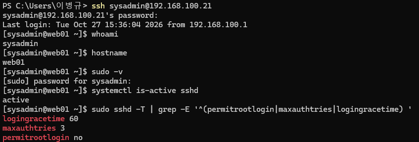
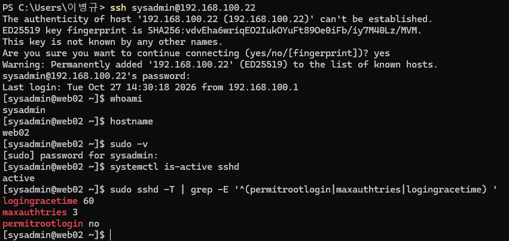

# 18. SSH 보안 강화 (SSH Hardening)

## 1. 실습 개요

### 1.1 목적

Rocky Linux 웹 서버의 SSH 보안 설정을 강화하여 관리자 계정에 대한 무단 접근 위험을 줄이고, 보안 정책 적용 후에도 원격 관리 기능이 정상적으로 유지되는지 검증한다.

이번 실습에서는 기존 SSH 접속 환경을 유지하면서 다음 항목을 적용한다.

- root 계정의 SSH 직접 로그인 차단
- SSH 최대 인증 시도 횟수 제한
- SSH 로그인 대기 시간 단축
- 별도 설정 파일을 이용한 보안 정책 관리
- 보안 정책 적용 후 SSH 접속 및 sudo 권한 검증

### 1.2 실습 환경

| 구분 | WEB01 | WEB02 |
|---|---|---|
| 운영체제 | Rocky Linux 9.8 | Rocky Linux 9.8 |
| 호스트명 | web01 | web02 |
| 관리 IP | 192.168.100.21 | 192.168.100.22 |
| 관리 네트워크 | VMnet2 (Host-only) | VMnet2 (Host-only) |
| SSH 서비스 | OpenSSH Server | OpenSSH Server |
| 관리 계정 | sysadmin | sysadmin |

Windows 호스트의 관리 IP는 `192.168.100.1`이며, SSH 접속에는 Host-only 네트워크를 사용한다.

WEB01과 WEB02에 동일한 보안 정책을 적용하므로 설정 명령어는 공통으로 작성하고 검증 결과만 비교한다.

---

## 2. SSH 기본 설정 점검

보안 설정을 변경하기 전에 기존 SSH 서비스와 주요 설정값을 확인하였다.

### 2.1 SSH 서비스 확인

**실행 서버: WEB01, WEB02**

```bash
systemctl is-active sshd
systemctl is-enabled sshd
```

두 서버 모두 SSH 서비스가 실행 중이며 자동 시작하도록 설정되어 있음을 확인하였다.

### 2.2 기존 SSH 보안 설정 확인

```bash
sudo sshd -T | grep -E '^(permitrootlogin|maxauthtries|logingracetime|passwordauthentication) '
```

**주요 설정**

| 설정 항목 | 기존 값 |
|---|---|
| PermitRootLogin | without-password |
| MaxAuthTries | 6 |
| LoginGraceTime | 120 |
| PasswordAuthentication | yes |

기존 설정에서는 root의 일부 SSH 인증 방식이 허용될 수 있었으며, 최대 인증 시도 횟수와 로그인 대기 시간도 상대적으로 길게 설정되어 있었다.

이를 개선하기 위해 별도 SSH Hardening 설정 파일을 작성하였다.

---

## 3. SSH Hardening 설정 적용

### 3.1 별도 설정 파일 사용

기존 `/etc/ssh/sshd_config`를 직접 수정하는 대신 /etc/ssh/sshd_config.d/10-hardening.conf 파일을 수정하여 보안 정책을 설정하였다.

**설정 파일**

`/etc/ssh/sshd_config.d/10-hardening.conf`

Rocky Linux의 SSH 설정은 `/etc/ssh/sshd_config`에서 추가 설정 파일을 포함하도록 구성되어 있다.

별도 파일을 사용하면 기존 설정과 사용자 정의 보안 정책을 구분하기 쉬워 유지보수에 유리하다.

### 3.2 SSH 보안 정책

**WEB01과 WEB02에 동일하게 적용한 설정**

```conf
# SSH Hardening - Rocky Linux Infrastructure Lab

PermitRootLogin no
MaxAuthTries 3
LoginGraceTime 60
```

| 설정 | 적용값 | 목적 |
|---|---|---|
| PermitRootLogin | no | root의 SSH 직접 로그인 차단 |
| MaxAuthTries | 3 | 연결당 최대 인증 시도 횟수 제한 |
| LoginGraceTime | 60 | 인증 완료 전 로그인 대기 시간을 60초로 제한 |

이번 단계에서는 `PasswordAuthentication yes`를 유지하였다.

SSH 키 인증 전환은 별도 작업으로 진행할 수 있도록 남겨두었으며, 비밀번호 인증을 비활성화하지 않은 상태에서 root 직접 로그인 제한과 인증 시도 제한을 우선 적용하였다.

### 3.3 설정 파일 확인

```bash
sudo cat /etc/ssh/sshd_config.d/10-hardening.conf
```

출력:

```conf
# SSH Hardening - Rocky Linux Infrastructure Lab

PermitRootLogin no
MaxAuthTries 3
LoginGraceTime 60
```

### 3.4 SSH 설정 문법 검사

```bash
sudo sshd -t
```

오류 메시지 없이 종료되는 것을 확인하였다.

설정 변경 시 문법 검사를 먼저 수행하여 잘못된 SSH 설정으로 인해 원격 접속이 중단되는 상황을 예방하였다.

### 3.5 SSH 서비스에 설정 반영

```bash
sudo systemctl reload sshd
```

`restart` 대신 `reload`를 사용하여 SSH 서비스를 완전히 재시작하지 않고 설정을 다시 읽도록 하였다.

---

## 4. SSH 보안 정책 적용 결과

### 4.1 실제 적용된 SSH 설정 확인

**실행 서버: WEB01, WEB02**

```bash
sudo sshd -T | grep -E '^(permitrootlogin|maxauthtries|logingracetime|passwordauthentication) '
```

**결과**

```text
logingracetime 60
maxauthtries 3
permitrootlogin no
passwordauthentication yes
```

| 검증 항목 | WEB01 | WEB02 |
|---|---|---|
| PermitRootLogin | no | no |
| MaxAuthTries | 3 | 3 |
| LoginGraceTime | 60 | 60 |
| PasswordAuthentication | yes | yes |
| SSH 설정 문법 검사 | 통과 | 통과 |
| SSH 설정 반영 | 완료 | 완료 |

`sshd -T`는 SSH 데몬이 해석한 최종 유효 설정값을 출력하므로, 단순히 설정 파일의 내용을 확인하는 것보다 실제 적용 상태를 검증하는 데 유용하다.

---

## 5. SSH 원격 접속 검증

SSH 보안 정책 적용 후에도 원격 관리가 가능한지 확인하기 위해 Windows PowerShell에서 새로운 SSH 세션을 생성하였다.

### 5.1 신규 SSH 접속

**Windows PowerShell**

```powershell
# WEB01
ssh sysadmin@192.168.100.21

# WEB02
ssh sysadmin@192.168.100.22
```

**접속 후 공통 검증**

```bash
whoami
hostname
systemctl is-active sshd
sudo -v
```

### 5.2 서버별 검증 결과

| 검증 항목 | WEB01 | WEB02 |
|---|---|---|
| 신규 SSH 접속 | 성공 | 성공 |
| 로그인 사용자 | sysadmin | sysadmin |
| 호스트명 | web01 | web02 |
| SSH 서비스 | active | active |
| sudo 인증 | 성공 | 성공 |
| root SSH 직접 로그인 차단 정책 | 적용 | 적용 |

기존 SSH 세션을 유지하는 것뿐 아니라 새로운 연결을 생성하여 보안 정책 적용 후에도 정상적인 원격 관리가 가능함을 확인하였다.

---

## 6. 작업 중 고려한 사항

### 6.1 SSH 접속 중단 방지

원격 서버에서 SSH 설정을 잘못 변경하면 관리자 접속이 차단될 수 있다.

이를 방지하기 위해 다음 순서로 작업하였다.

1. 기존 SSH 설정 확인
2. 별도 Hardening 설정 파일 작성
3. `sshd -t`로 문법 검사
4. `systemctl reload sshd`로 설정 반영
5. `sshd -T`로 유효 설정 확인
6. 새로운 SSH 세션으로 접속 검증

이 순서를 통해 설정 적용 여부뿐 아니라 실제 운영 관리 가능 여부까지 확인하였다.

### 6.2 비밀번호 인증 유지

이번 실습에서는 관리 계정의 비밀번호 인증을 유지하였다.

### 6.3 SSH 접근 네트워크 제한

SSH에 접근할 수 있는 출발지 네트워크를 제한하는 작업은 firewalld Rich Rule을 이용해 다음 실습에서 수행하였다.

---

## 7. 서버별 SSH Hardening 설정 확인

### WEB01 — SSH 설정



### WEB02 — SSH 설정



- `screenshots/hardening/01-web01-ssh-root-login-disabled.png` — WEB01 root SSH 직접 로그인 제한 확인

---

## 8. 실습 결과 및 정리

이번 실습에서는 Rocky Linux 9.8 기반 WEB01과 WEB02에 동일한 SSH 보안 정책을 적용하였다.

**주요 성과**

- root 계정의 SSH 직접 로그인 제한
- 최대 인증 시도 횟수 6회에서 3회로 축소
- 로그인 대기 시간 120초에서 60초로 축소
- 별도 설정 파일을 이용한 SSH 정책 관리
- SSH 문법 검사 및 유효 설정 검증
- Windows에서 신규 SSH 접속 및 sudo 권한 정상 동작 확인

단순히 SSH 설정을 변경하는 데 그치지 않고, **설정 변경 → 문법 검사 → 서비스 반영 → 실제 접속 검증** 순서로 작업하여 원격 관리 기능의 연속성을 확인하였다.

후속 보안 작업은 아래 문서에서 정리한다.

- **19. Firewalld & SELinux** — 네트워크 접근 제어 및 SELinux 정책
- **20. Account & Service Hardening** — 사용자 권한 및 불필요한 서비스 관리
- **21. Security Updates** — 보안 패치, 커널 업데이트 및 패키지 의존성 충돌 해결

