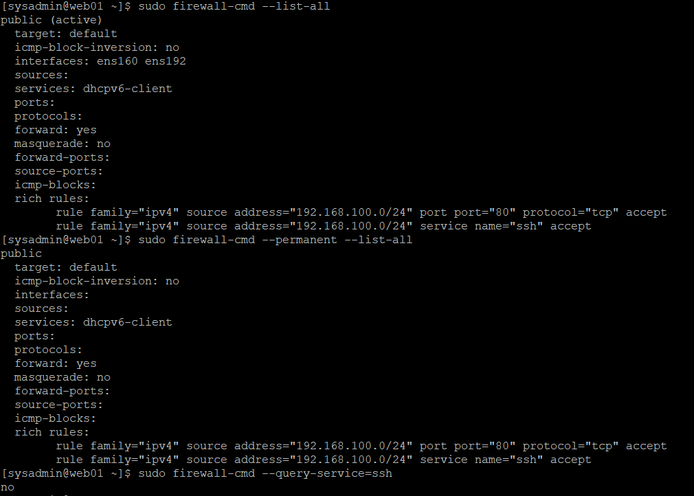
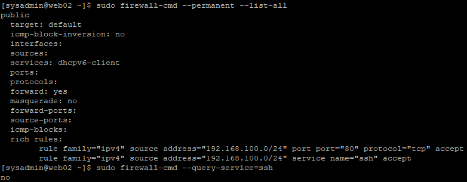
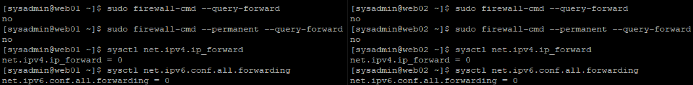

# 19. Firewalld & SELinux 보안 정책

## 1. 실습 개요

### 1.1 목적

Rocky Linux 웹 서버에 firewalld 기반 접근 제어 정책을 적용하고, SELinux를 활성화한 상태에서 Apache와 NFS 연동 기능이 정상적으로 동작하는지 검증한다.

이번 실습의 주요 목표는 다음과 같다.

- SSH 및 HTTP 접근을 내부 네트워크로 제한
- firewalld Rich Rule을 이용한 출발지 기반 접근 제어
- 기본 SSH 허용 규칙 제거
- 불필요한 Zone 내 포워딩 비활성화
- SELinux Enforcing 상태 유지
- SELinux 정책을 적용한 상태에서 Apache와 NFS 연동 검증

### 1.2 실습 환경

| 구분 | WEB01 | WEB02 |
|---|---|---|
| 운영체제 | Rocky Linux 9.8 | Rocky Linux 9.8 |
| 호스트명 | web01 | web02 |
| 내부 IP | 192.168.100.21 | 192.168.100.22 |
| 방화벽 | firewalld | firewalld |
| 활성 Zone | public | public |
| SELinux | Enforcing | Enforcing |
| 웹 서버 | Apache HTTP Server | Apache HTTP Server |
| 공유 스토리지 | NFSv4.2 Client | NFSv4.2 Client |

### 1.3 네트워크 구성

| 네트워크 | 대역 | 용도 |
|---|---|---|
| VMnet8 (NAT) | 10.10.10.0/24 | 외부 인터넷 및 패키지 업데이트 |
| VMnet2 (Host-only) | 192.168.100.0/24 | 내부 서버 통신 및 SSH 관리 |

WEB01과 WEB02에는 각각 NAT 및 Host-only 인터페이스가 연결되어 있다.

- `ens160`: NAT 네트워크
- `ens192`: Host-only 네트워크

Windows 호스트의 Host-only IP는 `192.168.100.1`이다.

이번 실습에서는 SSH 및 HTTP의 IPv4 접근 허용 범위를 `192.168.100.0/24`로 제한하였다.

---

## 2. Firewalld 기본 정책 점검

### 2.1 방화벽 서비스 확인

**실행 서버: WEB01, WEB02**

```bash
systemctl is-active firewalld
```

**검증 결과**

| 서버 | 결과 |
|---|---|
| WEB01 | active |
| WEB02 | active |

두 서버 모두 firewalld가 실행 중임을 확인하였다.

### 2.2 활성 Zone 및 인터페이스 확인

```bash
sudo firewall-cmd --list-all
```

확인된 주요 설정:

```text
public (active)
  target: default
  interfaces: ens160 ens192
```

NAT와 Host-only 인터페이스 모두 `public` Zone에 연결되어 있었다.

따라서 특정 인터페이스에서만 서비스를 허용하는 대신, **Rich Rule에 출발지 IPv4 대역을 설정하여 접근을 제어**하였다.

---

## 3. SSH 접근 제한

### 3.1 기존 SSH 허용 정책

초기 방화벽 설정에서는 `public` Zone의 기본 허용 서비스에 `ssh`가 포함되어 있었다.

```text
services: cockpit dhcpv6-client ssh
```

기본 SSH 서비스 허용 상태에서는 출발지 IPv4 대역을 별도로 제한하지 않는다.

이를 개선하기 위해 관리 네트워크를 출발지로 하는 Rich Rule을 추가한 후, 기본 SSH 허용 서비스를 제거하였다.

### 3.2 SSH Rich Rule 추가

**WEB01과 WEB02에 공통 적용**

```bash
sudo firewall-cmd --permanent --zone=public \
  --add-rich-rule='rule family="ipv4" source address="192.168.100.0/24" service name="ssh" accept'
```

설정 반영:

```bash
sudo firewall-cmd --reload
```

적용한 규칙:

```text
rule family="ipv4" source address="192.168.100.0/24" service name="ssh" accept
```

| 항목 | 설명 |
|---|---|
| family | IPv4 |
| source address | 192.168.100.0/24 |
| service | SSH |
| action | accept |

해당 규칙은 내부 관리 네트워크에서 들어오는 IPv4 SSH 연결을 허용한다.

### 3.3 기본 SSH 서비스 허용 제거

접근 제한용 Rich Rule을 먼저 추가한 뒤 기존의 광범위한 SSH 서비스 허용을 제거하였다.

```bash
sudo firewall-cmd --permanent --zone=public --remove-service=ssh
sudo firewall-cmd --reload
```

적용 확인:

```bash
sudo firewall-cmd --query-service=ssh
```

**WEB01과 WEB02 결과**

```text
no
```

두 서버 모두 `public` Zone의 기본 서비스 목록에서 SSH 허용이 제거되었음을 확인하였다.

### 3.4 신규 SSH 접속 검증

기존 SSH 세션이 유지되는 것만으로는 변경 후 신규 접속 가능 여부를 확인할 수 없다.

따라서 Windows PowerShell에서 새로운 SSH를 통해 접속하였다.

**WEB01**

```powershell
ssh sysadmin@192.168.100.21
```

**WEB02**

```powershell
ssh sysadmin@192.168.100.22
```

접속 후 공통 검증:

```bash
whoami
hostname
systemctl is-active sshd
```

**검증 결과**

| 항목 | WEB01 | WEB02 |
|---|---|---|
| Windows Host-only SSH 접속 | 성공 | 성공 |
| 로그인 사용자 | sysadmin | sysadmin |
| 호스트명 | web01 | web02 |
| SSH 서비스 | active | active |

기본 SSH 서비스 허용을 제거한 이후에도 Host-only 네트워크를 통한 신규 SSH 접속이 정상적으로 동작하였다.

### 3.5 서버별 설정 확인

**WEB01 — SSH 접근 제한**



**WEB02 — SSH 접근 제한**



---

## 4. HTTP 접근 제한

### 4.1 HTTP 접근 제어 정책

Apache 웹 서버의 HTTP 접근도 내부 네트워크로 제한하였다.

적용한 Rich Rule:

```text
rule family="ipv4" source address="192.168.100.0/24" port port="80" protocol="tcp" accept
```

설정 명령어:

```bash
sudo firewall-cmd --permanent --zone=public \
  --add-rich-rule='rule family="ipv4" source address="192.168.100.0/24" port port="80" protocol="tcp" accept'
```

설정 반영:

```bash
sudo firewall-cmd --reload
```

| 항목 | 적용값 |
|---|---|
| 프로토콜 | TCP |
| 목적지 포트 | 80 |
| 허용 출발지 | 192.168.100.0/24 |
| 동작 | accept |

SSH와 달리 HTTP는 서비스 이름 대신 TCP 포트 `80`을 지정하였다.

### 4.2 Apache HTTP 응답 확인

**WEB01**

```bash
curl -i --max-time 10 http://192.168.100.21/nfs-lab-check.txt
```

**WEB02**

```bash
curl -i --max-time 10 http://192.168.100.22/nfs-lab-check.txt
```

두 서버에서 다음 응답을 확인하였다.

```text
HTTP/1.1 200 OK

Apache NFS integration test
```

| 서버 | HTTP 응답 | 결과 |
|---|---|---|
| WEB01 | 200 OK | 정상 |
| WEB02 | 200 OK | 정상 |

--max-time 10은 HTTP 요청의 전체 실행 시간을 최대 10초로 제한하며, 웹 서비스 장애나 NFS 응답 지연으로 인해 테스트 명령어가 장시간 대기하는 상황을 방지하기 위해 사용하였다.

---

## 5. Firewalld Zone 포워딩 비활성화

### 5.1 기존 포워딩 설정 확인

초기 설정에서 WEB01과 WEB02의 firewalld Zone 포워딩이 활성화되어 있었다.

```bash
sudo firewall-cmd --query-forward
sudo firewall-cmd --permanent --query-forward
```

결과:

```text
yes
yes
```

추가로 Linux 커널의 IP 포워딩 설정을 확인하였다.

```bash
sysctl net.ipv4.ip_forward
sysctl net.ipv6.conf.all.forwarding
```

결과:

```text
net.ipv4.ip_forward = 0
net.ipv6.conf.all.forwarding = 0
```

커널의 IPv4 및 IPv6 패킷 포워딩은 이미 비활성화되어 있었다.

다만 firewalld의 Zone 내 포워딩 정책은 활성화되어 있었으므로, 웹 서버 역할에 필요하지 않은 해당 허용 설정을 제거하였다.

### 5.2 Zone 포워딩 허용 제거

**WEB01과 WEB02에 공통 적용**

```bash
sudo firewall-cmd --permanent --zone=public --remove-forward
sudo firewall-cmd --reload
```

설정 확인:

```bash
sudo firewall-cmd --query-forward
sudo firewall-cmd --permanent --query-forward
```

결과:

```text
no
no
```

### 5.3 변경 전후 비교

| 항목 | 변경 전 | WEB01 변경 후 | WEB02 변경 후 |
|---|---|---|---|
| firewalld 런타임 포워딩 | yes | no | no |
| firewalld 영구 포워딩 | yes | no | no |
| IPv4 커널 포워딩 | 0 | 0 | 0 |
| IPv6 커널 포워딩 | 0 | 0 | 0 |

커널 포워딩은 별도로 변경하지 않았으며, firewalld의 불필요한 Zone 내 포워딩 허용만 제거하였다.

### 5.4 기존 서비스 정상 동작 검증

포워딩 설정 변경 후 SSH, Apache 및 NFS 상태를 확인하였다.

```bash
systemctl is-active sshd
systemctl is-active httpd
findmnt /mnt/nfs-share
```

HTTP 기능도 다시 검증하였다.

```bash
curl -i --max-time 10 http://127.0.0.1/nfs-lab-check.txt
```

**검증 결과**

| 검증 항목 | WEB01 | WEB02 |
|---|---|---|
| SSH | active | active |
| Apache | active | active |
| NFSv4.2 마운트 | 정상 | 정상 |
| HTTP 응답 | 200 OK | 200 OK |

기존 서버 기능을 유지하면서 Zone 포워딩 허용 설정을 제거하였다.

### 5.5 WEB01·WEB02 포워딩 비활성화 증빙



---

## 6. SELinux 정책 확인 및 Apache·NFS 연동

### 6.1 SELinux 상태 확인

**실행 서버: WEB01, WEB02**

```bash
getenforce
```

두 서버의 결과:

```text
Enforcing
```

| 서버 | SELinux 상태 |
|---|---|
| WEB01 | Enforcing |
| WEB02 | Enforcing |

두 서버 모두 SELinux가 강제 적용 모드로 동작하고 있었다.

SELinux를 `Permissive` 또는 `Disabled`로 변경하지 않고 기존 웹 서비스를 운영하였다.

### 6.2 Apache의 NFS 접근 허용

앞서 NFS 클라이언트 실습에서 Apache가 NFS 공유 파일에 접근할 수 있도록 SELinux Boolean을 설정하였다.

```bash
sudo setsebool -P httpd_use_nfs on
```

| 옵션 | 설명 |
|---|---|
| `setsebool` | SELinux Boolean 설정 |
| `-P` | 설정을 영구적으로 유지 |
| `httpd_use_nfs` | Apache의 NFS 접근 관련 정책 |
| `on` | 해당 기능 허용 |

SELinux를 비활성화하는 대신, 필요한 서비스 동작에 해당하는 Boolean을 조정하였다.

설정 확인 명령어:

```bash
getsebool httpd_use_nfs
```

적용한 설정값:

```text
httpd_use_nfs --> on
```

### 6.3 NFS 공유 스토리지 확인

NAS01에서 제공하는 NFS 공유 디렉터리를 두 웹 서버에 마운트하였다.

| 항목 | 설정 |
|---|---|
| NFS 서버 | NAS01 |
| 서버 IP | 192.168.100.41 |
| NFS 공유 경로 | /data/nfs/share |
| 클라이언트 마운트 경로 | /mnt/nfs-share |
| NFS 버전 | 4.2 |

마운트 상태 확인:

```bash
nfsstat -m
```

WEB01과 WEB02 모두 다음 주요 옵션이 확인되었다.

```text
vers=4.2
proto=tcp
sec=sys
```

### 6.4 Apache와 NFS 연동 설정

NFS 공유 파일의 HTTP 제공을 검증하기 위해 다음 Apache 설정을 사용하였다.

**설정 파일**

`/etc/httpd/conf.d/nfs-lab-check.conf`

```apache
Alias /nfs-lab-check.txt "/mnt/nfs-share/http-nfs-test.txt"

<Directory "/mnt/nfs-share">
    Options None
    AllowOverride None
    Require all granted
</Directory>
```

이 설정은 요청 URL `/nfs-lab-check.txt`를 NFS에 저장된 테스트 파일과 연결한다.

설정 파일 확인:

```bash
sudo cat /etc/httpd/conf.d/nfs-lab-check.conf
```

### 6.5 SELinux Enforcing 상태에서 HTTP 연동 검증

WEB01과 WEB02에서 다음 명령어로 HTTP 응답을 확인하였다.

```bash
curl -i --max-time 10 http://127.0.0.1/nfs-lab-check.txt
```

결과:

```text
HTTP/1.1 200 OK

Apache NFS integration test
```

**검증 결과**

| 검증 항목 | WEB01 | WEB02 |
|---|---|---|
| SELinux | Enforcing | Enforcing |
| NFS 마운트 | 정상 | 정상 |
| Apache 서비스 | active | active |
| NFS 파일 HTTP 제공 | 200 OK | 200 OK |

SELinux를 비활성화하지 않고도 Apache와 NFS의 연동 기능이 정상적으로 동작함을 확인하였다.

이번 실습에서는 SELinux 상태 및 기존 NFS 연동 기능을 확인하였다.

---

## 7. 최종 방화벽 정책 검증

### 7.1 최종 firewalld 설정 확인

**실행 서버: WEB01, WEB02**

```bash
sudo firewall-cmd --list-all
```

두 서버에서 확인한 최종 설정:

```text
public (active)
  target: default
  icmp-block-inversion: no
  interfaces: ens160 ens192
  sources:
  services: dhcpv6-client
  ports:
  protocols:
  forward: no
  masquerade: no
  forward-ports:
  source-ports:
  icmp-blocks:
  rich rules:
        rule family="ipv4" source address="192.168.100.0/24" port port="80" protocol="tcp" accept
        rule family="ipv4" source address="192.168.100.0/24" service name="ssh" accept
```

### 7.2 주요 정책 비교

| 보안 항목 | WEB01 | WEB02 |
|---|---|---|
| 활성 Zone | public | public |
| 기본 SSH 서비스 허용 | 제거 | 제거 |
| HTTP 허용 IPv4 대역 | 192.168.100.0/24 | 192.168.100.0/24 |
| SSH 허용 IPv4 대역 | 192.168.100.0/24 | 192.168.100.0/24 |
| Zone 포워딩 | no | no |
| Masquerade | no | no |
| SELinux | Enforcing | Enforcing |

---

## 8. 실습 결과 및 정리

이번 실습에서는 Rocky Linux 9.8 기반 WEB01과 WEB02에 firewalld 및 SELinux 보안 정책을 적용하고, 기존 서비스가 정상적으로 유지되는지 검증하였다.

**주요 성과**

- SSH와 HTTP에 내부 IPv4 네트워크 기반 접근 제어 적용
- firewalld Rich Rule을 통한 출발지 기반 정책 관리
- 기본 SSH 서비스 허용 제거
- 불필요한 firewalld Zone 포워딩 비활성화
- SELinux Enforcing 상태 유지
- `httpd_use_nfs` Boolean을 이용한 Apache·NFS 연동 확인

단순히 방화벽 규칙을 변경하는 데 그치지 않고, **접근 제어 정책 적용 → 신규 SSH 접속 검증 → Apache·NFS 기능 검증 → 최종 정책 확인** 순서로 작업하였다.

이를 통해 보안 정책 강화와 서비스 가용성을 함께 검증하는 과정을 경험하였다.

### 관련 문서

- [18. SSH 보안 강화](18-ssh-hardening.md)
- [20. 사용자 및 서비스 보안 강화](20-account-service-hardening.md)
- [21. 보안 업데이트 및 패키지 의존성 충돌 해결](21-security-updates.md)

