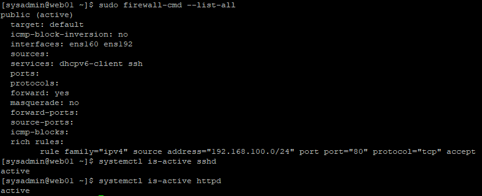
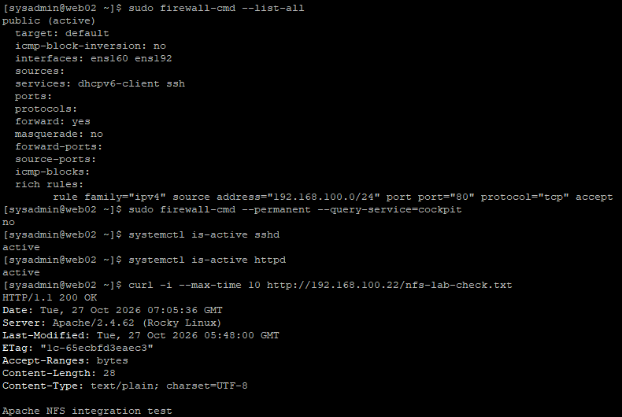
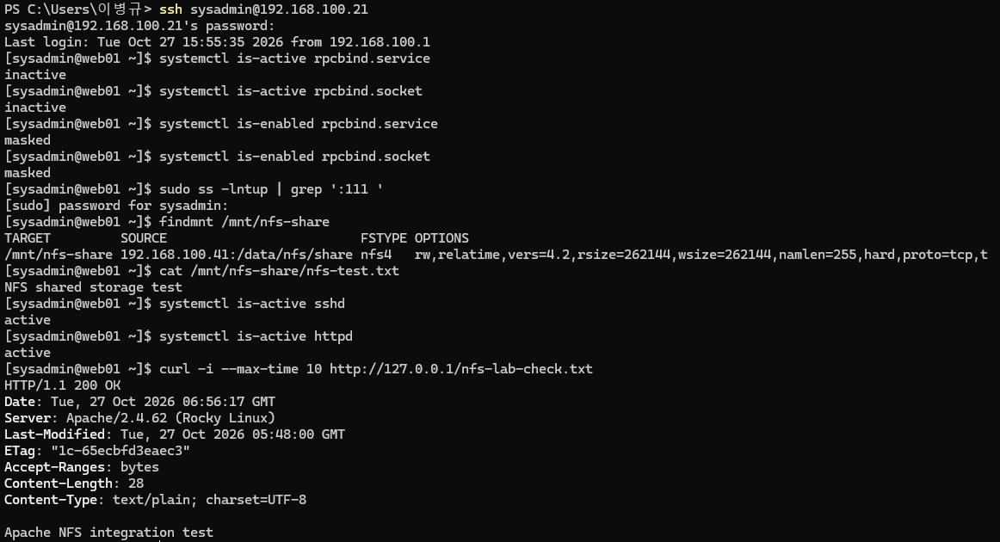

# 20. 사용자 및 서비스 보안 강화 (Account & Service Hardening)

## 1. 실습 개요

### 1.1 목적

Rocky Linux 9.8 웹 서버의 사용자 권한과 시스템 서비스를 점검하고, 운영에 불필요한 서비스 및 네트워크 노출을 최소화한다.

이번 실습의 주요 목표는 다음과 같다.

- 시스템 계정 및 관리자 권한 점검
- Apache 서비스 계정의 로그인 제한 확인
- 불필요한 Cockpit 방화벽 허용 규칙 제거
- NFSv4.2 환경에서 불필요한 rpcbind 서비스 비활성화
- NIS 미사용 환경의 관련 서비스 정리
- SSSD 및 NSS 인증 설정 점검
- 실제 네트워크 수신 포트 확인
- 서비스 비활성화 및 재부팅 후 기존 기능 정상 동작 검증

### 1.2 실습 환경

| 구분 | WEB01 | WEB02 |
|---|---|---|
| 운영체제 | Rocky Linux 9.8 | Rocky Linux 9.8 |
| 호스트명 | web01 | web02 |
| 관리 IP | 192.168.100.21 | 192.168.100.22 |
| 관리자 계정 | sysadmin | sysadmin |
| 웹 서비스 | Apache HTTP Server | Apache HTTP Server |
| 공유 스토리지 | NFSv4.2 Client | NFSv4.2 Client |
| NFS 서버 | NAS01 (192.168.100.41) | NAS01 (192.168.100.41) |

WEB01과 WEB02에 동일한 보안 정책을 적용하였다. 따라서 공통 작업은 한 번만 설명하고, 서버별 차이는 검증 결과에서 비교한다.

---

## 2. 사용자 계정 및 관리자 권한 점검

### 2.1 주요 시스템 계정 확인

**실행 서버: WEB01, WEB02**

```bash
getent passwd root sysadmin apache
```

두 서버에서 동일한 결과를 확인하였다.

```text
root:x:0:0:root:/root:/bin/bash
sysadmin:x:1000:1000:sysadmin:/home/sysadmin:/bin/bash
apache:x:48:48:Apache:/usr/share/httpd:/sbin/nologin
```

| 계정 | UID | 로그인 셸 | 역할 |
|---|---|---|---|
| root | 0 | /bin/bash | 시스템 관리자 |
| sysadmin | 1000 | /bin/bash | 서버 관리 계정 |
| apache | 48 | /sbin/nologin | Apache 서비스 계정 |

Apache 계정은 `/sbin/nologin`을 사용하여 일반적인 대화형 셸 로그인이 제한되어 있다.

관리자는 `sysadmin` 계정을 통해 로그인한 뒤 필요한 작업에 sudo 권한을 사용한다.

### 2.2 wheel 관리자 그룹 확인

```bash
getent group wheel
```

WEB01·WEB02 공통 결과:

```text
wheel:x:10:sysadmin
```

현재 확인한 `wheel` 그룹에는 `sysadmin` 계정이 포함되어 있다.

### 2.3 sudo 권한 확인

```bash
sudo -l
```

WEB01:

```text
User sysadmin may run the following commands on web01:
    (ALL) ALL
```

WEB02:

```text
User sysadmin may run the following commands on web02:
    (ALL) ALL
```

`sysadmin` 계정에 전체 sudo 권한이 부여된 것을 확인하였다.

이번 프로젝트에서는 해당 계정을 서버 관리 전용 계정으로 사용하므로 기존 권한을 유지하였다.

실제 운영 환경에서는 최소 권한 원칙에 따라 sudo 권한이 필요한 사용자에게만 관리자 권한을 부여해야 한다.

### 2.4 최종 계정 및 권한 검증

| 검증 항목 | WEB01 | WEB02 |
|---|---|---|
| sysadmin UID | 1000 | 1000 |
| apache UID | 48 | 48 |
| apache 로그인 셸 | /sbin/nologin | /sbin/nologin |
| wheel 그룹 구성원 | sysadmin | sysadmin |
| sysadmin sudo 권한 | (ALL) ALL | (ALL) ALL |

두 웹 서버의 주요 사용자와 관리자 권한 설정이 동일함을 확인하였다.

---

## 3. Cockpit 방화벽 허용 규칙 제거

### 3.1 기존 설정 점검

초기 firewalld 설정의 `public` Zone에는 다음 서비스가 허용되어 있었다.

```text
services: cockpit dhcpv6-client ssh
```

Cockpit은 웹 기반 시스템 관리 도구이며, 일반적으로 TCP 9090 포트를 사용한다.

이번 프로젝트에서는 Windows에서 SSH를 통해 서버를 관리하므로 Cockpit 웹 관리 기능이 필요하지 않는다.

WEB01과 WEB02에서 다음 사항을 확인하였다.

- `cockpit-ws` 패키지가 설치되어 있지 않음
- TCP 9090 포트에서 수신 대기하는 프로세스가 없음
- 방화벽에는 `cockpit` 서비스 허용 규칙이 남아 있음

따라서 불필요한 Cockpit 방화벽 허용 규칙을 제거하였다.

### 3.2 Cockpit 허용 규칙 제거

**WEB01·WEB02 공통 실행**

```bash
sudo firewall-cmd --permanent --remove-service=cockpit
sudo firewall-cmd --reload
```

각 명령어의 정상 실행 결과는 `success`였다.

### 3.3 적용 결과

```bash
sudo firewall-cmd --list-services
```

Cockpit 제거 이후 기본 허용 서비스 목록에서 `cockpit`이 사라진 것을 확인하였다.

다만 이후 SSH 접근 제한 작업을 통해 기본 `ssh` 서비스 허용도 제거하였다.

**최종 기본 허용 서비스**

```text
dhcpv6-client
```

SSH 및 HTTP 접근은 별도 Rich Rule로 관리한다.

방화벽 출발지 제한과 Rich Rule의 상세 설정은 [19. Firewalld & SELinux](19-firewall-selinux.md)에서 다룬다.

**WEB01 — Cockpit 방화벽 허용 제거**



**WEB02 — Cockpit 방화벽 허용 제거**



### 3.4 서비스 영향 확인

Cockpit 규칙 제거 후 다음 서비스를 확인하였다.

```bash
systemctl is-active sshd
systemctl is-active httpd
```

| 서버 | SSH | Apache |
|---|---|---|
| WEB01 | active | active |
| WEB02 | active | active |

불필요한 방화벽 허용 규칙을 제거하면서 기존 원격 관리 및 웹 서비스가 유지됨을 확인하였다.

---

## 4. rpcbind 서비스 비활성화

### 4.1 기존 rpcbind 상태 확인

초기 점검에서 WEB01과 WEB02의 다음 유닛이 활성화되어 있었다.

- `rpcbind.service`
- `rpcbind.socket`

또한 TCP/UDP 111번 포트가 사용 중이었다.

`rpcbind`는 RPC 서비스의 포트 정보를 관리하는 기능이다. NFSv3 등의 환경에서는 필요할 수 있으나, 이번 프로젝트에서는 NFSv4.2를 사용하고 있다.

따라서 실제 NFS 구성과 의존성을 확인한 뒤 rpcbind를 비활성화하였다.

### 4.2 NFS 클라이언트 버전 확인

```bash
nfsstat -m
```

WEB01:

```text
/mnt/nfs-share from 192.168.100.41:/data/nfs/share
Flags: rw,relatime,vers=4.2,...,proto=tcp,...,sec=sys,...
```

WEB02도 동일한 NFSv4.2 및 TCP 설정을 사용하고 있음을 확인하였다.

| 항목 | 설정 |
|---|---|
| NFS 서버 | 192.168.100.41 |
| 공유 경로 | /data/nfs/share |
| 마운트 경로 | /mnt/nfs-share |
| NFS 버전 | 4.2 |
| 전송 프로토콜 | TCP |

추가 점검에서 `rpc-statd`는 실행 중이지 않았고, 로컬 RPC 조회에는 포트 매퍼만 표시되었다.

현재 실습 구성에서 NFSv3 기능을 사용하지 않는 것을 확인한 뒤 rpcbind를 비활성화하였다.

### 4.3 rpcbind 서비스 및 소켓 차단

**WEB01·WEB02 공통 실행**

```bash
sudo systemctl mask --now rpcbind.service rpcbind.socket
```

`mask`는 서비스가 수동으로 시작되거나 다른 유닛에 의해 시작되는 것까지 방지하는 설정이다.

`--now`를 함께 사용하여 현재 실행 중인 유닛도 즉시 중지하였다.

단순히 `disable`만 수행하는 대신 서비스와 소켓을 모두 마스킹하였다.

### 4.4 비활성화 결과 확인

```bash
systemctl is-enabled rpcbind.service rpcbind.socket
systemctl is-active rpcbind.service rpcbind.socket
```

WEB01·WEB02 공통 결과:

```text
masked
masked
inactive
inactive
```

또한 `ss` 명령어를 통해 TCP/UDP 111번 포트가 더 이상 수신 대기하지 않는 것을 확인하였다.

**WEB01 — rpcbind 서비스 및 소켓 비활성화**



**WEB02 — rpcbind 서비스 및 소켓 비활성화**


### 4.5 NFS·Apache 정상 동작 확인

```bash
findmnt /mnt/nfs-share
```

NFS 마운트가 유지되는 것을 확인하였다.

```bash
cat /mnt/nfs-share/nfs-test.txt
```

확인한 공유 파일 내용:

```text
NFS shared storage test
```

Apache의 NFS 파일 제공 기능도 확인하였다.

```bash
curl -i --max-time 10 http://127.0.0.1/nfs-lab-check.txt
```

두 서버 모두 다음 응답을 반환하였다.

```text
HTTP/1.1 200 OK

Apache NFS integration test
```

### 4.6 재부팅 후 검증

WEB01과 WEB02를 재부팅한 뒤 rpcbind 설정과 기존 서비스를 다시 점검하였다.

| 검증 항목 | WEB01 | WEB02 |
|---|---|---|
| rpcbind.service | masked | masked |
| rpcbind.socket | masked | masked |
| rpcbind 실행 상태 | inactive | inactive |
| TCP/UDP 111번 수신 대기 | 없음 | 없음 |
| NFS 자동 마운트 | 정상 | 정상 |
| Apache HTTP 응답 | 200 OK | 200 OK |

보안 업데이트 및 새 커널 적용 후 재부팅에서도 해당 설정이 유지됨을 확인하였다.

---

## 5. 불필요한 NIS 도메인 설정 서비스 정리

### 5.1 NIS 관련 서비스 점검

초기 자동 실행 서비스 목록에 다음 유닛이 포함되어 있었다.

```text
nis-domainname.service
```

서비스 상태는 다음과 같았다.

| 항목 | 변경 전 |
|---|---|
| 실행 상태 | active |
| 자동 실행 | enabled |

NIS 도메인 사용 여부를 확인하였다.

```bash
domainname
```

WEB01·WEB02 공통 결과:

```text
(none)
```

설정 파일도 확인하였다.

```bash
sudo cat /etc/sysconfig/network
```

공통 결과:

```text
# Created by anaconda
```

두 서버 모두 `NISDOMAIN` 설정이 존재하지 않았다.

### 5.2 서비스 실행 방식 확인

WEB01에서 서비스 정의를 확인하였다.

```bash
systemctl cat nis-domainname.service
```

주요 설정:

```ini
[Service]
ExecStart=/usr/libexec/hostname/nis-domainname
Type=oneshot
RemainAfterExit=yes
```

`nis-domainname.service`는 지속적으로 연결을 수신하는 데몬이 아니라, 시작 시 NIS 도메인 이름을 읽고 설정하는 일회성 서비스이다.

`RemainAfterExit=yes` 설정으로 인해 작업 종료 후에도 `active`로 표시될 수 있다.

현재 프로젝트에서는 NIS 도메인을 사용하지 않으므로 자동 실행을 해제하였다.

### 5.3 NIS 서비스 비활성화

**WEB01·WEB02 공통 실행**

```bash
sudo systemctl disable --now nis-domainname.service
```

실행 결과:

```text
Removed "/etc/systemd/system/sysinit.target.wants/nis-domainname.service".
```

### 5.4 비활성화 검증

```bash
systemctl is-active nis-domainname.service
systemctl is-enabled nis-domainname.service
domainname
```

WEB01·WEB02 공통 결과:

```text
inactive
disabled
(none)
```

### 5.5 계정 및 NFS 기능 검증

NIS 서비스 비활성화 이후 사용자·그룹 정보를 확인하였다.

```bash
getent passwd sysadmin
id sysadmin
```

두 서버에서 동일한 결과를 확인하였다.

```text
sysadmin:x:1000:1000:sysadmin:/home/sysadmin:/bin/bash
```

```text
uid=1000(sysadmin) gid=1000(sysadmin) groups=1000(sysadmin),10(wheel),3000(nfs_shared)
```

`sysadmin` 계정의 관리자 그룹과 NFS 공유 그룹이 유지됨을 확인하였다.

NFS 및 Apache 서비스도 다시 검증하였다.

```bash
findmnt /mnt/nfs-share
curl -i --max-time 10 http://127.0.0.1/nfs-lab-check.txt
```

**검증 결과**

| 검증 항목 | WEB01 | WEB02 |
|---|---|---|
| sysadmin 계정 조회 | 정상 | 정상 |
| wheel 그룹 | 유지 | 유지 |
| nfs_shared 그룹 | GID 3000 | GID 3000 |
| NFS 마운트 | 정상 | 정상 |
| Apache HTTP 응답 | 200 OK | 200 OK |

불필요한 NIS 도메인 설정 서비스를 비활성화한 후에도 사용자 조회 및 기존 공유 스토리지 연동 기능이 유지되었다.

---

## 6. SSSD 및 NSS 인증 구성 점검

### 6.1 SSSD 서비스 상태 확인

WEB01에서 SSSD 상태와 관련 패키지를 확인하였다.

```bash
systemctl is-active sssd.service
systemctl is-enabled sssd.service
```

확인 결과:

```text
inactive
enabled
```

SSSD 서비스는 자동 실행 설정이 존재했으나 점검 당시 실행되지 않고 있었다.

관리 도구를 확인하였다.

```bash
sudo sssctl domain-list
```

출력:

```text
sudo: sssctl: command not found
```

패키지 확인:

```bash
rpm -q sssd-common sssd-tools
```

결과:

```text
sssd-common-2.9.8-4.el9_8.x86_64
package sssd-tools is not installed
```

`sssd-common`은 설치되어 있었으나 `sssd-tools` 관리 도구는 설치되지 않은 상태였다.

### 6.2 NSS 사용자 정보 조회 설정

WEB01과 WEB02에서 다음 명령어를 실행하였다.

```bash
grep -E '^(passwd|group|shadow|netgroup):' /etc/nsswitch.conf
```

두 서버의 결과:

```text
passwd:     sss files systemd
shadow:     files
group:      sss files systemd
netgroup:   sss
```

`sss` 조회 항목이 존재하므로 SSSD 관련 NSS 구성이 포함되어 있음을 확인하였다.

그러나 이것만으로 LDAP 또는 Active Directory 인증을 실제로 사용 중이라고 단정할 수는 없다.

### 6.3 authselect 상태 확인

WEB01에서 다음 명령어를 실행하였다.

```bash
authselect current
```

결과:

```text
No existing configuration detected.
```

현재 authselect가 관리하는 인증 프로필이 확인되지 않았다.

이에 따라 SSH 및 sudo 인증에 영향을 줄 가능성을 고려하여 인증 관련 설정을 임의로 변경하지 않았다.

### 6.4 조치 결과

이번 실습에서 SSSD에 대해 수행한 작업은 **사용 상태 점검**이다.

- `sssd.service` 비활성화 변경을 수행하지 않음
- `sssd-common` 패키지를 제거하지 않음
- `/etc/nsswitch.conf`를 직접 수정하지 않음
- PAM 및 authselect 인증 프로필을 강제로 변경하지 않음

확인되지 않은 인증 의존성이 존재할 수 있으므로, 불필요하다고 추정되는 구성이라도 즉시 제거하기보다 실제 사용 여부를 먼저 분석하는 것이 중요하다.

---

## 7. 자동 실행 서비스 및 네트워크 포트 점검

### 7.1 자동 실행 서비스 확인

WEB01에서 다음 명령어로 자동 실행 서비스 목록을 조회하였다.

```bash
systemctl list-unit-files --type=service --state=enabled --no-pager
```

점검 당시 총 24개의 활성화된 서비스 유닛이 조회되었다.

주요 서비스는 다음과 같다.

| 서비스 | 역할 | 조치 |
|---|---|---|
| sshd | SSH 원격 관리 | 유지 |
| httpd | Apache 웹 서비스 | 유지 |
| firewalld | 방화벽 관리 | 유지 |
| auditd | 보안 감사 로그 | 유지 |
| chronyd | 시간 동기화 | 유지 |
| rsyslog | 시스템 로그 | 유지 |
| NetworkManager | 네트워크 관리 | 유지 |
| lvm2-monitor | LVM 관리 | 유지 |
| vmtoolsd / vgauthd | VMware 게스트 기능 | 유지 |
| sssd | 인증 관련 기능 | 추가 사용 여부 검토 |
| nis-domainname | NIS 도메인 설정 | 비활성화 |
| kdump | 커널 장애 덤프 | 유지 |

실행 중인 서비스가 많다고 해서 모두 불필요한 것은 아니므로, 각 서비스의 역할과 의존성을 기준으로 정리 여부를 결정하였다.

### 7.2 네트워크 수신 포트 확인

**WEB01 점검 명령어**

```bash
sudo ss -lntup
```

확인된 주요 수신 포트:

| 프로토콜 | 주소 및 포트 | 프로세스 | 판단 |
|---|---|---|---|
| TCP | 0.0.0.0:22 | sshd | 필요 |
| TCP | [::]:22 | sshd | 필요 |
| TCP | *:80 | httpd | 필요 |
| UDP | 127.0.0.1:323 | chronyd | 로컬 수신 |
| UDP | [::1]:323 | chronyd | 로컬 수신 |

기존에 rpcbind가 사용하던 TCP/UDP 111번 포트는 목록에서 사라졌다.

`chronyd`의 UDP 323번 포트는 루프백 주소에서만 수신 대기하고 있어 유지하였다.

SSH와 Apache는 네트워크 인터페이스에서 수신 대기하지만, 실제 접근 허용 범위는 firewalld 정책에 의해 관리한다.

WEB02에서도 rpcbind 비활성화 후 111번 포트가 더 이상 수신 대기하지 않는 것을 확인하였다.

---

## 8. 최종 보안 설정 검증

보안 업데이트와 재부팅 이후 WEB01·WEB02의 서비스 상태를 최종 점검하였다.

### 8.1 rpcbind 및 NIS 자동 실행 설정

**WEB01·WEB02 공통 실행**

```bash
systemctl is-enabled rpcbind.service rpcbind.socket nis-domainname.service
```

두 서버의 결과:

```text
masked
masked
disabled
```

### 8.2 실제 서비스 실행 상태

```bash
systemctl is-active rpcbind.service rpcbind.socket nis-domainname.service
```

두 서버의 결과:

```text
inactive
inactive
inactive
```

### 8.3 SELinux 상태 확인

```bash
getenforce
```

두 서버의 결과:

```text
Enforcing
```

SELinux 정책의 상세 내용은 [19. Firewalld & SELinux](19-firewall-selinux.md)에서 다룬다.

### 8.4 최종 검증 결과

| 검증 항목 | WEB01 | WEB02 |
|---|---|---|
| sysadmin sudo 권한 | 정상 | 정상 |
| apache 로그인 셸 | /sbin/nologin | /sbin/nologin |
| Cockpit 기본 방화벽 허용 | 제거 | 제거 |
| rpcbind.service | masked | masked |
| rpcbind.socket | masked | masked |
| nis-domainname.service | disabled | disabled |
| rpcbind 실행 상태 | inactive | inactive |
| NIS 실행 상태 | inactive | inactive |
| TCP/UDP 111번 포트 | 수신 대기 없음 | 수신 대기 없음 |
| NFS 자동 마운트 | 정상 | 정상 |
| Apache HTTP 응답 | 200 OK | 200 OK |
| SELinux | Enforcing | Enforcing |

보안 업데이트와 재부팅 이후에도 서비스 비활성화 설정이 유지되었으며, 기존 NFS 및 Apache 기능도 정상적으로 동작하였다.

---

## 9. 실습 결과 및 정리

이번 실습에서는 Rocky Linux 9.8 기반 WEB01과 WEB02의 사용자 권한과 시스템 서비스를 분석하고 불필요한 서비스 및 네트워크 노출을 최소화하였다.

**주요 성과**

- 관리자 계정과 서비스 계정의 권한 구분 확인
- Apache 계정의 대화형 셸 로그인 제한 확인
- wheel 그룹 및 sudo 권한 검증
- 불필요한 Cockpit 방화벽 허용 규칙 제거
- NFSv4.2 환경에서 rpcbind 서비스 및 소켓 마스킹
- TCP/UDP 111번 포트 수신 대기 제거
- NIS 미사용 확인 후 자동 실행 서비스 비활성화
- SSSD 및 NSS 인증 설정 분석
- 재부팅 후에도 보안 설정과 기존 서비스 기능 유지 확인

이번 실습에서는 단순히 서비스를 비활성화하는 것이 아니라 **현재 상태 점검 → 실제 의존성 확인 → 설정 변경 → 기능 검증 → 재부팅 후 검증** 순서로 작업하였다.

특히 NFSv4.2 클라이언트에서 rpcbind를 비활성화한 후에도 NFS 자동 마운트와 Apache의 공유 파일 제공 기능이 유지되는 것을 확인하였다.

또한 인증 관련 서비스인 SSSD는 사용 여부가 완전히 확인되지 않았으므로 임의로 제거하지 않았다.

이를 통해 공격 표면 최소화와 함께 **서비스 가용성 및 운영 안정성을 고려한 보안 설정 관리 과정**을 경험하였다.

### 관련 문서

- [18. SSH 보안 강화](18-ssh-hardening.md)
- [19. Firewalld & SELinux](19-firewall-selinux.md)
- [21. Security Updates](21-security-updates.md)
