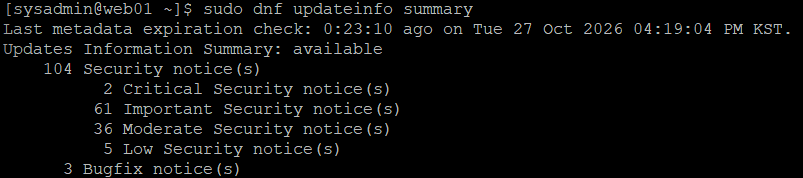
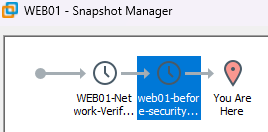
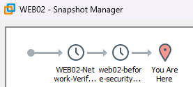
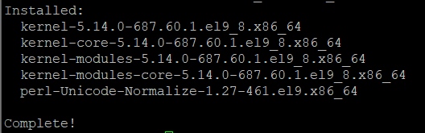
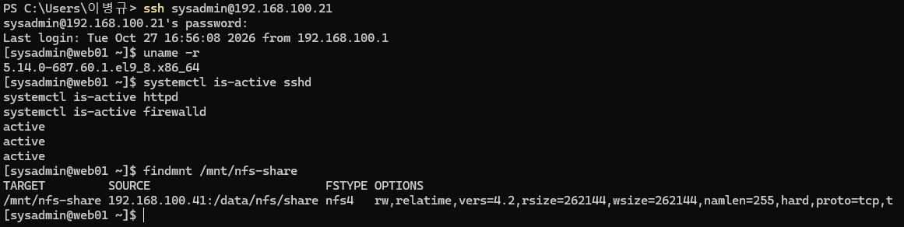
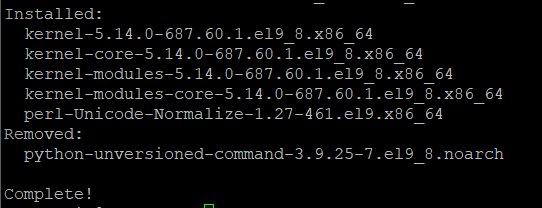
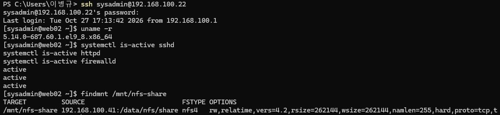

# 21. 보안 업데이트 및 패키지 의존성 충돌 해결 (Security Updates)

## 1. 실습 개요

### 1.1 목적

Rocky Linux 9.8 웹 서버의 보안 업데이트 현황을 점검하고, 업데이트 전 복구 지점을 확보한 뒤 보안 패치를 적용한다.

업데이트 과정에서 발생한 패키지 의존성 충돌을 분석하고 해결하여, 커널 및 주요 패키지 업데이트 후에도 기존 서비스가 정상적으로 유지되는지 검증한다.

**주요 목표**

- DNF를 이용한 보안 업데이트 현황 점검
- 보안 권고의 심각도 및 주요 대상 패키지 확인
- 업데이트 모의 실행을 통한 영향 범위 분석
- VMware 스냅샷을 이용한 업데이트 전 복구 지점 확보
- 보안 업데이트 및 신규 커널 적용
- Python 패키지 의존성 충돌 원인 분석 및 해결
- 재부팅 후 SSH·Apache·NFS·firewalld 정상 동작 검증
- 업데이트 전후 보안 권고 현황 비교

### 1.2 실습 환경

| 구분 | WEB01 | WEB02 |
|---|---|---|
| 운영체제 | Rocky Linux 9.8 | Rocky Linux 9.8 |
| 호스트명 | web01 | web02 |
| 내부 IP | 192.168.100.21 | 192.168.100.22 |
| 가상화 환경 | VMware Workstation | VMware Workstation |
| 패키지 관리자 | DNF | DNF |
| 웹 서비스 | Apache / PHP | Apache / PHP |
| NFS 클라이언트 | NFSv4.2 | NFSv4.2 |

**실습 일자:** 2026-10-27

WEB01과 WEB02에 동일한 보안 업데이트 절차를 적용하되, WEB01에서 먼저 업데이트 및 서비스 검증을 완료한 후 WEB02에 적용하였다.

---

## 2. 보안 업데이트 현황 점검

### 2.1 보안 업데이트 요약 조회

**실행 서버: WEB01, WEB02**

```bash
sudo dnf updateinfo summary
```

WEB02에서는 저장소 메타데이터를 새로 확인하기 위해 다음 명령어를 사용하였다.

```bash
sudo dnf --refresh updateinfo summary
```

**업데이트 전 공통 결과**

```text
Updates Information Summary: available
    104 Security notice(s)
          2 Critical Security notice(s)
         61 Important Security notice(s)
         36 Moderate Security notice(s)
          5 Low Security notice(s)
      3 Bugfix notice(s)
```

| 심각도 | 보안 권고 수 |
|---|---:|
| Critical | 2 |
| Important | 61 |
| Moderate | 36 |
| Low | 5 |
| **합계** | **104** |

추가로 Bugfix 권고 3건이 확인되었다.

여기서 104건은 취약점 또는 패키지 104개가 아니라 **저장소에서 제공하는 보안 권고(Security Advisory)의 개수**를 의미한다.

**WEB01 — 보안 업데이트 전 현황**



### 2.2 보안 업데이트 상세 목록 확인

```bash
sudo dnf updateinfo list --security
```

주요 보안 업데이트 대상은 다음과 같았다.

| 분류 | 주요 패키지 | 관련 기능 |
|---|---|---|
| 운영체제 | kernel, systemd, glibc | 커널 및 시스템 기반 기능 |
| 원격 관리 | openssh-server, sudo | SSH 및 관리자 권한 |
| 웹 서비스 | httpd, php | Apache 및 PHP |
| 네트워크 | NetworkManager, firewalld | 네트워크 연결 및 방화벽 |
| 암호화 | openssl, ca-certificates | 암호화 및 인증서 |
| 인증 관련 | sssd-common, libldb | 사용자 인증 관련 라이브러리 |

웹 서버 운영에 직접 영향을 줄 수 있는 OpenSSH, Apache, NetworkManager 및 커널이 포함되어 있었으므로 업데이트 후 서비스 검증이 필요하다고 판단하였다.

---

## 3. 업데이트 적용 전 영향 범위 분석

### 3.1 DNF 모의 실행

실제 업데이트에 앞서 패키지 변경 범위를 확인하였다.

```bash
sudo dnf upgrade --security --assumeno
```

| 옵션 | 설명 |
|---|---|
| `upgrade` | 설치된 패키지의 업그레이드 계산 |
| `--security` | 보안 권고와 관련된 업데이트 선택 |
| `--assumeno` | 확인 질문에 No를 선택하여 실제 변경 방지 |

### 3.2 WEB01 모의 실행 결과

```text
Transaction Summary
Install   5 Packages
Upgrade  96 Packages

Total download size: 170 M
Operation aborted.
```

| 항목 | 결과 |
|---|---:|
| 신규 설치 | 5개 |
| 업그레이드 | 96개 |
| 다운로드 용량 | 약 170MB |
| 실제 변경 | 없음 |

`Operation aborted.`는 `--assumeno`에 의해 업데이트가 중단된 것으로, 의도한 결과이다.

업데이트 목록에 새로운 커널 패키지가 포함되어 있음을 확인하였다.

**신규 설치 대상 커널**

```text
5.14.0-687.60.1.el9_8.x86_64
```

### 3.3 WEB02 모의 실행 결과

WEB02에서는 동일한 명령어 실행 중 다음 의존성 오류가 발생하였다.

```text
Problem: problem with installed package
python-unversioned-command-3.9.25-7.el9_8.noarch

requires python3 = 3.9.25-7.el9_8

cannot install both
python3-3.9.25-7.el9_8.6.x86_64
and
python3-3.9.25-7.el9_8.x86_64
```

WEB01과 달리 WEB02에서는 Python 패키지의 버전 의존성을 만족하지 못하여 일반적인 업데이트 계획을 진행할 수 없었다.

이에 따라 WEB02는 별도로 원인을 분석한 후 업데이트를 진행하였다.

자세한 해결 과정은 6장에서 정리한다.

---

## 4. 업데이트 전 시스템 상태 및 스냅샷

### 4.1 현재 커널 확인

```bash
uname -r
```

업데이트 전 WEB01과 WEB02의 실행 커널은 동일하였다.

```text
5.14.0-687.10.1.el9_8.0.1.x86_64
```

### 4.2 주요 패키지 버전 확인

```bash
rpm -q kernel-core openssh-server httpd php firewalld NetworkManager
```

업데이트 전 주요 버전은 다음과 같다.

| 패키지 | 업데이트 전 버전 |
|---|---|
| kernel-core | 5.14.0-687.10.1.el9_8.0.1 |
| openssh-server | 9.9p1-7.el9_8.rocky.0.1 |
| httpd | 2.4.62-13.el9_8.6 |
| php | 8.0.30-8.el9_8 |
| firewalld | 1.3.4-18.el9_7 |
| NetworkManager | 1.54.3-2.el9 |

### 4.3 디스크 여유 공간 확인

```bash
df -h /
df -h /boot
```

점검한 주요 결과는 다음과 같다.

| 파일시스템 | 전체 용량 | 사용량 | 여유 공간 | 사용률 |
|---|---:|---:|---:|---:|
| `/` | 17GB | 1.8GB | 16GB | 11% |
| `/boot` | 960MB | 394MB | 567MB | 41% |

업데이트 파일 다운로드와 신규 커널 설치를 진행할 수 있는 여유 공간이 있다고 판단하였다.

다만 실제 설치 가능 여부는 DNF의 의존성 및 디스크 공간 검사 결과에 따라 결정된다.

### 4.4 VMware 스냅샷 생성

커널과 주요 시스템 패키지 업데이트에 대비하여 각 가상 머신의 스냅샷을 생성하였다.

**진행 순서**

1. 웹 서버 정상 종료
2. VMware Workstation에서 해당 VM 선택
3. Snapshot Manager에서 업데이트 전 스냅샷 생성
4. VM 부팅 및 SSH 접속 확인
5. SSH·Apache·firewalld·NFS 상태 점검
6. 보안 업데이트 진행

서버 종료 명령어:

```bash
sudo systemctl poweroff
```

**스냅샷 정보**

| 서버 | 스냅샷 이름 |
|---|---|
| WEB01 | web01-before-security-updates |
| WEB02 | web02-before-security-updates |

**WEB01 — 업데이트 전 VMware 스냅샷**



**WEB02 — 업데이트 전 VMware 스냅샷**



---

## 5. WEB01 보안 업데이트 적용

### 5.1 업데이트 실행

WEB01에서는 별도의 의존성 충돌 없이 업데이트를 적용하였다.

```bash
sudo dnf upgrade --security
```

설치 전 Transaction Summary를 확인한 후 진행하였다.

**업데이트 계획**

```text
Install   5 Packages
Upgrade  96 Packages

Total download size: 170 M
```

업데이트 완료 후 다음 메시지를 확인하였다.

```text
Complete!
```

**WEB01 — 보안 업데이트 설치 완료**



### 5.2 업데이트된 주요 패키지 확인

```bash
rpm -q kernel-core openssh-server httpd php firewalld NetworkManager
```

확인 결과:

```text
kernel-core-5.14.0-687.10.1.el9_8.0.1.x86_64
kernel-core-5.14.0-687.60.1.el9_8.x86_64
openssh-server-9.9p1-13.el9_8.rocky.0.1.x86_64
httpd-2.4.62-13.el9_8.9.x86_64
php-8.0.30-8.el9_8.1.x86_64
firewalld-1.3.4-20.el9_8.noarch
NetworkManager-1.54.3-5.el9_8.x86_64
```

기존 커널과 신규 커널이 함께 설치되어 있음을 확인하였다.

### 5.3 기본 부팅 커널 확인

```bash
sudo grubby --default-kernel
```

결과:

```text
/boot/vmlinuz-5.14.0-687.60.1.el9_8.x86_64
```

신규 커널이 기본 부팅 대상으로 설정된 것을 확인하였다.

재부팅 전 `uname -r`에는 기존 커널이 표시되었다. 이는 커널 패키지 설치와 실제 실행 커널 변경이 별개의 과정이기 때문이다.

### 5.4 재부팅 및 적용 확인

```bash
sudo systemctl reboot
```

재부팅 후 Windows PowerShell에서 WEB01에 다시 접속하였다.

```powershell
ssh sysadmin@192.168.100.21
```

커널 및 서비스 확인:

```bash
hostname
uname -r
systemctl is-active sshd
systemctl is-active httpd
systemctl is-active firewalld
findmnt /mnt/nfs-share
```

**검증 결과**

| 항목 | 결과 |
|---|---|
| 호스트명 | web01 |
| 실행 커널 | 5.14.0-687.60.1.el9_8.x86_64 |
| SSH | active |
| Apache | active |
| firewalld | active |
| NFSv4.2 마운트 | 정상 |

새 커널 적용 후에도 주요 서비스가 정상적으로 동작함을 확인하였다.

**WEB01 — 신규 커널 및 서비스 정상 동작**



---

## 6. WEB02 Python 패키지 의존성 충돌 해결

### 6.1 장애 발생

WEB02에서 보안 업데이트 모의 실행 시 다음 명령어가 실패하였다.

```bash
sudo dnf upgrade --security --assumeno
```

주요 오류:

```text
python-unversioned-command requires python3 = 3.9.25-7.el9_8

cannot install both python3-3.9.25-7.el9_8.6
and python3-3.9.25-7.el9_8
```

DNF가 업데이트하려는 Python 3 버전과 기존 `python-unversioned-command` 패키지가 요구하는 버전이 일치하지 않았다.

### 6.2 설치된 Python 패키지 확인

```bash
rpm -q python3 python3-libs python-unversioned-command
```

결과:

```text
python3-3.9.25-7.el9_8.x86_64
python3-libs-3.9.25-7.el9_8.x86_64
python-unversioned-command-3.9.25-7.el9_8.noarch
```

초기 설치 상태에서는 세 패키지의 버전이 일치하였다.

그러나 DNF가 선택한 최신 업데이트 후보와 `python-unversioned-command`의 의존성이 충돌하였다.

### 6.3 저장소의 패키지 버전 확인

```bash
sudo dnf list --showduplicates python-unversioned-command
```

확인된 주요 버전:

```text
3.9.25-7.el9_8
3.9.25-7.el9_8.2
3.9.25-7.el9_8.3
```

반면 DNF가 선택한 `python3` 업데이트 후보는 다음과 같았다.

```text
python3-3.9.25-7.el9_8.6
```

| 패키지 | 확인된 업데이트 후보 |
|---|---|
| python3 | 3.9.25-7.el9_8.6 |
| python-unversioned-command | 3.9.25-7.el9_8.3까지 조회 |

`python-unversioned-command`는 특정 버전의 `python3`를 요구하므로, 두 패키지의 버전 불일치가 의존성 충돌의 직접적인 원인이었다.

저장소 미러 동기화 시차 등이 가능한 원인이지만, 실제 미러 서버의 상태를 별도로 확인하지 않았으므로 원인을 특정 미러 서버의 장애로 단정하지 않았다.

### 6.4 충돌 패키지의 역할 확인

```bash
command -v python
command -v python3
rpm -qf /usr/bin/python
```

확인 결과:

```text
/usr/bin/python
/usr/bin/python3
python-unversioned-command-3.9.25-7.el9_8.noarch
```

`python-unversioned-command`는 버전을 명시하지 않은 `/usr/bin/python` 명령어를 제공하는 패키지였다.

추가로 RPM 패키지 의존성을 확인하였다.

```bash
rpm -q --whatrequires python-unversioned-command
```

결과:

```text
no package requires python-unversioned-command
```

설치된 RPM 패키지 중 해당 패키지를 직접 요구하는 항목이 조회되지 않았다.

다만 별도 사용자 스크립트가 `/usr/bin/python`을 호출할 가능성까지 배제할 수는 없으므로 제거 후 Python 실행 환경을 검증하기로 하였다.

### 6.5 의존성 충돌 해결 모의 실행

DNF의 `--allowerasing` 옵션으로 충돌 패키지를 제거하는 해결 방법을 검토하였다.

```bash
sudo dnf upgrade --security --allowerasing --assumeno
```

**모의 실행 결과**

```text
Removing dependent packages:
 python-unversioned-command

Transaction Summary

Install   5 Packages
Upgrade  95 Packages
Remove    1 Package

Total download size: 170 M
Operation aborted.
```

| 항목 | 결과 |
|---|---:|
| 신규 설치 | 5개 |
| 업그레이드 | 95개 |
| 제거 | 1개 |
| 다운로드 용량 | 약 170MB |

제거 대상으로 표시된 패키지는 `python-unversioned-command` 하나였다.

`--allowerasing`은 의존성 해결 과정에서 패키지 제거를 허용하므로, 실제 적용 전에 반드시 제거 대상과 영향 범위를 확인해야 한다.

### 6.6 WEB02 보안 업데이트 적용

VMware 스냅샷 생성 및 부팅 검증을 완료한 후 다음 명령어를 실행하였다.

```bash
sudo dnf upgrade --security --allowerasing
```

모의 실행에서 확인한 제거 대상을 검토한 후 업데이트를 진행하였다.

**업데이트 완료**

```text
Removed:
  python-unversioned-command-3.9.25-7.el9_8.noarch

Complete!
```

의존성 충돌 패키지 하나를 제거하고 보안 업데이트를 정상적으로 완료하였다.

**WEB02 — Python 의존성 충돌 해결 및 업데이트 완료**



### 6.7 Python 실행 환경 검증

업데이트 직후 Python 패키지와 실행 상태를 확인하였다.

```bash
python3 --version
rpm -q python3 python3-libs python-unversioned-command
```

결과:

```text
Python 3.9.25
python3-3.9.25-7.el9_8.6.x86_64
python3-libs-3.9.25-7.el9_8.6.x86_64
package python-unversioned-command is not installed
```

**검증 결과**

| 항목 | 결과 |
|---|---|
| python3 실행 | 정상 |
| python3 패키지 | 3.9.25-7.el9_8.6 |
| python3-libs | 3.9.25-7.el9_8.6 |
| 충돌 패키지 | 제거 확인 |

충돌 패키지 제거 후에도 Python 3 실행 환경이 정상적으로 유지되었다.

---

## 7. WEB02 신규 커널 적용 및 재부팅 검증

### 7.1 설치된 신규 커널 확인

```bash
sudo grubby --default-kernel
```

결과:

```text
/boot/vmlinuz-5.14.0-687.60.1.el9_8.x86_64
```

WEB02에서도 신규 커널이 기본 부팅 대상으로 설정되었다.

### 7.2 주요 패키지 버전 확인

```bash
rpm -q kernel-core openssh-server httpd php firewalld NetworkManager
```

업데이트 후 주요 버전은 WEB01과 동일하였다.

| 패키지 | 업데이트 후 버전 |
|---|---|
| kernel-core | 5.14.0-687.60.1.el9_8 |
| openssh-server | 9.9p1-13.el9_8.rocky.0.1 |
| httpd | 2.4.62-13.el9_8.9 |
| php | 8.0.30-8.el9_8.1 |
| firewalld | 1.3.4-20.el9_8 |
| NetworkManager | 1.54.3-5.el9_8 |

### 7.3 재부팅

```bash
sudo systemctl reboot
```

재부팅 완료 후 Windows PowerShell에서 신규 SSH 접속을 생성하였다.

```powershell
ssh sysadmin@192.168.100.22
```

### 7.4 신규 커널 및 서비스 검증

```bash
hostname
uname -r
systemctl is-active sshd
systemctl is-active httpd
systemctl is-active firewalld
findmnt /mnt/nfs-share
```

**검증 결과**

| 항목 | 결과 |
|---|---|
| 호스트명 | web02 |
| 실행 커널 | 5.14.0-687.60.1.el9_8.x86_64 |
| SSH | active |
| Apache | active |
| firewalld | active |
| NFSv4.2 마운트 | 정상 |

Python 패키지 의존성 충돌 해결 이후에도 WEB02가 신규 커널로 정상 부팅되었으며, 주요 서비스가 유지되는 것을 확인하였다.

**WEB02 — 신규 커널 및 서비스 정상 동작**



---

## 8. 보안 업데이트 후 최종 검증

### 8.1 SSH Hardening 정책 유지 확인

**WEB01·WEB02 공통 실행**

```bash
sudo sshd -T | grep -E '^(permitrootlogin|maxauthtries|logingracetime) '
```

두 서버의 결과:

```text
logingracetime 60
maxauthtries 3
permitrootlogin no
```

기존 SSH 보안 정책이 패키지 업데이트 및 재부팅 이후에도 유지되었다.

### 8.2 방화벽 정책 유지 확인

```bash
sudo firewall-cmd --list-all
```

두 서버에서 확인한 주요 설정:

```text
services: dhcpv6-client
forward: no

rich rules:
    rule family="ipv4" source address="192.168.100.0/24" port port="80" protocol="tcp" accept
    rule family="ipv4" source address="192.168.100.0/24" service name="ssh" accept
```

기존 Host-only IPv4 접근 제한 규칙과 Zone 포워딩 비활성화 설정이 유지되었다.

SSH 및 firewalld 보안 정책의 상세 적용 과정은 18~19단원 문서에서 다룬다.

### 8.3 Apache와 NFS 연동 검증

WEB01:

```bash
curl -i --max-time 10 http://192.168.100.21/nfs-lab-check.txt
```

WEB02:

```bash
curl -i --max-time 10 http://192.168.100.22/nfs-lab-check.txt
```

공통 결과:

```text
HTTP/1.1 200 OK

Apache NFS integration test
```

NFS에 저장된 테스트 파일을 Apache가 정상적으로 제공하는 것을 확인하였다.

또한 재부팅 후 `findmnt /mnt/nfs-share`를 통해 두 서버의 NFSv4.2 자동 마운트도 확인하였다.

### 8.4 불필요한 서비스 비활성화 상태 확인

```bash
systemctl is-enabled rpcbind.service rpcbind.socket nis-domainname.service
systemctl is-active rpcbind.service rpcbind.socket nis-domainname.service
```

WEB01·WEB02 공통 결과:

```text
masked
masked
disabled
inactive
inactive
inactive
```

이전에 적용했던 불필요한 서비스 비활성화 설정이 재부팅 후에도 유지되었다.

### 8.5 SELinux 상태 확인

```bash
getenforce
```

두 서버 모두 다음 결과를 확인하였다.

```text
Enforcing
```

### 8.6 잔여 보안 업데이트 확인

WEB01:

```bash
sudo dnf updateinfo summary
```

WEB02:

```bash
sudo dnf --refresh updateinfo summary
```

WEB01은 현재 캐시된 저장소 메타데이터에서, WEB02는 새로 조회한 저장소 메타데이터에서 추가 보안 권고가 표시되지 않았다.

**업데이트 전후 비교**

| 항목 | WEB01 업데이트 전 | WEB01 업데이트 후 | WEB02 업데이트 전 | WEB02 업데이트 후 |
|---|---:|---:|---:|---:|
| 보안 권고 | 104건 | 조회 없음 | 104건 | 조회 없음 |
| Critical 권고 | 2건 | 조회 없음 | 2건 | 조회 없음 |

추가로 표시되는 보안 권고가 없다는 것은 **점검 당시 저장소 메타데이터 기준으로 적용 가능한 보안 권고가 조회되지 않았다는 의미**이다.

시스템의 모든 보안 취약점이 제거되었다는 의미는 아니다.

### 8.7 최종 검증 결과

| 검증 항목 | WEB01 | WEB02 |
|---|---|---|
| 보안 업데이트 설치 | 완료 | 완료 |
| 신규 커널 부팅 | 완료 | 완료 |
| SSH 재접속 | 성공 | 성공 |
| SSH Hardening | 유지 | 유지 |
| firewalld 정책 | 유지 | 유지 |
| Apache HTTP 응답 | 200 OK | 200 OK |
| NFS 자동 마운트 | 정상 | 정상 |
| rpcbind 비활성화 | 유지 | 유지 |
| NIS 서비스 비활성화 | 유지 | 유지 |
| SELinux | Enforcing | Enforcing |
| 잔여 보안 권고 | 조회 없음 | 조회 없음 |

---

## 9. 실습 결과 및 정리

이번 실습에서는 Rocky Linux 9.8 기반 WEB01과 WEB02의 보안 업데이트 현황을 점검하고, VMware 스냅샷을 생성한 후 보안 패치를 적용하였다.

**주요 성과**

- 보안 권고 104건 확인 및 심각도 분석
- 업데이트 모의 실행을 통한 영향 범위 확인
- 업데이트 전 VMware 스냅샷 생성
- WEB01·WEB02의 보안 업데이트 정상 적용
- 신규 커널 `5.14.0-687.60.1.el9_8` 적용
- WEB02 Python 패키지 의존성 충돌 분석 및 해결
- Python 3 실행 환경 유지 확인
- 재부팅 후 SSH·Apache·NFS·firewalld 정상 동작 검증
- 기존 SSH·방화벽·서비스 보안 정책 유지 확인
- 업데이트 전후 보안 권고 현황 비교

특히 WEB02에서는 `python3`와 `python-unversioned-command`의 버전 의존성 충돌로 인해 일반 보안 업데이트가 중단되는 문제가 발생하였다.

이를 해결하기 위해 **오류 메시지 분석 → 설치 패키지 확인 → 저장소 버전 비교 → 의존성 확인 → 해결 방법 모의 실행 → 실제 업데이트 → 기능 검증** 순서로 접근하였다.

또한 커널과 NetworkManager, OpenSSH, Apache 등 주요 구성 요소가 변경되는 작업에서도 스냅샷 확보와 재부팅 후 검증을 수행하였다.

이를 통해 단순 패키지 설치를 넘어 **변경 영향 분석, 장애 원인 파악, 위험 통제 및 서비스 정상 동작 검증**을 포함한 시스템 운영 절차를 경험하였다.

### 관련 문서

- [18. SSH 보안 강화](18-ssh-hardening.md)
- [19. Firewalld & SELinux](19-firewall-selinux.md)
- [20. 사용자 및 서비스 보안 강화](20-account-service-hardening.md)
