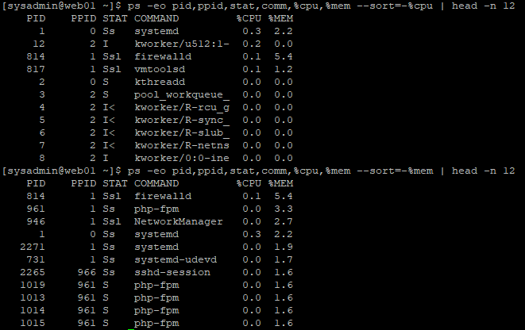
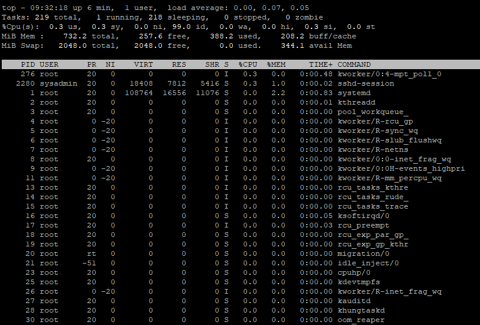
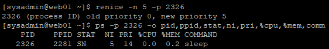
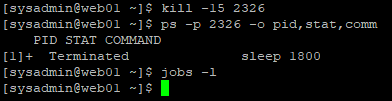
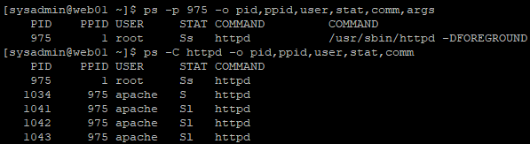
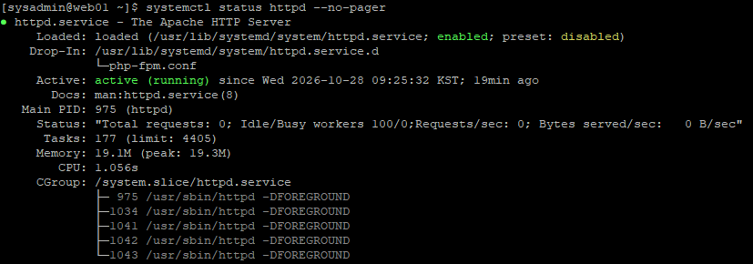
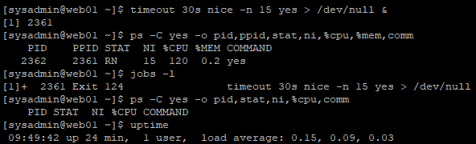
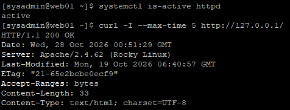

# 22. Linux 프로세스 및 리소스 관리 (Process & Resource Management)

## 1. 실습 개요

### 1.1 목적

Rocky Linux 웹 서버의 CPU·메모리 사용량과 프로세스 상태를 분석하고, 프로세스 우선순위 및 종료 신호를 관리한다.

또한 systemd 기반 Apache 서비스 상태를 점검하고, 30초간 CPU 부하를 발생시킨 후 웹 서비스가 정상적으로 동작하는지 검증한다.

**주요 목표**

- CPU·메모리 및 프로세스 상태 분석
- 백그라운드 프로세스 생성 및 우선순위 변경
- SIGTERM을 이용한 프로세스 종료
- systemd 기반 Apache 서비스 및 리소스 제한 확인
- CPU 부하 종료 후 Apache HTTP 응답 검증

### 1.2 실습 환경

| 항목 | 내용 |
|---|---|
| 운영체제 | Rocky Linux 9.8 |
| 실행 서버 | WEB01 (web01) |
| 관리 IP | 192.168.100.21 |
| 가상화 환경 | VMware Workstation |
| 관리자 계정 | sysadmin |
| 웹 서비스 | Apache HTTP Server |

본 실습은 WEB01에서 수행하였으며, PID와 리소스 수치는 실습 당시 측정값이다.

---

## 2. CPU·메모리 및 프로세스 상태 분석

### 2.1 시스템 리소스 확인

**실행 서버: WEB01**

```bash
uptime
nproc
free -h
ps -eo pid,ppid,stat,comm,%cpu,%mem --sort=-%cpu | head -n 12
ps -eo pid,ppid,stat,comm,%cpu,%mem --sort=-%mem | head -n 12
```

**시스템 리소스 확인 결과**

| 항목 | 결과 |
|---|---|
| Load Average (1·5·15분) | 0.16 / 0.16 / 0.07 |
| 논리 CPU 수 | 1 |
| 전체 메모리 | 약 732 MiB |
| 메모리 사용량 | 약 388 MiB |
| 사용 가능한 메모리 | 약 343 MiB |
| Swap | 2 GiB (사용량 0 B) |

`uptime`으로 시스템 부하를 확인하고, `nproc`와 `free -h`를 이용해 CPU 및 메모리 자원 상태를 점검하였다.

이어서 `ps` 명령어로 CPU와 메모리 사용률이 높은 프로세스를 각각 내림차순 정렬하였다.

**CPU 사용률 상위 프로세스**

| PID | 프로세스 | CPU 사용률 |
|---|---|---:|
| 1 | systemd | 0.3% |
| 12 | kworker/u512:1- | 0.2% |
| 814 | firewalld | 0.1% |
| 817 | vmtoolsd | 0.1% |

**메모리 사용률 상위 프로세스**

| PID | 프로세스 | 메모리 사용률 |
|---|---|---:|
| 814 | firewalld | 5.4% |
| 961 | php-fpm | 3.3% |
| 946 | NetworkManager | 2.7% |
| 1 | systemd | 2.2% |

CPU 사용률 기준으로 `systemd`, 메모리 사용률 기준으로 `firewalld`가 가장 높았다.

측정 당시 상위 프로세스의 리소스 사용률은 낮은 수준이었으며, 특정 프로세스의 과도한 자원 사용은 확인되지 않았다.

**WEB01 — CPU·메모리 사용 프로세스 확인**



### 2.2 top 실시간 프로세스 확인

```bash
top
```

**검증 결과**

| 항목 | 결과 |
|---|---|
| CPU Idle | 99.0% |
| 전체 태스크 | 219개 |
| Running | 1개 |
| Sleeping | 218개 |
| Zombie | 0개 |
| Load Average | 0.00 / 0.07 / 0.05 |
| 사용 가능한 메모리 | 344.1 MiB |
| Swap 사용량 | 0 MiB |

CPU 대부분이 유휴 상태였으며 좀비 태스크는 발견되지 않았다.

`uptime`과 `top`의 Load Average 및 메모리 수치는 서로 다른 시점에 측정하였으므로 차이가 발생할 수 있다.

**WEB01 — top 실시간 리소스 확인**



---

## 3. 백그라운드 프로세스 및 우선순위 관리

### 3.1 백그라운드 프로세스 생성

```bash
sleep 1800 &
jobs -l
ps -p 2326 -o pid,ppid,stat,ni,pri,%cpu,%mem,comm
```

**결과**

| PID | PPID | STAT | NI | PRI | CPU | MEM |
|---|---|---|---|---|---|---|
| 2326 | 2281 | S | 0 | 19 | 0.0% | 0.2% |

`sleep` 명령을 백그라운드에서 실행하고 PID 및 프로세스 상태를 확인하였다.

`STAT=S`는 프로세스가 대기(Sleeping) 상태임을 의미한다.

### 3.2 renice를 이용한 우선순위 변경

실행 중인 `sleep` 프로세스의 Nice 값을 변경하였다.

```bash
renice -n 5 -p 2326
ps -p 2326 -o pid,ppid,stat,ni,pri,%cpu,%mem,comm
```

**renice 결과**

```text
2326 (process ID) old priority 0, new priority 5
```

**변경 전후 비교**

| 항목 | 변경 전 | 변경 후 |
|---|---|---|
| PID | 2326 | 2326 |
| Nice (NI) | 0 | 5 |
| Priority (PRI) | 19 | 14 |
| STAT | S | SN |

Nice 값이 증가하면 일반적으로 CPU 스케줄링 우선순위가 낮아진다.

변경 후 `STAT`에 낮은 우선순위를 나타내는 `N`이 추가된 것을 확인하였다.

**WEB01 — renice 우선순위 변경 검증**



### 3.3 SIGTERM을 이용한 프로세스 종료

```bash
kill -15 2326
ps -p 2326 -o pid,stat,comm
jobs -l
```

**결과**

```text
[1]+ Terminated    sleep 1800
```

- `sleep` 프로세스 종료 확인
- `ps` 조회에서 PID 2326이 나타나지 않음
- `jobs -l`에서 실행 중인 백그라운드 작업이 조회되지 않음

SIGKILL(9) 대신 정상 종료를 요청하는 SIGTERM(15)을 사용하여 프로세스를 종료하였다.

**WEB01 — SIGTERM 프로세스 종료 검증**



---

## 4. systemd 및 Apache 프로세스 관리

### 4.1 Apache 서비스 및 프로세스 확인

```bash
systemctl is-active httpd
systemctl is-enabled httpd
systemctl show httpd -p MainPID -p ActiveState -p SubState
ps -p 975 -o pid,ppid,user,stat,comm,args
ps -C httpd -o pid,ppid,user,stat,comm
```

**서비스 상태**

```text
active
enabled
MainPID=975
ActiveState=active
SubState=running
```

Apache 서비스가 정상 실행 중이며 부팅 시 자동 시작하도록 설정된 것을 확인하였다.

**Apache 프로세스 구조**

| PID | PPID | 사용자 | 역할 |
|---|---|---|---|
| 975 | 1 | root | 메인 프로세스 |
| 1034 | 975 | apache | 자식 프로세스 |
| 1041 | 975 | apache | 자식 프로세스 |
| 1042 | 975 | apache | 자식 프로세스 |
| 1043 | 975 | apache | 자식 프로세스 |

Apache 메인 프로세스는 `root`, 자식 프로세스는 `apache` 계정으로 실행되어 권한이 분리되어 있음을 확인하였다.

**WEB01 — Apache 부모·자식 프로세스 확인**



### 4.2 systemd 리소스 제한 확인

```bash
systemctl status httpd --no-pager
systemctl show httpd -p CPUQuotaPerSecUSec -p MemoryMax -p TasksMax
```

**주요 서비스 상태**

| 항목 | 결과 |
|---|---|
| Apache 서비스 | active (running) |
| Main PID | 975 |
| Tasks | 177 (limit: 4405) |
| Memory | 19.1M |
| CGroup | /system.slice/httpd.service |

**리소스 제한 설정**

```text
CPUQuotaPerSecUSec=infinity
MemoryMax=infinity
TasksMax=4405
```

Apache 서비스에 별도의 CPU 할당량 및 메모리 최대 사용량 제한은 설정되어 있지 않았다.

태스크 수 상한은 4405로 확인되었다.

이번 실습에서는 리소스 제한 설정을 조회만 하였으며 기존 Apache 서비스 설정은 변경하지 않았다.

**WEB01 — Apache systemd 상태 및 리소스 확인**



---

## 5. CPU 부하 테스트 및 서비스 검증

### 5.1 30초 CPU 부하 생성

```bash
timeout 30s nice -n 15 yes > /dev/null &
ps -C yes -o pid,ppid,stat,ni,%cpu,%mem,comm
```

**검증 결과**

| 항목 | 결과 |
|---|---|
| 실행 프로세스 | yes |
| PID | 2362 |
| PPID | 2361 |
| STAT | RN |
| Nice (NI) | 15 |
| ps CPU 사용률 | 120% |
| 메모리 사용률 | 0.2% |
| 실행 시간 제한 | 30초 |

`yes` 명령으로 CPU 부하를 발생시키고 `timeout`으로 실행 시간을 제한하였다.

`nice -n 15`를 적용하여 테스트 프로세스의 CPU 스케줄링 우선순위를 낮췄다.

### 5.2 CPU 부하 종료 확인

30초 경과 후 다음 명령어로 프로세스 종료를 확인하였다.

```bash
jobs -l
ps -C yes -o pid,stat,ni,%cpu,comm
uptime
```

**검증 결과**

```text
[1]+ 2361 Exit 124  timeout 30s nice -n 15 yes > /dev/null
```

`ps -C yes` 명령어에서는 헤더만 표시되고 `yes` 프로세스가 조회되지 않았다.

**부하 종료 후 시스템 상태**

| 항목 | 결과 |
|---|---|
| 종료 코드 | Exit 124 |
| yes 프로세스 | 조회되지 않음 |
| 1분 Load Average | 0.15 |
| 5분 Load Average | 0.09 |
| 15분 Load Average | 0.03 |

Exit 124는 `timeout` 명령의 실행 제한 시간에 도달했음을 의미한다.

부하 프로세스가 자동 종료되었으며, 이후 시스템의 Load Average를 확인하였다.

단, CPU 부하 발생 중 전체 CPU 사용률을 지속적으로 측정하지는 않았다.

**WEB01 — CPU 부하 생성 및 자동 종료 검증**



### 5.3 Apache HTTP 응답 검증

CPU 부하 종료 후 기존 Apache 서비스의 정상 동작 여부를 확인하였다.

```bash
systemctl is-active httpd
curl -I --max-time 5 http://127.0.0.1/
```

**결과**

```text
active
HTTP/1.1 200 OK
Server: Apache/2.4.62 (Rocky Linux)
```

30초 CPU 부하 테스트 종료 이후에도 Apache가 정상 실행 중이며 HTTP 200 응답을 반환하는 것을 확인하였다.

이번 검증은 부하 종료 후 Apache 기본 HTTP 서비스의 정상 동작을 확인한 것이며, 부하 발생 중 응답 시간이나 HAProxy·DB 연동 상태는 측정하지 않았다.

**WEB01 — CPU 부하 종료 후 Apache HTTP 검증**



---

## 6. 실습 결과 및 정리

이번 실습에서는 Rocky Linux 9.8 기반 WEB01의 시스템 리소스와 프로세스 상태를 분석하고, 프로세스 우선순위 변경 및 종료, Apache 서비스 관리와 CPU 부하 테스트를 수행하였다.

**최종 검증 결과**

| 검증 항목 | 결과 |
|---|---|
| CPU·메모리 및 프로세스 분석 | 완료 |
| 백그라운드 프로세스 생성 | 완료 |
| renice 우선순위 변경 | NI 0 → 5 |
| SIGTERM 프로세스 종료 | 정상 |
| Apache systemd 상태 확인 | active |
| Apache 리소스 제한 조회 | 완료 |
| 30초 CPU 부하 종료 | Exit 124 |
| 부하 종료 후 Apache HTTP 응답 | 200 OK |

**주요 성과**

- CPU·메모리 및 Load Average 분석
- CPU·메모리 사용률 상위 프로세스 확인
- Nice 값 변경을 통한 프로세스 우선순위 관리
- SIGTERM을 이용한 프로세스 종료 검증
- systemd의 Apache 서비스 상태 및 리소스 제한 확인
- 제한된 시간 동안 CPU 부하 발생 및 자동 종료 검증
- CPU 부하 종료 후 Apache HTTP 200 응답 확인

이번 실습은 **리소스 상태 확인 → 프로세스 관리 → systemd 서비스 점검 → CPU 부하 테스트 → 서비스 정상 동작 검증** 순서로 진행하였다.

이를 통해 Linux 시스템 엔지니어가 서버 자원과 프로세스 상태를 점검하고, 서비스 운영 상태를 검증하는 기본 절차를 경험하였다.

### 관련 문서

- [20. 사용자 및 서비스 보안 강화](20-account-service-hardening.md)
- [21. 보안 업데이트 및 패키지 의존성 충돌 해결](21-security-updates.md)
