# 23. Linux 로그 관리 및 로그 기반 장애 분석 (Log Management & Troubleshooting)

## 1. 실습 개요

### 1.1 목적

Rocky Linux 9.8 웹 서버에서 시스템 로그와 서비스 로그의 저장 구조를 확인하고, `journalctl` 및 주요 로그 파일을 이용하여 시스템 상태와 사용자 인증 이력을 분석한다.

Apache 웹 서버에서 의도적으로 HTTP 404 오류를 발생시킨 뒤 Access 로그를 통해 요청 정보와 응답 상태를 추적하고, 정상 HTTP 응답과 비교하여 로그 기반 장애 분석 절차를 검증한다.

**주요 목표**

- 시스템 시간 및 로그 수집 서비스 상태 확인
- `systemd-journald`와 `rsyslog`의 역할 및 로그 저장 위치 확인
- `journalctl`을 이용한 시스템 및 Apache 서비스 로그 분석
- `/var/log/messages`를 통한 시스템 이벤트 확인
- `/var/log/secure`를 통한 사용자 인증 및 sudo 실행 기록 분석
- Apache Access 로그와 Error 로그 분석
- HTTP 404 오류 재현 및 Access 로그 추적
- HTTP 200 정상 응답과 최종 로그 기록 검증

### 1.2 실습 환경

| 항목 | 구성 |
|---|---|
| 가상화 환경 | VMware Workstation |
| 운영체제 | Rocky Linux 9.8 |
| 실습 서버 | WEB01 |
| 호스트명 | web01 |
| 내부 IP | `192.168.100.21` |
| 접속 방식 | Windows PuTTY / SSH |
| 사용자 | sysadmin |
| 시스템 로그 | systemd-journald, rsyslog |
| 웹 서비스 | Apache HTTP Server 2.4.62 |
| 로그 분석 도구 | journalctl, tail, grep |

---

## 2. 시스템 로그 환경 및 서비스 상태 확인

### 2.1 시스템 시간 및 시간 동기화 확인

로그 분석에 앞서 서버의 시스템 시간과 시간 동기화 상태를 확인하였다.

```bash
timedatectl
```

**주요 결과**

```text
Local time: Wed 2026-10-28 10:37:01 KST
Time zone: Asia/Seoul
System clock synchronized: yes
NTP service: active
```

| 항목 | 결과 |
|---|---|
| 시스템 시간대 | Asia/Seoul |
| 로컬 시간 | KST (UTC+9) |
| 시스템 시간 동기화 | yes |
| NTP 서비스 | active |

시스템 시간이 동기화된 상태임을 확인하였다.

로그에 기록되는 시각은 이벤트 발생 순서를 분석하고 여러 로그의 기록을 비교하는 기준이 되므로, 로그 분석 전 서버 시간 상태를 확인하는 것이 중요하다.

### 2.2 로그 수집 서비스 상태 확인

```bash
systemctl is-active systemd-journald
systemctl is-active rsyslog
```

두 로그 수집 서비스가 모두 실행 중임을 확인하였다.

| 서비스 | 역할 | 상태 |
|---|---|---|
| systemd-journald | 시스템 및 서비스의 Journal 로그 수집 | active |
| rsyslog | syslog 메시지 처리 및 텍스트 로그 파일 기록 | active |

### 2.3 Journal 디스크 사용량 확인

```bash
sudo journalctl --disk-usage
```

**결과**

```text
Archived and active journals take up 3.0M in the file system.
```

현재 Journal 로그가 약 3.0MB의 저장 공간을 사용하고 있었다.

### 2.4 Journal 저장 디렉터리 확인

```bash
sudo ls -ld /var/log/journal /run/log/journal
```

**결과**

```text
ls: cannot access '/var/log/journal': No such file or directory
drwxr-sr-x+ 3 root systemd-journal 60 Oct 28 09:25 /run/log/journal
```

현재 WEB01에는 `/var/log/journal` 디렉터리가 없고 `/run/log/journal` 디렉터리가 존재하였다.

따라서 실습 시점의 Journal 로그는 런타임 저장 경로를 사용하고 있었다.

| 경로 | 용도 | 확인 결과 |
|---|---|---|
| `/run/log/journal` | 런타임 Journal 로그 저장 | 존재 |
| `/var/log/journal` | 영구 Journal 로그 저장 경로 | 존재하지 않음 |

`/run`의 로그는 일반적으로 재부팅 후 유지되지 않으므로, 장기적인 로그 보존이 필요한 환경에서는 영구 저장 정책과 로그 보존 기간을 별도로 검토해야 한다.

**WEB01 — 시스템 시간 및 로그 서비스 상태**

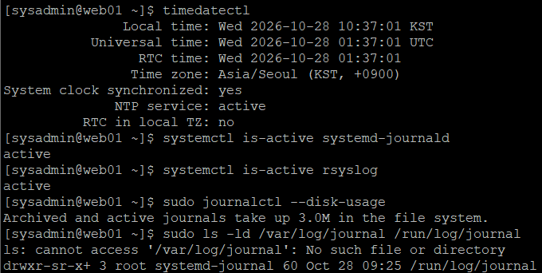

---

## 3. journalctl을 이용한 시스템 및 서비스 로그 분석

### 3.1 현재 부팅 세션의 시스템 로그 확인

```bash
sudo journalctl -b -n 20 --no-pager
```

| 옵션 | 의미 |
|---|---|
| `-b` | 현재 부팅 세션의 로그 조회 |
| `-n 20` | 최근 로그 20줄 출력 |
| `--no-pager` | 페이지 이동 없이 출력 |

조회 결과, 다음과 같은 시스템 이벤트가 확인되었다.

- DNF 메타데이터 갱신 작업 종료
- `systemd-timedated` 서비스 실행
- sudo 인증 관련 이벤트
- sudo 명령어 실행 및 세션 시작·종료 기록

**주요 로그**

```text
Oct 28 10:36:54 web01 unix_chkpwd[2450]: password check failed for user (sysadmin)
Oct 28 10:36:54 web01 sudo[2448]: pam_unix(sudo:auth): authentication failure
```

시스템 Journal 로그에는 서비스 실행뿐 아니라 사용자 인증과 관리자 명령어 실행 이력도 기록되는 것을 확인하였다.

**WEB01 — 현재 부팅 세션의 시스템 Journal 로그**

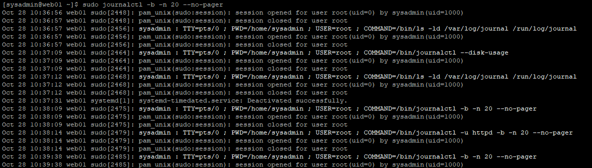

### 3.2 Apache 서비스 Journal 로그 확인

특정 서비스의 로그만 조회하기 위해 `-u` 옵션을 사용하였다.

```bash
sudo journalctl -u httpd -b -n 20 --no-pager
```

**주요 확인 결과**

```text
Oct 28 09:25:32 web01 systemd[1]: Starting The Apache HTTP Server...
Oct 28 09:25:32 web01 httpd[975]: Server configured, listening on: port 80
Oct 28 09:25:32 web01 systemd[1]: Started The Apache HTTP Server.
```

| 항목 | 확인 내용 |
|---|---|
| 서비스 | httpd |
| 실행 시각 | 2026-10-28 09:25:32 |
| 서비스 시작 | Started |
| 수신 포트 | TCP 80 |
| 프로세스 PID | 975 |

Apache가 현재 부팅 세션에서 정상적으로 시작되었으며 TCP 80 포트로 요청을 수신하도록 구성된 것을 확인하였다.

`journalctl -u httpd`를 이용하면 다른 시스템 로그와 구분하여 Apache 서비스의 시작 및 종료 이력을 조회할 수 있다.

**WEB01 — Apache 서비스 Journal 로그**

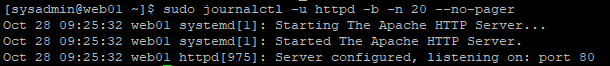

---

## 4. 주요 시스템 로그 파일 분석

### 4.1 로그 파일 및 디렉터리 확인

Rocky Linux의 주요 텍스트 로그 파일과 Apache 로그 디렉터리를 확인하였다.

```bash
sudo ls -lh /var/log/messages /var/log/secure /var/log/httpd/
```

**주요 확인 결과**

| 파일 | 실습 당시 크기 | 용도 |
|---|---:|---|
| `/var/log/messages` | 약 1.2MB | 일반 시스템 이벤트 |
| `/var/log/secure` | 약 49KB | 인증 및 sudo 관련 기록 |
| `/var/log/httpd/access_log` | 약 1.1KB | Apache HTTP 요청 기록 |
| `/var/log/httpd/error_log` | 약 6.9KB | Apache 오류 및 진단 메시지 |

Apache 로그 디렉터리에서는 다음과 같은 이전 로그 파일도 확인되었다.

```text
access_log-20261027
error_log-20261027
```

현재 로그 파일과 날짜가 포함된 이전 로그 파일이 함께 존재하였다.

**WEB01 — 주요 시스템 및 Apache 로그 파일**

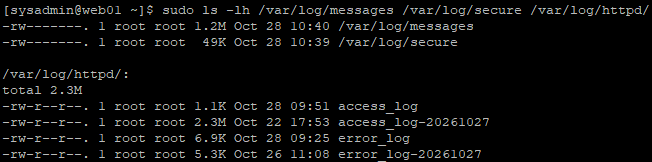

### 4.2 /var/log/messages 분석

```bash
sudo tail -n 20 /var/log/messages
```

**주요 확인 내용**

- Rocky Linux BaseOS 저장소 메타데이터 갱신
- AppStream 저장소 메타데이터 갱신
- Extras 저장소 메타데이터 갱신
- `Metadata cache created` 메시지
- `systemd-timedated` 관련 이벤트
- NetworkManager DHCP 임대 갱신

실습 당시 확인된 주요 이벤트는 다음과 같았다.

| 이벤트 | 확인 내용 |
|---|---|
| DNF 메타데이터 작업 | 10:26:42경 완료 |
| 시간 관련 서비스 | systemd-timedated 동작 |
| 네트워크 DHCP | ens160 인터페이스의 임대 갱신 |
| DHCP 주소 | `10.10.10.128` |
| NetworkManager | 디스패처 실행 및 종료 |

조회한 최근 20줄에서는 명확한 시스템 오류 메시지가 확인되지 않았다.

`/var/log/messages`는 패키지 관리 작업, 서비스 동작 및 네트워크 이벤트를 시간 순서대로 확인하는 데 활용할 수 있다.

**WEB01 — 시스템 메시지 로그 분석**

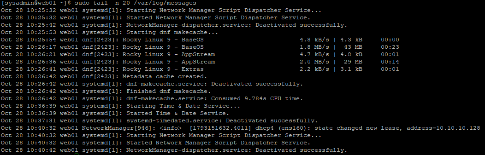

### 4.3 /var/log/secure 인증 로그 분석

```bash
sudo tail -n 20 /var/log/secure
```

최근 인증 로그에서 `sysadmin` 사용자의 sudo 명령어 실행과 PAM 세션 시작·종료 기록을 확인하였다.

이후 Journal 로그에서 확인한 인증 실패 이벤트를 텍스트 로그에서도 추적하였다.

```bash
sudo grep -n -C 2 'Oct 28 10:36:54' /var/log/secure
```

**실제 결과 중 주요 부분**

```text
428:Oct 28 10:36:54 web01 unix_chkpwd[2450]: password check failed for user (sysadmin)
429:Oct 28 10:36:54 web01 sudo[2448]: pam_unix(sudo:auth): authentication failure
430:Oct 28 10:36:56 web01 sudo[2448]: sysadmin : TTY=pts/0 ; PWD=/home/sysadmin ; USER=root ; COMMAND=/bin/journalctl --disk-usage
```

| 시각 | 이벤트 | 분석 |
|---|---|---|
| 10:36:54 | password check failed | sysadmin 인증 실패 |
| 10:36:54 | sudo authentication failure | sudo 인증 실패 |
| 10:36:56 | sudo 명령어 실행 | 이후 관리자 명령어 실행 확인 |

인증 실패 기록 이후 동일 사용자의 sudo 실행 기록이 확인되었다.

**Journal 로그와 `/var/log/secure`에서 동일한 인증 이벤트가 확인되었다는 점**이 중요하다.

**WEB01 — sudo 인증 실패 및 실행 로그 추적**

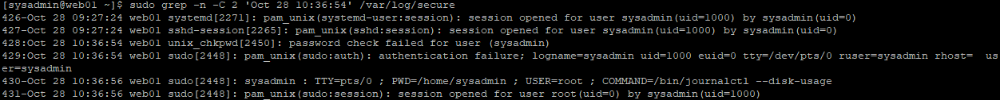

---

## 5. Apache Access 및 Error 로그 분석

### 5.1 Apache Access 로그 확인

```bash
sudo tail -n 20 /var/log/httpd/access_log
```

실습 당시 기존 Apache·NFS 연동 테스트 기록이 확인되었다.

**주요 요청 기록**

```text
"GET /nfs-lab-check.txt HTTP/1.1" 200 28
"HEAD / HTTP/1.1" 200 -
```

Access 로그에는 다음과 같은 정보가 포함되어 있었다.

| 항목 | 의미 |
|---|---|
| 클라이언트 IP | HTTP 요청을 보낸 주소 |
| 요청 시각 | Apache가 기록한 요청 시각 |
| GET / HEAD | HTTP 요청 방식 |
| 요청 URL | 클라이언트가 요청한 리소스 |
| HTTP 상태 코드 | 요청 처리 결과 |
| 응답 크기 | 반환한 응답 본문 크기 |
| User-Agent | 요청에 사용된 프로그램 |

기존 정상 요청에서는 HTTP 상태 코드 `200`이 기록되어 있었다.

Access 로그를 이용하면 특정 클라이언트가 어떤 URL을 요청했고 서버가 어떤 상태 코드로 응답했는지 분석할 수 있다.

**WEB01 — Apache Access 로그 분석**

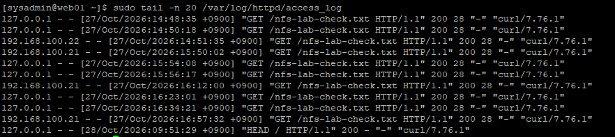

### 5.2 Apache Error 로그 확인

```bash
sudo tail -n 20 /var/log/httpd/error_log
```

**주요 로그**

```text
[Wed Oct 28 09:25:32.723143 2026] [core:notice] [pid 975:tid 975] SELinux policy enabled; httpd running as context system_u:system_r:httpd_t:s0
[Wed Oct 28 09:25:32.778054 2026] [lbmethod_heartbeat:notice] [pid 975:tid 975] AH02282: No slotmem from mod_heartmonitor
[Wed Oct 28 09:25:32.801277 2026] [mpm_event:notice] [pid 975:tid 975] AH00489: Apache/2.4.62 (Rocky Linux) configured -- resuming normal operations
[Wed Oct 28 09:25:32.801358 2026] [core:notice] [pid 975:tid 975] AH00094: Command line: '/usr/sbin/httpd -D FOREGROUND'
```

| 로그 코드 및 항목 | 의미 |
|---|---|
| `AH00489` | Apache 정상 동작 시작 |
| `AH00094` | Apache 실행 명령어 |
| `AH00492` | 정상 종료 절차 관련 메시지 |
| `AH01232` | suEXEC 기능 활성화 |
| `AH02282` | mod_heartmonitor 관련 알림 |
| `httpd_t` | Apache 프로세스의 SELinux 타입 |

조회한 로그의 대부분은 `notice` 수준의 서비스 시작 및 종료 관련 메시지였다.

`AH02282` 메시지도 확인되었지만, 해당 로그만으로 Apache 서비스 장애라고 판단할 수는 없다.

**WEB01 — Apache Error 로그 분석**

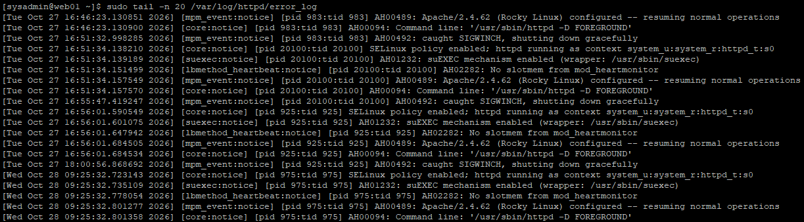

---

## 6. HTTP 404 오류 재현 및 로그 추적

### 6.1 테스트 목적

Apache에서 존재하지 않는 파일을 요청하여 의도적으로 HTTP 404 응답을 발생시켰다.

이후 Apache Access 로그와 Error 로그를 확인하여 해당 요청의 기록 여부를 분석하였다.

이번 테스트에서는 실제 서비스 파일이나 Apache 설정을 수정하지 않고, 존재하지 않는 URL에 대한 요청만 수행하였다.

### 6.2 HTTP 404 오류 발생

```bash
curl -i --max-time 5 http://127.0.0.1/log-lab-not-found-20261028.txt
```

**실제 결과**

```text
HTTP/1.1 404 Not Found
Date: Wed, 28 Oct 2026 01:47:56 GMT
Server: Apache/2.4.62 (Rocky Linux)
Content-Length: 196
Content-Type: text/html; charset=iso-8859-1
```

응답 본문:

```html
<h1>Not Found</h1>
<p>The requested URL was not found on this server.</p>
```

| 항목 | 결과 |
|---|---|
| 요청 대상 | 127.0.0.1 |
| 요청 파일 | log-lab-not-found-20261028.txt |
| HTTP 상태 코드 | 404 Not Found |
| 응답 본문 크기 | 196 Bytes |
| 요청 발생 시각 | 2026-10-28 10:47:56 KST |

서버에 존재하지 않는 파일을 요청했으므로 HTTP 404 응답이 발생한 것은 의도한 결과이다.

HTTP 404는 요청한 리소스를 찾을 수 없다는 의미이다.

**WEB01 — HTTP 404 오류 재현**

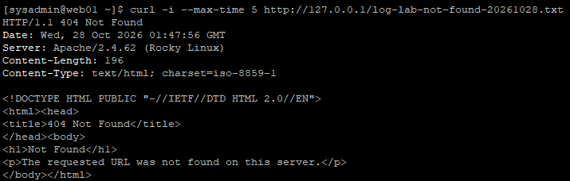

### 6.3 Access 로그에서 HTTP 404 추적

앞서 요청한 테스트 파일명을 기준으로 Access 로그를 검색하였다.

```bash
sudo grep 'log-lab-not-found-20261028.txt' /var/log/httpd/access_log
```

**결과**

```text
127.0.0.1 - - [28/Oct/2026:10:47:56 +0900] "GET /log-lab-not-found-20261028.txt HTTP/1.1" 404 196 "-" "curl/7.76.1"
```

| 로그 항목 | 실제 값 |
|---|---|
| 요청 IP | 127.0.0.1 |
| 요청 시각 | 10:47:56 KST |
| HTTP 메서드 | GET |
| 요청 경로 | `/log-lab-not-found-20261028.txt` |
| 상태 코드 | 404 |
| 응답 크기 | 196 Bytes |
| User-Agent | curl/7.76.1 |

`curl` 응답과 Apache Access 로그에서 요청 경로, 시각, HTTP 상태 코드 및 응답 크기가 일치하였다.

따라서 다음 과정을 확인하였다.

**HTTP 요청 → 404 응답 발생 → Access 로그 기록 → 요청 정보 추적**

**WEB01 — Apache Access 로그의 HTTP 404 기록**

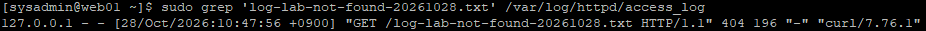

### 6.4 Error 로그에서 HTTP 404 관련 기록 확인

```bash
sudo tail -n 20 /var/log/httpd/error_log
```

조회한 최근 20줄에서는 테스트 요청과 관련된 별도의 오류 메시지가 확인되지 않았다.

가장 최근에 확인된 기록은 Apache가 시작된 2026-10-28 09:25:32의 `notice` 로그였다.

**비교 결과**

| 항목 | Access 로그 | Error 로그 |
|---|---|---|
| HTTP 404 요청 | 확인 | 최근 20줄에서 확인되지 않음 |
| 요청 시각 | 10:47:56 | 관련 기록 없음 |
| 요청 경로 | 확인 | 관련 기록 없음 |
| 분석 결과 | 요청 및 상태 코드 추적 가능 | 별도 오류 메시지 미확인 |

Apache의 일반적인 HTTP 404 응답은 Access 로그에는 기록되지만 Error 로그에는 별도 메시지가 남지 않을 수 있다.

따라서 이번 사례에서는 **Access 로그가 HTTP 404 발생 사실을 확인하는 주요 근거**였다.

**WEB01 — HTTP 404 발생 후 Error 로그 확인**

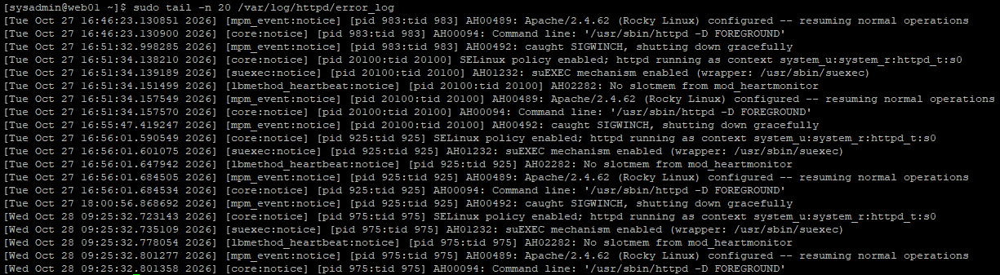

---

## 7. HTTP 정상 응답 및 최종 로그 검증

### 7.1 HTTP 200 정상 응답 확인

기존에 구성한 Apache 웹 서비스의 정상적인 파일 제공 여부를 확인하였다.

```bash
curl -i --max-time 5 http://127.0.0.1/nfs-lab-check.txt
```

**최종 검증 결과**

```text
HTTP/1.1 200 OK
Date: Wed, 28 Oct 2026 01:56:06 GMT
Server: Apache/2.4.62 (Rocky Linux)
Last-Modified: Tue, 27 Oct 2026 05:48:00 GMT
ETag: "1c-65ecbfd3eaec3"
Accept-Ranges: bytes
Content-Length: 28
Content-Type: text/plain; charset=UTF-8

Apache NFS integration test
```

| 항목 | 결과 |
|---|---|
| HTTP 상태 코드 | 200 OK |
| 웹 서버 | Apache/2.4.62 |
| 요청 경로 | `/nfs-lab-check.txt` |
| 응답 파일 내용 | Apache NFS integration test |
| 응답 크기 | 28 Bytes |

기존 웹 서비스 경로에서 HTTP 200 응답이 반환되고 테스트 파일의 내용이 정상적으로 출력되었다.

이를 통해 의도적인 HTTP 404 요청 이후에도 Apache가 정상적인 HTTP 요청을 처리하는 것을 확인하였다.

**WEB01 — Apache HTTP 200 정상 응답 검증**

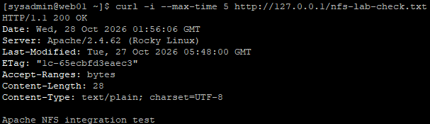

### 7.2 최종 Access 로그 확인

```bash
sudo tail -n 5 /var/log/httpd/access_log
```

**최종 조회 결과에서 확인한 핵심 기록**

HTTP 404:

```text
127.0.0.1 - - [28/Oct/2026:10:47:56 +0900] "GET /log-lab-not-found-20261028.txt HTTP/1.1" 404 196 "-" "curl/7.76.1"
```

HTTP 200:

```text
127.0.0.1 - - [28/Oct/2026:10:56:06 +0900] "GET /nfs-lab-check.txt HTTP/1.1" 200 28 "-" "curl/7.76.1"
```

| 구분 | 요청 경로 | HTTP 응답 |
|---|---|---|
| 오류 재현 | `/log-lab-not-found-20261028.txt` | 404 |
| 정상 검증 | `/nfs-lab-check.txt` | 200 |

오류 응답과 정상 응답이 모두 Access 로그에 기록된 것을 확인하였다.

이를 통해 **HTTP 응답 확인과 로그 기록 비교를 이용한 기본적인 장애 분석 절차**를 검증하였다.

---

## 8. 최종 검증 결과

| 검증 항목 | 실제 결과 | 상태 |
|---|---|---|
| 시스템 시간 동기화 | synchronized: yes | 확인 |
| NTP 서비스 | active | 확인 |
| systemd-journald | active | 정상 |
| rsyslog | active | 정상 |
| Journal 디스크 사용량 | 약 3.0MB | 확인 |
| Journal 저장 경로 | `/run/log/journal` | 확인 |
| 시스템 Journal 조회 | 현재 부팅 로그 확인 | 성공 |
| Apache Journal 조회 | 포트 80 및 서비스 시작 확인 | 성공 |
| `/var/log/messages` | DNF·시간·네트워크 이벤트 분석 | 완료 |
| `/var/log/secure` | sudo 인증 및 실행 기록 분석 | 완료 |
| Apache Access 로그 | 정상 HTTP 요청 기록 확인 | 성공 |
| Apache Error 로그 | 서비스 시작·종료 메시지 분석 | 완료 |
| HTTP 404 오류 재현 | 404 Not Found | 성공 |
| HTTP 404 Access 로그 추적 | 상태 코드·시각·요청 경로 일치 | 성공 |
| HTTP 404 Error 로그 확인 | 최근 20줄에서 관련 기록 없음 | 확인 |
| HTTP 200 정상 응답 | 200 OK | 성공 |
| 최종 Access 로그 비교 | 404 및 200 기록 확인 | 성공 |

---

## 9. 배운 점 및 운영 시 고려사항

### 9.1 Journal 로그와 텍스트 로그의 차이

`systemd-journald`는 시스템과 서비스 이벤트를 Journal 형식으로 관리하며, `rsyslog`는 관련 메시지를 텍스트 로그 파일에 기록할 수 있다.

이번 실습에서는 두 서비스가 모두 실행 중이었고, `journalctl`과 `/var/log/secure`에서 동일한 sudo 인증 이벤트를 확인하였다.

따라서 분석 대상에 따라 Journal 로그와 텍스트 로그를 함께 활용할 수 있다.

### 9.2 로그 저장 경로와 보존 정책

WEB01에서는 `/run/log/journal`이 존재하고 `/var/log/journal`은 존재하지 않았다.

런타임 Journal 로그는 재부팅 후 유지되지 않을 수 있으므로, 장기적인 장애 분석과 감사 기록이 필요한 환경에서는 영구 저장 및 로그 보존 정책을 별도로 구성해야 한다.

### 9.3 인증 실패 로그의 해석

`/var/log/secure`에 인증 실패 기록이 존재하더라도 해당 기록만으로 보안 침해를 단정할 수는 없다.

사용자, 시각, 접속 경로, 반복 횟수 및 이후 명령어 실행 기록을 함께 확인해야 한다.

이번 실습에서는 인증 실패 이후 정상적인 sudo 실행 기록이 확인되었다.

### 9.4 Access 로그와 Error 로그의 역할 구분

Apache Access 로그는 클라이언트 요청과 HTTP 응답 상태를 확인하는 데 사용된다.

반면 Error 로그는 Apache의 오류 및 진단 메시지와 서비스 동작 정보를 분석하는 데 활용한다.

이번 HTTP 404 테스트에서는 Access 로그에서 요청 정보를 확인할 수 있었지만, Error 로그의 조회 범위에서는 별도의 관련 메시지가 확인되지 않았다.

따라서 HTTP 오류 분석 시 **Access 로그와 Error 로그를 구분하여 확인하는 것이 중요하다.**

### 9.5 HTTP 상태 코드와 서비스 장애의 구분

HTTP 404는 요청한 파일을 찾지 못한 상태이며, HTTP 200은 요청이 정상적으로 처리된 상태를 의미한다.

HTTP 404 응답이 발생했다고 해서 Apache 서비스 전체가 중단된 것은 아니다.

이번 실습에서는 의도적으로 404를 발생시킨 뒤, 정상적인 경로에서 200 응답이 반환되는 것을 확인하였다.

---

## 10. 실습 결과 및 정리

이번 실습에서는 Rocky Linux 9.8 기반 WEB01에서 시스템 로그와 Apache 로그를 조회하고 실제 HTTP 요청을 이용하여 로그 기반 분석 절차를 검증하였다.

**주요 성과**

- systemd-journald 및 rsyslog 서비스 정상 동작 확인
- Journal 로그 저장 경로와 디스크 사용량 확인
- `journalctl`을 이용한 시스템·Apache 서비스 이벤트 조회
- `/var/log/messages`를 통한 시스템 운영 이벤트 분석
- `/var/log/secure`를 통한 sudo 인증 실패 및 실행 이력 추적
- Apache Access 및 Error 로그의 역할과 기록 내용 비교
- 의도적인 HTTP 404 오류 발생 및 Access 로그 추적
- HTTP 200 정상 응답 및 최종 Access 로그 기록 확인

특히 HTTP 404 분석에서는 **오류 재현 → 클라이언트 응답 확인 → Access 로그 검색 → Error 로그 비교 → 정상 응답 검증** 순서로 접근하였다.

이를 통해 단순히 서비스 상태를 확인하는 것을 넘어, 실제 요청과 로그 기록을 연계하여 오류 발생 시점과 요청 정보를 분석하는 방법을 학습하였다.

### 관련 문서

- [22. Linux 프로세스 및 리소스 관리](./22-process-resource.md)
