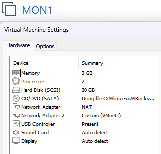
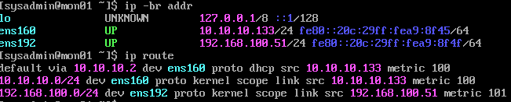
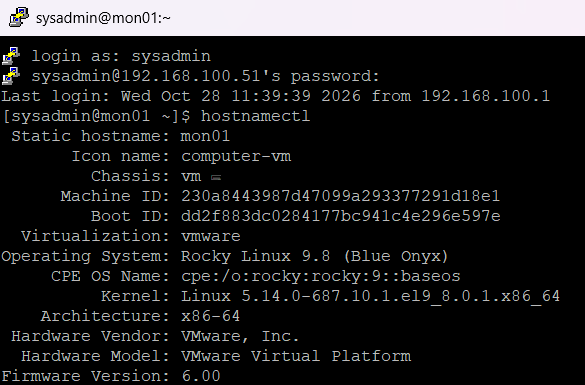
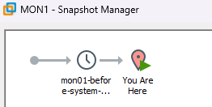
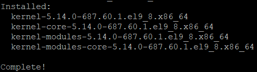
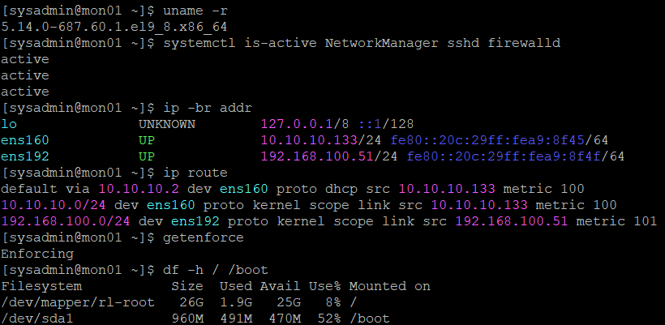
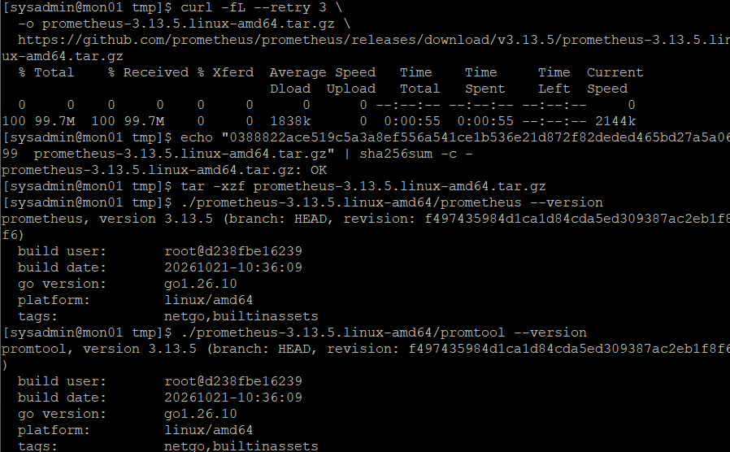
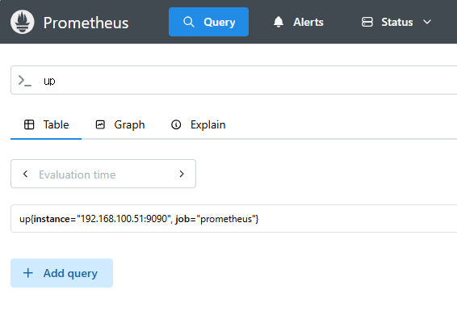
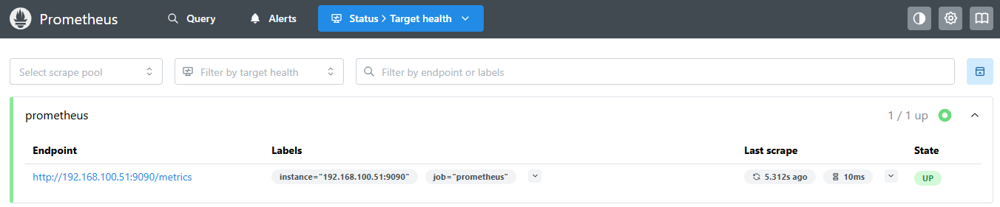

# 24. Prometheus 모니터링 서버 구축 및 메트릭 수집 검증 (Prometheus Monitoring)

## 1. 실습 개요

### 1.1 목적

Rocky Linux 9.8 기반 MON01 서버에 Prometheus를 설치하고, 시스템 메트릭을 수집하기 위한 모니터링 환경을 구축한다.

Web UI, Targets, PromQL 및 HTTP API를 통해 메트릭 수집이 정상적으로 이루어지는지 확인한다.

**주요 목표**

- MON01 서버 구축 및 기본 환경 검증
- Prometheus 3.13.5 다운로드 및 무결성 검증
- Prometheus 전용 계정 및 디렉터리 구성
- `prometheus.yml` 설정 및 문법 검증
- systemd 서비스 등록 및 자동 시작 설정
- TCP 9090 서비스 동작 확인
- Prometheus Web UI 및 Targets 상태 검증
- PromQL 및 HTTP API를 이용한 메트릭 수집 확인
- 서비스 재시작 후 정상 동작 검증

### 1.2 실습 환경

| 항목 | 구성 |
|---|---|
| 가상화 환경 | VMware Workstation |
| 운영체제 | Rocky Linux 9.8 |
| 서버 | MON01 |
| 호스트명 | mon01 |
| 내부 IP | `192.168.100.51/24` |
| NAT | `10.10.10.133/24` |
| CPU | 2 vCPU |
| 메모리 | 3GB |
| 디스크 | 30GB SCSI |
| 모니터링 도구 | Prometheus 3.13.5 |
| 서비스 관리 | systemd |
| 웹 포트 | TCP 9090 |
| 데이터 보존 기간 | 7일 |

---

## 2. MON01 서버 구축 및 기본 환경 검증

### 2.1 가상머신 및 운영체제 구성

기존 인프라 서버와 동일한 NAT + Host-only 네트워크 구조로 MON01을 구축하였다.

VMware Workstation에서 2 vCPU, RAM 3GB, SCSI 30GB 디스크를 할당하고 Rocky Linux 9.8을 Minimal Install 방식으로 설치하였다.

**MON01 — VMware 하드웨어 구성**



### 2.2 Host-only 고정 IP 설정

`ens160`은 NAT DHCP를 유지하고, `ens192`에는 고정 IP를 설정하였다.

```bash
sudo nmcli connection modify ens192 \
  ipv4.method manual \
  ipv4.addresses 192.168.100.51/24 \
  ipv4.never-default yes \
  connection.autoconnect yes

sudo nmcli connection up ens192
```

네트워크 설정 확인:

```bash
ip -br addr
ip route
```

**결과**

```text
ens160 UP 10.10.10.133/24
ens192 UP 192.168.100.51/24
```

```text
default via 10.10.10.2 dev ens160
192.168.100.0/24 dev ens192
```

외부 인터넷은 NAT, 내부 서버 통신은 Host-only를 사용하도록 구성하였다.

`ping`을 이용한 인터넷 통신과 DNS 조회가 정상적으로 수행되었으며, Windows에서 PuTTY로 `192.168.100.51`에 SSH 접속하였다.

**MON01 — 네트워크 설정 및 통신 검증**



### 2.3 시스템 기본 정보 확인

```bash
hostnamectl
```

**주요 결과**

```text
Static hostname: mon01
Operating System: Rocky Linux 9.8 (Blue Onyx)
Virtualization: vmware
Architecture: x86-64
```

호스트명, 운영체제 및 가상화 환경이 정상적으로 설정된 것을 확인하였다.

**MON01 — 시스템 정보 및 SSH 접속 확인**



### 2.4 시스템 업데이트 및 신규 커널 적용

Prometheus 설치 전 시스템 업데이트 범위를 확인하였다.

```bash
sudo dnf upgrade --refresh --assumeno
```

**모의 실행 결과**

```text
Transaction Summary

Install    4 Packages
Upgrade  110 Packages

Total download size: 919 M
Operation aborted.
```

업데이트 전 디스크 여유 공간을 확인하고 VMware 스냅샷을 생성하였다.

**MON01 — 시스템 업데이트 전 스냅샷**



이후 시스템 업데이트를 적용하였다.

```bash
sudo dnf upgrade --refresh
```

**업데이트 결과**

```text
Installed:
  kernel-5.14.0-687.60.1.el9_8.x86_64
  kernel-core-5.14.0-687.60.1.el9_8.x86_64
  kernel-modules-5.14.0-687.60.1.el9_8.x86_64
  kernel-modules-core-5.14.0-687.60.1.el9_8.x86_64

Complete!
```

**MON01 — 시스템 업데이트 완료**



재부팅 후 실행 커널과 주요 서비스 상태를 확인하였다.

```bash
uname -r
systemctl is-active NetworkManager sshd firewalld
ip -br addr
getenforce
```

**주요 결과**

```text
5.14.0-687.60.1.el9_8.x86_64
active
active
active
Enforcing
```

신규 커널이 적용되었고, 네트워크·SSH·방화벽·SELinux 설정이 정상적으로 설정되었다.

**MON01 — 업데이트 후 시스템 검증**



---

## 3. Prometheus 다운로드 및 무결성 검증

### 3.1 Prometheus 다운로드

MON01에 Prometheus 3.13.5 Linux AMD64 배포 파일을 다운로드하였다.

```bash
cd /tmp

curl -fL --retry 3 \
  -o prometheus-3.13.5.linux-amd64.tar.gz \
  https://github.com/prometheus/prometheus/releases/download/v3.13.5/prometheus-3.13.5.linux-amd64.tar.gz
```

약 99.7MB의 압축 파일이 다운로드되었다.

### 3.2 SHA256 무결성 검증

```bash
echo "0388822ace519c5a3a8ef556a541ce1b536e21d872f82deded465bd27a5a0699  prometheus-3.13.5.linux-amd64.tar.gz" | sha256sum -c -
```

**실제 결과**

```text
prometheus-3.13.5.linux-amd64.tar.gz: OK
```

지정된 SHA256 체크섬과 다운로드 파일의 해시값이 일치하였다.

### 3.3 압축 해제 및 버전 확인

```bash
tar -xzf prometheus-3.13.5.linux-amd64.tar.gz

./prometheus-3.13.5.linux-amd64/prometheus --version
./prometheus-3.13.5.linux-amd64/promtool --version
```

**주요 결과**

```text
prometheus, version 3.13.5
platform: linux/amd64
```

```text
promtool, version 3.13.5
platform: linux/amd64
```

Prometheus와 설정 검증 도구 `promtool`의 버전이 일치하는 것을 확인하였다.

**MON01 — Prometheus 다운로드 및 무결성 검증**



---

## 4. Prometheus 전용 계정 및 디렉터리 구성

### 4.1 전용 시스템 계정 생성

Prometheus를 root 계정이 아닌 별도 시스템 계정으로 실행하도록 구성하였다.

```bash
sudo useradd --system \
  --no-create-home \
  --shell /sbin/nologin \
  prometheus
```

| 옵션 | 의미 |
|---|---|
| `--system` | 시스템 계정 생성 |
| `--no-create-home` | 홈 디렉터리 생성 생략 |
| `--shell /sbin/nologin` | 일반 로그인 제한 |

### 4.2 설정 및 데이터 디렉터리 생성

```bash
sudo install -d -m 755 /etc/prometheus

sudo install -d -o prometheus -g prometheus \
  -m 750 /var/lib/prometheus
```

| 경로 | 용도 |
|---|---|
| `/etc/prometheus` | Prometheus 설정 파일 |
| `/var/lib/prometheus` | 메트릭 시계열 데이터 저장 |

데이터 디렉터리는 `prometheus` 사용자가 소유하도록 설정하였다.

### 4.3 실행 파일 설치

```bash
sudo install -m 755 \
  prometheus-3.13.5.linux-amd64/prometheus \
  /usr/local/bin/prometheus

sudo install -m 755 \
  prometheus-3.13.5.linux-amd64/promtool \
  /usr/local/bin/promtool
```

설치 확인:

```bash
ls -l /usr/local/bin/prometheus /usr/local/bin/promtool
```

**실제 결과**

```text
-rwxr-xr-x. 1 root root 137507992 Oct 28 12:07 /usr/local/bin/prometheus
-rwxr-xr-x. 1 root root 113909096 Oct 28 12:07 /usr/local/bin/promtool
```

두 실행 파일이 정상적으로 설치되고 실행 권한이 부여된 것을 확인하였다.

---

## 5. Prometheus 설정 파일 작성 및 검증

Prometheus가 자기 자신의 메트릭을 15초 간격으로 수집하도록 설정하였다.

```bash
sudo tee /etc/prometheus/prometheus.yml > /dev/null <<'EOF'
global:
  scrape_interval: 15s

scrape_configs:
  - job_name: 'prometheus'
    static_configs:
      - targets: ['192.168.100.51:9090']
EOF
```

설정 파일 권한 적용:

```bash
sudo chown root:prometheus /etc/prometheus/prometheus.yml
sudo chmod 640 /etc/prometheus/prometheus.yml
```

설정 확인:

```bash
sudo cat /etc/prometheus/prometheus.yml
```

**설정 내용**

```yaml
global:
  scrape_interval: 15s

scrape_configs:
  - job_name: 'prometheus'
    static_configs:
      - targets: ['192.168.100.51:9090']
```

| 설정 | 의미 |
|---|---|
| `scrape_interval: 15s` | 15초 간격 메트릭 수집 |
| `job_name: prometheus` | 메트릭 수집 작업 이름 |
| `192.168.100.51:9090` | Prometheus 자체 수집 대상 |

---

## 6. Prometheus systemd 서비스 등록 및 실행

### 6.1 systemd 서비스 파일 작성

Prometheus를 시스템 서비스로 관리하고 서버 부팅 시 자동 실행되도록 Unit 파일을 작성하였다.

```bash
sudo tee /etc/systemd/system/prometheus.service > /dev/null <<'EOF'
[Unit]
Description=Prometheus Monitoring Server
Wants=network-online.target
After=network-online.target

[Service]
Type=simple
User=prometheus
Group=prometheus
ExecStart=/usr/local/bin/prometheus \
  --config.file=/etc/prometheus/prometheus.yml \
  --storage.tsdb.path=/var/lib/prometheus \
  --storage.tsdb.retention.time=7d \
  --web.listen-address=192.168.100.51:9090
Restart=on-failure
RestartSec=5s

[Install]
WantedBy=multi-user.target
EOF
```

**주요 설정**

| 설정 | 의미 |
|---|---|
| `User`, `Group` | prometheus 계정으로 실행 |
| `ExecStart` | 실행 파일 및 옵션 지정 |
| `--config.file` | 설정 파일 경로 |
| `--storage.tsdb.path` | 메트릭 데이터 저장 위치 |
| `--storage.tsdb.retention.time=7d` | 데이터 보존 기간 7일 |
| `--web.listen-address` | Host-only IP의 TCP 9090에서 수신 |
| `Restart=on-failure` | 비정상 종료 시 자동 재시작 |
| `WantedBy=multi-user.target` | 부팅 시 자동 실행 설정에 사용 |

Prometheus는 전용 계정으로 실행되며, 수집 데이터는 `/var/lib/prometheus`에 저장하도록 구성하였다.

### 6.2 SELinux 컨텍스트 복원

```bash
sudo restorecon -Rv \
  /usr/local/bin/prometheus \
  /usr/local/bin/promtool \
  /etc/prometheus \
  /var/lib/prometheus \
  /etc/systemd/system/prometheus.service
```

서비스 설정 파일 확인:

```bash
sudo cat /etc/systemd/system/prometheus.service
```

### 6.3 systemd 서비스 등록

```bash
sudo systemctl daemon-reload
sudo systemctl enable --now prometheus
```

**실제 결과**

```text
Created symlink /etc/systemd/system/multi-user.target.wants/prometheus.service → /etc/systemd/system/prometheus.service.
```

### 6.4 서비스 및 포트 검증

```bash
systemctl is-active prometheus
systemctl is-enabled prometheus
sudo ss -lntp | grep ':9090'
```

**실제 결과**

```text
active
enabled
```

```text
LISTEN 0 4096 192.168.100.51:9090 0.0.0.0:* users:(("prometheus",pid=5621,fd=6))
```

Prometheus가 정상 실행 중이며 부팅 시 자동 실행되도록 등록되었다.

또한 TCP 9090 포트에서 HTTP 요청을 수신하고 있음을 확인하였다.

### 6.5 HTTP 준비 상태 및 서비스 로그 확인

```bash
curl -fsS --max-time 5 http://192.168.100.51:9090/-/ready
```

**실제 결과**

```text
Prometheus Server is Ready.
```

서비스 로그 확인:

```bash
sudo journalctl -u prometheus -n 15 --no-pager
```

**주요 로그**

```text
msg="TSDB started"
msg="Completed loading of configuration file"
msg="Server is ready to receive web requests."
```

Prometheus의 시계열 데이터베이스(TSDB) 초기화, 설정 파일 로딩 및 웹 서비스 시작이 정상적으로 완료되었다.

---

## 7. Prometheus Web UI 및 메트릭 수집 검증

### 7.1 Web UI 접속

Windows 브라우저에서 다음 주소로 접속하였다.

```text
http://192.168.100.51:9090
```

Prometheus Web UI가 정상적으로 표시되었다.

이를 통해 Windows 호스트에서 MON01의 Prometheus 웹 서비스에 접근할 수 있음을 확인하였다.

### 7.2 PromQL up 쿼리 실행

Prometheus Query 화면에서 다음 쿼리를 실행하였다.

```promql
up
```

조회 대상:

```text
up{instance="192.168.100.51:9090", job="prometheus"}
```

`up` 메트릭은 Prometheus가 대상의 메트릭을 성공적으로 수집했는지 나타낸다.

| 값 | 의미 |
|---|---|
| `1` | 정상 수집 |
| `0` | 수집 실패 |

**MON01 — Prometheus Web UI 및 PromQL 조회**



### 7.3 Targets 상태 확인

다음 주소에서 수집 대상 상태를 확인하였다.

```text
http://192.168.100.51:9090/targets
```

**실제 결과**

| 항목 | 결과 |
|---|---|
| Job | prometheus |
| Endpoint | `192.168.100.51:9090/metrics` |
| Target 수 | 1개 |
| 정상 Target | 1개 |
| 상태 | UP |
| 마지막 Scrape 소요 시간 | 약 10ms |

```text
1 / 1 UP
```

등록된 Prometheus 자체 수집 대상이 정상적으로 동작하였다.

**MON01 — Prometheus Targets 상태**



### 7.4 서비스 재시작 후 최종 검증

Prometheus를 재시작한 후에도 메트릭 수집 기능이 정상적으로 유지되는지 확인하였다.

```bash
sudo /usr/local/bin/promtool check config /etc/prometheus/prometheus.yml
sudo systemctl restart prometheus

systemctl is-active prometheus
systemctl is-enabled prometheus
```

**실제 결과**

```text
SUCCESS: /etc/prometheus/prometheus.yml is valid prometheus config file syntax
active
enabled
```

HTTP 준비 상태 확인:

```bash
curl -fsS --max-time 5 http://192.168.100.51:9090/-/ready
```

**실제 결과**

```text
Prometheus Server is Ready.
```

### 7.5 HTTP API 메트릭 검증

Web UI뿐 아니라 HTTP API를 이용하여 `up` 메트릭을 조회하였다.

```bash
curl -fsSG --max-time 5 \
  --data-urlencode 'query=up' \
  http://192.168.100.51:9090/api/v1/query
```

**실제 결과 중 주요 부분**

```json
{
  "status": "success",
  "data": {
    "resultType": "vector",
    "result": [
      {
        "metric": {
          "__name__": "up",
          "instance": "192.168.100.51:9090",
          "job": "prometheus"
        },
        "value": [1793157577.724, "1"]
      }
    ]
  }
}
```

HTTP API에서도 `status: success`, `up = 1`이 확인되었다.

### 7.6 데이터 저장 및 Journal 검증

데이터 디렉터리 확인:

```bash
sudo ls -ld /var/lib/prometheus
```

**실제 결과**

```text
drwxr-x---. 4 prometheus prometheus 70 Oct 28 12:19 /var/lib/prometheus
```

재시작 후 서비스 로그 확인:

```bash
sudo journalctl -u prometheus -n 10 --no-pager
```

**주요 로그**

```text
msg="WAL replay completed"
msg="TSDB started"
msg="Completed loading of configuration file"
msg="Server is ready to receive web requests."
```

Prometheus 재시작 후에도 데이터 디렉터리의 소유권이 유지되고, 시계열 데이터베이스와 웹 서비스가 정상적으로 시작된 것을 확인하였다.

---

## 8. 최종 검증 결과 및 정리

### 8.1 최종 검증 결과

| 검증 항목 | 실제 결과 | 상태 |
|---|---|---|
| MON01 서버 구축 | Rocky Linux 9.8 | 완료 |
| Host-only IP | `192.168.100.51/24` | 정상 |
| NAT 인터넷 연결 | 패킷 손실 0% | 성공 |
| PuTTY SSH 접속 | sysadmin | 성공 |
| 시스템 업데이트 | DNF Complete! | 성공 |
| 신규 커널 | `5.14.0-687.60.1.el9_8` | 적용 |
| VMware 스냅샷 | 업데이트 전 생성 | 완료 |
| Prometheus 설치 | 3.13.5 | 완료 |
| SHA256 무결성 검증 | OK | 성공 |
| 전용 시스템 계정 | prometheus | 완료 |
| 설정 파일 문법 | SUCCESS | 정상 |
| systemd 서비스 | active | 정상 |
| 부팅 시 자동 시작 | enabled | 정상 |
| TCP 9090 | LISTEN | 정상 |
| HTTP 준비 상태 | Ready | 정상 |
| Windows Web UI 접속 | 성공 | 정상 |
| Prometheus Targets | 1 / 1 UP | 성공 |
| PromQL up | 1 | 성공 |
| HTTP API | status: success | 성공 |
| 서비스 재시작 | 정상 실행 유지 | 성공 |
| 메트릭 데이터 디렉터리 | prometheus:prometheus | 정상 |
| 데이터 보존 기간 | 7일 | 적용 |

**접근 제어 확인 사항**

Windows에서 Prometheus Web UI에 정상 접속하였으나, TCP 9090 방화벽 Rich Rule의 실제 설정 내용은 별도 출력으로 검증하지 않았다.

따라서 접근 허용 대상 IP와 Zone 설정은 추가 확인 대상으로 남겨 두었다.

### 8.2 배운 점

**Prometheus 메트릭 수집 방식**

Prometheus는 대상 서버의 메트릭 엔드포인트에 주기적으로 접근하여 데이터를 수집하는 Pull 방식을 사용한다.

이번 실습에서는 Prometheus 자체 메트릭을 15초 간격으로 수집하도록 구성하였다.

**전용 계정을 이용한 서비스 실행**

Prometheus를 root가 아닌 전용 계정으로 실행하고, 설정 파일과 데이터 디렉터리의 소유권 및 접근 권한을 구분하였다.

**systemd를 이용한 서비스 관리**

Unit 파일에서 실행 계정, 실행 옵션 및 자동 재시작 정책을 지정하였다.

`systemctl`을 통해 서비스 실행 및 자동 시작 상태를 관리하고, `journalctl`을 통해 실행 로그를 분석하였다.

**설정 파일 검증**

`promtool`을 이용하여 Prometheus 설정 파일의 문법을 검사하고 `SUCCESS` 결과를 확인하였다.

**서비스 상태와 기능 검증의 차이**

서비스가 `active`인 것만으로 메트릭 수집이 정상이라고 판단할 수는 없다.

이번 실습에서는 HTTP 준비 상태, Targets의 UP 상태, PromQL 및 HTTP API 결과를 함께 확인하여 실제 기능을 검증하였다.

### 8.3 최종 결과

MON01에 Prometheus 3.13.5를 설치하고, 전용 계정 및 systemd 기반 서비스 관리 환경을 구성하였다.

Prometheus 자체 메트릭을 수집하도록 설정한 후 Web UI, Targets, PromQL 및 HTTP API를 통해 수집 상태를 검증하였다.

서비스 재시작 이후에도 Prometheus가 정상 실행되었으며, 메트릭 수집 상태가 유지되는 것을 확인하였다.

이를 통해 향후 WEB01, WEB02, DB01, NAS01 등 인프라 서버의 리소스 상태를 통합 수집하기 위한 모니터링 서버 환경을 구축하였다.

### 관련 문서

- [23. Linux 로그 관리 및 로그 기반 장애 분석](./23-log-management.md)
