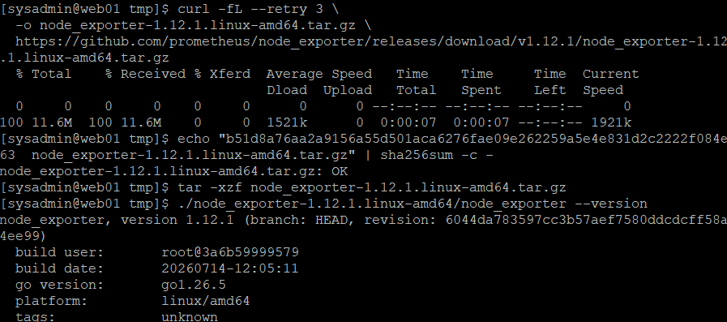
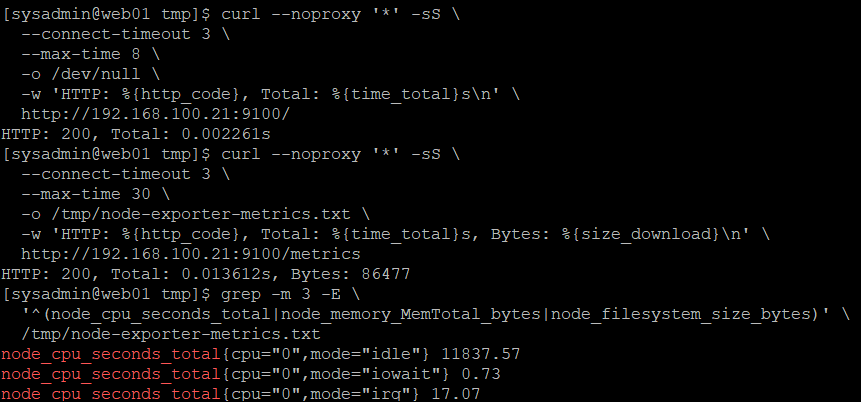
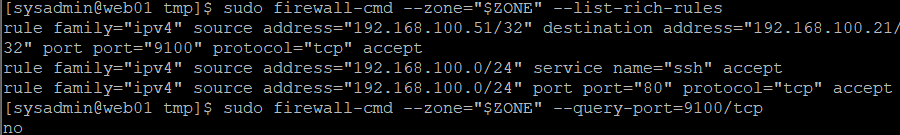
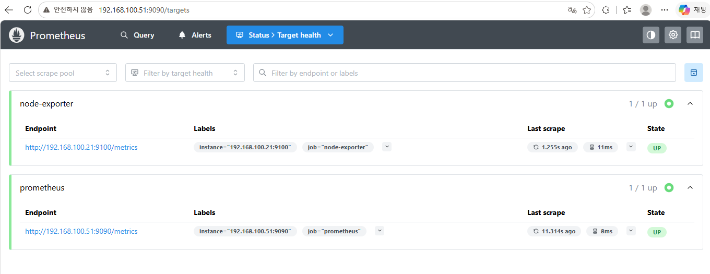
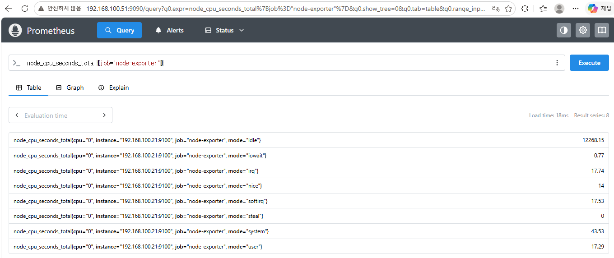
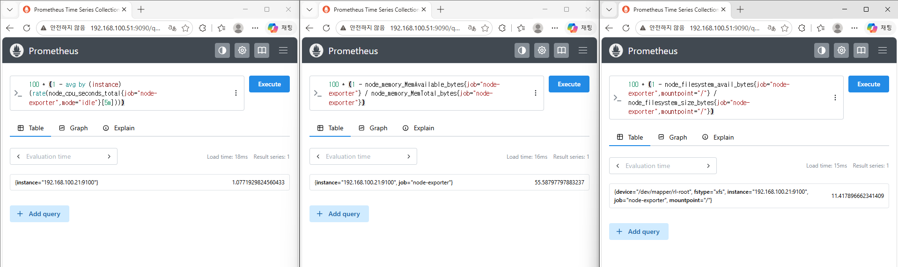
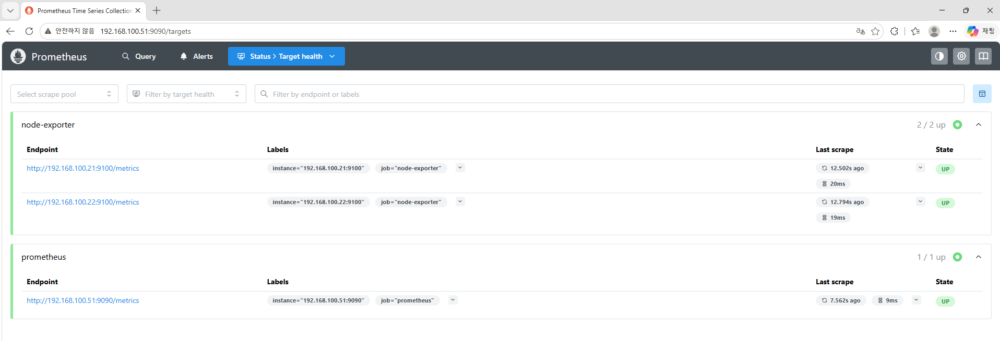
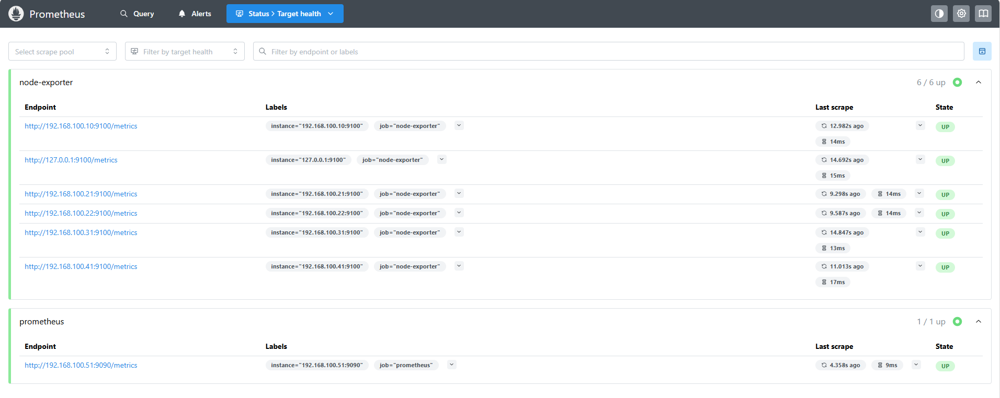

# 25. Node Exporter 기반 Linux 서버 메트릭 수집 및 통합 모니터링 (Node Exporter Monitoring)

## 1. 실습 개요

### 1.1 목적

Rocky Linux 9.8 기반 인프라 서버에 Node Exporter를 설치하고, MON01의 Prometheus에서 각 서버의 시스템 리소스 메트릭을 통합 수집한다.

Node Exporter를 systemd 서비스로 등록하고, firewalld를 이용하여 모니터링 서버에서만 메트릭 포트에 접근할 수 있도록 구성한다.

Prometheus Targets 및 PromQL을 이용하여 CPU·메모리·디스크 메트릭이 정상적으로 수집되는지 검증한다.

**주요 목표**

- Node Exporter 1.12.1 설치 및 SHA256 무결성 검증
- 전용 시스템 계정 및 systemd 서비스 구성
- TCP 9100 메트릭 제공 및 HTTP 응답 검증
- firewalld를 이용한 모니터링 접근 제어
- MON01 Prometheus와 WEB01 연동
- PromQL을 이용한 CPU·메모리·디스크 사용률 확인
- WEB02·DB01·NAS01·LB01·MON01으로 수집 대상 확장
- Prometheus Targets 전체 7 / 7 UP 검증

### 1.2 실습 환경

| 항목 | 구성 |
|---|---|
| 가상화 환경 | VMware Workstation |
| 운영체제 | Rocky Linux 9.8 |
| 모니터링 서버 | MON01 |
| Prometheus | 3.13.5 |
| Node Exporter | 1.12.1 |
| 메트릭 제공 포트 | TCP 9100 |
| Prometheus 웹 포트 | TCP 9090 |
| 메트릭 수집 주기 | 15초 |
| 서비스 관리 | systemd |
| 네트워크 | Host-only (192.168.100.0/24) |

**서버별 구성**

| 서버 | IP | 역할 |
|---|---|---|
| LB01 | 192.168.100.10 | HAProxy 로드 밸런서 |
| WEB01 | 192.168.100.21 | Apache/PHP 웹 서버 |
| WEB02 | 192.168.100.22 | Apache/PHP 웹 서버 |
| DB01 | 192.168.100.31 | MariaDB 데이터베이스 |
| NAS01 | 192.168.100.41 | NFS 및 LVM 스토리지 |
| MON01 | 192.168.100.51 | Prometheus 모니터링 서버 |

---

## 2. Node Exporter 모니터링 구조

### 2.1 Node Exporter 역할

Node Exporter는 Linux 서버의 시스템 리소스 정보를 메트릭 형태로 제공하는 Exporter이다.

Prometheus는 각 서버의 `/metrics` 엔드포인트에 HTTP 요청을 보내 데이터를 수집한다.

**주요 수집 항목**

| 메트릭 | 용도 |
|---|---|
| `node_cpu_seconds_total` | CPU 동작 모드별 누적 사용 시간 |
| `node_memory_MemTotal_bytes` | 전체 메모리 |
| `node_memory_MemAvailable_bytes` | 사용 가능한 메모리 |
| `node_filesystem_size_bytes` | 파일시스템 전체 크기 |
| `node_filesystem_avail_bytes` | 파일시스템 사용 가능 공간 |
| `node_network_receive_bytes_total` | 네트워크 수신 바이트 누적량 |

### 2.2 수집 구조

```text
                     MON01
             192.168.100.51
               Prometheus
                TCP 9090
                    |
          HTTP Pull /metrics
                    |
     +--------------+--------------+
     |              |              |
   LB01           WEB01          WEB02
  .10:9100       .21:9100       .22:9100
     |              |              |
     +--------------+--------------+
                    |
             DB01 / NAS01
           .31:9100 / .41:9100

MON01 Node Exporter
127.0.0.1:9100
```

LB01, WEB01, WEB02, DB01, NAS01은 Host-only 네트워크를 통해 MON01에 메트릭을 제공한다.

MON01 자체 Node Exporter는 Prometheus와 동일한 서버에서 실행되므로 루프백 주소(`127.0.0.1:9100`)를 이용하여 메트릭을 수집한다.

---

## 3. WEB01 Node Exporter 설치 및 서비스 구성

### 3.1 Node Exporter 다운로드

WEB01에서 Node Exporter 1.12.1 Linux AMD64 배포 파일을 다운로드하였다.

```bash
cd /tmp

curl -fL --retry 3 \
  -o node_exporter-1.12.1.linux-amd64.tar.gz \
  https://github.com/prometheus/node_exporter/releases/download/v1.12.1/node_exporter-1.12.1.linux-amd64.tar.gz
```

### 3.2 SHA256 무결성 검증

```bash
echo "b51d8a76aa2a9156a55d501aca6276fae09e262259a5e4e831d2c2222f084e63  node_exporter-1.12.1.linux-amd64.tar.gz" | sha256sum -c -
```

**결과**

```text
node_exporter-1.12.1.linux-amd64.tar.gz: OK
```

다운로드한 파일이 지정된 SHA256 체크섬과 일치함을 확인하였다.

### 3.3 압축 해제 및 버전 확인

```bash
tar -xzf node_exporter-1.12.1.linux-amd64.tar.gz

./node_exporter-1.12.1.linux-amd64/node_exporter --version
```

**결과**

```text
node_exporter, version 1.12.1
platform: linux/amd64
```

Node Exporter의 버전과 아키텍처가 실습 환경에 적합함을 확인하였다.

**WEB01 — Node Exporter 다운로드 및 SHA256 검증**



### 3.4 전용 시스템 계정 생성

Node Exporter를 root가 아닌 별도 시스템 계정으로 실행하기 위해 전용 계정을 생성하였다.

```bash
sudo useradd --system \
  --no-create-home \
  --shell /sbin/nologin \
  node_exporter
```

실행 파일을 `/usr/local/bin`에 설치하였다.

```bash
sudo install -m 755 \
  /tmp/node_exporter-1.12.1.linux-amd64/node_exporter \
  /usr/local/bin/node_exporter
```

### 3.5 systemd 서비스 파일 작성

Node Exporter를 시스템 서비스로 관리하기 위해 Unit 파일을 작성하였다.

```bash
sudo tee /etc/systemd/system/node_exporter.service > /dev/null <<'EOF'
[Unit]
Description=Prometheus Node Exporter
Wants=network-online.target
After=network-online.target

[Service]
Type=simple
User=node_exporter
Group=node_exporter
ExecStart=/usr/local/bin/node_exporter \
  --web.listen-address=192.168.100.21:9100
Restart=on-failure
RestartSec=5s

[Install]
WantedBy=multi-user.target
EOF
```

**주요 설정**

| 설정 | 의미 |
|---|---|
| `User=node_exporter` | 전용 계정으로 실행 |
| `Group=node_exporter` | 전용 그룹 사용 |
| `ExecStart` | Node Exporter 실행 명령어 |
| `--web.listen-address` | 메트릭 제공 IP 및 포트 |
| `Restart=on-failure` | 비정상 종료 시 자동 재시작 |
| `RestartSec=5s` | 재시작 전 5초 대기 |
| `WantedBy=multi-user.target` | 부팅 시 자동 실행 설정에 사용 |

WEB01의 Host-only IP인 `192.168.100.21`에서만 TCP 9100 요청을 수신하도록 구성하였다.

### 3.6 서비스 등록 및 실행 확인

SELinux 컨텍스트를 복원하였다.

```bash
sudo restorecon -v \
  /usr/local/bin/node_exporter \
  /etc/systemd/system/node_exporter.service
```

서비스 파일 확인:

```bash
sudo cat /etc/systemd/system/node_exporter.service
```

서비스 등록 및 실행:

```bash
sudo systemctl daemon-reload
sudo systemctl enable --now node_exporter
```

서비스 상태와 포트 확인:

```bash
systemctl is-active node_exporter
systemctl is-enabled node_exporter
sudo ss -lntp | grep ':9100'
```

**결과**

```text
active
enabled
```

```text
LISTEN 0 4096 192.168.100.21:9100 0.0.0.0:* users:(("node_exporter",pid=2823,fd=3))
```

Node Exporter가 정상 실행 중이며, 서버 부팅 시 자동 실행되도록 설정된 것을 확인하였다.

---

## 4. WEB01 메트릭 제공 및 방화벽 검증

### 4.1 HTTP 메트릭 응답 확인

초기 `/metrics` 요청에서 다음 오류가 발생하였다.

```text
curl: (28) Operation timed out after 10002 milliseconds with 0 bytes received
```

이후 프록시를 사용하지 않도록 `--noproxy '*'` 옵션을 적용하여 다시 검증하였다.

먼저 Node Exporter 기본 페이지에 접근하였다.

```bash
curl --noproxy '*' -sS \
  --connect-timeout 3 \
  --max-time 8 \
  -o /dev/null \
  -w 'HTTP: %{http_code}, Total: %{time_total}s\n' \
  http://192.168.100.21:9100/
```

**결과**

```text
HTTP: 200, Total: 0.002261s
```

이어서 `/metrics` 엔드포인트를 확인하였다.

```bash
curl --noproxy '*' -sS \
  --connect-timeout 3 \
  --max-time 30 \
  -o /tmp/node-exporter-metrics.txt \
  -w 'HTTP: %{http_code}, Total: %{time_total}s, Bytes: %{size_download}\n' \
  http://192.168.100.21:9100/metrics
```

**결과**

```text
HTTP: 200, Total: 0.013612s, Bytes: 86477
```

메트릭 파일에서 CPU 관련 데이터를 확인하였다.

```bash
grep -m 3 -E \
  '^(node_cpu_seconds_total|node_memory_MemTotal_bytes|node_filesystem_size_bytes)' \
  /tmp/node-exporter-metrics.txt
```

**결과**

```text
node_cpu_seconds_total{cpu="0",mode="idle"} 11837.57
node_cpu_seconds_total{cpu="0",mode="iowait"} 0.73
node_cpu_seconds_total{cpu="0",mode="irq"} 17.07
```

HTTP 200 응답과 실제 CPU 메트릭을 통해 Node Exporter가 정상적으로 데이터를 제공하고 있음을 확인하였다.

**WEB01 — Node Exporter HTTP 응답 및 메트릭 확인**



### 4.2 WEB01 방화벽 설정

MON01(`192.168.100.51`)에서만 WEB01의 TCP 9100 포트에 접근할 수 있도록 방화벽을 설정하였다.

먼저 Host-only 인터페이스인 `ens192`에 적용된 방화벽 Zone을 확인하였다.

```bash
sudo firewall-cmd --state
sudo firewall-cmd --get-zone-of-interface=ens192
```

**실제 결과**

```text
running
public
```

`ens192`에 `public` Zone이 적용되어 있으므로 해당 Zone에 접근 허용 규칙을 추가하였다.

```bash
sudo firewall-cmd --permanent --zone=public \
  --add-rich-rule='rule family="ipv4" source address="192.168.100.51/32" destination address="192.168.100.21/32" port port="9100" protocol="tcp" accept'
```

방화벽 설정 적용:

```bash
sudo firewall-cmd --reload
```

설정 확인:

```bash
sudo firewall-cmd --zone=public --list-rich-rules

sudo firewall-cmd --zone=public --query-port=9100/tcp
```

**실제 결과 중 Node Exporter 접근 허용 규칙**

```text
rule family="ipv4" source address="192.168.100.51/32" destination address="192.168.100.21/32" port port="9100" protocol="tcp" accept
```

일반 포트 개방 여부:

```text
no
```

`no`는 TCP 9100이 일반 포트 허용 목록에 등록되지 않았다는 의미이다.

이번 실습에서는 일반 포트 개방 대신 Rich Rule을 이용하여 MON01의 IP에서 접근하도록 설정하였다.

기존 SSH 및 HTTP 서비스 관련 방화벽 규칙은 유지하였다.

**WEB01 — Node Exporter 방화벽 접근 제어**



### 4.3 MON01에서 WEB01 메트릭 확인

MON01에 접속한 뒤 WEB01의 Node Exporter에 HTTP 요청을 전송하였다.

```bash
curl --noproxy '*' -fsS \
  --connect-timeout 3 \
  --max-time 10 \
  -o /tmp/web01-node-metrics.txt \
  -w 'HTTP: %{http_code}, Total: %{time_total}s, Bytes: %{size_download}\n' \
  http://192.168.100.21:9100/metrics

grep -m 3 '^node_cpu_seconds_total' \
  /tmp/web01-node-metrics.txt
```

**결과**

```text
HTTP: 200, Total: 0.010483s, Bytes: 86532
```

```text
node_cpu_seconds_total{cpu="0",mode="idle"} 12053.31
node_cpu_seconds_total{cpu="0",mode="iowait"} 0.77
node_cpu_seconds_total{cpu="0",mode="irq"} 17.4
```

MON01에서 WEB01의 메트릭에 직접 접근할 수 있음을 확인하였다.

---

## 5. Prometheus 수집 대상 등록 및 리소스 검증

### 5.1 WEB01 수집 대상 등록

MON01의 Prometheus 설정 파일을 백업하고 WEB01을 새로운 수집 대상으로 추가하였다.

```bash
sudo cp -a \
  /etc/prometheus/prometheus.yml \
  /etc/prometheus/prometheus.yml.bak
```

```bash
sudo tee /etc/prometheus/prometheus.yml > /dev/null <<'EOF'
global:
  scrape_interval: 15s

scrape_configs:
  - job_name: 'prometheus'
    static_configs:
      - targets: ['192.168.100.51:9090']

  - job_name: 'node-exporter'
    static_configs:
      - targets: ['192.168.100.21:9100']
EOF
```

설정 파일을 확인하고 문법을 검증하였다.

```bash
sudo cat /etc/prometheus/prometheus.yml

sudo /usr/local/bin/promtool check config \
  /etc/prometheus/prometheus.yml
```

**결과**

```text
SUCCESS: /etc/prometheus/prometheus.yml is valid prometheus config file syntax
```

설정 검증 후 서비스를 재시작하였다.

```bash
sudo systemctl restart prometheus

systemctl is-active prometheus
```

**결과**

```text
active
```

HTTP 준비 상태도 확인하였다.

```bash
curl --noproxy '*' -fsS \
  http://192.168.100.51:9090/-/ready
```

**결과**

```text
Prometheus Server is Ready.
```

### 5.2 Prometheus Targets 확인

Windows 브라우저에서 Prometheus Targets 화면에 접속하였다.

```text
http://192.168.100.51:9090/targets
```

**결과**

| 수집 대상 | Endpoint | 상태 |
|---|---|---|
| Prometheus | 192.168.100.51:9090 | UP |
| WEB01 Node Exporter | 192.168.100.21:9100 | UP |

```text
Prometheus: 1 / 1 UP
Node Exporter: 1 / 1 UP
```

Prometheus 자체 메트릭과 WEB01의 시스템 메트릭이 모두 정상적으로 수집되었다.

**MON01 — WEB01 Node Exporter Targets 검증**



### 5.3 WEB01 CPU 메트릭 조회

Prometheus Query 화면에서 다음 PromQL을 실행하였다.

```promql
node_cpu_seconds_total{job="node-exporter"}
```

**주요 조회 결과**

```text
node_cpu_seconds_total{cpu="0",instance="192.168.100.21:9100",job="node-exporter",mode="idle"}
node_cpu_seconds_total{cpu="0",instance="192.168.100.21:9100",job="node-exporter",mode="system"}
node_cpu_seconds_total{cpu="0",instance="192.168.100.21:9100",job="node-exporter",mode="user"}
```

CPU 동작 모드별 누적 사용 시간이 수집되는 것을 확인하였다.

`node_cpu_seconds_total`은 누적값이므로 현재 CPU 사용률을 계산하려면 `rate()`와 같은 PromQL 함수를 사용해야 한다.

**MON01 — WEB01 CPU 메트릭 조회**



### 5.4 CPU 사용률 계산

최근 5분 평균 CPU 사용률을 계산하였다.

```promql
100 * (1 - avg by (instance) (rate(node_cpu_seconds_total{job="node-exporter",mode="idle"}[5m])))
```

**결과**

```text
instance="192.168.100.21:9100"
1.0771929824560433
```

약 **1.08%**의 CPU 사용률이 확인되었다.

### 5.5 메모리 사용률 계산

전체 메모리와 사용 가능한 메모리를 이용하여 사용률을 계산하였다.

```promql
100 * (1 - node_memory_MemAvailable_bytes{job="node-exporter"} / node_memory_MemTotal_bytes{job="node-exporter"})
```

**결과**

```text
instance="192.168.100.21:9100"
55.58797797883237
```

약 **55.59%**의 메모리 사용률이 확인되었다.

### 5.6 디스크 사용률 계산

루트 파일시스템(`/`)의 사용률을 계산하였다.

```promql
100 * (1 - node_filesystem_avail_bytes{job="node-exporter",mountpoint="/"} / node_filesystem_size_bytes{job="node-exporter",mountpoint="/"})
```

**결과**

```text
instance="192.168.100.21:9100"
mountpoint="/"
11.417896662341409
```

약 **11.42%**의 루트 파일시스템 사용률이 확인되었다.

**WEB01 리소스 조회 결과 요약**

| 항목 | 측정값 |
|---|---:|
| CPU 사용률 | 약 1.08% |
| 메모리 사용률 | 약 55.59% |
| 루트 디스크 사용률 | 약 11.42% |

위 수치는 실습 당시 조회한 값이며, 서버 상태에 따라 달라질 수 있다.

**MON01 — WEB01 CPU·메모리·디스크 사용률**



---

## 6. 전체 인프라 Node Exporter 확장

### 6.1 WEB02 Node Exporter 구성

WEB01에서 검증한 설치 방식을 WEB02에 동일하게 적용하였다.

**WEB02 환경**

| 항목 | 설정 |
|---|---|
| 서버 | WEB02 |
| IP | 192.168.100.22 |
| Node Exporter | 1.12.1 |
| 메트릭 주소 | 192.168.100.22:9100 |

SHA256 검증:

```text
node_exporter-1.12.1.linux-amd64.tar.gz: OK
```

systemd 서비스 설정의 주요 차이점은 수신 주소이다.

```ini
ExecStart=/usr/local/bin/node_exporter \
  --web.listen-address=192.168.100.22:9100
```

**주요 검증 결과**

```text
active
enabled
```

WEB02 자체 메트릭 조회:

```text
HTTP: 200, Total: 0.033421s, Bytes: 86011
```

MON01에서 WEB02 메트릭 조회:

```text
HTTP: 200, Total: 0.010848s, Bytes: 86071
```

방화벽에서는 MON01의 TCP 9100 접근만 허용하도록 설정하였다.

Prometheus의 `node-exporter` Job에 WEB02를 추가하고 Targets 상태를 확인하였다.

**WEB01·WEB02 모니터링 결과**

```text
Node Exporter: 2 / 2 UP
Prometheus: 1 / 1 UP
```

**MON01 — WEB01·WEB02 Targets 검증**



### 6.2 DB01 Node Exporter 구성

DB01에도 동일한 Node Exporter 1.12.1을 설치하였다.

**DB01 환경**

| 항목 | 설정 |
|---|---|
| 서버 | DB01 |
| IP | 192.168.100.31 |
| 메트릭 주소 | 192.168.100.31:9100 |

SHA256 검증:

```text
node_exporter-1.12.1.linux-amd64.tar.gz: OK
```

systemd 서비스 설정:

```ini
ExecStart=/usr/local/bin/node_exporter \
  --web.listen-address=192.168.100.31:9100
```

**주요 검증 결과**

```text
active
enabled
LISTEN ... 192.168.100.31:9100 ...
```

DB01 자체 메트릭 조회:

```text
HTTP: 200, Total: 0.022406s, Bytes: 79652
```

MON01에서 DB01 메트릭 조회:

```text
HTTP: 200, Total: 0.020513s, Bytes: 79682
```

방화벽에 MON01의 TCP 9100 접근 허용 규칙을 적용하고, Prometheus 수집 대상으로 등록한 뒤 UP 상태를 확인하였다.

### 6.3 NAS01 Node Exporter 구성

NAS01에는 동일한 방식으로 Node Exporter를 구성하고 Prometheus 수집 대상으로 등록하였다.

**NAS01 환경**

| 항목 | 설정 |
|---|---|
| 서버 | NAS01 |
| IP | 192.168.100.41 |
| 메트릭 주소 | 192.168.100.41:9100 |

NAS01은 NFS 및 LVM 스토리지 서버이므로 파일시스템 메트릭을 주요 모니터링 항목으로 활용할 수 있다.

대표적인 메트릭:

```promql
node_filesystem_size_bytes{instance="192.168.100.41:9100"}
```

최종 Prometheus Targets 화면에서 NAS01의 Node Exporter가 **UP** 상태임을 확인하였다.

### 6.4 LB01 Node Exporter 구성

LB01에도 Node Exporter를 설치하고 Prometheus 수집 대상으로 추가하였다.

**LB01 환경**

| 항목 | 설정 |
|---|---|
| 서버 | LB01 |
| IP | 192.168.100.10 |
| 메트릭 주소 | 192.168.100.10:9100 |

Node Exporter를 이용하여 LB01의 CPU·메모리·디스크 등 운영체제 리소스를 수집하도록 구성하였다.

HAProxy의 백엔드 상태나 HTTP 요청 수와 같은 서비스 전용 메트릭은 이번 Node Exporter 수집 범위에 포함되지 않는다.

최종 Prometheus Targets 화면에서 LB01의 Node Exporter가 **UP** 상태임을 확인하였다.

### 6.5 MON01 자체 Node Exporter 구성

MON01에도 Node Exporter를 설치하여 모니터링 서버 자신의 시스템 리소스를 수집하도록 구성하였다.

다른 서버와 달리, Prometheus와 Node Exporter가 같은 서버에서 실행되므로 루프백 주소를 사용하였다.

```ini
ExecStart=/usr/local/bin/node_exporter \
  --web.listen-address=127.0.0.1:9100
```

| 항목 | 설정 |
|---|---|
| 서버 | MON01 |
| Prometheus | 192.168.100.51:9090 |
| Node Exporter | 127.0.0.1:9100 |

Node Exporter가 로컬 인터페이스에서만 요청을 수신하도록 구성하여 별도의 외부 TCP 9100 방화벽 개방 없이 메트릭을 수집하도록 하였다.

최종 Prometheus Targets에서 MON01의 Node Exporter가 **UP** 상태임을 확인하였다.

---

## 7. Prometheus 전체 수집 대상 및 통합 검증

### 7.1 최종 수집 대상 구성

각 서버에 Node Exporter를 설치하고 MON01의 Prometheus 설정에 수집 대상을 등록하였다.

최종 수집 대상 목록은 다음과 같다.

```yaml
global:
  scrape_interval: 15s

scrape_configs:
  - job_name: 'prometheus'
    static_configs:
      - targets: ['192.168.100.51:9090']

  - job_name: 'node-exporter'
    static_configs:
      - targets:
          - '192.168.100.21:9100'
          - '192.168.100.22:9100'
          - '192.168.100.31:9100'
          - '192.168.100.41:9100'
          - '192.168.100.10:9100'
          - '127.0.0.1:9100'
```

위 구성은 최종 Targets 화면에 등록된 주소를 기준으로 정리한 설정 예시이다.

Prometheus 설정 변경 시 다음 명령어로 내용을 확인하고 문법을 검증하였다.

```bash
sudo cat /etc/prometheus/prometheus.yml

sudo /usr/local/bin/promtool check config \
  /etc/prometheus/prometheus.yml
```

설정 검증 후 Prometheus를 재시작하여 변경 내용을 적용하였다.

```bash
sudo systemctl restart prometheus

systemctl is-active prometheus
```

```text
active
```

Prometheus Web UI와 Targets에서 모든 수집 대상이 정상 동작하는 것을 확인하였다.

### 7.2 전체 Targets 상태 확인

Windows에서 다음 주소로 접속하였다.

```text
http://192.168.100.51:9090/targets
```

**최종 검증 결과**

| Job | 서버 | Endpoint | 상태 |
|---|---|---|---|
| node-exporter | LB01 | 192.168.100.10:9100 | UP |
| node-exporter | WEB01 | 192.168.100.21:9100 | UP |
| node-exporter | WEB02 | 192.168.100.22:9100 | UP |
| node-exporter | DB01 | 192.168.100.31:9100 | UP |
| node-exporter | NAS01 | 192.168.100.41:9100 | UP |
| node-exporter | MON01 | 127.0.0.1:9100 | UP |
| prometheus | MON01 | 192.168.100.51:9090 | UP |

**최종 상태**

```text
node-exporter: 6 / 6 UP
prometheus:   1 / 1 UP

Total: 7 / 7 UP
```

6대 서버의 Node Exporter와 Prometheus 자체 메트릭 수집이 모두 정상적으로 동작하는 것을 확인하였다.

**MON01 — 전체 인프라 Targets 7 / 7 UP**



### 7.3 서버별 메트릭 구분

Prometheus는 수집 대상의 `instance` 레이블을 이용하여 서버별 메트릭을 구분한다.

예를 들어 다음과 같이 특정 서버의 메트릭만 조회할 수 있다.

**WEB01 CPU 메트릭**

```promql
node_cpu_seconds_total{instance="192.168.100.21:9100"}
```

**WEB02 CPU 메트릭**

```promql
node_cpu_seconds_total{instance="192.168.100.22:9100"}
```

**DB01 수집 상태**

```promql
up{instance="192.168.100.31:9100"}
```

**NAS01 파일시스템 메트릭**

```promql
node_filesystem_size_bytes{instance="192.168.100.41:9100"}
```

**MON01 수집 상태**

```promql
up{instance="127.0.0.1:9100"}
```

각 서버의 메트릭을 구분하여 조회할 수 있는 구조를 구성하였다.

---

## 8. 최종 검증 결과 및 정리

### 8.1 최종 검증 결과

| 검증 항목 | 결과 | 상태 |
|---|---|---|
| Node Exporter 버전 | 1.12.1 | 정상 |
| WEB01 SHA256 검증 | OK | 성공 |
| WEB01 systemd | active / enabled | 정상 |
| WEB01 TCP 9100 | LISTEN | 정상 |
| WEB01 `/metrics` | HTTP 200 | 성공 |
| WEB01 접근 제어 | MON01 허용 Rich Rule | 적용 |
| MON01 → WEB01 메트릭 조회 | HTTP 200 | 성공 |
| Prometheus 설정 검증 | SUCCESS | 성공 |
| WEB01 Prometheus 연동 | UP | 성공 |
| WEB02 Prometheus 연동 | UP | 성공 |
| DB01 Prometheus 연동 | UP | 성공 |
| NAS01 Prometheus 연동 | UP | 성공 |
| LB01 Prometheus 연동 | UP | 성공 |
| MON01 Node Exporter 연동 | UP | 성공 |
| Prometheus 자체 수집 | UP | 성공 |
| WEB01 CPU 사용률 조회 | 약 1.08% | 성공 |
| WEB01 메모리 사용률 조회 | 약 55.59% | 성공 |
| WEB01 루트 디스크 사용률 조회 | 약 11.42% | 성공 |
| 전체 Targets | 7 / 7 UP | 성공 |

### 8.2 배운 점

**Node Exporter와 Prometheus의 역할 차이**

Node Exporter는 Linux 서버의 시스템 메트릭을 제공하고, Prometheus는 해당 메트릭을 주기적으로 수집하고 저장한다.

이번 실습을 통해 Exporter와 모니터링 서버가 분리된 구조를 이해하였다.

**systemd를 이용한 서비스 관리**

Node Exporter를 전용 시스템 계정으로 실행하고, systemd 서비스에 등록하였다.

`systemctl`을 이용하여 서비스 실행 상태와 부팅 시 자동 시작 여부를 확인하였다.

**firewalld를 이용한 접근 제어**

각 서버의 Node Exporter는 Host-only 네트워크에서 동작하도록 설정하였다.

MON01의 IP만 TCP 9100에 접근하도록 Rich Rule을 구성하여 불필요한 접근을 제한하였다.

MON01 자체 Node Exporter는 루프백 주소를 사용하여 별도의 외부 포트 개방이 필요하지 않도록 하였다.

**HTTP 요청을 통한 서비스 검증**

서비스가 `active`인 것만으로 정상이라고 판단하지 않고, `/metrics` 엔드포인트에서 HTTP 200과 실제 메트릭 데이터를 확인하였다.

초기 HTTP 요청에서 시간 초과가 발생하였으나, 프록시를 우회한 직접 연결을 통해 정상 응답을 확인하였다.

**PromQL을 이용한 리소스 사용률 계산**

CPU 누적 사용 시간, 메모리 용량 및 파일시스템 용량 메트릭을 활용하여 실제 사용률을 계산하였다.

이를 통해 수집된 원시 메트릭을 운영에 필요한 지표로 변환하는 방법을 학습하였다.

**통합 모니터링 및 상태 검증**

Prometheus의 Targets 화면을 이용하여 여러 서버의 메트릭 수집 상태를 한곳에서 확인하였다.

최종적으로 Node Exporter 6개와 Prometheus 자체 수집 1개가 모두 UP인 것을 검증하였다.

서버가 종료된 경우에는 해당 Target이 DOWN으로 표시될 수 있으므로, Targets 상태는 서버의 실제 전원 및 네트워크 상태와 함께 판단해야 한다.

### 8.3 최종 결과

이번 실습에서는 Rocky Linux 기반 6대 서버에 Node Exporter를 구성하고, MON01의 Prometheus에서 모든 서버의 시스템 리소스 메트릭을 통합 수집하도록 설정하였다.

WEB01에서는 다운로드 무결성 검증, systemd 서비스 등록, HTTP 메트릭 응답 및 방화벽 접근 제어를 상세히 검증하였다.

이후 WEB02, DB01, NAS01, LB01, MON01까지 수집 대상을 확장하여 **전체 7 / 7 UP** 상태를 확인하였다.

또한 PromQL을 활용하여 WEB01의 CPU·메모리·디스크 사용률을 조회하였다.

이를 통해 인프라 전체 서버의 시스템 상태를 중앙에서 수집하고 조회할 수 있는 기본 모니터링 환경을 구축하였다.

다음 단원에서는 Grafana를 설치하고 Prometheus를 데이터 소스로 연결하여 서버별 리소스 사용률을 대시보드로 시각화할 예정이다.

### 관련 문서

- [24. Prometheus 모니터링 서버 구축 및 메트릭 수집 검증](./24-prometheus.md)
