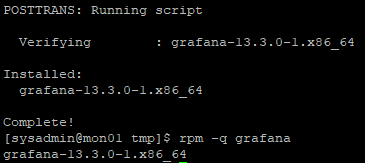
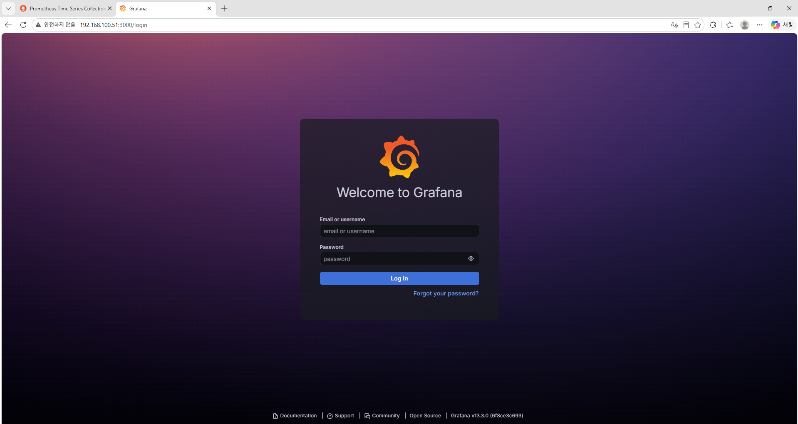
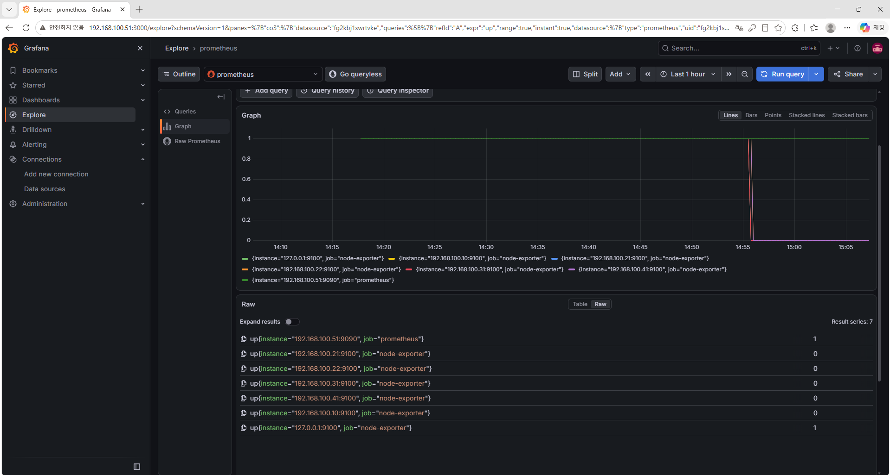
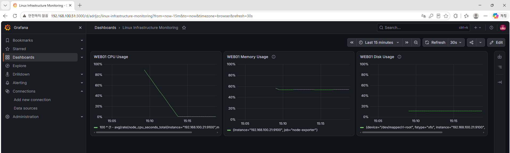
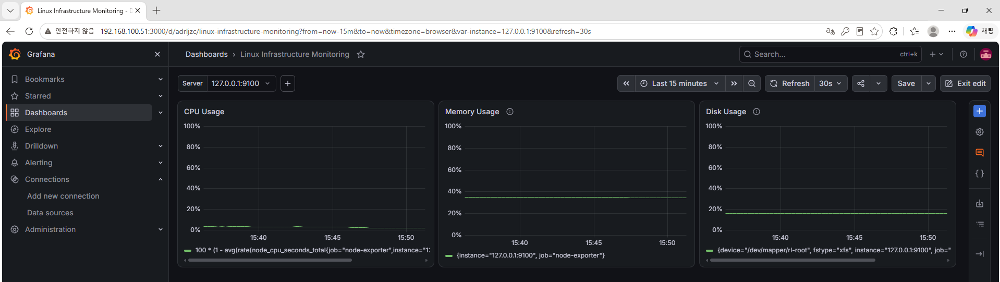
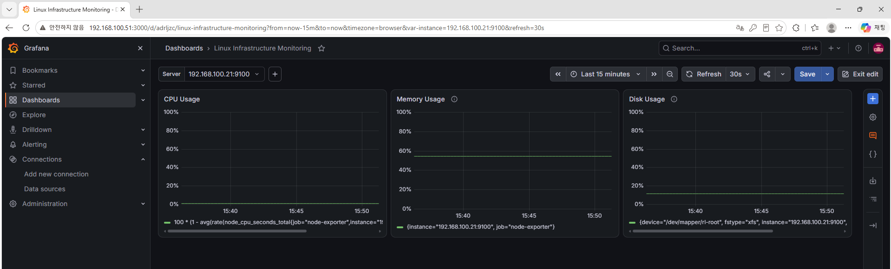
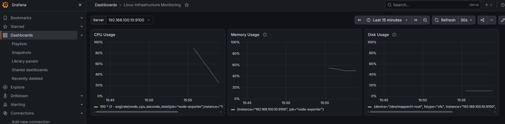

# 26. Grafana 기반 Linux 서버 리소스 대시보드 구축 및 통합 모니터링 (Grafana Monitoring)

## 1. 실습 개요

### 1.1 목적

Rocky Linux 9.8 기반 MON01 서버에 Grafana를 설치하고, 기존에 구축한 Prometheus를 데이터 소스로 연결하여 Linux 서버의 시스템 리소스를 시각화한다.

Node Exporter를 통해 수집한 CPU·메모리·디스크 메트릭을 Grafana 대시보드에서 확인하고, 서버 선택 변수를 이용하여 6대 서버의 리소스 사용률을 하나의 대시보드에서 조회할 수 있도록 구성한다.

**주요 목표**

- Grafana 공식 RPM 저장소 구성 및 설치
- Grafana systemd 서비스 등록 및 자동 시작 설정
- Host-only 네트워크 기반 Grafana 웹 서비스 구성
- firewalld를 이용한 TCP 3000 접근 제어
- Grafana HTTP API 및 Windows 웹 접속 검증
- Prometheus 데이터 소스 연결
- Grafana Explore에서 PromQL 메트릭 조회
- CPU·메모리·디스크 사용률 대시보드 구축
- `instance` 변수를 이용한 서버 선택 기능 구현
- 전체 6대 서버의 대시보드 정상 조회 검증

### 1.2 실습 환경

| 항목 | 구성 |
|---|---|
| 가상화 환경 | VMware Workstation |
| 운영체제 | Rocky Linux 9.8 |
| 모니터링 서버 | MON01 |
| Grafana | 13.3.0 |
| Prometheus | 3.13.5 |
| Node Exporter | 1.12.1 |
| Grafana 포트 | TCP 3000 |
| Prometheus 포트 | TCP 9090 |
| Node Exporter 포트 | TCP 9100 |
| 내부 네트워크 | Host-only (192.168.100.0/24) |
| 서비스 관리 | systemd |
| 대시보드 새로고침 | 30초 |
| 대시보드 시간 범위 | 최근 15분 |

**서버별 구성**

| 서버 | IP | 역할 |
|---|---|---|
| LB01 | 192.168.100.10 | HAProxy 로드밸런서 |
| WEB01 | 192.168.100.21 | Apache/PHP 웹 서버 |
| WEB02 | 192.168.100.22 | Apache/PHP 웹 서버 |
| DB01 | 192.168.100.31 | MariaDB 데이터베이스 |
| NAS01 | 192.168.100.41 | NFS 및 LVM 스토리지 |
| MON01 | 192.168.100.51 | Prometheus 및 Grafana |

---

## 2. Grafana 모니터링 구조

### 2.1 Grafana 역할

Grafana는 Prometheus와 같은 데이터 소스에서 메트릭을 조회하고, 이를 그래프와 대시보드로 시각화하는 도구이다.

기존 실습에서는 Prometheus Query 화면에서 PromQL을 직접 실행하여 CPU·메모리·디스크 사용률을 확인하였다.

이번 실습에서는 동일한 메트릭을 Grafana의 Time series 패널로 시각화하고, 서버별 리소스 상태를 하나의 화면에서 확인하도록 구성하였다.

### 2.2 전체 모니터링 구조

```text
          Linux Infrastructure
 ┌────────────────────────────────┐
 │ LB01   WEB01   WEB02           │
 │ DB01   NAS01   MON01           │
 │                                │
 │ Node Exporter :9100            │
 └────────────────────────────────┘
                │
                │ HTTP /metrics
                ▼
 ┌────────────────────────────────┐
 │ MON01 - Prometheus             │
 │ 192.168.100.51:9090            │
 │                                │
 │ 메트릭 수집 및 저장            │
 └────────────────────────────────┘
                │
                │ PromQL / HTTP API
                ▼
 ┌────────────────────────────────┐
 │ MON01 - Grafana                │
 │ 192.168.100.51:3000            │
 │                                │
 │ CPU / Memory / Disk Dashboard  │
 └────────────────────────────────┘
                ▲
                │
         Windows 브라우저
         192.168.100.1
```

**구성 요소별 역할**

| 구성 요소 | 역할 |
|---|---|
| Node Exporter | Linux 서버의 시스템 메트릭 제공 |
| Prometheus | 메트릭 수집·저장 및 PromQL 조회 |
| Grafana | Prometheus 메트릭 시각화 |
| Windows | Grafana 대시보드 확인 및 관리 |

Grafana가 Node Exporter에 직접 접근하는 것이 아니라, Prometheus에서 수집한 데이터를 조회하는 구조이다.

---

## 3. Grafana 설치

### 3.1 기존 MON01 환경 확인

Grafana 설치 전 MON01의 호스트명과 기존 모니터링 서비스 상태를 확인하였다.

```bash
hostnamectl --static

systemctl is-active prometheus
systemctl is-active node_exporter

free -h
df -h /
```

Prometheus와 Node Exporter를 구성한 기존 MON01에 Grafana를 추가 설치하였다.

이번 실습에서는 Windows 호스트의 메모리 사용량을 고려하여 MON01만 실행한 상태에서 설치와 기본 설정을 진행하였다.

### 3.2 Grafana GPG 키 등록

Grafana 공식 RPM 저장소를 사용하기 위해 GPG 키를 다운로드하고 등록하였다.

```bash
cd /tmp

curl -fL --retry 3 \
  -o grafana-gpg.key \
  https://rpm.grafana.com/gpg.key
```

```bash
sudo rpm --import /tmp/grafana-gpg.key
```

GPG 키는 RPM 패키지의 서명을 검증하는 데 사용한다.

### 3.3 Grafana 공식 RPM 저장소 구성

```bash
sudo tee /etc/yum.repos.d/grafana.repo > /dev/null <<'EOF'
[grafana]
name=grafana
baseurl=https://rpm.grafana.com
repo_gpgcheck=1
enabled=1
gpgcheck=1
gpgkey=https://rpm.grafana.com/gpg.key
sslverify=1
EOF
```

설정 파일 확인:

```bash
sudo cat /etc/yum.repos.d/grafana.repo
```

**주요 설정**

| 항목 | 의미 |
|---|---|
| `baseurl` | Grafana RPM 저장소 주소 |
| `enabled=1` | 저장소 활성화 |
| `gpgcheck=1` | RPM 패키지 서명 확인 |
| `repo_gpgcheck=1` | 저장소 메타데이터 서명 확인 |
| `sslverify=1` | HTTPS 인증서 검증 |

### 3.4 Grafana 설치

Grafana 저장소의 메타데이터를 갱신하고 설치 가능한 패키지 정보를 확인하였다.

```bash
sudo dnf makecache --disablerepo='*' --enablerepo=grafana

sudo dnf info grafana
```

Grafana를 설치하였다.

```bash
sudo dnf install grafana
```

**결과**

```text
Installed:
  grafana-13.3.0-1.x86_64

Complete!
```

설치된 패키지 버전을 확인하였다.

```bash
rpm -q grafana
```

**결과**

```text
grafana-13.3.0-1.x86_64
```

Grafana 13.3.0이 정상 설치되었음을 확인하였다.

**MON01 — Grafana 설치 및 버전 검증**



---

## 4. Grafana 웹 서비스 설정 및 검증

### 4.1 Grafana 설정 파일 백업

Grafana 웹 서비스 설정을 변경하기 전에 기존 설정 파일을 백업하였다.

```bash
sudo cp -a \
  /etc/grafana/grafana.ini \
  /etc/grafana/grafana.ini.bak
```

설정 파일을 편집하였다.

```bash
sudo vi /etc/grafana/grafana.ini
```

### 4.2 Host-only IP 및 포트 설정

Grafana가 MON01의 Host-only IP에서 HTTP 요청을 수신하도록 설정하였다.

```ini
[server]
http_addr = 192.168.100.51
http_port = 3000
```

`http_addr`는 Grafana가 요청을 수신할 네트워크 주소이고, `http_port`는 웹 서비스 포트이다.

설정 변경 후 다음 명령어로 확인하였다.

```bash
sudo grep -E '^\[server\]|^http_addr|^http_port' \
  /etc/grafana/grafana.ini
```

**결과**

```text
[server]
http_addr = 192.168.100.51
http_port = 3000
```

Grafana가 Host-only 인터페이스의 TCP 3000에서 동작하도록 설정된 것을 확인하였다.

### 4.3 Grafana systemd 서비스 등록

Grafana 서비스를 활성화하고 실행하였다.

```bash
sudo systemctl enable --now grafana-server
```

**결과**

```text
Created symlink /etc/systemd/system/multi-user.target.wants/grafana-server.service → /usr/lib/systemd/system/grafana-server.service.
```

서비스 상태 확인:

```bash
systemctl is-active grafana-server
systemctl is-enabled grafana-server
```

**결과**

```text
active
enabled
```

TCP 3000 수신 상태 확인:

```bash
sudo ss -lntp | grep ':3000'
```

**결과**

```text
LISTEN 0 4096 192.168.100.51:3000 0.0.0.0:* users:(("grafana",pid=6518,fd=68))
```

Grafana 서비스가 정상 실행 중이며 서버 부팅 시 자동으로 시작되도록 설정된 것을 확인하였다.

### 4.4 HTTP API 상태 확인

Grafana의 HTTP API를 이용하여 서비스 상태를 검증하였다.

```bash
curl --noproxy '*' -fsS \
  http://192.168.100.51:3000/api/health
```

**실제 결과 중 주요 항목**

```json
{
  "database": "ok",
  "version": "13.3.0"
}
```

HTTP API에서 데이터베이스 상태가 `ok`로 표시되고 Grafana 버전이 정상적으로 조회되었다.

Grafana 서비스가 정상적으로 요청을 처리하고 있음을 확인하였다.

---

## 5. Grafana 방화벽 설정 및 Windows 접속

### 5.1 Host-only 인터페이스 Zone 확인

Windows 호스트에서만 Grafana TCP 3000에 접근할 수 있도록 방화벽을 구성하였다.

먼저 firewalld 상태와 Host-only 인터페이스의 Zone을 확인하였다.

```bash
sudo firewall-cmd --state
sudo firewall-cmd --get-zone-of-interface=ens192
```

**확인 결과**

```text
running
public
```

`ens192`에 `public` Zone이 적용되어 있으므로 해당 Zone에 접근 허용 규칙을 추가하였다.

### 5.2 Grafana TCP 3000 접근 허용

Windows Host-only IP는 `192.168.100.1`, MON01의 Host-only IP는 `192.168.100.51`이다.

```bash
sudo firewall-cmd --permanent --zone=public \
  --add-rich-rule='rule family="ipv4" source address="192.168.100.1/32" destination address="192.168.100.51/32" port port="3000" protocol="tcp" accept'
```

방화벽 규칙을 적용하였다.

```bash
sudo firewall-cmd --reload
```

설정 확인:

```bash
sudo firewall-cmd --zone=public --list-rich-rules
```

**결과**

```text
rule family="ipv4" source address="192.168.100.1/32" destination address="192.168.100.51/32" port port="3000" protocol="tcp" accept
rule family="ipv4" source address="192.168.100.1/32" port port="9090" protocol="tcp" accept
```

기존 Prometheus TCP 9090 접근 허용 규칙은 유지하고, Grafana TCP 3000 접근 허용 규칙을 추가하였다.

### 5.3 Windows 브라우저 접속

Windows 브라우저에서 다음 주소로 접속하였다.

```text
http://192.168.100.51:3000
```

Grafana 로그인 화면이 정상적으로 표시되었다.

이를 통해 Host-only 네트워크를 이용한 Windows → MON01 Grafana 웹 접근이 가능함을 확인하였다.

**MON01 — Grafana 웹 로그인 화면**



### 5.4 관리자 계정 로그인

Grafana 최초 로그인 시 기본 관리자 계정을 사용한다.

| 항목 | 초기 값 |
|---|---|
| Username | admin |
| Password | admin |

관리자 계정의 비밀번호는 최초 로그인 후 변경하여 관리하였다.
---

## 6. Prometheus 데이터 소스 연결

### 6.1 데이터 소스 추가

Grafana 웹 UI에 로그인한 뒤 Prometheus를 데이터 소스로 등록하였다.

**설정 경로**

```text
Connections
  → Data sources
  → Add new data source
  → Prometheus
```

**설정값**

| 항목 | 값 |
|---|---|
| Name | prometheus |
| Type | Prometheus |
| Prometheus server URL | http://192.168.100.51:9090 |
| Authentication | 별도 인증 사용하지 않음 |
| Default data source | 적용 |

Grafana와 Prometheus가 같은 MON01에서 실행되지만, Prometheus는 `192.168.100.51:9090`에서 요청을 수신하도록 구성되어 있으므로 해당 주소를 사용하였다.

### 6.2 Save & test 검증

데이터 소스 설정 후 **Save & test**를 실행하였다.

**결과**

```text
Successfully queried the Prometheus API.
```

Prometheus API 연결에 성공하였다.

또한 화면에 `Remove default` 버튼이 표시되어 Prometheus가 기본 데이터 소스로 지정되어 있음을 확인하였다.

**MON01 — Prometheus 데이터 소스 연결 성공**


---

## 7. Grafana Explore 메트릭 조회 검증

### 7.1 PromQL 조회

Grafana의 Explore 메뉴에서 Prometheus 데이터 소스를 선택하고, Code 모드에서 다음 PromQL을 실행하였다.

```promql
up
```

`up` 메트릭은 Prometheus가 등록된 대상에서 메트릭을 성공적으로 수집했는지 나타낸다.

| 값 | 의미 |
|---|---|
| `1` | 메트릭 수집 성공 |
| `0` | 메트릭 수집 실패 |

### 7.2 실제 조회 결과

초기 Grafana 설정 단계에서는 MON01만 실행하고 다른 서버는 종료한 상태였다.

**실제 조회 결과**

| 서버 | Instance | 결과 |
|---|---|---:|
| MON01 Prometheus | 192.168.100.51:9090 | 1 |
| MON01 Node Exporter | 127.0.0.1:9100 | 1 |
| WEB01 | 192.168.100.21:9100 | 0 |
| WEB02 | 192.168.100.22:9100 | 0 |
| DB01 | 192.168.100.31:9100 | 0 |
| NAS01 | 192.168.100.41:9100 | 0 |
| LB01 | 192.168.100.10:9100 | 0 |

MON01의 Prometheus 및 Node Exporter는 정상적으로 `1`이 조회되었다.

나머지 서버는 당시 가상머신이 종료된 상태였으므로 `0`으로 표시되었다.

이후 서버를 실행하여 각 서버의 리소스 메트릭을 정상적으로 조회하였다.

**MON01 — Grafana Explore PromQL 조회**



---

## 8. WEB01 리소스 대시보드 구축

### 8.1 대시보드 생성

Grafana에서 새로운 대시보드를 생성하였다.

**설정 경로**

```text
Dashboards
  → New dashboard
  → Add visualization
  → Prometheus
```

대시보드 이름:

```text
Linux Infrastructure Monitoring
```

CPU·메모리·디스크 메트릭을 각각 Time series 패널로 구성하였다.

### 8.2 WEB01 CPU 사용률 패널

WEB01의 CPU 사용률을 계산하기 위해 다음 PromQL을 사용하였다.

```promql
100 * (1 - avg(rate(node_cpu_seconds_total{instance="192.168.100.21:9100",mode="idle"}[5m])))
```

이 쿼리는 CPU의 유휴 시간 비율을 이용하여 최근 5분의 평균 CPU 사용률을 백분율로 계산한다.

**패널 설정**

| 항목 | 설정 |
|---|---|
| Title | WEB01 CPU Usage |
| Visualization | Time series |
| Unit | Percent (0-100) |
| Min | 0 |
| Max | 100 |

그래프에서 WEB01의 CPU 사용률이 정상적으로 표시되었다.

서버 부팅 또는 서비스 시작 과정에서 CPU 사용률이 일시적으로 증가한 구간도 확인하였다.

### 8.3 WEB01 메모리 사용률 패널

```promql
100 * (1 - node_memory_MemAvailable_bytes{instance="192.168.100.21:9100"} / node_memory_MemTotal_bytes{instance="192.168.100.21:9100"})
```

전체 메모리에서 사용 가능한 메모리 비율을 제외하여 사용률을 계산하였다.

**패널 설정**

| 항목 | 설정 |
|---|---|
| Title | WEB01 Memory Usage |
| Visualization | Time series |
| Unit | Percent (0-100) |
| Min | 0 |
| Max | 100 |

WEB01의 메모리 사용률이 그래프로 표시되었다.

### 8.4 WEB01 디스크 사용률 패널

루트 파일시스템(`/`)의 사용률을 계산하였다.

```promql
100 * (1 - node_filesystem_avail_bytes{instance="192.168.100.21:9100",mountpoint="/"} / node_filesystem_size_bytes{instance="192.168.100.21:9100",mountpoint="/"})
```

**패널 설정**

| 항목 | 설정 |
|---|---|
| Title | WEB01 Disk Usage |
| Visualization | Time series |
| Unit | Percent (0-100) |
| Min | 0 |
| Max | 100 |

루트 파일시스템의 디스크 사용률이 정상적으로 표시되었다.

### 8.5 대시보드 저장 및 자동 새로고침

3개 패널을 구성한 뒤 대시보드를 저장하였다.

**최종 설정**

| 항목 | 설정 |
|---|---|
| Dashboard | Linux Infrastructure Monitoring |
| Time range | Last 15 minutes |
| Refresh | 30s |
| Panel count | 3개 |

처음에는 WEB01의 IP를 직접 지정하여 리소스 그래프를 구현하였다.

**WEB01 — CPU·메모리·디스크 대시보드**



---

## 9. Grafana 서버 선택 변수 구성

### 9.1 서버 선택 기능의 목적

초기 대시보드는 WEB01의 IP를 PromQL에 직접 지정한 형태였다.

이 경우 다른 서버를 조회하려면 각 패널의 쿼리를 수정해야 한다.

이 문제를 해결하기 위해 Grafana의 Dashboard Variable을 사용하여 서버 선택 기능을 구성하였다.

**목표**

- 하나의 대시보드에서 6대 서버 조회
- CPU·메모리·디스크 패널 재사용
- 서버 선택 시 전체 패널 자동 전환
- 서버마다 동일한 대시보드를 별도로 생성하는 작업 방지

### 9.2 Query 변수 생성

대시보드 편집 화면에서 Query 변수를 추가하였다.

**변수 기본 설정**

| 항목 | 값 |
|---|---|
| Name | instance |
| Label | Server |
| Variable type | Query |
| Refresh | On dashboard load |
| Multi-value | 비활성화 |
| Include All value | 비활성화 |

Grafana 13.3.0의 `Open variable editor`에서 다음과 같이 조회 조건을 설정하였다.

**Query variable 설정**

| 항목 | 값 |
|---|---|
| Target data source | prometheus |
| Query type | Label values |
| Label | instance |
| Metric | up |
| Label filters | job = node-exporter |

위 설정은 다음과 같은 Prometheus 레이블 조회 목적에 해당한다.

```text
label_values(up{job="node-exporter"}, instance)
```

### 9.3 변수 Preview 결과

변수 편집 화면에서 Preview를 실행하였다.

**결과**

```text
127.0.0.1:9100
192.168.100.10:9100
192.168.100.21:9100
192.168.100.22:9100
192.168.100.31:9100
192.168.100.41:9100
```

Node Exporter 수집 대상 6개가 모두 표시되었다.

변수를 적용한 뒤 대시보드 상단에 `Server` 선택 메뉴가 생성되었다.

설정 과정에서 생성된 불필요한 변수는 정리하고 `Server` 변수만 남겼다.

---

## 10. CPU·메모리·디스크 패널에 변수 적용

### 10.1 CPU 사용률 쿼리 변경

기존 WEB01 IP를 직접 지정한 쿼리를 `$instance` 변수를 사용하는 형태로 변경하였다.

```promql
100 * (1 - avg(rate(node_cpu_seconds_total{job="node-exporter",instance="$instance",mode="idle"}[5m])))
```

패널 제목:

```text
CPU Usage
```

### 10.2 메모리 사용률 쿼리 변경

```promql
100 * (1 - node_memory_MemAvailable_bytes{job="node-exporter",instance="$instance"} / node_memory_MemTotal_bytes{job="node-exporter",instance="$instance"})
```

패널 제목:

```text
Memory Usage
```

### 10.3 디스크 사용률 쿼리 변경

```promql
100 * (1 - node_filesystem_avail_bytes{job="node-exporter",instance="$instance",mountpoint="/"} / node_filesystem_size_bytes{job="node-exporter",instance="$instance",mountpoint="/"})
```

패널 제목:

```text
Disk Usage
```

세 패널 모두 Time series와 Percent (0-100) 단위를 유지하였다.

### 10.4 서버 선택 기능 검증

`Server` 드롭다운에서 MON01과 WEB01을 선택하여 대시보드 동작을 검증하였다.

**MON01 선택**

```text
Server: 127.0.0.1:9100
```

MON01의 CPU·메모리·디스크 그래프가 표시되었다.

**MON01 — 서버 선택 변수 적용 결과**



**WEB01 선택**

```text
Server: 192.168.100.21:9100
```

WEB01의 CPU·메모리·디스크 그래프가 표시되었다.

**WEB01 — 서버 선택 변수 적용 결과**



서버 선택값 변경에 따라 세 패널의 리소스 사용률이 함께 변경되는 것을 확인하였다.

이로써 별도 패널을 추가하지 않고 동일한 대시보드에서 여러 서버를 조회할 수 있게 되었다.

---

## 11. 전체 서버별 Grafana 모니터링 검증

### 11.1 서버별 검증 방식

Windows 호스트의 RAM이 16GB인 점을 고려하여 모든 가상머신을 동시에 실행하지 않고, 서버를 순차적으로 실행하여 검증하였다.

MON01의 Grafana와 Prometheus는 계속 실행하고, 검증 대상 서버를 한 대씩 추가로 실행하였다.

**검증 절차**

1. 대상 가상머신 실행
2. Grafana 대시보드 접속
3. `Server` 드롭다운에서 대상 서버 선택
4. CPU·메모리·디스크 그래프 확인
5. 검증 후 대상 가상머신 정상 종료
6. 다음 서버로 전환하여 동일하게 검증

### 11.2 WEB01 및 MON01 검증

WEB01과 MON01을 선택했을 때 각각의 CPU·메모리·디스크 그래프가 정상적으로 표시되었다.

| 서버 | CPU | 메모리 | 디스크 |
|---|---|---|---|
| WEB01 | 정상 | 정상 | 정상 |
| MON01 | 정상 | 정상 | 정상 |

### 11.3 WEB02 검증

WEB02를 실행하고 Grafana에서 다음 인스턴스를 선택하였다.

```text
192.168.100.22:9100
```

CPU·메모리·디스크 사용률이 모두 표시되었다.

CPU 사용률은 서버 부팅 직후 높게 나타났다가 점차 낮아지는 구간이 확인되었다.

### 11.4 DB01 검증

DB01을 실행하고 다음 인스턴스를 선택하였다.

```text
192.168.100.31:9100
```

CPU·메모리·디스크 그래프가 모두 정상적으로 표시되었다.

### 11.5 NAS01 검증

NAS01을 실행하고 다음 인스턴스를 선택하였다.

```text
192.168.100.41:9100
```

NAS01의 CPU·메모리·디스크 사용률이 모두 정상적으로 표시되었다.

NAS01의 파일시스템 사용률은 향후 NFS 스토리지 운영 상태를 모니터링할 때 활용할 수 있다.

### 11.6 LB01 검증

마지막으로 LB01을 실행하고 다음 인스턴스를 선택하였다.

```text
192.168.100.10:9100
```

LB01의 CPU·메모리·디스크 사용률이 모두 정상적으로 표시되었다.

**LB01 — Grafana 통합 대시보드 최종 검증**



### 11.7 전체 검증 결과

| 서버 | Grafana Instance | CPU | 메모리 | 디스크 |
|---|---|---|---|---|
| WEB01 | 192.168.100.21:9100 | 정상 | 정상 | 정상 |
| WEB02 | 192.168.100.22:9100 | 정상 | 정상 | 정상 |
| DB01 | 192.168.100.31:9100 | 정상 | 정상 | 정상 |
| NAS01 | 192.168.100.41:9100 | 정상 | 정상 | 정상 |
| LB01 | 192.168.100.10:9100 | 정상 | 정상 | 정상 |
| MON01 | 127.0.0.1:9100 | 정상 | 정상 | 정상 |

**최종 검증 결과**

```text
Grafana Dashboard
- CPU Usage:    6 / 6 정상 조회
- Memory Usage: 6 / 6 정상 조회
- Disk Usage:   6 / 6 정상 조회

서버 선택 기능: 정상
전체 서버 검증: 6 / 6 완료
```

---

## 12. 실습 중 확인 사항

### 12.1 Grafana 데이터 소스 기본 설정

데이터 소스 설정 화면에서 `Default data source` 항목이 별도로 표시되지 않아 설정 여부를 확인하였다.

이후 데이터 소스 화면에서 `Remove default` 버튼이 표시되는 것을 확인하였다.

이를 통해 Prometheus가 이미 기본 데이터 소스로 지정되어 있음을 확인하였다.

### 12.2 Grafana Explore에서 DOWN 상태 표시

MON01만 실행한 상태에서 `up`을 조회하였을 때 다른 서버가 `0`으로 표시되었다.

이는 해당 서버들의 가상머신이 종료되어 Prometheus에서 메트릭을 수집할 수 없었던 상황이다.

서버를 실행한 뒤 Grafana에서 각 서버의 CPU·메모리·디스크 그래프가 표시되는 것을 확인하였다.

따라서 `up = 0`이 항상 Node Exporter 설정 오류를 의미하는 것은 아니며, 실제 서버 전원 및 네트워크 상태도 함께 확인해야 한다.

### 12.3 Grafana 변수 편집 화면

Grafana 13.3.0에서는 데이터 소스 선택 항목이 변수 기본 설정 화면에 바로 표시되지 않고, `Open variable editor`에서 확인되는 형태였다.

`Query type = Label values`, `Label = instance`, `Metric = up`, `job = node-exporter`를 설정하여 6개의 서버 주소를 가져왔다.


---

## 13. 최종 검증 결과 및 정리

### 13.1 최종 검증 결과

| 검증 항목 | 실제 결과 | 상태 |
|---|---|---|
| Grafana 패키지 설치 | 13.3.0 | 완료 |
| Grafana RPM 저장소 | 공식 저장소 | 구성 |
| Grafana 서비스 | active | 정상 |
| 자동 시작 설정 | enabled | 정상 |
| Host-only IP | 192.168.100.51 | 정상 |
| TCP 3000 | LISTEN | 정상 |
| HTTP API | database: ok | 성공 |
| Windows 브라우저 접속 | Grafana 로그인 화면 | 성공 |
| 방화벽 Rich Rule | Windows → TCP 3000 허용 | 적용 |
| Prometheus 데이터 소스 | 연결 성공 | 정상 |
| Default data source | Prometheus | 적용 |
| Grafana Explore `up` 조회 | 7개 수집 대상 확인 | 성공 |
| CPU 사용률 패널 | Time series | 정상 |
| 메모리 사용률 패널 | Time series | 정상 |
| 디스크 사용률 패널 | Time series | 정상 |
| `instance` 변수 | 6개 서버 주소 | 정상 |
| Server 드롭다운 | 서버별 패널 전환 | 정상 |
| 자동 새로고침 | 30초 | 적용 |
| 전체 서버별 대시보드 | 6 / 6 검증 | 성공 |

### 13.2 배운 점

**Grafana와 Prometheus의 역할 차이**

Prometheus는 Node Exporter에서 메트릭을 수집하고 저장하는 역할을 담당한다.

Grafana는 Prometheus 데이터를 조회하여 그래프와 대시보드로 시각화한다.

이번 실습을 통해 메트릭 수집과 시각화 도구를 연동하는 과정을 이해하였다.

**Host-only 네트워크 기반 모니터링**

Grafana 웹 서비스가 MON01의 Host-only IP에서만 요청을 수신하도록 구성하였다.

firewalld Rich Rule을 이용하여 Windows 호스트에서 Grafana TCP 3000에 접근하도록 설정하였다.

**systemd를 이용한 서비스 관리**

Grafana를 `grafana-server` 서비스로 실행하고 부팅 시 자동 시작하도록 등록하였다.

서비스 상태뿐만 아니라 TCP 3000 LISTEN 및 HTTP API 응답까지 확인하였다.

**Grafana 데이터 소스 연동**

Grafana에 Prometheus를 등록하고 `Save & test`로 API 연결을 검증하였다.

이후 Explore에서 `up` 메트릭을 조회하여 실제 데이터 연결 상태를 확인하였다.

**PromQL 기반 시스템 리소스 시각화**

CPU·메모리·디스크 메트릭을 PromQL로 계산하고 Time series 패널을 이용하여 시각화하였다.

**Dashboard Variable 활용**

`instance` 변수를 이용하여 서버별로 동일한 패널을 재사용하도록 구성하였다.

이를 통해 6대 서버의 메트릭을 조회하기 위해 별도의 대시보드를 만들 필요 없이 하나의 대시보드에서 전환할 수 있었다.

**서버별 순차 검증**

Windows 호스트의 제한된 메모리 환경을 고려하여 서버를 순차적으로 실행하고 각각의 Grafana 메트릭을 확인하였다.

전체 6대 서버의 CPU·메모리·디스크 그래프가 정상적으로 표시되는 것을 검증하였다.

### 13.3 최종 결과

이번 실습에서는 MON01에 Grafana 13.3.0을 설치하고, 기존 Prometheus 3.13.5를 데이터 소스로 연결하였다.

Grafana의 systemd 서비스, TCP 3000 수신 상태, HTTP API 및 Windows 웹 접속을 검증하였다.

Prometheus의 Node Exporter 메트릭을 활용하여 CPU·메모리·디스크 사용률을 표시하는 `Linux Infrastructure Monitoring` 대시보드를 구축하였다.

이후 `instance` 변수를 적용하여 하나의 대시보드에서 서버를 선택할 수 있도록 구성하였다.

최종적으로 LB01, WEB01, WEB02, DB01, NAS01, MON01의 리소스 그래프가 모두 정상적으로 표시되는 것을 확인하였다.

**최종 성과: Grafana를 이용한 6대 Linux 서버 리소스 대시보드 구축 및 서버별 조회 검증 완료**

다음 단원에서는 Alertmanager를 이용한 장애 알림 환경을 구성할 예정이다.

### 관련 문서

- [24. Prometheus 모니터링 서버 구축 및 메트릭 수집 검증](./24-prometheus.md)
- [25. Node Exporter 기반 Linux 서버 메트릭 수집 및 통합 모니터링](./25-node-exporter.md)
