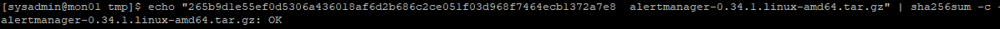
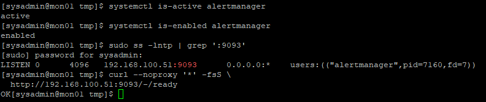
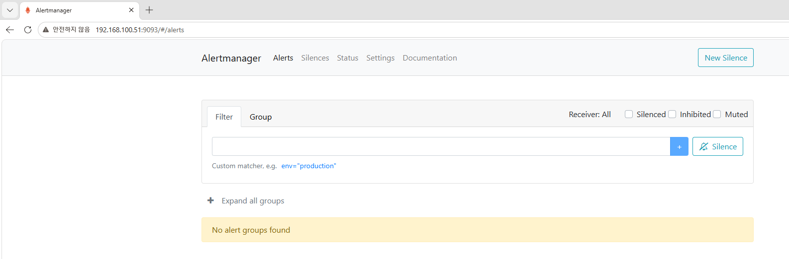
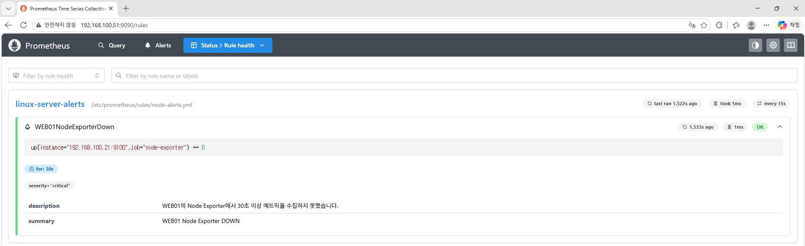
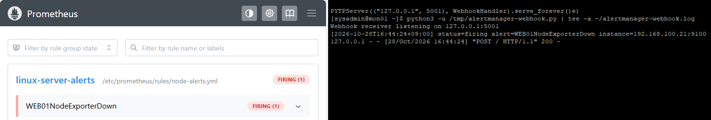
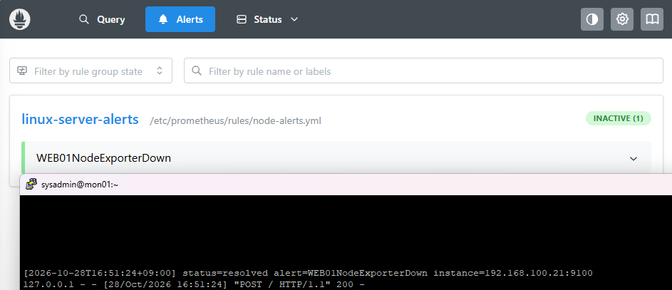
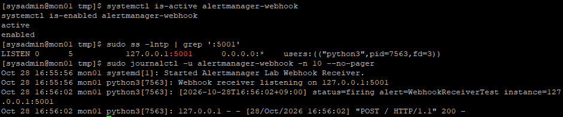

# 27. Alertmanager 기반 Linux 서버 장애 감지 및 알림 검증 (Alertmanager Monitoring)

## 1. 실습 개요

### 1.1 목적

Rocky Linux 9.8 기반 MON01 서버에 Alertmanager를 설치하고, 기존 Prometheus와 연동하여 Linux 서버의 장애 발생 및 복구 알림을 처리하는 환경을 구축한다.

WEB01의 Node Exporter 서비스를 의도적으로 중지하여 Prometheus의 장애 감지 기능을 검증하고, Alertmanager를 통해 Webhook 수신기로 장애 알림이 전달되는지 확인한다.

Node Exporter 서비스를 복구하여 정상 상태 전환과 복구 알림 전달까지 확인한다.

**주요 목표**

- Alertmanager 설치 및 SHA256 무결성 검증
- Alertmanager systemd 서비스 등록 및 자동 시작
- Host-only 네트워크 기반 Alertmanager 서비스 구성
- firewalld를 이용한 TCP 9093 접근 제어
- Prometheus와 Alertmanager 연동
- WEB01 Node Exporter 장애 감지 규칙 작성
- Prometheus `Pending` 및 `Firing` 상태 확인
- 로컬 Webhook 수신기 구축
- 장애 발생 `firing` 알림 수신 검증
- 장애 복구 `resolved` 알림 수신 검증
- Webhook 수신기의 systemd 서비스 등록 및 동작 확인

### 1.2 실습 환경

| 항목 | 구성 |
|---|---|
| 가상화 환경 | VMware Workstation |
| 운영체제 | Rocky Linux 9.8 |
| 모니터링 서버 | MON01 |
| 장애 테스트 서버 | WEB01 |
| Alertmanager | 0.34.1 |
| Prometheus | 3.13.5 |
| Node Exporter | 1.12.1 |
| Alertmanager 포트 | TCP 9093 |
| Prometheus 포트 | TCP 9090 |
| Node Exporter 포트 | TCP 9100 |
| Webhook 수신 포트 | TCP 5001 (Loopback) |
| 내부 네트워크 | Host-only (192.168.100.0/24) |
| 서비스 관리 | systemd |
| Prometheus 수집 주기 | 15초 |
| 알림 규칙 평가 주기 | 15초 |
| 장애 지속 조건 | 30초 |

**주요 서버**

| 서버 | IP | 역할 |
|---|---|---|
| MON01 | 192.168.100.51 | Prometheus, Alertmanager 및 Webhook 수신기 |
| WEB01 | 192.168.100.21 | Node Exporter 장애 발생 및 복구 테스트 |

실습 환경의 메모리가 16GB이므로 MON01과 WEB01만 실행하여 실습하였다.

---

## 2. Alertmanager 장애 알림 구조

### 2.1 Alertmanager 역할

Prometheus는 Node Exporter에서 메트릭을 수집하고, 미리 정의한 알림 규칙을 평가하여 장애 상태를 감지한다.

Alertmanager는 Prometheus에서 전달한 알림을 수신하고, 라우팅 및 그룹화 설정에 따라 지정된 수신기로 알림을 전달한다.

이번 실습에서는 Python으로 작성한 Webhook 수신기를 이용하여 알림을 수신하고 로그로 확인하였다.

### 2.2 전체 구성

```text
              WEB01
        192.168.100.21
      ┌───────────────────┐
      │ Node Exporter     │
      │ TCP 9100          │
      └─────────┬─────────┘
                │
                │ HTTP /metrics
                ▼
              MON01
        192.168.100.51
      ┌───────────────────┐
      │ Prometheus        │
      │ TCP 9090          │
      │                   │
      │ 장애 규칙 평가    │
      │ up == 0           │
      └─────────┬─────────┘
                │
                │ Alert
                ▼
      ┌───────────────────┐
      │ Alertmanager      │
      │ TCP 9093          │
      │                   │
      │ 알림 라우팅       │
      └─────────┬─────────┘
                │
                │ HTTP POST
                ▼
      ┌───────────────────┐
      │ Webhook Receiver  │
      │ 127.0.0.1:5001    │
      │                   │
      │ firing / resolved │
      │ 로그 기록         │
      └───────────────────┘
```

**구성 요소별 역할**

| 구성 요소 | 역할 |
|---|---|
| Node Exporter | WEB01 시스템 메트릭 제공 |
| Prometheus | 메트릭 수집 및 장애 규칙 평가 |
| Alertmanager | 장애 알림 수신 및 라우팅 |
| Webhook Receiver | HTTP POST 알림 수신 및 로그 기록 |
| systemd | Alertmanager 및 Webhook 수신기 서비스 관리 |

---

## 3. Alertmanager 다운로드 및 설치

### 3.1 기존 환경 확인

MON01에서 기존 모니터링 서비스와 시스템 상태를 확인하였다.

```bash
hostnamectl --static

systemctl is-active prometheus
systemctl is-active node_exporter
systemctl is-active grafana-server

free -h
df -h /
```

기존 Prometheus, Node Exporter 및 Grafana 구성은 유지하고 Alertmanager를 추가 설치하였다.

### 3.2 Alertmanager 다운로드

공식 GitHub 릴리스의 Alertmanager 0.34.1 Linux AMD64 패키지를 다운로드하였다.

```bash
cd /tmp

curl -fL --retry 3 \
  -o alertmanager-0.34.1.linux-amd64.tar.gz \
  https://github.com/prometheus/alertmanager/releases/download/v0.34.1/alertmanager-0.34.1.linux-amd64.tar.gz
```

### 3.3 SHA256 무결성 검증

다운로드한 압축 파일의 SHA256 체크섬을 검증하였다.

```bash
echo "265b9d1e55ef0d5306a436018af6d2b686c2ce051f03d968f7464ecb1372a7e8  alertmanager-0.34.1.linux-amd64.tar.gz" | sha256sum -c -
```

**결과**

```text
alertmanager-0.34.1.linux-amd64.tar.gz: OK
```

파일 무결성 검증에 성공하였다.

**MON01 — Alertmanager 다운로드 파일 검증**



### 3.4 압축 해제 및 버전 확인

```bash
tar -xzf alertmanager-0.34.1.linux-amd64.tar.gz

./alertmanager-0.34.1.linux-amd64/alertmanager --version

./alertmanager-0.34.1.linux-amd64/amtool --version
```

설치 대상 버전인 Alertmanager 0.34.1을 확인하였다.

### 3.5 전용 시스템 계정 생성

Alertmanager 서비스를 실행할 전용 시스템 계정을 생성하였다.

```bash
sudo useradd --system \
  --no-create-home \
  --shell /sbin/nologin \
  alertmanager
```

로그인용 일반 사용자 대신 전용 시스템 계정으로 서비스를 실행하도록 구성하였다.

### 3.6 실행 파일 설치

```bash
sudo install -m 755 \
  /tmp/alertmanager-0.34.1.linux-amd64/alertmanager \
  /usr/local/bin/alertmanager

sudo install -m 755 \
  /tmp/alertmanager-0.34.1.linux-amd64/amtool \
  /usr/local/bin/amtool
```

설정 및 데이터 디렉터리를 생성하였다.

```bash
sudo install -d -m 755 /etc/alertmanager

sudo install -d -o alertmanager -g alertmanager \
  -m 750 /var/lib/alertmanager
```

**주요 경로**

| 경로 | 용도 |
|---|---|
| `/usr/local/bin/alertmanager` | Alertmanager 실행 파일 |
| `/usr/local/bin/amtool` | 설정 검사 및 관리 도구 |
| `/etc/alertmanager/` | Alertmanager 설정 |
| `/var/lib/alertmanager/` | Alertmanager 데이터 저장 |

---

## 4. Alertmanager 기본 설정 및 서비스 등록

### 4.1 초기 설정 파일 작성

Alertmanager의 기본 라우팅 설정을 작성하였다.

```bash
sudo tee /etc/alertmanager/alertmanager.yml > /dev/null <<'EOF'
route:
  receiver: 'lab-receiver'
  group_by: ['alertname', 'instance']
  group_wait: 10s
  group_interval: 30s
  repeat_interval: 1h

receivers:
  - name: 'lab-receiver'
EOF
```

설정 파일 확인:

```bash
sudo cat /etc/alertmanager/alertmanager.yml
```

설정 문법 검사:

```bash
sudo /usr/local/bin/amtool check-config \
  /etc/alertmanager/alertmanager.yml
```

이후 실제 알림 수신을 위해 Webhook 설정을 추가하였다.

### 4.2 systemd 서비스 파일 작성

Alertmanager를 systemd 서비스로 관리하도록 설정하였다.

```bash
sudo tee /etc/systemd/system/alertmanager.service > /dev/null <<'EOF'
[Unit]
Description=Prometheus Alertmanager
Wants=network-online.target
After=network-online.target

[Service]
Type=simple
User=alertmanager
Group=alertmanager
ExecStart=/usr/local/bin/alertmanager \
  --config.file=/etc/alertmanager/alertmanager.yml \
  --storage.path=/var/lib/alertmanager \
  --web.listen-address=192.168.100.51:9093
Restart=on-failure
RestartSec=5s

[Install]
WantedBy=multi-user.target
EOF
```

서비스 파일 확인:

```bash
sudo cat /etc/systemd/system/alertmanager.service
```

SELinux 컨텍스트를 복원하였다.

```bash
sudo restorecon -Rv \
  /usr/local/bin/alertmanager \
  /usr/local/bin/amtool \
  /etc/alertmanager \
  /var/lib/alertmanager \
  /etc/systemd/system/alertmanager.service
```

### 4.3 서비스 실행

```bash
sudo systemctl daemon-reload

sudo systemctl enable --now alertmanager
```

상태 확인:

```bash
systemctl is-active alertmanager

systemctl is-enabled alertmanager
```

**결과**

```text
active
enabled
```

TCP 9093 수신 상태 확인:

```bash
sudo ss -lntp | grep ':9093'
```

**결과**

```text
LISTEN 0 4096 192.168.100.51:9093 0.0.0.0:*
```

### 4.4 HTTP 준비 상태 확인

```bash
curl --noproxy '*' -fsS \
  http://192.168.100.51:9093/-/ready
```

**결과**

```text
OK
```

Alertmanager의 systemd 서비스, 포트 수신 및 HTTP 준비 상태를 확인하였다.

**MON01 — Alertmanager 서비스 검증**



---

## 5. Alertmanager 방화벽 및 웹 접속

### 5.1 Host-only 인터페이스 확인

```bash
sudo firewall-cmd --state

sudo firewall-cmd --get-zone-of-interface=ens192
```

Host-only 인터페이스 `ens192`에 `public` Zone이 적용되어 있음을 확인하였다.

### 5.2 TCP 9093 접근 허용

Windows 호스트의 Host-only IP인 `192.168.100.1`에서 MON01의 Alertmanager 웹 서비스에 접근하도록 Rich Rule을 구성하였다.

```bash
sudo firewall-cmd --permanent --zone=public \
  --add-rich-rule='rule family="ipv4" source address="192.168.100.1/32" destination address="192.168.100.51/32" port port="9093" protocol="tcp" accept'
```

방화벽 설정 적용:

```bash
sudo firewall-cmd --reload
```

설정 확인:

```bash
sudo firewall-cmd --zone=public --list-rich-rules
```

### 5.3 Windows 웹 접속

Windows 브라우저에서 다음 주소를 이용한다.

```text
http://192.168.100.51:9093
```

Alertmanager 웹 UI에서 알림 상태와 라우팅 결과를 확인할 수 있다.

**MON01 — Alertmanager 웹 UI**



---

## 6. Prometheus 장애 감지 규칙 작성

### 6.1 장애 감지 대상

이번 실습에서는 WEB01의 Node Exporter를 장애 테스트 대상으로 선정하였다.

| 항목 | 설정 |
|---|---|
| 대상 서버 | WEB01 |
| 대상 IP | 192.168.100.21 |
| Node Exporter | TCP 9100 |
| Prometheus Job | node-exporter |
| 장애 판단 조건 | `up == 0` |
| 지속 시간 | 30초 |
| 심각도 | critical |

다른 서버의 전원 상태와 관계없이 WEB01의 장애만 검증할 수 있도록 구성하였다.

### 6.2 알림 규칙 파일 생성

```bash
sudo mkdir -p /etc/prometheus/rules
```

```bash
sudo tee /etc/prometheus/rules/node-alerts.yml > /dev/null <<'EOF'
groups:
  - name: linux-server-alerts
    rules:
      - alert: WEB01NodeExporterDown
        expr: up{job="node-exporter",instance="192.168.100.21:9100"} == 0
        for: 30s
        labels:
          severity: critical
        annotations:
          summary: "WEB01 Node Exporter DOWN"
          description: "WEB01의 Node Exporter에서 30초 이상 메트릭을 수집하지 못했습니다."
EOF
```

설정 파일 확인:

```bash
sudo cat /etc/prometheus/rules/node-alerts.yml
```

### 6.3 알림 규칙 검증

```bash
sudo /usr/local/bin/promtool check rules \
  /etc/prometheus/rules/node-alerts.yml
```

**결과**

```text
Checking /etc/prometheus/rules/node-alerts.yml
  SUCCESS: 1 rules found
```

알림 규칙 한 개가 정상적으로 등록되었다.

### 6.4 알림 규칙 동작 방식

`up` 메트릭은 Prometheus가 해당 수집 대상에서 메트릭을 성공적으로 수집했는지 나타낸다.

| 값 | 의미 |
|---|---|
| `up = 1` | 메트릭 수집 정상 |
| `up = 0` | 메트릭 수집 실패 |

WEB01의 `up` 값이 `0`이 되면 장애 조건에 해당한다.

`for: 30s` 설정에 따라 장애 조건이 30초 이상 지속되면 알림이 `Firing` 상태로 전환된다.

---

## 7. Prometheus와 Alertmanager 연동

### 7.1 기존 설정 백업

```bash
sudo cp -a /etc/prometheus/prometheus.yml \
  /etc/prometheus/prometheus.yml.bak-27
```

### 7.2 Prometheus 설정 변경

기존 7개 수집 대상은 유지하면서 알림 규칙과 Alertmanager 연결 설정을 추가하였다.

```bash
sudo tee /etc/prometheus/prometheus.yml > /dev/null <<'EOF'
global:
  scrape_interval: 15s
  evaluation_interval: 15s

rule_files:
  - /etc/prometheus/rules/node-alerts.yml

alerting:
  alertmanagers:
    - static_configs:
        - targets:
            - '192.168.100.51:9093'

scrape_configs:
  - job_name: 'prometheus'
    static_configs:
      - targets: ['192.168.100.51:9090']

  - job_name: 'node-exporter'
    static_configs:
      - targets:
          - '192.168.100.21:9100'
          - '192.168.100.22:9100'
          - '192.168.100.31:9100'
          - '192.168.100.41:9100'
          - '192.168.100.10:9100'
          - '127.0.0.1:9100'
EOF
```

**추가 설정**

| 설정 | 역할 |
|---|---|
| `evaluation_interval` | 알림 규칙 평가 주기 |
| `rule_files` | 장애 감지 규칙 파일 등록 |
| `alerting` | Alertmanager 서버 주소 등록 |

### 7.3 설정 검증 및 적용

설정 파일 확인:

```bash
sudo cat /etc/prometheus/prometheus.yml
```

문법 검사:

```bash
sudo /usr/local/bin/promtool check config \
  /etc/prometheus/prometheus.yml
```

설정 검증 후 Prometheus 서비스를 재시작하였다.

```bash
sudo systemctl restart prometheus

systemctl is-active prometheus
```

**결과**

```text
active
```

### 7.4 Prometheus 웹 UI에서 규칙 확인

Windows 브라우저에서 다음 주소에 접속하였다.

```text
http://192.168.100.51:9090/rules
```

`linux-server-alerts` 그룹과 `WEB01NodeExporterDown` 규칙이 표시되었다.

규칙 평가 상태가 `OK`인 것을 확인하였다.

**MON01 — Prometheus 알림 규칙 등록 확인**



### 7.5 Alertmanager 연결 API 검증

Prometheus HTTP API에서 Alertmanager 연결 상태를 확인하였다.

```bash
curl --noproxy '*' -fsS \
  http://192.168.100.51:9090/api/v1/alertmanagers
```

**결과**

```json
{
  "status": "success",
  "data": {
    "activeAlertmanagers": [
      {
        "url": "http://192.168.100.51:9093/api/v2/alerts"
      }
    ],
    "droppedAlertmanagers": []
  }
}
```

Prometheus가 Alertmanager를 정상적으로 발견하였으며 비활성화된 연결 대상이 없음을 확인하였다.

---

## 8. 로컬 Webhook 수신기 구축

### 8.1 Webhook 수신기 구성 목적

Alertmanager가 발생한 알림을 실제 HTTP 요청으로 전달하는지 검증하기 위해 Python 기반 Webhook 수신기를 구성하였다.

수신기는 MON01의 Loopback 주소인 `127.0.0.1:5001`에서 실행한다.

외부 네트워크로 수신 포트를 노출하지 않고 MON01 내부에서 알림을 처리하도록 구성하였다.

### 8.2 Python Webhook 수신기 작성

초기 테스트를 위해 `/tmp/alertmanager-webhook.py` 파일을 작성하였다.

```bash
cat > /tmp/alertmanager-webhook.py <<'PY'
from http.server import BaseHTTPRequestHandler, HTTPServer
from datetime import datetime
import json

class WebhookHandler(BaseHTTPRequestHandler):
    def do_POST(self):
        length = int(self.headers.get("Content-Length", 0))
        data = json.loads(self.rfile.read(length))

        for alert in data.get("alerts", []):
            labels = alert.get("labels", {})
            print(
                f'[{datetime.now().astimezone().isoformat(timespec="seconds")}] '
                f'status={alert.get("status")} '
                f'alert={labels.get("alertname")} '
                f'instance={labels.get("instance")}',
                flush=True
            )

        self.send_response(200)
        self.end_headers()
        self.wfile.write(b"OK")

print("Webhook receiver listening on 127.0.0.1:5001", flush=True)
HTTPServer(("127.0.0.1", 5001), WebhookHandler).serve_forever()
PY
```

**주요 동작**

- HTTP POST 요청 수신
- JSON 형식의 Alertmanager 알림 데이터 처리
- `status`, `alertname`, `instance` 정보 출력
- 정상 수신 시 HTTP 200 응답

### 8.3 임시 Webhook 수신기 실행

MON01의 별도 PuTTY 창에서 실행하였다.

```bash
python3 -u /tmp/alertmanager-webhook.py \
  | tee -a ~/alertmanager-webhook.log
```

**결과**

```text
Webhook receiver listening on 127.0.0.1:5001
```

다른 PuTTY 창에서 수신 포트를 확인하였다.

```bash
sudo ss -lntp | grep ':5001'
```

**확인 결과**

```text
LISTEN ... 127.0.0.1:5001 ...
```

Webhook 수신기가 TCP 5001에서 정상 실행되었다.

---

## 9. Alertmanager Webhook 연동

### 9.1 기존 설정 백업

```bash
sudo cp -a /etc/alertmanager/alertmanager.yml \
  /etc/alertmanager/alertmanager.yml.bak-27
```

### 9.2 Webhook 수신기 등록

Alertmanager의 라우팅 대상과 Webhook URL을 설정하였다.

```bash
sudo tee /etc/alertmanager/alertmanager.yml > /dev/null <<'EOF'
route:
  receiver: 'lab-webhook'
  group_by: ['alertname', 'instance']
  group_wait: 10s
  group_interval: 30s
  repeat_interval: 1h

receivers:
  - name: 'lab-webhook'
    webhook_configs:
      - url: 'http://127.0.0.1:5001/'
        send_resolved: true
EOF
```

**주요 설정**

| 항목 | 값 | 의미 |
|---|---|---|
| `receiver` | lab-webhook | 알림 수신기 |
| `group_by` | alertname, instance | 알림 그룹화 기준 |
| `group_wait` | 10s | 최초 알림 그룹 전달 대기 시간 |
| `group_interval` | 30s | 기존 알림 그룹 변경 후 전달 간격 |
| `repeat_interval` | 1h | 활성 알림 재전송 간격 |
| `webhook_configs.url` | 127.0.0.1:5001 | HTTP 알림 수신 주소 |
| `send_resolved` | true | 장애 복구 알림 전달 |

### 9.3 설정 검증

```bash
sudo cat /etc/alertmanager/alertmanager.yml
```

```bash
sudo /usr/local/bin/amtool check-config \
  /etc/alertmanager/alertmanager.yml
```

**결과**

```text
Checking '/etc/alertmanager/alertmanager.yml' SUCCESS
Found:
 - global config
 - route
 - 0 inhibit rules
 - 1 receivers
 - 0 templates
```

Webhook 수신기가 한 개 등록된 것을 확인하였다.

### 9.4 Alertmanager 재시작

```bash
sudo systemctl restart alertmanager

systemctl is-active alertmanager
```

HTTP 준비 상태와 포트 수신 여부를 재확인하였다.

```bash
sudo ss -lntp | grep ':9093'

curl --noproxy '*' -fsS \
  http://192.168.100.51:9093/-/ready
```

**최종 확인 결과**

```text
active
LISTEN ... 192.168.100.51:9093 ...
OK
```

Alertmanager 설정 변경이 정상 적용되었다.

---

## 10. WEB01 장애 발생 알림 검증

### 10.1 정상 상태 확인

WEB01을 실행하고 Node Exporter 서비스 상태를 확인하였다.

```bash
hostnamectl --static

systemctl is-active node_exporter
```

Prometheus에서 다음 쿼리를 실행하였다.

```promql
up{job="node-exporter",instance="192.168.100.21:9100"}
```

**결과**

```text
1
```

WEB01의 Node Exporter 메트릭이 정상적으로 수집되고 있음을 확인하였다.

### 10.2 Node Exporter 서비스 중지

장애를 재현하기 위해 WEB01에서 Node Exporter 서비스를 중지하였다.

```bash
sudo systemctl stop node_exporter

systemctl is-active node_exporter
```

**결과**

```text
inactive
```

서버 전체를 종료하지 않고 Node Exporter 서비스만 중지하여 장애를 재현하였다.

### 10.3 Prometheus 장애 감지

Windows 브라우저에서 다음 주소에 접속하였다.

```text
http://192.168.100.51:9090/alerts
```

알림 상태가 다음 순서로 변경되는 것을 확인하였다.

```text
Inactive
   ↓
Pending
   ↓
Firing
```

**Pending**

Prometheus가 장애 조건을 감지하였으나, 설정된 지속 시간 30초가 아직 충족되지 않은 상태이다.

**Firing**

장애 조건이 설정된 시간 이상 유지되어 실제 알림이 활성화된 상태이다.

### 10.4 Webhook 장애 알림 수신

MON01의 Webhook 수신기에서 다음 로그를 확인하였다.

**결과**

```text
[2026-10-28T16:44:24+09:00] status=firing alert=WEB01NodeExporterDown instance=192.168.100.21:9100
127.0.0.1 - - [28/Oct/2026 16:44:24] "POST / HTTP/1.1" 200 -
```

장애 알림을 HTTP POST로 수신하고 HTTP 200 응답을 반환한 것을 확인하였다.

### 10.5 장애 발생 검증 결과

| 항목 | 결과 | 상태 |
|---|---|---|
| WEB01 Node Exporter | inactive | 장애 재현 |
| Prometheus 장애 감지 | Pending | 성공 |
| Prometheus 알림 활성화 | Firing | 성공 |
| Alertmanager 알림 라우팅 | lab-webhook | 정상 |
| Webhook 알림 수신 | status=firing | 성공 |
| Webhook HTTP 응답 | 200 | 성공 |

**장애 감지부터 Webhook 알림 수신까지 전체 과정이 정상적으로 동작하였다.**

**WEB01 — Prometheus Firing 및 Webhook 수신 검증**



---

## 11. WEB01 장애 복구 알림 검증

### 11.1 Node Exporter 서비스 복구

장애 발생 알림을 확인한 뒤 WEB01에서 서비스를 다시 시작하였다.

```bash
sudo systemctl start node_exporter

systemctl is-active node_exporter

systemctl is-enabled node_exporter
```

서비스가 정상적으로 실행되도록 복구하였다.

### 11.2 Prometheus 정상화 확인

Prometheus에서 다음 쿼리를 실행하였다.

```promql
up{job="node-exporter",instance="192.168.100.21:9100"}
```

Node Exporter의 메트릭 수집이 정상화된 것을 확인하였다.

Prometheus Alerts 화면에서도 다음 상태를 확인하였다.

```text
linux-server-alerts
WEB01NodeExporterDown
INACTIVE (1)
```

장애 조건이 해제되어 알림이 비활성 상태로 전환되었다.

### 11.3 Webhook 복구 알림 수신

Webhook 수신기에서 `resolved` 알림이 추가로 전달되는 것을 확인하였다.

**결과**

```text
[2026-10-28T16:51:24+09:00] status=resolved alert=WEB01NodeExporterDown instance=192.168.100.21:9100
127.0.0.1 - - [28/Oct/2026 16:51:24] "POST / HTTP/1.1" 200 -
```

`send_resolved: true` 설정에 따라 장애 복구 시에도 Webhook 알림이 전달되었다.

### 11.4 장애 복구 검증 결과

| 항목 | 결과 | 상태 |
|---|---|---|
| WEB01 Node Exporter | 서비스 재시작 | 완료 |
| Prometheus 메트릭 수집 | 정상화 | 성공 |
| Prometheus 알림 | Inactive | 정상 |
| Webhook 복구 알림 | status=resolved | 성공 |
| Webhook HTTP 응답 | 200 | 성공 |

**WEB01 — Prometheus 정상화 및 Webhook 복구 알림**



---

## 12. Webhook 수신기 systemd 서비스 등록

### 12.1 systemd 등록 목적

초기 Webhook 수신기는 PuTTY에서 Python 프로그램을 직접 실행하는 방식이었다.

이 방식은 PuTTY 창을 종료하면 수신기도 중지되는 문제가 있다.

이에 따라 Webhook 수신기를 systemd 서비스로 등록하여 별도의 PuTTY 세션 없이 실행할 수 있도록 구성하였다.

### 12.2 Python 실행 파일 배치

기존 임시 스크립트를 정식 경로로 설치하였다.

```bash
sudo install -D -m 755 \
  /tmp/alertmanager-webhook.py \
  /usr/local/libexec/alertmanager-webhook.py
```

SELinux 컨텍스트를 복원하였다.

```bash
sudo restorecon -v \
  /usr/local/libexec/alertmanager-webhook.py
```

### 12.3 systemd 서비스 파일 작성

```bash
sudo tee /etc/systemd/system/alertmanager-webhook.service > /dev/null <<'EOF'
[Unit]
Description=Alertmanager Lab Webhook Receiver
After=network.target

[Service]
Type=simple
User=alertmanager
Group=alertmanager
ExecStart=/usr/bin/python3 -u /usr/local/libexec/alertmanager-webhook.py
Restart=on-failure
RestartSec=5
NoNewPrivileges=true

[Install]
WantedBy=multi-user.target
EOF
```

설정 파일 확인:

```bash
sudo cat /etc/systemd/system/alertmanager-webhook.service
```

**주요 설정**

| 항목 | 값 | 역할 |
|---|---|---|
| User | alertmanager | 전용 서비스 계정 |
| Group | alertmanager | 서비스 실행 그룹 |
| ExecStart | Python Webhook 실행 | 수신기 시작 |
| Restart | on-failure | 오류 발생 시 재시작 |
| RestartSec | 5 | 재시작 대기 시간 |
| NoNewPrivileges | true | 권한 상승 제한 |

### 12.4 기존 임시 Webhook 종료

기존 PuTTY에서 실행하던 Python Webhook 수신기를 `Ctrl + C`로 종료하였다.

포트 사용 여부를 확인하였다.

```bash
sudo ss -lntp | grep ':5001'
```

아무것도 출력되지 않아 기존 수신기가 종료된 것을 확인하였다.

### 12.5 systemd 서비스 실행

```bash
sudo systemctl daemon-reload

sudo systemctl enable --now alertmanager-webhook
```

서비스 상태 확인:

```bash
systemctl is-active alertmanager-webhook

systemctl is-enabled alertmanager-webhook
```

**결과**

```text
active
enabled
```

포트 수신 상태 확인:

```bash
sudo ss -lntp | grep ':5001'
```

**결과**

```text
LISTEN 0 5 127.0.0.1:5001 0.0.0.0:* users:(("python3",pid=7563,fd=3))
```

Webhook 수신기가 systemd에서 정상적으로 실행 중임을 확인하였다.

### 12.6 Webhook HTTP 수신 테스트

systemd로 실행한 Webhook 수신기가 HTTP 요청을 정상 처리하는지 테스트하였다.

```bash
curl --noproxy '*' -fsS \
  -X POST \
  -H 'Content-Type: application/json' \
  -d '{"alerts":[{"status":"firing","labels":{"alertname":"WebhookReceiverTest","instance":"127.0.0.1:5001"}}]}' \
  http://127.0.0.1:5001/
```

**결과**

```text
OK
```

이 요청은 Webhook 수신기의 HTTP 처리 기능을 확인하기 위한 테스트 데이터이다.

### 12.7 systemd 로그 확인

```bash
sudo journalctl -u alertmanager-webhook -n 10 --no-pager
```

**결과**

```text
Oct 28 16:55:56 mon01 systemd[1]: Started Alertmanager Lab Webhook Receiver.
Oct 28 16:55:56 mon01 python3[7563]: Webhook receiver listening on 127.0.0.1:5001
Oct 28 16:56:02 mon01 python3[7563]: [2026-10-28T16:56:02+09:00] status=firing alert=WebhookReceiverTest instance=127.0.0.1:5001
Oct 28 16:56:02 mon01 python3[7563]: 127.0.0.1 - - [28/Oct/2026 16:56:02] "POST / HTTP/1.1" 200 -
```

Webhook 수신기의 자동 실행 설정, TCP 5001 수신 및 HTTP 요청 처리를 확인하였다.

**MON01 — Webhook systemd 서비스 검증**



---


## 13. 최종 검증 결과

### 13.1 전체 검증 결과

| 검증 항목 | 결과 | 상태 |
|---|---|---|
| Alertmanager 다운로드 | 0.34.1 | 완료 |
| SHA256 무결성 검사 | OK | 성공 |
| Alertmanager 전용 계정 | alertmanager | 구성 |
| Alertmanager systemd | active | 정상 |
| Alertmanager 자동 시작 | enabled | 정상 |
| TCP 9093 | LISTEN | 정상 |
| HTTP 준비 상태 | OK | 정상 |
| Prometheus 알림 규칙 | 1 rules found | 성공 |
| Prometheus 연동 | activeAlertmanagers 등록 | 정상 |
| Webhook 수신기 설정 | 1 receiver | 정상 |
| WEB01 장애 감지 | Pending → Firing | 성공 |
| 장애 발생 알림 | status=firing | 수신 성공 |
| WEB01 서비스 복구 | 정상화 | 성공 |
| 복구 알림 상태 | Inactive | 정상 |
| 장애 복구 알림 | status=resolved | 수신 성공 |
| Webhook HTTP 응답 | 200 | 정상 |
| Webhook systemd | active | 정상 |
| Webhook 자동 시작 | enabled | 정상 |
| Webhook 수신 테스트 | WebhookReceiverTest | 성공 |

### 13.2 장애 발생 및 복구 흐름

```text
[정상 상태]

WEB01 Node Exporter : active
Prometheus up      : 1
Alert              : Inactive

          ↓

[장애 발생]

Node Exporter 중지
Prometheus up      : 0
Alert              : Pending → Firing
Webhook            : status=firing
HTTP               : 200 OK

          ↓

[장애 복구]

Node Exporter 시작
Prometheus up      : 1
Alert              : Inactive
Webhook            : status=resolved
HTTP               : 200 OK
```

장애 발생부터 복구 알림 수신까지 전체 과정이 정상적으로 동작하였다.

---

## 14. 실습을 통해 배운 점

### 14.1 Prometheus와 Alertmanager의 역할 구분

Prometheus는 수집한 메트릭을 바탕으로 장애 조건을 평가한다.

Alertmanager는 발생한 알림을 수신하여 설정된 수신기로 전달한다.

두 서비스를 연동하여 메트릭 수집과 장애 알림 처리가 분리된 구조를 이해하였다.

### 14.2 PromQL 기반 장애 감지

Node Exporter의 `up` 메트릭을 이용하여 특정 서버의 메트릭 수집 실패를 감지하였다.

`for: 30s`를 이용하여 장애 조건이 일정 시간 이상 지속되었을 때 알림이 발생하도록 설정하였다.

### 14.3 Webhook을 이용한 알림 검증

Python HTTP 수신기를 구성하여 Alertmanager의 알림 데이터를 JSON으로 수신하였다.

`firing`과 `resolved` 상태를 각각 확인하고 HTTP 200 응답으로 알림 전달 성공 여부를 검증하였다.

### 14.4 systemd 서비스 관리

Alertmanager와 Webhook 수신기를 각각 systemd 서비스로 구성하였다.

서비스 상태, 자동 시작, TCP LISTEN 및 journald 로그를 통해 실행 상태를 검증하였다.

### 14.5 장애 발생 및 복구 테스트

WEB01의 Node Exporter를 중지하여 장애를 재현하였다.

Prometheus에서 장애를 감지하고 Alertmanager를 통해 Webhook 알림이 수신되는 것을 확인하였다.

이후 Node Exporter를 재시작하여 정상 복구 및 복구 알림 전달까지 검증하였다.

---

## 15. 최종 결과

이번 실습에서는 MON01에 Alertmanager 0.34.1을 설치하고 Prometheus 3.13.5와 연동하였다.

WEB01 Node Exporter를 대상으로 장애 감지 규칙을 작성하여, 메트릭 수집이 30초 이상 실패하면 `WEB01NodeExporterDown` 알림이 발생하도록 구성하였다.

Python 기반 Webhook 수신기를 구축하여 장애 발생 시 `firing`, 장애 복구 시 `resolved` 알림이 전달되는 것을 확인하였다.

이후 Webhook 수신기를 systemd 서비스로 등록하여 자동 시작과 서비스 로그 확인 기능을 구성하였다.

최종적으로 **WEB01 Node Exporter 장애 발생 → Prometheus 감지 → Alertmanager 전달 → Webhook 수신 → 장애 복구 → 복구 알림 수신** 과정을 검증하였다.

**최종 성과: Alertmanager 기반 WEB01 장애 감지 및 복구 알림 전달 환경 구축 완료**

다음 단원에서는 Bash와 rsync를 이용한 파일 백업 및 복구 실습을 진행한다.

### 관련 문서

- [24. Prometheus 모니터링 서버 구축 및 메트릭 수집 검증](./24-prometheus.md)
- [25. Node Exporter 기반 Linux 서버 메트릭 수집 및 통합 모니터링](./25-node-exporter.md)
- [26. Grafana 기반 Linux 서버 리소스 대시보드 구축 및 통합 모니터링](./26-grafana.md)
