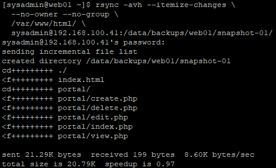
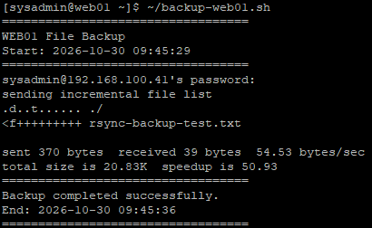
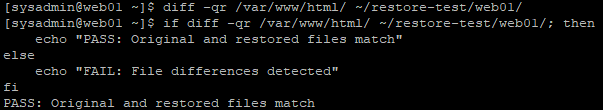

# 28. Bash·rsync 기반 파일 백업 및 복구 검증 (File Backup & Recovery)

## 1. 실습 개요

### 1.1 목적

Rocky Linux 9.8 환경에서 Bash와 rsync를 이용하여 WEB01의 웹 서비스 파일을 NAS01에 백업하고, 실제 복원을 통해 데이터 무결성을 검증한다.

기존에 구축한 NAS01의 RAID 1, LVM 기반 스토리지를 백업 저장소로 활용하며, SSH를 이용하여 WEB01에서 NAS01로 파일을 전송한다.

최초 백업, 신규 파일 추가, 기존 파일 수정에 따른 증분 백업 동작을 확인하고, 백업 파일을 WEB01의 별도 디렉터리에 복원하여 원본과 비교한다.

복원된 파일의 소유권 및 SELinux를 비교하여 실제 서비스 복구 시 고려해야 할 사항을 확인한다.

**주요 목표**

- WEB01 및 NAS01의 백업 환경 확인
- NAS01에 rsync 설치
- RAID 1·LVM 기반 백업 저장소 구성
- SSH 기반 WEB01 → NAS01 최초 백업
- rsync 체크섬 기반 파일 일치 검증
- Bash 백업 스크립트 작성 및 실행
- 신규 파일 추가에 따른 증분 백업 검증
- 기존 파일 수정에 따른 증분 백업 검증
- NAS01 → WEB01 파일 복원
- 원본과 복원본의 파일 내용 비교
- 복원 후 소유권·권한 및 SELinux 컨텍스트 비교
- 실습용 파일 및 복원 디렉터리 정리

### 1.2 실습 환경

| 항목 | 구성 |
|---|---|
| 가상화 환경 | VMware Workstation |
| 운영체제 | Rocky Linux 9.8 |
| 원본 서버 | WEB01 |
| 백업 서버 | NAS01 |
| 파일 전송 도구 | rsync 3.2.7 |
| 원격 접속 방식 | SSH |
| 스크립트 언어 | Bash |
| 내부 네트워크 | Host-only (192.168.100.0/24) |
| NAS01 스토리지 | RAID 1 + LVM + XFS |
| 백업 방식 | 수동 실행 및 Bash 스크립트 |

**서버 구성**

| 서버 | IP | 역할 |
|---|---|---|
| WEB01 | 192.168.100.21 | 웹 포털 파일 원본 및 복원 검증 |
| NAS01 | 192.168.100.41 | rsync 백업 파일 저장 |

### 1.3 백업과 파일 배포의 차이

기존 12단원에서는 rsync를 이용하여 WEB01의 웹 애플리케이션 파일을 WEB02로 배포하고 동기화하였다.

| 구분 | 12단원 | 28단원 |
|---|---|---|
| 목적 | 웹 애플리케이션 배포 | 파일 백업 및 복원 |
| 원본 | WEB01 | WEB01 |
| 대상 | WEB02 | NAS01 |
| 주요 작업 | 파일 동기화 및 배포 검증 | 백업 생성 및 복원 검증 |
| 검증 | 웹 서비스 정상 동작 | 원본과 복원본의 일치 여부 |

---

## 2. 백업 구조 설계

### 2.1 전체 백업 구성

```text
                   WEB01
              192.168.100.21
        ┌──────────────────────────┐
        │ /var/www/html/           │
        │                          │
        │ ├── index.html           │
        │ └── portal/              │
        │     ├── create.php       │
        │     ├── delete.php       │
        │     ├── edit.php         │
        │     ├── index.php        │
        │     └── view.php         │
        │                          │
        │ backup-web01.sh          │
        └────────────┬─────────────┘
                     │
                     │ rsync + SSH
                     ▼
                   NAS01
              192.168.100.41
        ┌──────────────────────────┐
        │ RAID 1                   │
        │   ↓                      │
        │ LVM                      │
        │   ↓                      │
        │ XFS (/data)              │
        │                          │
        │ /data/backups/web01/     │
        │                          │
        │ ├── snapshot-01/         │
        │ └── current/             │
        └──────────────────────────┘
```

### 2.2 백업 경로

| 구분 | 경로 | 용도 |
|---|---|---|
| WEB01 원본 | `/var/www/html/` | Apache 웹 콘텐츠 |
| WEB01 스크립트 | `/home/sysadmin/backup-web01.sh` | Bash 백업 실행 |
| NAS01 백업 상위 경로 | `/data/backups/web01/` | WEB01 백업 저장 |
| 최초 백업 | `/data/backups/web01/snapshot-01/` | 최초 백업본 보관 |
| 반복 백업 | `/data/backups/web01/current/` | 최신 파일 동기화 |
| WEB01 복원 테스트 | `/home/sysadmin/restore-test/web01/` | 별도 경로 복원 검증 |

`snapshot-01`은 최초 백업본을 보관하는 디렉터리이며, `current`는 Bash 스크립트 실행 시 갱신되는 디렉터리이다.

`current`는 최신 파일 상태를 동기화하는 구조이므로 여러 시점의 백업 버전이 자동으로 보관되지는 않는다.

### 2.3 NAS01 백업 저장소 선정 이유

NAS01에는 기존에 구성한 RAID 1 및 LVM 기반 XFS 파일시스템이 `/data`에 마운트되어 있다.

기존 NFS 공유 경로는 다음과 같다.

```text
/data/nfs/share
```

백업 파일은 기존 NFS 공유 파일과 구분하기 위해 별도의 경로에 저장하였다.

```text
/data/backups/web01
```

이 방식은 동일한 스토리지 내에서 공유 데이터와 백업 데이터를 논리적으로 구분한다.

다만 백업 파일과 NFS 데이터가 동일한 NAS01의 물리적 저장소를 사용하므로 NAS01 자체 장애로부터 완전히 독립된 백업은 아니다.

---

## 3. 기존 서버 및 백업 대상 확인

### 3.1 WEB01 환경 확인

WEB01에서 서버 이름, 웹 파일, NFS 마운트 및 rsync 설치 상태를 확인하였다.

```bash
hostnamectl --static

sudo ls -lah /var/www/html

findmnt -t nfs,nfs4

command -v rsync

rsync --version | head -n 1
```

**확인 결과**

```text
web01

/var/www/html/
├── index.html
└── portal/

/mnt/nfs-share
192.168.100.41:/data/nfs/share

/usr/bin/rsync
rsync version 3.2.7 protocol version 31
```

WEB01의 NFS 마운트와 rsync 설치 상태를 확인하였다.

### 3.2 백업 대상 파일 확인

```bash
sudo du -sh /var/www/html

sudo ls -lah /var/www/html/portal

findmnt -T /var/www/html/portal
```

**결과**

```text
36K /var/www/html
```

웹 포털 디렉터리에는 다음 PHP 파일 5개가 존재하였다.

```text
create.php
delete.php
edit.php
index.php
view.php
```

`findmnt` 결과에서 `/var/www/html/portal`은 WEB01의 로컬 XFS 파일시스템에 저장되어 있음을 확인하였다.

따라서 이번 백업 대상은 NFS 공유 파일이 아니라 WEB01의 로컬 웹 콘텐츠이다.

### 3.3 NAS01 스토리지 확인

NAS01에서 디스크, 파일시스템 및 NFS 공유 상태를 확인하였다.

```bash
hostnamectl --static

lsblk -f

df -hT

sudo exportfs -v
```

**주요 확인 결과**

```text
nas01

sdb ─┐
     ├─ md0
sdc ─┘   └─ vg_data-lv_data
                  └─ /data
```

`/data`에는 RAID 1 기반 LVM 논리 볼륨이 XFS 파일시스템으로 구성되어 있었다.

**용량 확인**

```text
Filesystem                  Type  Size  Used  Avail  Use%
/dev/mapper/vg_data-lv_data xfs   8.0G  100M  7.9G   2%
```

백업 파일을 저장하기에 충분한 여유 공간이 있음을 확인하였다.

### 3.4 WEB01 → NAS01 SSH 접속 검증

WEB01에서 NAS01로 SSH 연결이 가능한지 확인하였다.

```bash
ssh sysadmin@192.168.100.41 'hostnamectl --static'
```

첫 연결에서 호스트 키 확인 후 NAS01의 `sysadmin` 계정으로 인증하였다.

**결과**

```text
nas01
```

WEB01에서 NAS01로 SSH 접속 및 원격 명령어 실행이 정상적으로 동작하였다.

---

## 4. NAS01 rsync 설치 및 백업 저장소 구성

### 4.1 rsync 설치 상태 확인

NAS01에서 rsync 설치 여부를 확인하였다.

```bash
command -v rsync

rsync --version | head -n 1
```

**초기 결과**

```text
-bash: rsync: command not found
```

NAS01에는 rsync가 설치되어 있지 않았다.

### 4.2 rsync 설치

```bash
sudo dnf install -y rsync
```

설치 과정에서 rsync와 함께 ACL 관련 패키지도 업데이트되었다.

**설치 결과**

```text
Installed:
  rsync-3.2.7-1.el9_8.x86_64

Upgraded:
  acl-2.4.0-1.el9_8.x86_64
  libacl-2.4.0-1.el9_8.x86_64

Complete!
```

### 4.3 설치 검증

```bash
command -v rsync

rsync --version | head -n 1
```

**결과**

```text
/usr/bin/rsync
rsync version 3.2.7 protocol version 31
```

NAS01에서도 rsync를 사용할 수 있음을 확인하였다.

### 4.4 백업 디렉터리 생성

기존 NFS 공유 경로와 구분하여 `/data/backups` 디렉터리를 생성하였다.

```bash
sudo install -d -o root -g root -m 755 /data/backups
```

WEB01 백업 파일을 저장할 하위 디렉터리를 생성하였다.

```bash
sudo install -d -o sysadmin -g sysadmin -m 700 /data/backups/web01
```

**설정 이유**

| 설정 | 목적 |
|---|---|
| `/data/backups` | 백업 파일을 위한 상위 디렉터리 |
| `root:root` | 상위 디렉터리 관리 |
| `755` | 상위 디렉터리 접근 권한 |
| `sysadmin:sysadmin` | SSH 백업 계정과 소유자 일치 |
| `700` | 백업 계정만 하위 디렉터리 접근 가능 |

### 4.5 백업 경로 검증

```bash
ls -ld /data/backups /data/backups/web01

df -hT /data

sudo ls -lah /data/backups/web01
```

**결과**

```text
drwxr-xr-x root     root     /data/backups
drwx------ sysadmin sysadmin /data/backups/web01
```

최초 생성된 백업 디렉터리는 비어 있었다.

---

## 5. rsync 최초 파일 백업

### 5.1 Dry Run

실제 백업을 수행하기 전에 rsync의 Dry Run 기능을 이용하여 전송 대상 파일을 확인하였다.

**WEB01에서 실행**

```bash
rsync -avhn --itemize-changes \
  --no-owner --no-group \
  /var/www/html/ \
  sysadmin@192.168.100.41:/data/backups/web01/snapshot-01/
```

**주요 옵션**

| 옵션 | 의미 |
|---|---|
| `-a` | Archive 모드: 디렉터리 구조, 기본 권한, 수정 시간 등 보존 |
| `-v` | 전송 파일 목록 상세 출력 |
| `-h` | 읽기 쉬운 용량 단위 출력 |
| `-n` | 실제 전송 없이 실행 결과 미리 확인 |
| `--itemize-changes` | 생성·변경된 파일 정보 출력 |
| `--no-owner` | 원본 소유자 보존 제외 |
| `--no-group` | 원본 그룹 보존 제외 |

**결과**

```text
sending incremental file list
created directory /data/backups/web01/snapshot-01
cd+++++++++ ./
<f+++++++++ index.html
cd+++++++++ portal/
<f+++++++++ portal/create.php
<f+++++++++ portal/delete.php
<f+++++++++ portal/edit.php
<f+++++++++ portal/index.php
<f+++++++++ portal/view.php

total size is 20.79K
(DRY RUN)
```

원본 디렉터리의 파일들이 백업 대상으로 확인되었다.

### 5.2 최초 백업 실행

Dry Run에서 오류가 없음을 확인한 뒤 실제 rsync 백업을 수행하였다.

```bash
rsync -avh --itemize-changes \
  --no-owner --no-group \
  /var/www/html/ \
  sysadmin@192.168.100.41:/data/backups/web01/snapshot-01/
```

**결과**

```text
sending incremental file list
created directory /data/backups/web01/snapshot-01
cd+++++++++ ./
<f+++++++++ index.html
cd+++++++++ portal/
<f+++++++++ portal/create.php
<f+++++++++ portal/delete.php
<f+++++++++ portal/edit.php
<f+++++++++ portal/index.php
<f+++++++++ portal/view.php

sent 21.29K bytes  received 199 bytes  8.60K bytes/sec
total size is 20.79K  speedup is 0.97
```

WEB01의 `index.html`과 웹 포털 PHP 파일 5개가 NAS01에 백업되었다.

**WEB01 — rsync 최초 백업 성공**



### 5.3 rsync 전송 결과 해석

| 출력 | 의미 |
|---|---|
| `cd+++++++++` | 대상에 새 디렉터리 생성 |
| `<f+++++++++` | 대상에 새 일반 파일 전송 |
| `sent` | 전송한 데이터 및 프로토콜 정보 |
| `received` | 상대 서버에서 수신한 데이터 |
| `total size` | 대상 파일들의 논리적 총크기 |
| `speedup` | 총 파일 크기 대비 전송량 비율 |

`/var/www/html/`의 마지막 `/`는 디렉터리 자체가 아닌 내부 내용을 전송하도록 지정한다.

### 5.4 NAS01 백업 파일 확인

**NAS01에서 실행**

```bash
ls -lah /data/backups/web01/snapshot-01/

ls -lah /data/backups/web01/snapshot-01/portal/

du -sh /data/backups/web01/snapshot-01/
```

**결과**

```text
snapshot-01/
├── index.html
└── portal/
    ├── create.php
    ├── delete.php
    ├── edit.php
    ├── index.php
    └── view.php
```

```text
36K /data/backups/web01/snapshot-01/
```

백업 대상의 파일 구조가 정상적으로 저장되었음을 확인하였다.

`rsync`의 `total size`와 `du -sh` 결과가 다른 이유는 각각 논리적 파일 크기와 실제 디스크 사용량을 측정하기 때문이다.

---

## 6. 체크섬 기반 백업 파일 일치 검증

### 6.1 검증 목적

백업 디렉터리에 파일이 존재하는 것만으로 원본과 백업본의 내용이 동일하다고 판단할 수는 없다.

따라서 rsync의 체크섬 비교 기능을 이용하여 파일 내용이 일치하는지 검증하였다.

### 6.2 체크섬 비교 실행

**WEB01에서 실행**

```bash
rsync -avhnc --itemize-changes \
  --no-owner --no-group \
  /var/www/html/ \
  sysadmin@192.168.100.41:/data/backups/web01/snapshot-01/
```

**추가 옵션**

| 옵션 | 의미 |
|---|---|
| `-c` | 체크섬을 이용하여 파일 내용 비교 |
| `-n` | 실제 파일 변경 없이 비교 |

### 6.3 실제 결과

```text
sending incremental file list

sent 326 bytes  received 13 bytes  226.00 bytes/sec
total size is 20.79K  speedup is 61.32 (DRY RUN)
```

변경 또는 재전송이 필요한 파일 목록이 출력되지 않았다.

따라서 rsync가 비교한 원본과 NAS01 백업본의 파일 내용이 일치하는 것을 확인하였다.

---

## 7. Bash 백업 스크립트 작성

### 7.1 스크립트 작성 목적

기존에는 rsync 명령어를 직접 입력하여 파일을 백업하였다.

반복 실행 시 동일한 명령어를 사용할 수 있도록 Bash 스크립트로 작성하였다.

최초 백업본인 `snapshot-01`은 보존하고, 스크립트는 별도의 `current` 디렉터리를 사용하도록 구성하였다.

### 7.2 Bash 스크립트 생성

**WEB01에서 실행**

```bash
cat > ~/backup-web01.sh <<'EOF'
#!/bin/bash

set -euo pipefail

SOURCE="/var/www/html"
DEST="sysadmin@192.168.100.41:/data/backups/web01/current"

echo "=================================="
echo "WEB01 File Backup"
echo "Start: $(date '+%F %T')"
echo "=================================="

if [ ! -d "$SOURCE" ]; then
    echo "ERROR: Source directory not found."
    exit 1
fi

rsync -avh --itemize-changes \
    --no-owner --no-group \
    "$SOURCE/" \
    "$DEST/"

echo "=================================="
echo "Backup completed successfully."
echo "End: $(date '+%F %T')"
echo "=================================="
EOF
```

스크립트 저장 경로:

```text
/home/sysadmin/backup-web01.sh
```

### 7.3 스크립트 주요 구성

**Bash 실행 환경**

```bash
#!/bin/bash
```

Bash 인터프리터를 이용하여 스크립트를 실행한다.

**오류 처리**

```bash
set -euo pipefail
```

| 옵션 | 의미 |
|---|---|
| `-e` | 일반적으로 명령어 실패 시 스크립트 종료 |
| `-u` | 정의되지 않은 변수 사용 시 오류 처리 |
| `-o pipefail` | 파이프라인 내 명령어 실패를 종료 상태에 반영 |

**백업 경로 변수**

```bash
SOURCE="/var/www/html"
DEST="sysadmin@192.168.100.41:/data/backups/web01/current"
```

백업 원본과 대상 경로를 변수로 지정하였다.

**원본 디렉터리 검사**

```bash
if [ ! -d "$SOURCE" ]; then
    echo "ERROR: Source directory not found."
    exit 1
fi
```

원본 디렉터리가 존재하지 않으면 백업을 실행하지 않도록 구성하였다.

**백업 작업**

```bash
rsync -avh --itemize-changes \
    --no-owner --no-group \
    "$SOURCE/" \
    "$DEST/"
```

SSH를 통해 NAS01의 `current` 디렉터리로 파일을 백업한다.

### 7.4 스크립트 문법 및 실행 권한 검증

```bash
cat ~/backup-web01.sh

bash -n ~/backup-web01.sh

chmod 700 ~/backup-web01.sh

ls -l ~/backup-web01.sh
```

**결과**

```text
-rwx------. 1 sysadmin sysadmin 586 Oct 30 09:43 /home/sysadmin/backup-web01.sh
```

`bash -n` 검사에서 문법 오류가 출력되지 않았다.

`700` 권한을 부여하여 소유자만 스크립트를 읽고 수정하고 실행하도록 구성하였다.

### 7.5 Bash 백업 스크립트 실행

```bash
~/backup-web01.sh
```

**결과**

```text
==================================
WEB01 File Backup
Start: 2026-10-30 09:43:47
==================================
sysadmin@192.168.100.41's password:
sending incremental file list
created directory /data/backups/web01/current
cd+++++++++ ./
<f+++++++++ index.html
cd+++++++++ portal/
<f+++++++++ portal/create.php
<f+++++++++ portal/delete.php
<f+++++++++ portal/edit.php
<f+++++++++ portal/index.php
<f+++++++++ portal/view.php

sent 21.28K bytes  received 191 bytes  8.59K bytes/sec
total size is 20.79K  speedup is 0.97
==================================
Backup completed successfully.
End: 2026-10-30 09:43:49
==================================
```

스크립트 실행 후 백업 완료 메시지가 정상적으로 출력되었다.

### 7.6 NAS01 백업 결과 확인

```bash
ls -lah /data/backups/web01/

ls -lah /data/backups/web01/current/

ls -lah /data/backups/web01/current/portal/

du -sh /data/backups/web01/current/
```

**결과**

```text
/data/backups/web01/
├── snapshot-01/
└── current/
```

```text
36K /data/backups/web01/current/
```

Bash 스크립트를 통해 별도의 `current` 백업 디렉터리가 생성되었다.

현재 스크립트는 SSH 비밀번호를 입력하는 수동 실행 방식으로 구성하였다.

---

## 8. 신규 파일 생성에 따른 증분 백업 검증

### 8.1 검증 목적

최초 백업 이후 새로운 파일이 추가되면 rsync가 기존 파일 전체를 다시 전송하지 않고, 새 파일만 전송하는지 확인한다.

실제 웹 포털 PHP 파일을 수정하지 않기 위해 별도의 텍스트 파일을 생성하였다.

### 8.2 WEB01 테스트 파일 생성

```bash
echo "rsync incremental backup test - 2026-10-30" | \
sudo tee /var/www/html/rsync-backup-test.txt
```

파일 확인:

```bash
sudo cat /var/www/html/rsync-backup-test.txt

sudo ls -l /var/www/html/rsync-backup-test.txt
```

**파일 내용**

```text
rsync incremental backup test - 2026-10-30
```

### 8.3 Bash 백업 스크립트 재실행

```bash
~/backup-web01.sh
```

**결과**

```text
==================================
WEB01 File Backup
Start: 2026-10-30 09:45:29
==================================
sending incremental file list
.d..t...... ./
<f+++++++++ rsync-backup-test.txt

sent 370 bytes  received 39 bytes  54.53 bytes/sec
total size is 20.83K  speedup is 50.93
==================================
Backup completed successfully.
End: 2026-10-30 09:45:36
==================================
```

### 8.4 결과 분석

| 출력 | 의미 |
|---|---|
| `.d..t...... ./` | 최상위 디렉터리의 수정 시간 변경 |
| `<f+++++++++ rsync-backup-test.txt` | 신규 테스트 파일 전송 |
| `Backup completed successfully.` | Bash 백업 성공 |

기존 PHP 파일 5개는 재전송 대상에 표시되지 않았다.

새롭게 생성된 테스트 파일만 전송되었으므로 rsync의 증분 동작을 확인하였다.

**WEB01 — 신규 파일 증분 백업 성공**



### 8.5 NAS01 백업 결과 확인

```bash
cat /data/backups/web01/current/rsync-backup-test.txt
```

**결과**

```text
rsync incremental backup test - 2026-10-30
```

백업본에 신규 파일이 생성되었음을 확인하였다.

### 8.6 최초 백업본 유지 확인

```bash
test ! -e /data/backups/web01/snapshot-01/rsync-backup-test.txt && echo "snapshot-01 unchanged"
```

**결과**

```text
snapshot-01 unchanged
```

최초 백업 이후 추가한 테스트 파일이 `snapshot-01`에 존재하지 않는 것을 확인하였다.

이 검사는 특정 테스트 파일의 부재를 검증한 것으로, 최초 백업본의 모든 파일이 변경되지 않았음을 검사하는 명령어는 아니다.

---

## 9. 기존 파일 수정에 따른 증분 백업 검증

### 9.1 검증 목적

이번에는 새 파일 생성이 아니라 기존에 백업된 파일의 내용을 수정한다.

수정된 파일만 rsync가 감지하고 NAS01 백업본에 반영하는지 확인한다.

### 9.2 WEB01 테스트 파일 수정

기존 테스트 파일에 한 줄을 추가하였다.

```bash
echo "rsync modified backup test - 2026-10-30" | \
sudo tee -a /var/www/html/rsync-backup-test.txt
```

수정 내용 확인:

```bash
sudo cat /var/www/html/rsync-backup-test.txt
```

**결과**

```text
rsync incremental backup test - 2026-10-30
rsync modified backup test - 2026-10-30
```

### 9.3 Bash 백업 스크립트 재실행

```bash
~/backup-web01.sh
```

**결과**

```text
==================================
WEB01 File Backup
Start: 2026-10-30 09:50:45
==================================
sending incremental file list
<f.st...... rsync-backup-test.txt

sent 407 bytes  received 42 bytes  299.33 bytes/sec
total size is 20.87K  speedup is 46.48
==================================
Backup completed successfully.
End: 2026-10-30 09:50:46
==================================
```

`<f.st......` 출력은 기존 일반 파일의 크기와 수정 시간 변경이 감지되어 대상 서버로 전송되었음을 의미한다.

다른 웹 포털 파일은 전송 목록에 나타나지 않았다.

### 9.4 NAS01 변경 내용 확인

```bash
cat /data/backups/web01/current/rsync-backup-test.txt
```

**결과**

```text
rsync incremental backup test - 2026-10-30
rsync modified backup test - 2026-10-30
```

WEB01에서 수정한 파일 내용이 NAS01의 `current` 백업본에 반영되었다.

### 9.5 최초 백업본 유지 확인

```bash
test ! -e /data/backups/web01/snapshot-01/rsync-backup-test.txt && echo "snapshot-01 unchanged"
```

**결과**

```text
snapshot-01 unchanged
```

최초 백업본에 새 테스트 파일이 추가되지 않았음을 확인하였다.

---

## 10. NAS01 백업 파일 복원

### 10.1 복원 검증 목적

백업된 파일을 실제로 다시 가져올 수 있는지 확인한다.

운영 웹 서비스에 영향을 주지 않도록 `/var/www/html/`에 직접 복원하지 않고 WEB01의 별도 경로에 복원하였다.

**복원 방향**

```text
NAS01
/data/backups/web01/current/
             │
             │ rsync + SSH
             ▼
WEB01
/home/sysadmin/restore-test/web01/
```

### 10.2 WEB01 복원 디렉터리 준비

```bash
mkdir -p ~/restore-test

chmod 700 ~/restore-test

ls -ld ~/restore-test
```

**결과**

```text
drwx------. 2 sysadmin sysadmin /home/sysadmin/restore-test
```

### 10.3 복원 전 Dry Run

```bash
rsync -avhn --itemize-changes \
  --no-owner --no-group \
  sysadmin@192.168.100.41:/data/backups/web01/current/ \
  ~/restore-test/web01/
```

**결과**

```text
receiving incremental file list
created directory /home/sysadmin/restore-test/web01
cd+++++++++ ./
>f+++++++++ index.html
>f+++++++++ rsync-backup-test.txt
cd+++++++++ portal/
>f+++++++++ portal/create.php
>f+++++++++ portal/delete.php
>f+++++++++ portal/edit.php
>f+++++++++ portal/index.php
>f+++++++++ portal/view.php

total size is 20.87K
(DRY RUN)
```

NAS01의 백업 파일이 WEB01의 별도 경로로 복원될 예정임을 확인하였다.

### 10.4 실제 파일 복원

```bash
rsync -avh --itemize-changes \
  --no-owner --no-group \
  sysadmin@192.168.100.41:/data/backups/web01/current/ \
  ~/restore-test/web01/
```

**결과**

```text
receiving incremental file list
created directory /home/sysadmin/restore-test/web01
cd+++++++++ ./
>f+++++++++ index.html
>f+++++++++ rsync-backup-test.txt
cd+++++++++ portal/
>f+++++++++ portal/create.php
>f+++++++++ portal/delete.php
>f+++++++++ portal/edit.php
>f+++++++++ portal/index.php
>f+++++++++ portal/view.php

sent 172 bytes  received 21.45K bytes  8.65K bytes/sec
total size is 20.87K  speedup is 0.97
```

NAS01의 백업 파일이 WEB01로 정상 복원되었다.

최초 백업과 달리 원본과 대상 경로를 반대로 지정하였다.

### 10.5 복원 파일 확인

```bash
ls -lah ~/restore-test/web01/

ls -lah ~/restore-test/web01/portal/

cat ~/restore-test/web01/rsync-backup-test.txt
```

**복원 파일 구조**

```text
restore-test/
└── web01/
    ├── index.html
    ├── rsync-backup-test.txt
    └── portal/
        ├── create.php
        ├── delete.php
        ├── edit.php
        ├── index.php
        └── view.php
```

수정된 테스트 파일의 두 줄도 정상적으로 복원되었다.

---

## 11. 원본과 복원본 무결성 검증

### 11.1 diff 명령어로 파일 비교

WEB01에서 원본 웹 디렉터리와 복원 디렉터리를 비교하였다.

```bash
diff -qr /var/www/html/ ~/restore-test/web01/
```

**결과**

```text
(출력 없음)
```

`diff -qr`는 디렉터리 구조와 파일 내용을 비교한다.

차이가 발견되지 않으면 아무것도 출력되지 않는다.

### 11.2 PASS / FAIL 결과 출력

검증 결과를 명확하게 기록하기 위해 Bash 조건문을 사용하였다.

```bash
if diff -qr /var/www/html/ ~/restore-test/web01/; then
    echo "PASS: Original and restored files match"
else
    echo "FAIL: File differences detected"
fi
```

**결과**

```text
PASS: Original and restored files match
```

원본과 복원본의 파일 내용 및 디렉터리 구조가 일치하는 것을 확인하였다.

**WEB01 — rsync 복원 및 원본·복원본 검증 성공**



### 11.3 복원 검증 결과

| 검증 항목 | 결과 |
|---|---|
| NAS01 백업본 접근 | 성공 |
| rsync 복원 | 성공 |
| PHP 파일 5개 복원 | 성공 |
| 테스트 파일 복원 | 성공 |
| 수정된 파일 내용 | 유지 |
| 원본·복원본 비교 | 차이 없음 |
| 운영 웹 디렉터리 덮어쓰기 | 없음 |

이번 복원은 실제 운영 웹 콘텐츠를 변경하지 않는 별도 디렉터리 복원 테스트로 진행하였다.

---

## 12. 복원 파일 소유권·권한 및 SELinux 비교

### 12.1 검증 목적

파일의 내용이 동일하더라도 소유자, 그룹, 권한 및 SELinux 컨텍스트는 원본과 다를 수 있다.

이번 실습에서는 일반 계정인 `sysadmin`을 이용하여 백업과 복원을 수행했으므로 해당 차이를 확인하였다.

### 12.2 파일 소유권 및 권한 확인

**WEB01에서 실행**

```bash
sudo stat -c '%n | %U:%G | %a' \
  /var/www/html/portal/index.php

stat -c '%n | %U:%G | %a' \
  ~/restore-test/web01/portal/index.php
```

**결과**

```text
/var/www/html/portal/index.php | root:apache | 644
/home/sysadmin/restore-test/web01/portal/index.php | sysadmin:sysadmin | 644
```

### 12.3 비교 결과

| 항목 | 원본 | 복원본 |
|---|---|---|
| 소유자 | root | sysadmin |
| 그룹 | apache | sysadmin |
| 권한 | 644 | 644 |

일반 파일 권한은 동일하지만 소유자와 그룹은 다르게 복원되었다.

이는 rsync 실행 시 다음 옵션을 사용했기 때문이다.

```bash
--no-owner --no-group
```

### 12.4 SELinux 컨텍스트 비교

```bash
ls -Z /var/www/html/portal/index.php

ls -Z ~/restore-test/web01/portal/index.php
```

**결과**

```text
unconfined_u:object_r:httpd_sys_content_t:s0 /var/www/html/portal/index.php

unconfined_u:object_r:user_home_t:s0 /home/sysadmin/restore-test/web01/portal/index.php
```

### 12.5 SELinux 비교 결과

| 파일 | SELinux Type |
|---|---|
| 원본 웹 콘텐츠 | httpd_sys_content_t |
| 복원 테스트 파일 | user_home_t |

`httpd_sys_content_t`는 Apache 웹 콘텐츠에 사용하는 SELinux 유형이다.

`user_home_t`는 일반 사용자 홈 디렉터리에서 사용하는 유형이다.

따라서 복원 파일을 실제 웹 서비스 경로에 다시 배포할 경우 소유권, 그룹, 권한, ACL 및 SELinux 컨텍스트 등을 추가로 확인해야 한다.

이번 실습에서는 실제 운영 파일의 소유권이나 SELinux 설정을 변경하지 않았다.

---

## 13. 테스트 파일 및 복원 디렉터리 정리

### 13.1 WEB01 원본 테스트 파일 삭제

증분 백업 및 복원 검증이 완료된 뒤 WEB01에서 실습용 파일을 삭제하였다.

```bash
sudo rm -v -- /var/www/html/rsync-backup-test.txt
```

삭제 확인:

```bash
test ! -e /var/www/html/rsync-backup-test.txt && echo "PASS: Test file removed"
```

**결과**

```text
PASS: Test file removed
```

### 13.2 NAS01 백업 테스트 파일 확인

WEB01에서 테스트 파일을 삭제한 후 NAS01의 `current` 백업본에는 파일이 남아 있었다.

```bash
cat /data/backups/web01/current/rsync-backup-test.txt
```

**결과**

```text
rsync incremental backup test - 2026-10-30
rsync modified backup test - 2026-10-30
```

현재 백업 스크립트에는 `--delete` 옵션을 사용하지 않았다.

따라서 원본에서 파일이 삭제되더라도 백업본에서는 해당 파일이 자동으로 삭제되지 않는다.

### 13.3 NAS01 테스트 파일 삭제

**NAS01에서 실행**

```bash
rm -v -- /data/backups/web01/current/rsync-backup-test.txt
```

**결과**

```text
removed '/data/backups/web01/current/rsync-backup-test.txt'
```

삭제 검증:

```bash
test ! -e /data/backups/web01/current/rsync-backup-test.txt && echo "PASS: Backup test file removed"
```

**결과**

```text
PASS: Backup test file removed
```

### 13.4 최종 백업 파일 확인

```bash
ls -lah /data/backups/web01/

ls -lah /data/backups/web01/current/

ls -lah /data/backups/web01/current/portal/
```

**최종 확인 구조**

```text
/data/backups/web01/
├── snapshot-01/
│   ├── index.html
│   └── portal/
│       ├── create.php
│       ├── delete.php
│       ├── edit.php
│       ├── index.php
│       └── view.php
└── current/
    ├── index.html
    └── portal/
        ├── create.php
        ├── delete.php
        ├── edit.php
        ├── index.php
        └── view.php
```

실습용 테스트 파일을 제거하고 기존 웹 포털 파일은 유지하였다.

### 13.5 WEB01 복원 테스트 디렉터리 삭제

복원 검증이 완료되어 WEB01에 생성했던 임시 복원 디렉터리를 삭제하였다.

```bash
ls -lah ~/restore-test/web01/

rm -r -- ~/restore-test/web01

rmdir ~/restore-test
```

삭제 확인:

```bash
test ! -e ~/restore-test && echo "PASS: Restore test directory removed"
```

**결과**

```text
PASS: Restore test directory removed
```

복원 테스트에 사용했던 임시 디렉터리가 정상적으로 제거되었다.

단, 다음 단원에서 사용할 Bash 백업 스크립트는 유지하였다.

```text
/home/sysadmin/backup-web01.sh
```

---

## 14. 실습 중 확인 사항

### 14.1 rsync 실행 시 소유권 보존 제한

이번 백업은 SSH를 통해 일반 계정인 `sysadmin`으로 수행하였다.

원본의 소유자와 그룹을 그대로 복원하지 않도록 `--no-owner --no-group` 옵션을 적용하였다.

이로 인해 파일 내용과 기본 권한은 복원되었지만 원본의 `root:apache` 소유권은 유지되지 않았다.

### 14.2 rsync와 SELinux 컨텍스트

이번 rsync 명령어는 ACL 및 확장 속성의 완전한 보존을 위한 추가 옵션을 사용하지 않았다.

따라서 파일 내용이 일치하더라도 SELinux 컨텍스트까지 동일하게 복원된 것은 아니다.

실제 복구 환경에서는 적절한 소유권·권한과 SELinux 정책을 확인해야 한다.

### 14.3 원본 파일 삭제와 백업 파일 보존

`--delete` 옵션 없이 rsync를 실행하면 원본에서 삭제된 파일도 백업 대상에 남을 수 있다.

이번에는 실습용 파일만 수동으로 삭제하여 백업 데이터를 정리하였다.

### 14.4 백업 파일의 저장 위치

NAS01의 `/data/backups/web01/`은 RAID 1 및 LVM 기반 저장소에 위치한다.

이는 WEB01의 로컬 파일과 백업 파일을 서로 다른 서버에 저장하는 구성이지만, NAS01 자체 장애에 대응하는 별도 외부 백업은 아니다.

### 14.5 백업 스크립트의 현재 동작 방식

현재 Bash 스크립트는 수동 실행 방식이며 실행할 때 NAS01의 SSH 비밀번호를 입력한다.

따라서 사용자 입력 없이 정해진 시간에 실행하는 백업 자동화는 아직 적용하지 않았다.

### 14.6 명령어 실행 서버 확인

실습 중 NAS01의 백업 파일 경로를 WEB01에서 직접 확인하려고 하여 `No such file or directory` 오류가 발생하였다.

`/data/backups/web01/`은 NAS01의 로컬 디렉터리이므로 해당 파일을 확인하거나 삭제할 때는 NAS01에서 명령어를 실행해야 한다.

이후 NAS01에서 경로를 확인하고 테스트 파일 정리를 정상 완료하였다.

---

## 15. 최종 검증 결과

### 15.1 전체 검증 결과

| 검증 항목 | 결과 | 상태 |
|---|---|---|
| WEB01 rsync | 3.2.7 | 정상 |
| NAS01 rsync 설치 | 3.2.7 | 완료 |
| NAS01 스토리지 | RAID 1 + LVM + XFS | 정상 |
| NAS01 백업 경로 | /data/backups/web01 | 구성 완료 |
| 백업 디렉터리 접근 권한 | 700 | 정상 |
| WEB01 → NAS01 SSH 접속 | nas01 응답 | 성공 |
| rsync 최초 Dry Run | 파일 목록 확인 | 성공 |
| rsync 최초 백업 | PHP 파일 5개 포함 | 성공 |
| 체크섬 기반 비교 | 변경 목록 없음 | 성공 |
| Bash 문법 검사 | 오류 없음 | 성공 |
| Bash 스크립트 실행 | Backup completed successfully | 성공 |
| current 백업본 생성 | 완료 | 성공 |
| 신규 파일 증분 백업 | 신규 파일만 전송 | 성공 |
| 기존 파일 수정 백업 | 수정 파일만 전송 | 성공 |
| snapshot-01 테스트 파일 부재 | 확인 | 성공 |
| NAS01 → WEB01 복원 | 파일 복원 완료 | 성공 |
| diff 원본·복원본 비교 | 차이 없음 | 성공 |
| 원본·복원본 권한 비교 | 644 / 644 | 확인 |
| 원본·복원본 소유권 비교 | root:apache / sysadmin:sysadmin | 차이 확인 |
| SELinux 컨텍스트 비교 | httpd_sys_content_t / user_home_t | 차이 확인 |
| WEB01 테스트 파일 정리 | 완료 | 성공 |
| NAS01 테스트 파일 정리 | 완료 | 성공 |
| WEB01 복원 테스트 경로 정리 | 완료 | 성공 |

### 15.2 최종 백업 및 복원 흐름

```text
[최초 백업]

WEB01 /var/www/html/
       │
       ▼
rsync Dry Run
       │
       ▼
NAS01 snapshot-01 생성
       │
       ▼
rsync 체크섬 기반 비교
       │
       ▼
원본·백업본 내용 일치 확인


[증분 백업]

WEB01 테스트 파일 생성
       │
       ▼
Bash 백업 스크립트 실행
       │
       ▼
NAS01 current 갱신
       │
       ▼
WEB01 테스트 파일 내용 수정
       │
       ▼
Bash 백업 스크립트 재실행
       │
       ▼
변경된 파일만 백업


[복원 검증]

NAS01 current
       │
       ▼
rsync + SSH
       │
       ▼
WEB01 restore-test
       │
       ▼
diff -qr 비교
       │
       ▼
PASS: Original and restored files match
       │
       ▼
소유권·권한·SELinux 비교
       │
       ▼
테스트 파일 및 복원 경로 정리
```

---

## 16. 실습을 통해 배운 점

### 16.1 rsync를 이용한 원격 백업

SSH를 이용하여 WEB01의 웹 서비스 파일을 NAS01에 백업하였다.

rsync의 Archive 모드와 변경 사항 출력 옵션을 활용하여 파일 구조 및 전송 내역을 확인하였다.

### 16.2 최초 백업과 증분 백업의 차이

최초 백업에서는 전체 파일을 전송하였다.

이후 새로운 파일을 추가하거나 기존 파일을 수정했을 때 변경된 파일만 다시 전송되는 것을 확인하였다.

### 16.3 Bash 스크립트를 이용한 반복 작업

rsync 명령어를 Bash 스크립트로 작성하여 동일한 백업 작업을 반복 실행할 수 있도록 구성하였다.

원본 경로 확인, 오류 처리, 백업 시작 및 종료 시간 출력 기능을 추가하였다.

### 16.4 백업 후 복원 검증의 중요성

백업 파일이 존재하는 것만으로 복구 가능 여부를 판단하지 않고 실제 파일을 복원하였다.

원본과 복원본을 `diff -qr` 명령어로 비교하여 파일 내용과 구조가 동일함을 확인하였다.

### 16.5 파일 메타데이터 확인

rsync를 이용하여 파일을 백업하고 복원하더라도 소유권과 SELinux 컨텍스트가 원본과 다를 수 있음을 확인하였다.

실제 서비스 복구에서는 파일 내용뿐 아니라 권한 및 보안 설정도 함께 고려해야 한다는 점을 학습하였다.

### 16.6 백업 저장소와 운영 스토리지 구분

NAS01의 기존 NFS 공유 디렉터리와 별도로 백업 디렉터리를 구성하였다.

이를 통해 운영 데이터와 백업 데이터를 논리적으로 분리하여 관리하는 방법을 학습하였다.

---

## 17. 최종 결과

이번 실습에서는 WEB01의 Apache 웹 콘텐츠를 NAS01에 백업하기 위한 환경을 구축하였다.

NAS01에 rsync를 설치하고 RAID 1·LVM 기반 `/data/backups/web01/` 디렉터리를 생성하였다.

rsync를 이용하여 최초 백업을 수행하고 체크섬 기반 비교를 통해 원본과 백업본의 파일 내용이 일치함을 확인하였다.

Bash 백업 스크립트를 작성하여 백업 과정을 반복 실행할 수 있도록 구성하고, 새로운 파일 생성 및 기존 파일 수정에 따른 증분 백업을 검증하였다.

이후 NAS01 백업본을 WEB01의 별도 디렉터리로 복원하여 원본과 복원본이 일치함을 확인하였다.

추가로 파일 소유권·권한 및 SELinux 컨텍스트의 차이를 확인하고, 모든 실습용 테스트 파일과 임시 복원 경로를 정리하였다.

**최종 성과: Bash·rsync 기반 원격 파일 백업, 증분 동기화 및 복원 검증 완료**

다음 단원에서는 기존 Bash 백업 스크립트를 활용하여 cron 기반 백업 자동화를 구성하고, 비대화형 SSH 인증과 예약 실행 및 로그를 검증한다.

### 관련 문서

- [12. rsync 기반 웹 애플리케이션 배포 및 동기화](./12-rsync-deployment.md)
- [14. RAID 구성, 디스크 장애 및 복구 검증](./14-raid.md)
- [15. LVM 논리 볼륨 구성 및 용량 확장](./15-lvm.md)
- [16. NAS01 NFS 공유 스토리지 구축](./16-nfs-server.md)
- [17. WEB01/WEB02 NFS 연동 및 파일 권한 검증](./17-nfs-client.md)
