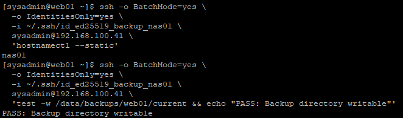
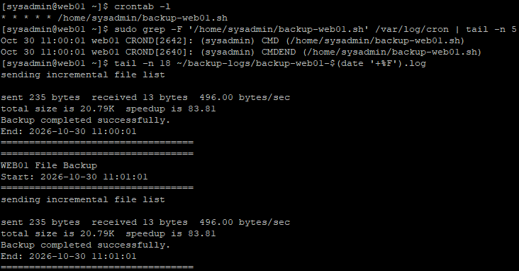
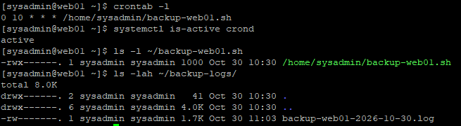

# 29. SSH 키 인증 및 cron 기반 파일 백업 자동화

## 1. 실습 개요

### 1.1 목적

28단원에서 구축한 rsync 기반 WEB01 파일 백업 환경에 SSH 공개키 인증과 cron을 적용하여 백업 작업을 자동화한다.

백업 결과를 날짜별 로그 파일에 기록하고, cron을 통해 예약 실행되는지 확인한다.

**주요 목표**

- WEB01의 cron 설치 및 서비스 상태 확인
- NAS01의 SSH 및 백업 저장소 상태 확인
- 백업 전용 Ed25519 SSH 키 생성
- SSH 공개키 기반 비대화형 인증 검증
- Bash 백업 스크립트 수정
- 날짜별 백업 로그 기록
- cron 1분 간격 자동 실행 테스트
- 실제 cron 실행 기록과 백업 로그 확인
- 매일 오전 10시 백업 일정 적용

### 1.2 실습 환경

| 항목 | 구성 |
|---|---|
| 가상화 | VMware Workstation |
| 운영체제 | Rocky Linux 9.8 |
| 백업 실행 서버 | WEB01 (192.168.100.21) |
| 백업 저장 서버 | NAS01 (192.168.100.41) |
| 백업 도구 | rsync 3.2.7 |
| 스크립트 | Bash |
| 작업 스케줄러 | cronie |
| SSH 키 알고리즘 | Ed25519 |
| 시간대 | Asia/Seoul (KST) |

---

## 2. 자동 백업 구조

### 2.1 전체 구성

```text
                WEB01
           192.168.100.21
    ┌───────────────────────────┐
    │ crond                     │
    │   │                       │
    │   ▼                       │
    │ backup-web01.sh           │
    │   │                       │
    │   ├─ rsync + SSH 키 인증  │
    │   │                       │
    │   └─ 날짜별 로그 기록     │
    │                           │
    │ 원본: /var/www/html/      │
    └─────────────┬─────────────┘
                  │
                  │ Host-only 네트워크
                  │ SSH
                  ▼
                NAS01
           192.168.100.41
    ┌───────────────────────────┐
    │ RAID 1 + LVM + XFS        │
    │                           │
    │ /data/backups/web01/      │
    │ ├── snapshot-01/          │
    │ └── current/              │
    └───────────────────────────┘
```

### 2.2 주요 경로

| 경로 | 용도 |
|---|---|
| `/var/www/html/` | WEB01 웹 콘텐츠 원본 |
| `/home/sysadmin/backup-web01.sh` | 자동 백업 스크립트 |
| `/home/sysadmin/backup-web01.sh.bak` | 28단원 스크립트 보관본 |
| `/home/sysadmin/.ssh/id_ed25519_backup_nas01` | 백업 전용 SSH 개인키 |
| `/home/sysadmin/.ssh/id_ed25519_backup_nas01.pub` | 백업 전용 SSH 공개키 |
| `/home/sysadmin/backup-logs/` | 백업 실행 로그 |
| `/data/backups/web01/current/` | NAS01 최신 백업 디렉터리 |
| `/data/backups/web01/snapshot-01/` | NAS01 최초 백업본 |

이번 단원에서는 `snapshot-01`을 변경하지 않고 `current` 디렉터리를 백업 대상으로 사용한다.

---

## 3. cron 및 기존 백업 환경 점검

### 3.1 WEB01 cron 확인

WEB01에서 cronie 패키지 설치 여부와 서비스 상태를 확인하였다.

```bash
rpm -q cronie

systemctl is-active crond

systemctl is-enabled crond

crontab -l
```

**결과**

```text
cronie-1.5.7-16.el9.x86_64
active
enabled
no crontab for sysadmin
```

cronie 패키지가 설치되어 있으며, `crond` 서비스가 실행 중이고 부팅 시 자동 시작하도록 설정되어 있었다.

`no crontab for sysadmin`은 해당 사용자에게 아직 예약 작업이 등록되어 있지 않다는 의미이다.

### 3.2 기존 백업 스크립트 확인

```bash
cat ~/backup-web01.sh

bash -n ~/backup-web01.sh

ls -l ~/backup-web01.sh
```

**결과**

```text
-rwx------. 1 sysadmin sysadmin 586 Oct 30 09:43 /home/sysadmin/backup-web01.sh
```

28단원에서 작성한 스크립트가 존재하며, `bash -n` 문법 검사에서 오류가 발생하지 않았다.

### 3.3 SSH 디렉터리 및 백업 전용 키 확인

```bash
ls -ld ~/.ssh 2>/dev/null || echo "SSH directory not found"

test -e ~/.ssh/id_ed25519_backup_nas01 \
  && echo "Backup SSH key exists" \
  || echo "Backup SSH key not found"
```

**결과**

```text
drwx------. 2 sysadmin sysadmin 48 Oct 30 09:33 /home/sysadmin/.ssh
Backup SSH key not found
```

SSH 디렉터리는 존재했으나 이번 실습에서 사용할 백업 전용 키는 아직 생성되지 않은 상태였다.

### 3.4 서버 시간 확인

```bash
timedatectl
```

**결과**

```text
Local time: Fri 2026-10-30 10:21:53 KST
Time zone: Asia/Seoul (KST, +0900)
System clock synchronized: yes
NTP service: active
```

WEB01의 시간대가 한국 표준시(KST)로 설정되어 있고 시스템 시간이 동기화된 상태임을 확인하였다.

### 3.5 NAS01 상태 확인

NAS01에서 다음 명령어를 실행하였다.

```bash
hostnamectl --static

systemctl is-active sshd

ls -ld /data/backups/web01

ls -ld /data/backups/web01/current
```

**결과**

```text
nas01
active

drwx------. 4 sysadmin sysadmin 40 Oct 30 09:43 /data/backups/web01
drwxr-xr-x. 3 sysadmin sysadmin 38 Oct 30 10:02 /data/backups/web01/current
```

NAS01의 SSH 서비스가 실행 중이고, 기존 백업 저장소가 유지되고 있음을 확인하였다.

---

## 4. 백업 전용 SSH 공개키 인증 구성

### 4.1 SSH 키 인증을 사용하는 이유

28단원에서는 NAS01에 파일을 전송할 때마다 `sysadmin` 계정의 비밀번호를 입력하였다.

그러나 cron은 사용자 입력 없이 백그라운드에서 명령어를 실행하므로, 비밀번호를 입력해야 하는 구조로는 자동화가 어렵다.

따라서 WEB01에서 백업 전용 SSH 키를 생성하고 NAS01에 공개키를 등록하였다.

### 4.2 WEB01 SSH 키 생성

```bash
ssh-keygen -t ed25519 \
  -f ~/.ssh/id_ed25519_backup_nas01 \
  -N "" \
  -C "web01-to-nas01-backup"
```

**옵션 설명**

| 옵션 | 의미 |
|---|---|
| `-t ed25519` | Ed25519 알고리즘으로 키 생성 |
| `-f` | 키 저장 경로 지정 |
| `-N ""` | 비밀번호 문구 없이 키 생성 |
| `-C` | 키 식별을 위한 설명 |

자동 실행을 위해 암호 문구가 없는 SSH 키를 사용하였다.

### 4.3 SSH 키 파일 확인

```bash
ls -l ~/.ssh/id_ed25519_backup_nas01*
```

생성된 파일은 다음과 같다.

```text
/home/sysadmin/.ssh/
├── id_ed25519_backup_nas01
└── id_ed25519_backup_nas01.pub
```

- 개인키: WEB01에 보관
- 공개키: NAS01에 등록
- 개인키는 GitHub에 업로드하지 않음

### 4.4 NAS01에 공개키 등록

WEB01에서 실행하였다.

```bash
ssh-copy-id \
  -i ~/.ssh/id_ed25519_backup_nas01.pub \
  sysadmin@192.168.100.41
```

이 과정에서 NAS01 계정 인증 후 공개키를 등록하였다.

### 4.5 비대화형 SSH 인증 검증

```bash
ssh -o BatchMode=yes \
  -o IdentitiesOnly=yes \
  -i ~/.ssh/id_ed25519_backup_nas01 \
  sysadmin@192.168.100.41 \
  'hostnamectl --static'
```

**결과**

```text
nas01
```

비밀번호 입력 없이 NAS01의 호스트명이 출력되었다.

**주요 옵션**

| 옵션 | 역할 |
|---|---|
| `-i` | 사용할 개인키 지정 |
| `BatchMode=yes` | 대화형 인증 입력 방지 |
| `IdentitiesOnly=yes` | 지정한 인증 키 중심으로 접속 |

### 4.6 NAS01 백업 디렉터리 쓰기 권한 검증

```bash
ssh -o BatchMode=yes \
  -o IdentitiesOnly=yes \
  -i ~/.ssh/id_ed25519_backup_nas01 \
  sysadmin@192.168.100.41 \
  'test -w /data/backups/web01/current && echo "PASS: Backup directory writable"'
```

**결과**

```text
PASS: Backup directory writable
```

SSH 키 인증에 성공하고 NAS01의 백업 디렉터리에 쓰기 권한이 있음을 확인하였다.

**WEB01 — SSH 키 인증 및 NAS01 쓰기 권한 검증**



---

## 5. Bash 백업 스크립트 수정

### 5.1 기존 스크립트 보관

28단원에서 작성한 기존 스크립트를 백업하였다.

```bash
cp -p ~/backup-web01.sh ~/backup-web01.sh.bak

ls -l ~/backup-web01.sh*
```

**결과**

```text
-rwx------. 1 sysadmin sysadmin 586 Oct 30 09:43 /home/sysadmin/backup-web01.sh
-rwx------. 1 sysadmin sysadmin 586 Oct 30 09:43 /home/sysadmin/backup-web01.sh.bak
```

### 5.2 수정된 백업 스크립트

**WEB01: `/home/sysadmin/backup-web01.sh`**

```bash
#!/bin/bash

set -euo pipefail
umask 077

SOURCE="/var/www/html"
DEST="sysadmin@192.168.100.41:/data/backups/web01/current"
SSH_KEY="/home/sysadmin/.ssh/id_ed25519_backup_nas01"

LOG_DIR="/home/sysadmin/backup-logs"
LOG_FILE="$LOG_DIR/backup-web01-$(date '+%F').log"

mkdir -p "$LOG_DIR"
chmod 700 "$LOG_DIR"

exec >> "$LOG_FILE" 2>&1

echo "=================================="
echo "WEB01 File Backup"
echo "Start: $(date '+%F %T')"
echo "=================================="

if [ ! -d "$SOURCE" ]; then
    echo "ERROR: Source directory not found."
    exit 1
fi

if [ ! -r "$SSH_KEY" ]; then
    echo "ERROR: SSH private key not found or unreadable."
    exit 1
fi

if rsync -avh --itemize-changes \
    --no-owner --no-group \
    -e "ssh -i $SSH_KEY -o BatchMode=yes -o IdentitiesOnly=yes" \
    "$SOURCE/" \
    "$DEST/"; then

    echo "Backup completed successfully."
else
    echo "ERROR: Backup failed."
    exit 1
fi

echo "End: $(date '+%F %T')"
echo "=================================="
```

### 5.3 주요 변경 사항

**① SSH 키 지정**

```bash
SSH_KEY="/home/sysadmin/.ssh/id_ed25519_backup_nas01"
```

NAS01 연결에 사용할 개인키를 명시적으로 지정하였다.

**② 비대화형 rsync 실행**

```bash
-e "ssh -i $SSH_KEY -o BatchMode=yes -o IdentitiesOnly=yes"
```

rsync가 SSH 키를 이용해 원격 서버에 접속하도록 구성하였다.

**③ 날짜별 로그 파일**

```bash
LOG_DIR="/home/sysadmin/backup-logs"
LOG_FILE="$LOG_DIR/backup-web01-$(date '+%F').log"
```

날짜를 기준으로 로그 파일을 생성하며 동일한 날짜의 재실행 기록은 같은 파일에 추가된다.

**④ 출력 및 오류 로그 저장**

```bash
exec >> "$LOG_FILE" 2>&1
```

표준 출력과 표준 오류를 모두 로그 파일에 저장하도록 설정하였다.

**⑤ 로그 접근 권한**

```bash
umask 077

mkdir -p "$LOG_DIR"
chmod 700 "$LOG_DIR"
```

로그 디렉터리와 신규 로그 파일이 불필요하게 다른 사용자에게 노출되지 않도록 구성하였다.

**⑥ 백업 실패 처리**

```bash
if rsync ...; then
    echo "Backup completed successfully."
else
    echo "ERROR: Backup failed."
    exit 1
fi
```

rsync 명령어가 실패하면 오류를 기록하고 종료 코드 1을 반환하도록 작성하였다.

---

## 6. 수정된 스크립트 수동 실행 검증

### 6.1 스크립트 문법 및 권한 확인

```bash
chmod 700 ~/backup-web01.sh

bash -n ~/backup-web01.sh

ls -l ~/backup-web01.sh
```

**결과**

```text
-rwx------. 1 sysadmin sysadmin 1000 Oct 30 10:30 /home/sysadmin/backup-web01.sh
```

문법 검사에서 오류가 없었으며, 소유자만 실행 가능한 권한으로 설정하였다.

### 6.2 SSH 키 기반 백업 실행

```bash
~/backup-web01.sh

echo "Exit code: $?"
```

**결과**

```text
Exit code: 0
```

SSH 비밀번호 요청 없이 스크립트가 종료되었다.

### 6.3 로그 파일 확인

```bash
ls -lah ~/backup-logs/

cat ~/backup-logs/backup-web01-$(date '+%F').log
```

**로그**

```text
==================================
WEB01 File Backup
Start: 2026-10-30 10:30:44
==================================
sending incremental file list
.d..t...... ./

sent 242 bytes  received 20 bytes  524.00 bytes/sec
total size is 20.79K  speedup is 79.34
Backup completed successfully.
End: 2026-10-30 10:30:44
==================================
```

로그 파일이 정상 생성되고 백업 성공 메시지가 기록되었다.

기존 웹 파일에 변경 사항이 없었기 때문에 파일 재전송 목록은 출력되지 않았다.

### 6.4 로그 파일 권한 확인

```bash
ls -lah ~/backup-logs/
```

**확인**

```text
drwx------. ... /home/sysadmin/backup-logs
-rw-------. ... backup-web01-2026-10-30.log
```

로그 디렉터리는 `700`, 로그 파일은 `600` 권한으로 생성되었다.

---

## 7. cron 1분 간격 자동 실행 검증

### 7.1 검증 목적

수동 실행이 성공하더라도 실제 cron 환경에서 스크립트가 정상적으로 실행된다는 보장은 없다.

따라서 먼저 1분 간격 임시 작업을 등록하여 실제 예약 실행 및 백업 로그를 검증하였다.

### 7.2 테스트용 crontab 등록

**WEB01에서 실행**

```bash
printf '%s\n' '* * * * * /home/sysadmin/backup-web01.sh' | crontab -
```

등록 확인:

```bash
crontab -l
```

**결과**

```text
* * * * * /home/sysadmin/backup-web01.sh
```

### 7.3 cron 표현식

```text
* * * * *
│ │ │ │ │
│ │ │ │ └── 요일
│ │ │ └──── 월
│ │ └────── 일
│ └──────── 시
└────────── 분
```

`* * * * *`는 매분 실행을 의미한다.

해당 설정은 자동 실행 검증을 위한 임시 일정으로 사용하였다.

### 7.4 cron 실제 실행 기록 확인

```bash
date

sudo grep -F '/home/sysadmin/backup-web01.sh' /var/log/cron | tail -n 5
```

**결과**

```text
Oct 30 11:00:01 web01 CROND[2642]: (sysadmin) CMD (/home/sysadmin/backup-web01.sh)

Oct 30 11:00:01 web01 CROND[2640]: (sysadmin) CMDEND (/home/sysadmin/backup-web01.sh)
```

- `CMD`: cron에서 예약 명령어 실행
- `CMDEND`: 해당 명령어 실행 종료

WEB01에서 `sysadmin` 사용자의 백업 스크립트가 cron에 의해 실행된 것을 확인하였다.

`CMDEND` 자체가 백업 성공을 보장하지는 않으므로 실제 백업 로그도 함께 확인하였다.

### 7.5 자동 실행 백업 로그 검증

```bash
tail -n 18 ~/backup-logs/backup-web01-$(date '+%F').log
```

**결과**

```text
==================================
WEB01 File Backup
Start: 2026-10-30 11:01:01
==================================
sending incremental file list

sent 235 bytes  received 13 bytes  496.00 bytes/sec
total size is 20.79K  speedup is 83.81
Backup completed successfully.
End: 2026-10-30 11:01:01
==================================
```

11:00과 11:01에 자동 백업이 수행되었고, 로그에 성공 메시지가 기록되었다.

백업 파일에 변경 사항이 없었으므로 전송량이 적게 나타났다.

**WEB01 — cron 자동 실행 및 rsync 백업 성공**



---

## 8. 최종 일일 백업 일정 설정

### 8.1 1분 간격 테스트 종료

매분 백업을 실행하는 설정은 실습용이므로, 검증 완료 후 실제 운영 목적에 맞게 변경하였다.

### 8.2 매일 오전 10시 실행 설정

```bash
printf '%s\n' '0 10 * * * /home/sysadmin/backup-web01.sh' | crontab -
```

기존 `sysadmin` crontab에는 실습용 백업 작업 하나만 등록되어 있었으므로 전체 일정을 교체하였다.

### 8.3 최종 crontab 검증

```bash
crontab -l

systemctl is-active crond

ls -l ~/backup-web01.sh

ls -lah ~/backup-logs/
```

**결과**

```text
0 10 * * * /home/sysadmin/backup-web01.sh

active

-rwx------. 1 sysadmin sysadmin 1000 Oct 30 10:30 /home/sysadmin/backup-web01.sh
```

백업 로그 디렉터리와 `backup-web01-2026-10-30.log` 파일도 존재함을 확인하였다.

### 8.4 최종 cron 일정 해석

| 항목 | 값 | 의미 |
|---|---|---|
| 분 | `0` | 0분 |
| 시 | `10` | 오전 10시 |
| 일 | `*` | 매일 |
| 월 | `*` | 매월 |
| 요일 | `*` | 모든 요일 |

**최종 설정: 매일 오전 10시(KST) 백업 실행**

1분 간격 자동 실행은 실제로 검증했으며, 일일 백업은 최종 crontab 등록 상태를 확인하였다.

**WEB01 — 최종 cron 일정 및 백업 로그 확인**



---

## 9. 자동 백업 운영 시 고려 사항

### 9.1 VM 전원 상태

cron은 WEB01에서 실행되므로 예약된 시간에 WEB01이 켜져 있어야 한다.

또한 백업 대상인 NAS01도 실행 중이고 SSH 접근이 가능해야 한다.

VM이 꺼져 있는 동안 놓친 작업은 일반적인 cron 설정만으로 자동 보충되지 않는다.

### 9.2 SSH 개인키 보안

이번 실습에서는 암호 문구 없는 SSH 키를 사용하였다.

자동화에는 유리하지만, 개인키가 유출되면 해당 인증 정보를 악용할 위험이 있다.

따라서 개인키를 GitHub에 업로드해서는 안 되며, 실제 운영 환경에서는 백업 전용 계정과 최소 권한 정책을 사용하는 것이 바람직하다.

### 9.3 백업 스크립트의 메타데이터 보존 범위

이번 rsync 스크립트는 다음 옵션을 사용한다.

```bash
--no-owner --no-group
```

따라서 원본 파일의 소유자와 그룹을 보존하지 않는다.

또한 ACL과 SELinux 컨텍스트를 완전하게 보존하도록 설정한 백업은 아니다.

실제 서비스 복구 시에는 파일 내용 외에도 소유권, 권한, ACL 및 SELinux 컨텍스트를 확인해야 한다.

### 9.4 `current` 백업의 한계

백업 스크립트는 NAS01의 `current` 디렉터리를 반복 갱신한다.

따라서 이전 버전이 자동으로 여러 개 보관되지는 않는다.

또한 `--delete` 옵션이 없으므로 WEB01에서 삭제된 파일이 `current` 백업본에 남을 수 있다.

최신 상태의 정확한 복제본이나 날짜별 이력 보존이 필요하면 별도의 정책이 필요하다.

### 9.5 로그 관리

현재는 날짜별 로그 파일을 생성하지만, 오래된 로그를 자동으로 삭제하거나 압축하는 기능은 구현하지 않았다.

장기간 운영할 경우 로그 보존 기간, 저장 용량 및 실패 알림 정책을 추가해야 한다.

---

## 10. 최종 검증 결과

| 검증 항목 | 결과 | 상태 |
|---|---|---|
| cronie 설치 | 1.5.7 | 완료 |
| crond 실행 상태 | active | 정상 |
| crond 부팅 자동 시작 | enabled | 정상 |
| WEB01 시간대 | Asia/Seoul | 정상 |
| NAS01 SSH 서비스 | active | 정상 |
| 백업 전용 SSH 키 | Ed25519 | 구성 완료 |
| SSH 비대화형 접속 | `nas01` 출력 | 성공 |
| NAS01 쓰기 권한 | PASS 출력 | 성공 |
| 기존 스크립트 보관 | `.bak` 생성 | 완료 |
| Bash 문법 검사 | 오류 없음 | 성공 |
| 스크립트 실행 권한 | 700 | 정상 |
| 키 기반 rsync 실행 | Exit code 0 | 성공 |
| 로그 파일 생성 | 날짜별 로그 | 성공 |
| 로그 파일 권한 | 600 | 정상 |
| 1분 간격 cron 등록 | `* * * * *` | 성공 |
| cron 실제 자동 실행 | 11:00, 11:01 | 확인 |
| 자동 백업 로그 | 성공 메시지 확인 | 성공 |
| 최종 일일 일정 | `0 10 * * *` | 설정 완료 |

---

## 11. 실습을 통해 배운 점

### 11.1 비대화형 SSH 인증

cron과 같은 자동화 환경에서는 사용자가 비밀번호를 입력할 수 없다.

SSH 공개키 인증과 `BatchMode=yes` 옵션을 활용하여 사용자 입력 없이 원격 백업을 수행할 수 있음을 확인하였다.

### 11.2 cron을 이용한 예약 실행

`crontab`에 실행 시각과 스크립트 경로를 등록하여 반복 작업을 자동화하였다.

실제 `/var/log/cron` 기록을 통해 cron이 예약 작업을 실행했음을 확인하였다.

### 11.3 로그 기반 실행 결과 확인

스크립트에서 표준 출력과 표준 오류를 날짜별 로그 파일에 저장하도록 구성하였다.

cron 실행 여부와 실제 백업 성공 여부를 각각 확인하여 자동화 작업의 정상 동작을 검증하였다.

### 11.4 자동화 작업의 보안과 운영 관리

자동 실행을 위해 SSH 개인키를 사용하면서 접근 권한 관리의 중요성을 확인하였다.

또한 자동 백업에는 단순한 스케줄 등록뿐 아니라 서버 가용성, 로그 보존, 오류 확인, 백업 이력 관리 등의 운영 요소가 필요하다는 점을 학습하였다.

---

## 12. 최종 결과

이번 실습에서는 28단원에서 구축한 WEB01 → NAS01 수동 백업 환경을 cron 기반 자동 백업 환경으로 확장하였다.

WEB01에 백업 전용 Ed25519 SSH 키를 생성하고 NAS01에 공개키를 등록하여 비밀번호 입력 없는 SSH 인증을 구성하였다.

기존 Bash 백업 스크립트에 SSH 키 지정과 로그 기록 기능을 추가하고, 수동 실행을 통해 정상 동작을 확인하였다.

이후 1분 간격의 cron 테스트를 진행하여 11:00과 11:01에 자동 백업이 실제로 실행되고 성공 로그가 기록되는 것을 검증하였다.

테스트 완료 후 예약 일정을 매일 오전 10시로 변경하여 최종 자동 백업 환경을 구성하였다.

**최종 성과: SSH 공개키 인증, Bash·rsync 백업 스크립트, cron 예약 실행 및 로그 검증 완료**

### 관련 문서

- [28. Bash·rsync 기반 파일 백업 및 복구 검증](./28-file-backup.md)
