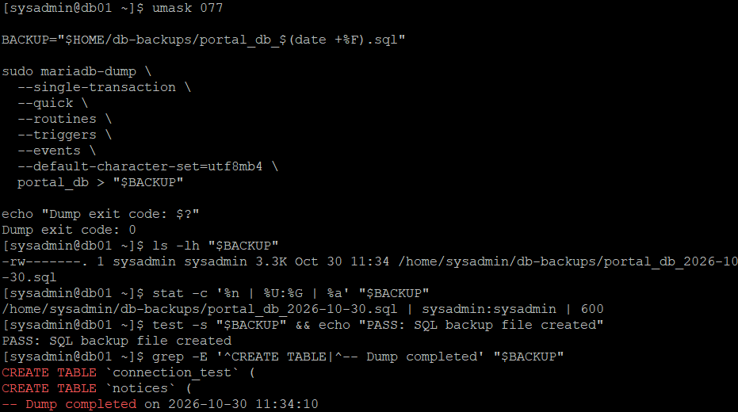
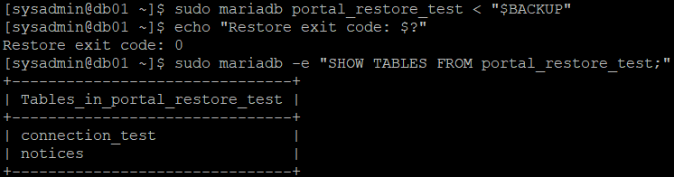
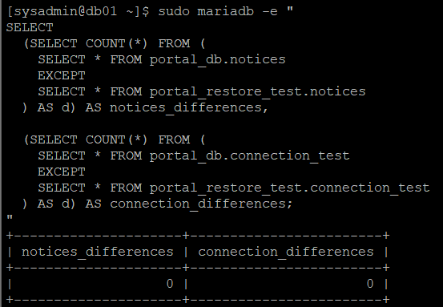

# 30. MariaDB 데이터베이스 백업 및 복구 검증

## 1. 실습 개요

### 1.1 목적

Rocky Linux 9.8 기반 사내 업무 포털에서 운영 중인 DB01의 MariaDB 데이터베이스를 백업하고, 실제 복원 과정을 통해 데이터 무결성을 검증한다.

기존 업무 포털에서 사용하는 `portal_db`를 `mariadb-dump`로 논리 백업한 뒤, 별도의 `portal_restore_test` 데이터베이스에 복원한다.

복원된 데이터와 원본 데이터를 비교한 후, SQL 백업 파일을 NAS01의 RAID 1·LVM 기반 스토리지에 보관한다.

**주요 목표**

- MariaDB 서비스와 기존 데이터 확인
- `mariadb-dump` 기반 SQL 논리 백업
- 백업 파일 권한 및 SQL 구조 확인
- 별도 테스트 DB 생성 및 백업 복원
- 원본·복원본 데이터 건수 및 내용 비교
- NAS01으로 SQL 백업 파일 전송
- SHA-256 해시 기반 파일 무결성 검증
- 복원 테스트 DB 삭제 및 운영 DB 유지 확인

### 1.2 실습 환경

| 항목 | 구성 |
|---|---|
| 가상화 환경 | VMware Workstation |
| 운영체제 | Rocky Linux 9.8 |
| DB 서버 | DB01 (192.168.100.31) |
| 백업 저장 서버 | NAS01 (192.168.100.41) |
| 데이터베이스 | MariaDB 10.5.29 |
| 백업 도구 | `mariadb-dump` |
| 데이터베이스 원본 | `portal_db` |
| 복원 테스트 DB | `portal_restore_test` |
| 테이블 엔진 | InnoDB |
| 백업 파일 전송 | SCP / SSH |
| 무결성 검증 | SQL 비교, SHA-256 |
| NAS01 스토리지 | RAID 1 + LVM + XFS |
| 실습 일자 | 2026-10-30 |

### 1.3 백업 대상

기존 09~11단원에서 구축한 MariaDB의 `portal_db`를 백업 대상으로 사용하였다.

`portal_db`는 WEB01과 WEB02에서 실행되는 PHP 업무 포털이 공통으로 사용하는 데이터베이스이다.

주요 테이블은 다음과 같다.

| 테이블 | 역할 |
|---|---|
| `connection_test` | WEB 서버와 DB 연동 검증 |
| `notices` | 업무 포털 공지사항 데이터 |

이번 실습에서는 원본 데이터베이스의 데이터를 삭제하거나 수정하지 않고 별도 테스트 DB로 복원하였다.

---

## 2. 데이터베이스 백업 및 복원 구성

### 2.1 전체 구성

```text
                 DB01
            192.168.100.31
    ┌────────────────────────────┐
    │ MariaDB                    │
    │                            │
    │ portal_db                  │
    │ ├── connection_test        │
    │ └── notices                │
    │          │                 │
    │          ▼                 │
    │     mariadb-dump           │
    │          │                 │
    │          ▼                 │
    │ portal_db_2026-10-30.sql   │
    │          │                 │
    │          ├── 복원 테스트   │
    │          │                 │
    │          ▼                 │
    │ portal_restore_test        │
    │                            │
    └────────────┬───────────────┘
                 │
                 │ SCP + SSH
                 ▼
                NAS01
           192.168.100.41
    ┌────────────────────────────┐
    │ RAID 1 + LVM + XFS         │
    │                            │
    │ /data/backups/db01/        │
    │ └── portal_db_2026-10-30.sql
    └────────────────────────────┘
```

### 2.2 주요 경로

| 구분 | 경로 |
|---|---|
| DB01 원본 데이터베이스 | `portal_db` |
| DB01 SQL 백업 디렉터리 | `/home/sysadmin/db-backups/` |
| DB01 백업 파일 | `/home/sysadmin/db-backups/portal_db_2026-10-30.sql` |
| DB01 복원 테스트 데이터베이스 | `portal_restore_test` |
| NAS01 백업 디렉터리 | `/data/backups/db01/` |
| NAS01 백업 파일 | `/data/backups/db01/portal_db_2026-10-30.sql` |

---

## 3. DB01 MariaDB 환경 점검

### 3.1 서버 및 서비스 확인

DB01에서 다음 명령어를 실행하였다.

```bash
hostnamectl --static

systemctl is-active mariadb

systemctl is-enabled mariadb

mariadb --version

mariadb-dump --version
```

**결과**

```text
db01
active
enabled

mariadb  Ver 15.1 Distrib 10.5.29-MariaDB
mariadb-dump  Ver 10.19 Distrib 10.5.29-MariaDB
```

MariaDB 서비스가 실행 중이며 부팅 시 자동 시작하도록 구성되어 있었다.

또한 `mariadb-dump`가 설치되어 있어 별도의 패키지 설치 없이 백업을 진행할 수 있었다.

### 3.2 기존 데이터베이스 확인

```bash
sudo mariadb -e "SHOW DATABASES;"
```

**결과**

```text
+--------------------+
| Database           |
+--------------------+
| information_schema |
| mysql              |
| performance_schema |
| portal_db          |
+--------------------+
```

기존 `portal_db`가 정상적으로 존재하였다.

### 3.3 테이블 확인

```bash
sudo mariadb -e "SHOW TABLES FROM portal_db;"
```

**결과**

```text
+---------------------+
| Tables_in_portal_db |
+---------------------+
| connection_test     |
| notices             |
+---------------------+
```

백업 대상 테이블 2개를 확인하였다.

### 3.4 스토리지 엔진 확인

```bash
sudo mariadb -e "
SELECT TABLE_NAME, ENGINE
FROM information_schema.TABLES
WHERE TABLE_SCHEMA = 'portal_db'
ORDER BY TABLE_NAME;
"
```

**결과**

```text
+-----------------+--------+
| TABLE_NAME      | ENGINE |
+-----------------+--------+
| connection_test | InnoDB |
| notices         | InnoDB |
+-----------------+--------+
```

두 테이블 모두 InnoDB 스토리지 엔진을 사용하고 있었다.

이번 실습에서는 InnoDB의 트랜잭션 특성을 활용하기 위해 `--single-transaction` 옵션을 사용하였다.

### 3.5 기존 업무 데이터 확인

```bash
sudo mariadb portal_db -e "
SELECT COUNT(*) AS notice_count
FROM notices;
"
```

**결과**

```text
+--------------+
| notice_count |
+--------------+
|            1 |
+--------------+
```

공지사항 목록을 확인하였다.

```bash
sudo mariadb portal_db -e "
SELECT id, title, author
FROM notices
ORDER BY id;
"
```

**결과**

```text
+----+------------------------------------+----------+
| id | title                              | author   |
+----+------------------------------------+----------+
|  1 | 사내 업무 포털 오픈 안내           | sysadmin |
+----+------------------------------------+----------+
```

기존 11단원에서 유지했던 공지사항 1건이 남아 있었다.

### 3.6 디스크 용량 확인

```bash
df -h /home /var/lib/mysql
```

**결과**

```text
Filesystem           Size  Used Avail Use% Mounted on
/dev/mapper/rl-root   17G  2.0G   15G  12% /
/dev/mapper/rl-root   17G  2.0G   15G  12% /
```

DB01 루트 파일시스템에 약 15GB의 여유 공간이 있어 SQL 백업을 진행하였다.

---

## 4. MariaDB SQL 논리 백업

### 4.1 백업 디렉터리 생성

DB01에서 백업 파일을 저장할 디렉터리를 생성하였다.

```bash
mkdir -p ~/db-backups

chmod 700 ~/db-backups

ls -ld ~/db-backups
```

**결과**

```text
drwx------. 2 sysadmin sysadmin 6 Oct 30 11:33 /home/sysadmin/db-backups
```

백업 파일에는 업무 데이터가 포함되므로 디렉터리 접근 권한을 `700`으로 설정하였다.

### 4.2 SQL 백업 명령어

```bash
umask 077

BACKUP="$HOME/db-backups/portal_db_$(date +%F).sql"

sudo mariadb-dump \
  --single-transaction \
  --quick \
  --routines \
  --triggers \
  --events \
  --default-character-set=utf8mb4 \
  portal_db > "$BACKUP"

echo "Dump exit code: $?"
```

**결과**

```text
Dump exit code: 0
```

MariaDB 논리 백업 명령어가 정상적으로 종료되었다.

### 4.3 백업 옵션 설명

| 옵션 | 의미 |
|---|---|
| `--single-transaction` | 트랜잭션을 이용하여 InnoDB 데이터를 일관된 시점으로 조회 |
| `--quick` | 조회한 데이터를 순차적으로 처리 |
| `--routines` | 저장 프로시저 및 함수 백업 대상 포함 |
| `--triggers` | 트리거 백업 대상 포함 |
| `--events` | 이벤트 백업 대상 포함 |
| `--default-character-set=utf8mb4` | UTF-8 문자 데이터 처리 |
| `>` | SQL 출력 내용을 파일에 저장 |

`--single-transaction`은 InnoDB 데이터에 적합한 논리 백업 옵션이다.

다만 백업 중 테이블 구조가 변경되는 DDL 작업까지 모두 안전하게 처리한다는 의미는 아니다.

`--routines`, `--triggers`, `--events`는 해당 객체가 존재할 경우 백업 대상에 포함하기 위한 옵션이다.

이번 백업은 `portal_db`에 대한 논리 백업이므로 MariaDB 서버 전체의 사용자 계정 및 권한을 완전하게 보존하는 전체 서버 백업과는 다르다.

### 4.4 백업 파일 확인

```bash
ls -lh "$BACKUP"
```

**결과**

```text
-rw-------. 1 sysadmin sysadmin 3.3K Oct 30 11:34 /home/sysadmin/db-backups/portal_db_2026-10-30.sql
```

백업 파일 크기는 약 3.3KB였다.

### 4.5 백업 파일 권한 확인

```bash
stat -c '%n | %U:%G | %a' "$BACKUP"
```

**결과**

```text
/home/sysadmin/db-backups/portal_db_2026-10-30.sql | sysadmin:sysadmin | 600
```

`umask 077`을 적용하여 백업 파일이 `600` 권한으로 생성된 것을 확인하였다.

### 4.6 파일 생성 검증

```bash
test -s "$BACKUP" && echo "PASS: SQL backup file created"
```

**결과**

```text
PASS: SQL backup file created
```

백업 파일이 존재하며 크기가 0이 아님을 확인하였다.

### 4.7 SQL 백업 내용 확인

```bash
grep -E '^CREATE TABLE|^-- Dump completed' "$BACKUP"
```

**결과**

```text
CREATE TABLE `connection_test` (
CREATE TABLE `notices` (
-- Dump completed on 2026-10-30 11:34:10
```

백업 파일에 두 테이블의 생성 구문이 포함되어 있었다.

이는 SQL 구조의 존재 여부를 확인한 것으로, 실제 복원 가능 여부는 이후 별도 데이터베이스에 복원하여 검증하였다.

**DB01 — MariaDB SQL 백업 생성 및 검증**



---

## 5. MariaDB 별도 데이터베이스 복원

### 5.1 복원 목적

SQL 백업 파일이 존재하더라도 해당 파일을 이용하여 실제 데이터베이스를 복원할 수 있다는 보장은 없다.

따라서 운영 DB인 `portal_db`를 변경하지 않고 별도 데이터베이스에 복원을 수행하였다.

복원 대상 데이터베이스:

```text
portal_restore_test
```

### 5.2 복원 테스트 DB 존재 확인

```bash
sudo mariadb -e "SHOW DATABASES LIKE 'portal_restore_test';"
```

**결과**

```text
(출력 없음)
```

복원용 데이터베이스가 기존에 존재하지 않음을 확인하였다.

### 5.3 복원용 데이터베이스 생성

```bash
sudo mariadb -e "
CREATE DATABASE portal_restore_test
CHARACTER SET utf8mb4
COLLATE utf8mb4_unicode_ci;
"
```

생성 결과를 확인하였다.

```bash
sudo mariadb -e "SHOW DATABASES LIKE 'portal_restore_test';"
```

**결과**

```text
+--------------------------------+
| Database (portal_restore_test) |
+--------------------------------+
| portal_restore_test            |
+--------------------------------+
```

### 5.4 백업 파일의 데이터베이스 전환 구문 확인

복원하기 전 SQL 백업 파일에 다른 데이터베이스를 지정하는 구문이 있는지 확인하였다.

```bash
grep -nE '^(CREATE DATABASE|USE |DROP DATABASE)' "$BACKUP"
```

**결과**

```text
(출력 없음)
```

지정한 패턴과 일치하는 구문이 없음을 확인하였다.

### 5.5 SQL 백업 파일 복원

```bash
sudo mariadb portal_restore_test < "$BACKUP"

echo "Restore exit code: $?"
```

**결과**

```text
Restore exit code: 0
```

백업 파일의 SQL 구문을 `portal_restore_test` 데이터베이스에서 실행하여 복원하였다.

### 5.6 복원된 테이블 확인

```bash
sudo mariadb -e "SHOW TABLES FROM portal_restore_test;"
```

**결과**

```text
+-------------------------------+
| Tables_in_portal_restore_test |
+-------------------------------+
| connection_test               |
| notices                       |
+-------------------------------+
```

원본과 동일한 이름의 테이블 2개가 복원되었다.

**DB01 — SQL 백업 파일 복원 및 테이블 확인**



---

## 6. 원본 및 복원본 데이터 비교

### 6.1 검증 목적

복원된 데이터가 원본과 동일한지 확인하기 위해 다음 항목을 비교하였다.

- 테이블별 행 개수
- 공지사항 주요 데이터
- 모든 컬럼을 대상으로 한 양방향 `EXCEPT` 비교

### 6.2 공지사항 데이터 건수 비교

```bash
sudo mariadb -e "
SELECT 'Original' AS db_type, COUNT(*) AS notice_count
FROM portal_db.notices
UNION ALL
SELECT 'Restored', COUNT(*)
FROM portal_restore_test.notices;
"
```

**결과**

```text
+----------+--------------+
| db_type  | notice_count |
+----------+--------------+
| Original |            1 |
| Restored |            1 |
+----------+--------------+
```

원본과 복원본의 공지사항 데이터 건수가 모두 1건이었다.

### 6.3 공지사항 주요 내용 비교

```bash
sudo mariadb -e "
SELECT 'Original' AS db_type, id, title, author
FROM portal_db.notices
UNION ALL
SELECT 'Restored', id, title, author
FROM portal_restore_test.notices
ORDER BY id, db_type;
"
```

**결과**

```text
+----------+----+------------------------------------+----------+
| db_type  | id | title                              | author   |
+----------+----+------------------------------------+----------+
| Original |  1 | 사내 업무 포털 오픈 안내           | sysadmin |
| Restored |  1 | 사내 업무 포털 오픈 안내           | sysadmin |
+----------+----+------------------------------------+----------+
```

공지사항의 ID, 제목 및 작성자가 동일함을 확인하였다.

### 6.4 connection_test 데이터 건수 비교

```bash
sudo mariadb -e "
SELECT 'Original' AS db_type, COUNT(*) AS row_count
FROM portal_db.connection_test
UNION ALL
SELECT 'Restored', COUNT(*)
FROM portal_restore_test.connection_test;
"
```

**결과**

```text
+----------+-----------+
| db_type  | row_count |
+----------+-----------+
| Original |         2 |
| Restored |         2 |
+----------+-----------+
```

`connection_test` 테이블의 행 개수도 동일하였다.

### 6.5 원본 → 복원본 데이터 차이 확인

`EXCEPT`를 이용하여 원본에만 존재하는 데이터가 있는지 비교하였다.

```bash
sudo mariadb -e "
SELECT
  (SELECT COUNT(*) FROM (
    SELECT * FROM portal_db.notices
    EXCEPT
    SELECT * FROM portal_restore_test.notices
  ) AS d) AS notices_differences,

  (SELECT COUNT(*) FROM (
    SELECT * FROM portal_db.connection_test
    EXCEPT
    SELECT * FROM portal_restore_test.connection_test
  ) AS d) AS connection_differences;
"
```

**결과**

```text
+---------------------+------------------------+
| notices_differences | connection_differences |
+---------------------+------------------------+
|                   0 |                      0 |
+---------------------+------------------------+
```

원본에만 존재하는 행이 확인되지 않았다.

**DB01 — 원본·복원본 데이터 비교**



### 6.6 복원본 → 원본 데이터 차이 확인

반대 방향으로도 데이터를 비교하였다.

```bash
sudo mariadb -e "
SELECT
  (SELECT COUNT(*) FROM (
    SELECT * FROM portal_restore_test.notices
    EXCEPT
    SELECT * FROM portal_db.notices
  ) AS d) AS notices_reverse_diff,

  (SELECT COUNT(*) FROM (
    SELECT * FROM portal_restore_test.connection_test
    EXCEPT
    SELECT * FROM portal_db.connection_test
  ) AS d) AS connection_reverse_diff;
"
```

**결과**

```text
+----------------------+-------------------------+
| notices_reverse_diff | connection_reverse_diff |
+----------------------+-------------------------+
|                    0 |                       0 |
+----------------------+-------------------------+
```

복원본에만 존재하는 행도 확인되지 않았다.

### 6.7 데이터 검증 결과

| 항목 | 원본 | 복원본 | 결과 |
|---|---:|---:|---|
| notices 행 개수 | 1 | 1 | 일치 |
| connection_test 행 개수 | 2 | 2 | 일치 |
| 원본 → 복원본 차이 | 0 | 0 | 정상 |
| 복원본 → 원본 차이 | 0 | 0 | 정상 |

양방향 `EXCEPT` 결과가 모두 0이고 행 개수도 동일하였다.

이번 실습에서 비교한 두 테이블의 데이터가 복원 후에도 일치함을 확인하였다.

단, `EXCEPT`는 중복 행을 제거하여 비교하므로, 중복 행의 개별 발생 횟수까지 검증하는 범용 백업 무결성 검사와는 구분할 필요가 있다.

---

## 7. NAS01 SQL 백업 파일 보관

### 7.1 NAS01 백업 경로 생성

NAS01에서 DB01 백업 파일을 보관하기 위한 별도 디렉터리를 생성하였다.

```bash
hostnamectl --static

sudo install -d -o sysadmin -g sysadmin -m 700 /data/backups/db01

ls -ld /data/backups/db01

df -hT /data
```

**결과**

```text
nas01

drwx------. 2 sysadmin sysadmin 6 Oct 30 11:58 /data/backups/db01

Filesystem                  Type  Size  Used  Avail Use%
/dev/mapper/vg_data-lv_data xfs   8.0G  100M  7.9G   2%
```

기존 WEB01 백업 경로와 분리하여 DB01 전용 백업 디렉터리를 생성하였다.

### 7.2 DB01에서 NAS01으로 SQL 백업 전송

DB01에서 SCP 명령어로 SQL 파일을 전송하였다.

```bash
scp -p ~/db-backups/portal_db_2026-10-30.sql \
  sysadmin@192.168.100.41:/data/backups/db01/
```

첫 연결 시 SSH 호스트 키 확인 메시지가 출력되었으며, 이를 수락한 후 NAS01의 `sysadmin` 계정으로 인증하였다.

**결과**

```text
portal_db_2026-10-30.sql  100%  3314  7.7MB/s  00:00
```

3,314바이트 크기의 SQL 백업 파일이 전송되었다.

`scp -p` 옵션으로 원본 파일의 수정 시간과 권한을 유지하도록 하였다.

### 7.3 NAS01 백업 파일 확인

```bash
ls -lah /data/backups/db01/

stat -c '%n | %U:%G | %a' \
  /data/backups/db01/portal_db_2026-10-30.sql
```

**결과**

```text
-rw-------. 1 sysadmin sysadmin 3.3K Oct 30 11:34 portal_db_2026-10-30.sql

/data/backups/db01/portal_db_2026-10-30.sql | sysadmin:sysadmin | 600
```

백업 파일이 NAS01에 저장되었고 `600` 권한이 유지되었다.

---

## 8. SHA-256 파일 무결성 검증

### 8.1 검증 목적

파일 전송이 완료되었다는 사실만으로 원본 파일과 전송된 파일의 내용이 완전히 동일하다고 단정하지 않고 SHA-256 해시값을 비교하였다.

### 8.2 DB01 원본 백업 파일 해시값

**DB01에서 실행**

```bash
sha256sum ~/db-backups/portal_db_2026-10-30.sql
```

**결과**

```text
58edde1b5f2cfd50d09c7b0850b740c55005656948744b86e1918bac29c53cbd  /home/sysadmin/db-backups/portal_db_2026-10-30.sql
```

### 8.3 NAS01 백업 파일 해시값

**NAS01에서 실행**

```bash
sha256sum /data/backups/db01/portal_db_2026-10-30.sql
```

**결과**

```text
58edde1b5f2cfd50d09c7b0850b740c55005656948744b86e1918bac29c53cbd  /data/backups/db01/portal_db_2026-10-30.sql
```

### 8.4 검증 결과

| 구분 | SHA-256 결과 |
|---|---|
| DB01 | `58edde1b...29c53cbd` |
| NAS01 | `58edde1b...29c53cbd` |
| 비교 | 일치 |

DB01 원본 SQL 파일과 NAS01에 전송된 SQL 파일의 SHA-256 값이 완전히 일치하였다.

따라서 파일 전송 과정에서 내용이 변경되지 않았음을 검증하였다.

이 검증은 SQL 파일 자체의 동일성 검사이며, 복원 가능한지 여부는 5~6장에서 별도로 검증하였다.

---

## 9. 복원 테스트 환경 정리

### 9.1 테스트 DB 확인

복원 검증을 완료한 뒤 DB01에서 테스트 데이터베이스를 확인하였다.

```bash
sudo mariadb -e "SHOW DATABASES LIKE 'portal_restore_test';"
```

**결과**

```text
portal_restore_test
```

### 9.2 테스트 데이터베이스 삭제

기존 업무 포털 DB를 유지하고 복원 테스트 DB만 삭제하였다.

```bash
sudo mariadb -e "DROP DATABASE portal_restore_test;"
```

`DROP DATABASE`는 해당 데이터베이스를 삭제하는 명령어이므로 운영 데이터베이스인 `portal_db`에는 실행하지 않았다.

### 9.3 운영 데이터베이스 유지 확인

```bash
sudo mariadb -e "SHOW DATABASES;"
```

**결과**

```text
+--------------------+
| Database           |
+--------------------+
| information_schema |
| mysql              |
| performance_schema |
| portal_db          |
+--------------------+
```

`portal_restore_test`가 삭제되고 `portal_db`가 유지되었다.

### 9.4 기존 테이블 확인

```bash
sudo mariadb -e "SHOW TABLES FROM portal_db;"
```

**결과**

```text
+---------------------+
| Tables_in_portal_db |
+---------------------+
| connection_test     |
| notices             |
+---------------------+
```

### 9.5 공지사항 데이터 유지 확인

```bash
sudo mariadb portal_db -e "
SELECT COUNT(*) AS notice_count
FROM notices;
"
```

**결과**

```text
+--------------+
| notice_count |
+--------------+
|            1 |
+--------------+
```

기존 공지사항 1건이 유지되었다.

따라서 테스트 데이터베이스를 정리한 후에도 운영 데이터베이스의 기존 테이블과 데이터가 정상적으로 유지됨을 확인하였다.

---

## 10. 최종 백업 구조

```text
DB01
└── /home/sysadmin/
    └── db-backups/
        └── portal_db_2026-10-30.sql

NAS01
└── /data/
    └── backups/
        ├── web01/
        │   ├── snapshot-01/
        │   └── current/
        │
        └── db01/
            └── portal_db_2026-10-30.sql
```

기존 WEB01 파일 백업과 DB01 데이터베이스 백업을 NAS01의 서로 다른 디렉터리로 분리하였다.

SQL 파일은 DB01과 NAS01에 각각 보관하였다.

---

## 11. 백업 및 복원 시 고려 사항

### 11.1 논리 백업과 물리 백업

이번 실습에서는 `mariadb-dump`로 SQL 논리 백업을 수행하였다.

논리 백업은 데이터베이스 객체와 데이터를 SQL 구문 형태로 추출하는 방식이다.

반면 물리 백업은 실제 데이터 파일을 대상으로 하며 별도의 도구와 복원 절차가 필요하다.

이번 실습에서는 비교적 작은 업무 포털 데이터베이스의 백업과 복원 검증에 적합한 논리 백업 방식을 선택하였다.

### 11.2 백업 시점 이후 데이터

이번에 생성한 백업 파일은 2026년 10월 30일 11:34 시점의 데이터가 담긴 백업본이다.

그 이후 DB에 변경된 데이터까지 자동으로 보존되지는 않는다.

지속적인 데이터 보호를 위해서는 정기 백업과 보존 정책이 필요하다.

### 11.3 데이터베이스 복제와 백업의 차이

DB 서버 간 데이터 복제는 가용성 및 읽기 성능 향상에 활용할 수 있다.

하지만 데이터 삭제나 잘못된 수정도 복제될 수 있으므로 복제만으로 백업을 대체할 수 없다.

이번 실습에서는 별도의 SQL 백업 파일을 생성하여 복원하는 방식을 검증하였다.

### 11.4 SQL 백업 파일 보안

SQL 백업 파일에는 테이블 구조와 실제 데이터가 포함될 수 있다.

따라서 백업 디렉터리를 `700`, 백업 파일을 `600`으로 관리하였다.

SQL 백업 파일은 공개 GitHub 저장소에 업로드하지 않고, 명령어 및 검증 결과만 문서화하였다.

### 11.5 백업 서버의 장애

NAS01은 RAID 1 기반 스토리지를 사용하지만, RAID 1만으로 모든 데이터 손실을 방지할 수는 없다.

스토리지 파일 삭제, 파일시스템 손상, NAS01 자체 장애 등에도 대응하려면 별도의 백업 위치 및 복구 정책이 필요하다.

### 11.6 자동 백업과 복구 범위

이번 30단원에서는 수동으로 SQL 백업, 복원 및 NAS01 보관을 검증하였다.

MariaDB의 정기 자동 백업, 바이너리 로그 기반 시점 복구, 사용자·권한 전체 복구는 이번 실습의 검증 범위에 포함하지 않았다.

---

## 12. 최종 검증 결과

| 검증 항목 | 결과 | 상태 |
|---|---|---|
| MariaDB 서비스 | active | 정상 |
| MariaDB 버전 | 10.5.29 | 정상 |
| mariadb-dump | 설치 확인 | 정상 |
| 운영 DB | portal_db | 유지 |
| 원본 테이블 | 2개 | 정상 |
| 스토리지 엔진 | InnoDB | 확인 |
| 원본 공지사항 | 1건 | 정상 |
| DB01 백업 디렉터리 | 700 | 정상 |
| SQL 백업 종료 코드 | 0 | 성공 |
| SQL 백업 파일 크기 | 3,314바이트 | 정상 |
| SQL 백업 파일 권한 | 600 | 정상 |
| SQL 파일 테이블 정의 | 2개 | 확인 |
| 복원 테스트 DB 생성 | portal_restore_test | 성공 |
| SQL 복원 종료 코드 | 0 | 성공 |
| 복원된 테이블 | 2개 | 정상 |
| notices 데이터 건수 | 1건 / 1건 | 일치 |
| connection_test 데이터 건수 | 2건 / 2건 | 일치 |
| 정방향 데이터 차이 | 0건 | 정상 |
| 역방향 데이터 차이 | 0건 | 정상 |
| NAS01 전송 | SCP 100% | 성공 |
| NAS01 백업 파일 권한 | 600 | 정상 |
| SHA-256 비교 | 동일 | 성공 |
| 복원 테스트 DB 정리 | 삭제 완료 | 성공 |
| 운영 DB 최종 상태 | 기존 테이블 및 데이터 유지 | 정상 |

---

## 13. 실습을 통해 배운 점

### 13.1 MariaDB 논리 백업

`mariadb-dump`를 이용하여 기존 데이터베이스의 테이블 구조와 데이터를 SQL 파일로 백업하는 방법을 학습하였다.

### 13.2 별도 데이터베이스를 이용한 복원 검증

운영 데이터베이스를 삭제하거나 덮어쓰지 않고 별도의 테스트 DB에 백업 파일을 복원하였다.

이를 통해 실제 서비스 데이터를 보호하면서 복원 가능성을 검증할 수 있었다.

### 13.3 데이터 무결성 비교

데이터 건수 비교뿐 아니라 SQL의 `EXCEPT` 연산자를 이용하여 원본과 복원본의 차이를 양방향으로 확인하였다.

### 13.4 원격 백업 저장소 활용

DB01에 생성한 SQL 백업 파일을 SSH 기반 SCP로 NAS01에 전송하였다.

백업 파일의 소유권과 접근 권한을 확인하고 SHA-256으로 전송 무결성을 검증하였다.

### 13.5 운영 DB 보호

복원 실습 후 테스트 DB만 삭제하고 기존 `portal_db`의 테이블과 업무 데이터가 유지되는 것을 확인하였다.

---

## 14. 최종 결과

이번 실습에서는 DB01의 MariaDB `portal_db`를 대상으로 SQL 논리 백업과 복원 검증을 수행하였다.

`mariadb-dump`를 이용하여 데이터베이스의 테이블 구조와 데이터를 SQL 파일로 추출하였으며, 백업 파일의 존재 여부와 권한을 확인하였다.

별도의 `portal_restore_test` 데이터베이스를 생성하여 SQL 파일을 복원하고 원본과 복원본의 데이터 건수 및 내용을 비교하였다.

두 테이블의 양방향 데이터 비교 결과는 모두 차이 0건으로 확인되었다.

이후 SQL 백업 파일을 NAS01에 전송하고 SHA-256 해시값이 일치함을 확인하였다.

마지막으로 복원 테스트 데이터베이스를 삭제한 뒤 기존 운영 DB와 업무 데이터가 정상적으로 유지됨을 검증하였다.

**최종 성과: MariaDB 논리 백업, 별도 데이터베이스 복원, 데이터 비교 및 NAS01 백업 파일 무결성 검증 완료**

### 관련 문서

- [09. DB01 MariaDB 설치 및 연동 검증](./09-mariadb.md)
- [10. WEB01/WEB02 PHP 및 MariaDB 연동](./10-php-mariadb.md)
- [11. PHP 업무 포털 CRUD 및 HAProxy 통합 검증](./11-php-portal-crud.md)
- [28. Bash·rsync 기반 파일 백업 및 복구 검증](./28-file-backup.md)
- [29. cron 기반 파일 백업 자동화](./29-cron-backup.md)
