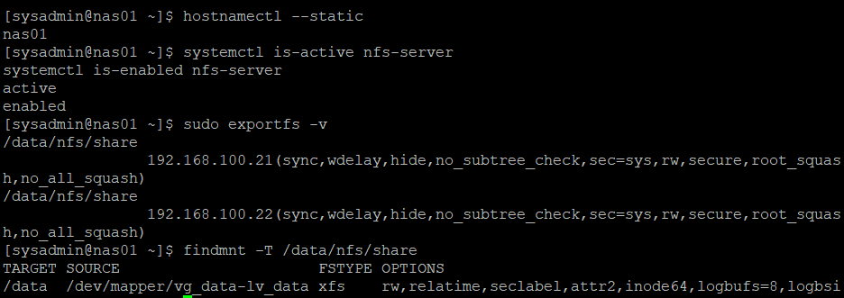
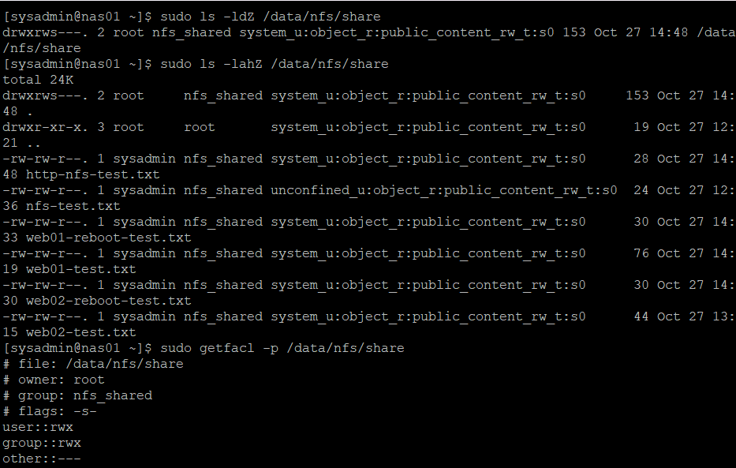
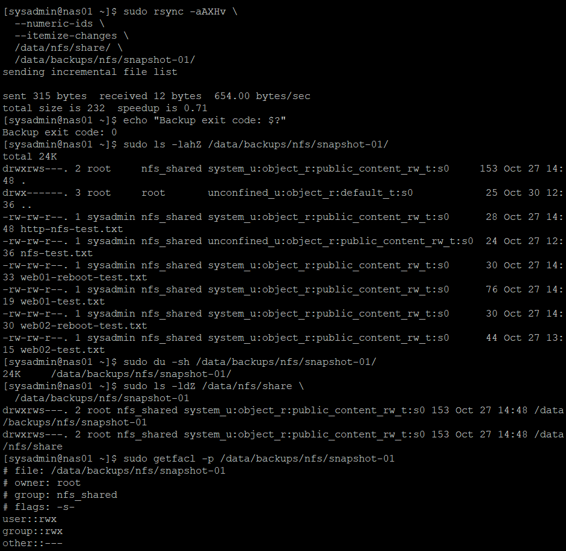
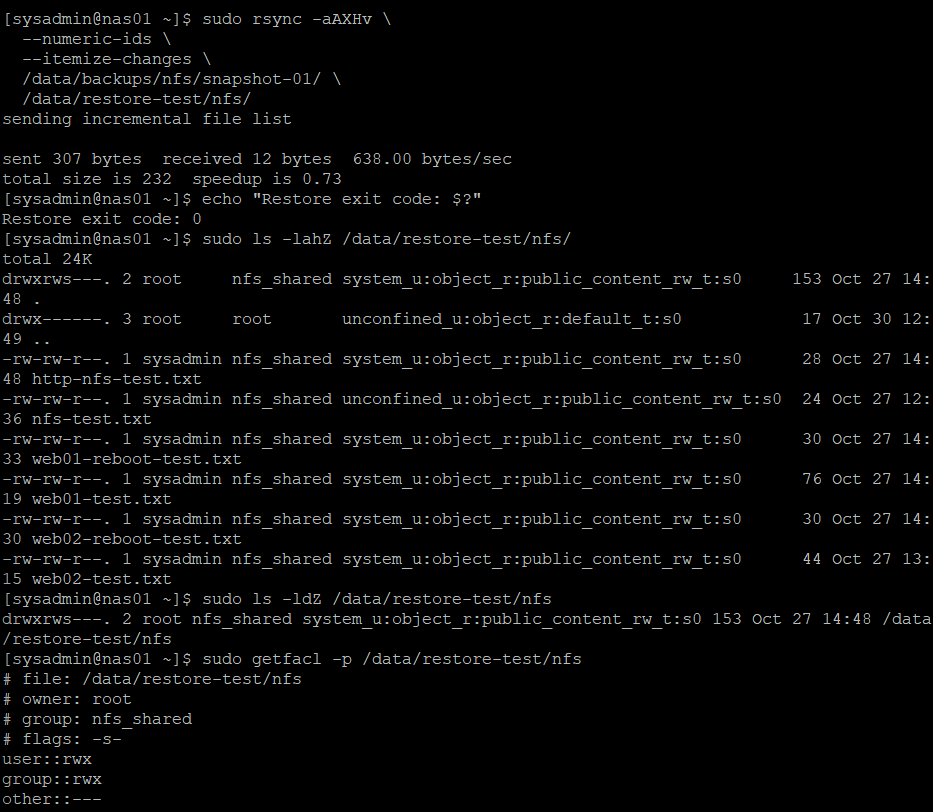
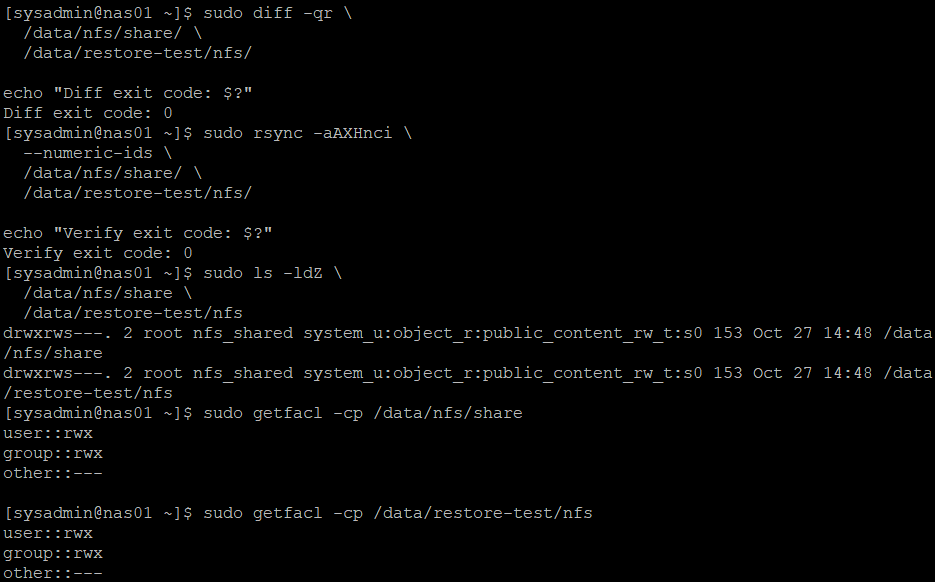
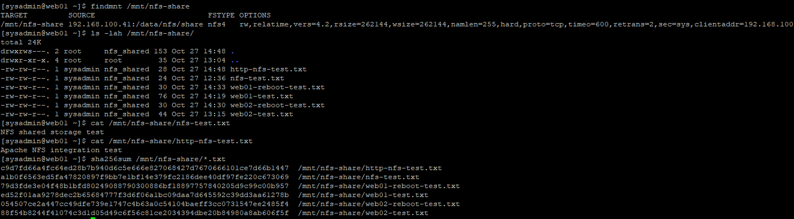

# 31. NFS 데이터 백업 및 복구 검증

## 1. 실습 개요

### 1.1 목적

Rocky Linux 9.8 기반 사내 업무 포털 인프라에서 NAS01의 NFS 공유 데이터를 백업하고 복원하여 데이터 무결성을 검증한다.

기존 NFS 공유 디렉터리 `/data/nfs/share`를 `rsync`로 백업한 뒤, 운영 공유 경로와 분리된 테스트 디렉터리에 복원한다.

복원 후 파일 내용, 소유권, 권한, ACL 및 SELinux 컨텍스트를 비교하고, WEB01에서 기존 NFS 공유에 정상적으로 접근할 수 있는지도 확인한다.

**주요 목표**

- NAS01의 NFS 서비스 및 스토리지 상태 확인
- NFS 공유 파일과 권한·ACL·SELinux 설정 확인
- `rsync` 기반 NFS 데이터 백업
- 백업 파일 및 메타데이터 보존 검증
- 별도 디렉터리에 NFS 데이터 복원
- 원본과 복원본의 데이터 무결성 비교
- WEB01 NFSv4.2 클라이언트 접근 검증
- SHA-256 해시 기반 데이터 비교
- 복원 테스트 데이터 정리 및 원본·백업본 유지 확인

### 1.2 실습 환경

| 항목 | 구성 |
|---|---|
| 가상화 | VMware Workstation |
| 운영체제 | Rocky Linux 9.8 |
| NFS 서버 | NAS01 (192.168.100.41) |
| NFS 클라이언트 | WEB01 (192.168.100.21) |
| 추가 공유 대상 | WEB02 (192.168.100.22) |
| NFS 프로토콜 | NFSv4.2 |
| 스토리지 | RAID 1 + LVM + XFS |
| LVM 장치 | `/dev/mapper/vg_data-lv_data` |
| NFS 공유 경로 | `/data/nfs/share` |
| 백업 도구 | rsync 3.2.7 |
| 백업 방식 | 로컬 rsync 논리 파일 백업 |
| 무결성 검증 | diff, rsync checksum, SHA-256 |
| 실습 일자 | 2026-10-30 |

### 1.3 백업 대상

기존 16~17단원에서 구성한 NAS01의 NFS 공유 디렉터리를 백업 대상으로 선정하였다.

원본 경로:

```text
/data/nfs/share/
```

기존 공유 파일은 다음과 같다.

| 파일명 | 크기 |
|---|---:|
| `http-nfs-test.txt` | 28B |
| `nfs-test.txt` | 24B |
| `web01-reboot-test.txt` | 30B |
| `web01-test.txt` | 76B |
| `web02-reboot-test.txt` | 30B |
| `web02-test.txt` | 44B |

총 6개 파일, 논리적 파일 크기 합계 232바이트를 대상으로 실습하였다.

---

## 2. NFS 백업 및 복원 구성

### 2.1 전체 구성

```text
                    NAS01
               192.168.100.41

    ┌────────────────────────────────┐
    │ RAID 1 + LVM + XFS             │
    │                                │
    │ /data/nfs/share/               │
    │ └── NFS 원본 파일 6개          │
    │           │                    │
    │           ▼                    │
    │     rsync -aAXH                │
    │           │                    │
    │           ▼                    │
    │ /data/backups/nfs/             │
    │ └── snapshot-01/               │
    │     └── 백업 파일 6개          │
    │           │                    │
    │           ▼                    │
    │       rsync 복원               │
    │           │                    │
    │           ▼                    │
    │ /data/restore-test/nfs/        │
    │ └── 복원 파일 6개              │
    │                                │
    │ diff / rsync / ACL 비교        │
    └───────────────┬────────────────┘
                    │
                    │ NFSv4.2
                    ▼
                   WEB01
              192.168.100.21

          /mnt/nfs-share/
                  │
                  ▼
          파일 읽기 및 SHA-256
```

### 2.2 주요 디렉터리

| 구분 | 경로 | 용도 |
|---|---|---|
| NFS 원본 | `/data/nfs/share/` | 운영 공유 파일 |
| 백업 상위 디렉터리 | `/data/backups/nfs/` | NFS 백업 관리 |
| 백업본 | `/data/backups/nfs/snapshot-01/` | 원본 데이터 백업 |
| 복원 테스트 상위 디렉터리 | `/data/restore-test/` | 복원 검증 |
| 복원 테스트 경로 | `/data/restore-test/nfs/` | 복원 데이터 비교 |
| WEB01 NFS 마운트 | `/mnt/nfs-share/` | 클라이언트 접근 |

원본과 복원본을 분리하여 실제 NFS 공유 데이터를 덮어쓰지 않도록 구성하였다.

---

## 3. NAS01 NFS 환경 점검

### 3.1 스토리지 마운트 확인

NAS01에서 다음 명령어를 실행하였다.

```bash
findmnt -T /data/nfs/share

df -hT /data
```

**결과**

```text
TARGET SOURCE                      FSTYPE
/data  /dev/mapper/vg_data-lv_data xfs

Filesystem                  Type  Size  Used Avail Use% Mounted on
/dev/mapper/vg_data-lv_data xfs   8.0G  100M  7.9G   2% /data
```

NFS 공유 디렉터리가 XFS 파일시스템을 사용하는 LVM 논리 볼륨에 위치함을 확인하였다.

전체 용량은 8GB이고 약 7.9GB의 여유 공간이 있었다.

### 3.2 NFS 서비스 확인

```bash
systemctl is-active nfs-server

systemctl is-enabled nfs-server
```

**결과**

```text
active
enabled
```

NFS 서비스가 정상적으로 실행 중이며 부팅 시 자동 시작되도록 구성되어 있었다.

### 3.3 NFS Export 설정 확인

```bash
sudo exportfs -v
```

**결과**

```text
/data/nfs/share
    192.168.100.21(sync,wdelay,hide,no_subtree_check,sec=sys,rw,secure,root_squash,no_all_squash)

/data/nfs/share
    192.168.100.22(sync,wdelay,hide,no_subtree_check,sec=sys,rw,secure,root_squash,no_all_squash)
```

WEB01과 WEB02에 대해 NFS 공유가 설정되어 있음을 확인하였다.

주요 설정은 다음과 같다.

| 옵션 | 의미 |
|---|---|
| `rw` | 읽기·쓰기 허용 |
| `sync` | 동기식 쓰기 처리 |
| `root_squash` | NFS 클라이언트의 root 권한 매핑 제한 |
| `no_subtree_check` | 하위 디렉터리 검사 비활성화 |
| `sec=sys` | AUTH_SYS 기반 사용자 인증 |

**NAS01 — NFS 서비스 및 공유 설정**



### 3.4 NFS 원본 파일 확인

```bash
sudo ls -ldZ /data/nfs/share

sudo ls -lahZ /data/nfs/share

sudo du -sh /data/nfs/share
```

**결과**

```text
drwxrws---. 2 root nfs_shared system_u:object_r:public_content_rw_t:s0 153 Oct 27 14:48 /data/nfs/share
```

파일 목록:

```text
http-nfs-test.txt          28B
nfs-test.txt               24B
web01-reboot-test.txt      30B
web01-test.txt             76B
web02-reboot-test.txt      30B
web02-test.txt             44B
```

디스크 사용량:

```text
24K /data/nfs/share
```

원본 NFS 공유 디렉터리에 6개 파일이 존재하였다.

### 3.5 권한 및 SELinux 확인

원본 공유 디렉터리의 설정은 다음과 같았다.

| 항목 | 설정 |
|---|---|
| 소유자 | `root` |
| 그룹 | `nfs_shared` |
| 권한 | `2770` |
| setgid | 설정 |
| SELinux 타입 | `public_content_rw_t` |

`2770` 권한에서 setgid 비트는 공유 디렉터리 내 새 파일이나 하위 디렉터리의 그룹 상속에 사용된다.

SELinux는 기존 NFS 공유 경로에 설정한 `public_content_rw_t` 타입을 사용하고 있었다.

### 3.6 ACL 확인

```bash
sudo getfacl -p /data/nfs/share
```

**결과**

```text
# file: /data/nfs/share
# owner: root
# group: nfs_shared
# flags: -s-
user::rwx
group::rwx
other::---
```

기본 ACL 항목을 확인하였다.

추가적인 사용자 또는 그룹별 확장 ACL 항목은 존재하지 않았다.

**NAS01 — NFS 원본 파일·권한·ACL**



### 3.7 rsync 버전 확인

```bash
command -v rsync

rsync --version | head -n 1
```

**결과**

```text
/usr/bin/rsync
rsync  version 3.2.7  protocol version 31
```

기존 28단원에서 설치한 rsync를 사용할 수 있음을 확인하였다.

---

## 4. NFS 백업 디렉터리 구성

### 4.1 백업 상위 디렉터리 생성

```bash
sudo install -d -o root -g root -m 700 /data/backups/nfs
```

생성 결과 확인:

```bash
sudo ls -ld /data/backups/nfs
```

**결과**

```text
drwx------. 2 root root 6 Oct 30 12:31 /data/backups/nfs
```

백업 상위 디렉터리를 `root:root`, 권한 `700`으로 구성하였다.

일반 사용자가 백업 데이터에 직접 접근하지 못하도록 제한하였다.

### 4.2 백업 경로 충돌 확인

```bash
sudo test ! -e /data/backups/nfs/snapshot-01 \
  && echo "PASS: New snapshot path"
```

**결과**

```text
PASS: New snapshot path
```

기존 백업 디렉터리와 충돌하지 않음을 확인하였다.

---

## 5. rsync 기반 NFS 데이터 백업

### 5.1 백업 Dry Run

실제 백업 전에 rsync Dry Run 기능으로 복사 대상을 확인하였다.

```bash
sudo rsync -aAXHvn \
  --numeric-ids \
  --itemize-changes \
  /data/nfs/share/ \
  /data/backups/nfs/snapshot-01/
```

**결과**

```text
sending incremental file list
created directory /data/backups/nfs/snapshot-01
cd+++++++++ ./
>f+++++++++ http-nfs-test.txt
>f+++++++++ nfs-test.txt
>f+++++++++ web01-reboot-test.txt
>f+++++++++ web01-test.txt
>f+++++++++ web02-reboot-test.txt
>f+++++++++ web02-test.txt

sent 336 bytes  received 89 bytes  850.00 bytes/sec
total size is 232  speedup is 0.55 (DRY RUN)
```

백업 대상 파일 6개와 디렉터리 생성 대상이 확인되었다.

`-n` 옵션으로 실제 데이터를 변경하지 않고 복사 예정 목록만 확인하였다.

### 5.2 rsync 옵션 설명

| 옵션 | 의미 |
|---|---|
| `-a` | 재귀 복사와 기본 파일 메타데이터 보존 |
| `-A` | ACL 보존 |
| `-X` | 확장 속성 보존 |
| `-H` | 하드링크 관계 보존 |
| `-v` | 상세 출력 |
| `-n` | Dry Run |
| `-c` | 파일 체크섬 기반 내용 비교 |
| `-i` | 항목별 변경 정보 표시 |
| `--numeric-ids` | UID/GID를 숫자 기준으로 처리 |
| `--itemize-changes` | 변경된 파일과 속성 표시 |

이번 실습에서는 파일 내용 외에 권한, 소유권, ACL 및 SELinux 컨텍스트도 복원할 수 있도록 `-aAXH`를 사용하였다.

메타데이터를 보존하기 위해 NAS01에서 `sudo` 권한으로 rsync를 실행하였다.

### 5.3 NFS 데이터 실제 백업

```bash
sudo rsync -aAXHv \
  --numeric-ids \
  --itemize-changes \
  /data/nfs/share/ \
  /data/backups/nfs/snapshot-01/

echo "Backup exit code: $?"
```

**결과**

```text
sending incremental file list
created directory /data/backups/nfs/snapshot-01
cd+++++++++ ./
>f+++++++++ http-nfs-test.txt
>f+++++++++ nfs-test.txt
>f+++++++++ web01-reboot-test.txt
>f+++++++++ web01-test.txt
>f+++++++++ web02-reboot-test.txt
>f+++++++++ web02-test.txt

sent 909 bytes  received 198 bytes  2,214.00 bytes/sec
total size is 232  speedup is 0.21

Backup exit code: 0
```

파일 6개가 백업 대상으로 처리되었으며 rsync가 정상 종료되었다.

### 5.4 백업 파일 확인

```bash
sudo ls -lahZ /data/backups/nfs/snapshot-01/

sudo du -sh /data/backups/nfs/snapshot-01/
```

**결과**

```text
http-nfs-test.txt          28B
nfs-test.txt               24B
web01-reboot-test.txt      30B
web01-test.txt             76B
web02-reboot-test.txt      30B
web02-test.txt             44B

24K /data/backups/nfs/snapshot-01/
```

백업 경로에 6개 파일이 존재하고 원본과 동일한 파일 크기가 확인되었다.

### 5.5 백업본 소유권 및 SELinux 확인

```bash
sudo ls -ldZ /data/nfs/share \
  /data/backups/nfs/snapshot-01
```

**결과**

```text
drwxrws---. 2 root nfs_shared system_u:object_r:public_content_rw_t:s0 153 Oct 27 14:48 /data/backups/nfs/snapshot-01
drwxrws---. 2 root nfs_shared system_u:object_r:public_content_rw_t:s0 153 Oct 27 14:48 /data/nfs/share
```

두 디렉터리의 소유권, 그룹, 권한 및 SELinux 컨텍스트가 동일하였다.

### 5.6 백업본 ACL 확인

```bash
sudo getfacl -p /data/backups/nfs/snapshot-01
```

**결과**

```text
# file: /data/backups/nfs/snapshot-01
# owner: root
# group: nfs_shared
# flags: -s-
user::rwx
group::rwx
other::---
```

원본 디렉터리와 동일한 ACL 항목을 확인하였다.

**NAS01 — NFS 데이터 rsync 백업**



참고로 백업 명령어를 다시 실행했을 때는 전송할 변경 파일이 없어 추가 파일 목록이 출력되지 않았다.

### 5.7 원본과 백업본의 체크섬 비교

```bash
sudo rsync -aAXHnci \
  --numeric-ids \
  /data/nfs/share/ \
  /data/backups/nfs/snapshot-01/
```

**결과**

```text
(변경 항목 출력 없음)
```

rsync가 확인한 범위에서 원본과 백업본의 파일 내용 및 보존 대상 메타데이터에 차이가 발견되지 않았다.

---

## 6. NFS 데이터 복원

### 6.1 복원 방식

운영 NFS 공유 디렉터리인 `/data/nfs/share`에 직접 복원하지 않고 별도 테스트 경로에 복원하였다.

복원 경로:

```text
/data/restore-test/nfs/
```

실제 공유 데이터를 덮어쓰지 않고 복구 절차를 검증하기 위한 구성이다.

### 6.2 복원 테스트 상위 디렉터리 생성

```bash
sudo install -d -o root -g root -m 700 /data/restore-test

sudo ls -ld /data/restore-test
```

복원 테스트 상위 디렉터리를 별도로 생성하고 일반 사용자 접근을 제한하였다.

### 6.3 복원 대상 경로 충돌 확인

```bash
sudo test ! -e /data/restore-test/nfs \
  && echo "PASS: New restore path"
```

복원 대상 경로가 기존 데이터와 충돌하지 않는지 확인하는 용도로 사용하였다.

### 6.4 백업 파일 복원

```bash
sudo rsync -aAXHv \
  --numeric-ids \
  --itemize-changes \
  /data/backups/nfs/snapshot-01/ \
  /data/restore-test/nfs/

echo "Restore exit code: $?"
```

**복원 검증 시 확인한 결과**

```text
sending incremental file list

sent 307 bytes  received 12 bytes  638.00 bytes/sec
total size is 232  speedup is 0.73

Restore exit code: 0
```

확인 화면은 복원 경로에 파일이 이미 존재하는 상태에서 rsync를 다시 실행한 결과로, 재전송할 변경 파일이 없었다.

복원 대상 경로에 백업 파일 6개가 존재하고 복원 검증 명령어가 정상 종료된 것을 확인하였다.

### 6.5 복원 파일 확인

```bash
sudo ls -lahZ /data/restore-test/nfs/

sudo ls -ldZ /data/restore-test/nfs
```

**결과**

```text
http-nfs-test.txt          28B
nfs-test.txt               24B
web01-reboot-test.txt      30B
web01-test.txt             76B
web02-reboot-test.txt      30B
web02-test.txt             44B
```

복원된 디렉터리의 메타데이터:

```text
drwxrws---. 2 root nfs_shared system_u:object_r:public_content_rw_t:s0 153 Oct 27 14:48 /data/restore-test/nfs
```

복원 경로에서도 기존 파일 6개와 원본 디렉터리의 권한 및 SELinux 컨텍스트가 확인되었다.

### 6.6 복원 디렉터리 ACL 확인

```bash
sudo getfacl -p /data/restore-test/nfs
```

**결과**

```text
# file: /data/restore-test/nfs
# owner: root
# group: nfs_shared
# flags: -s-
user::rwx
group::rwx
other::---
```

복원 디렉터리에서 원본과 동일한 ACL 항목이 확인되었다.

**NAS01 — NFS 데이터 별도 경로 복원**



---

## 7. 원본과 복원본 데이터 무결성 검증

### 7.1 파일 내용 및 목록 비교

```bash
sudo diff -qr \
  /data/nfs/share/ \
  /data/restore-test/nfs/

echo "Diff exit code: $?"
```

**결과**

```text
Diff exit code: 0
```

두 디렉터리 사이에서 파일 내용 및 목록의 차이가 발견되지 않았다.

### 7.2 rsync 체크섬 및 메타데이터 비교

```bash
sudo rsync -aAXHnci \
  --numeric-ids \
  /data/nfs/share/ \
  /data/restore-test/nfs/

echo "Verify exit code: $?"
```

**결과**

```text
Verify exit code: 0
```

변경 파일 목록도 출력되지 않았다.

따라서 rsync가 확인한 파일 내용 및 메타데이터에서 차이가 발견되지 않았다.

### 7.3 디렉터리 권한 및 SELinux 비교

```bash
sudo ls -ldZ \
  /data/nfs/share \
  /data/restore-test/nfs
```

**결과**

```text
drwxrws---. 2 root nfs_shared system_u:object_r:public_content_rw_t:s0 153 Oct 27 14:48 /data/nfs/share
drwxrws---. 2 root nfs_shared system_u:object_r:public_content_rw_t:s0 153 Oct 27 14:48 /data/restore-test/nfs
```

두 디렉터리의 소유자, 그룹, 권한, 수정 시간 및 SELinux 컨텍스트가 동일하였다.

### 7.4 ACL 비교

```bash
sudo getfacl -cp /data/nfs/share

sudo getfacl -cp /data/restore-test/nfs
```

**결과**

원본:

```text
user::rwx
group::rwx
other::---
```

복원본:

```text
user::rwx
group::rwx
other::---
```

ACL 항목이 동일하였다.

### 7.5 검증 결과

| 항목 | 결과 |
|---|---|
| 파일 수 | 원본·복원본 6개 |
| `diff -qr` | 차이 없음 |
| `rsync -aAXHnci` | 차이 없음 |
| 소유자 | `root` |
| 그룹 | `nfs_shared` |
| 디렉터리 권한 | `2770` |
| SELinux 타입 | `public_content_rw_t` |
| ACL | 동일 |

**NAS01 — NFS 복원 데이터 무결성 검증**



이번 실습에서 확인한 범위에서는 원본과 복원본의 파일 내용 및 보존 대상 메타데이터가 일치하였다.

---

## 8. WEB01 NFS 클라이언트 연동 검증

### 8.1 검증 목적

NAS01에서 백업 및 복원 테스트를 완료한 후, 기존 NFS 공유가 WEB01에서도 정상적으로 접근되는지 확인하였다.

WEB01에서는 원본 공유 데이터의 읽기 작업만 수행하였다.

### 8.2 WEB01 사용자 및 네트워크 확인

```bash
hostnamectl --static

id
```

**결과**

```text
web01

uid=1000(sysadmin) gid=1000(sysadmin)
groups=1000(sysadmin),10(wheel),3000(nfs_shared)
```

WEB01의 `sysadmin` 사용자가 NFS 공유 접근에 사용하는 `nfs_shared` 그룹에 속해 있음을 확인하였다.

### 8.3 WEB01 NFS 마운트 확인

```bash
findmnt /mnt/nfs-share
```

**결과**

```text
TARGET          SOURCE                         FSTYPE
/mnt/nfs-share  192.168.100.41:/data/nfs/share nfs4
```

기존 NFS 공유가 WEB01의 `/mnt/nfs-share`에 마운트되어 있었다.

마운트 옵션에서 `vers=4.2`, `rw`, `proto=tcp` 등을 확인하였다.

### 8.4 WEB01 네트워크 경로 확인

```bash
ip -4 route get 192.168.100.41
```

**결과**

```text
192.168.100.41 dev ens192 src 192.168.100.21 uid 1000
    cache
```

WEB01이 Host-only 네트워크 인터페이스 `ens192` 및 내부 IP `192.168.100.21`을 통해 NAS01에 접근하도록 라우팅되는 것을 확인하였다.

### 8.5 NFS 공유 파일 목록 확인

```bash
ls -lah /mnt/nfs-share/
```

**결과**

```text
http-nfs-test.txt
nfs-test.txt
web01-reboot-test.txt
web01-test.txt
web02-reboot-test.txt
web02-test.txt
```

기존 공유 파일 6개가 모두 조회되었다.

### 8.6 NFS 공유 파일 읽기

```bash
cat /mnt/nfs-share/nfs-test.txt

cat /mnt/nfs-share/http-nfs-test.txt
```

**결과**

```text
NFS shared storage test
Apache NFS integration test
```

WEB01에서 NAS01의 기존 NFS 공유 데이터를 정상적으로 읽을 수 있었다.

### 8.7 WEB01 SHA-256 확인

```bash
sha256sum /mnt/nfs-share/*.txt
```

6개 파일에 대해 SHA-256 값을 계산하였다.

### 8.8 NAS01 SHA-256 확인

NAS01의 `sysadmin` 계정은 원본 공유 디렉터리에 직접 접근할 수 있는 권한이 제한되어 있었다.

```bash
sudo sh -c 'sha256sum /data/nfs/share/*.txt'
```

**결과**

```text
c9d7fd66a4fc64ed28b7b940d6c5e666e827068427d7670666101ce7d66b1447  /data/nfs/share/http-nfs-test.txt
a1b0f6563ed5fa47820897f9bb7e1bf14e379fc2186dee40df97fe220c673069  /data/nfs/share/nfs-test.txt
79d3fde3e04f48b1bfd80249088790300886bf18897757840205d9c99c00b957  /data/nfs/share/web01-reboot-test.txt
ed52f01aa9278dec2b65684777f3d6f06a1bc09daa7d645592c39dd3aa61278b  /data/nfs/share/web01-test.txt
054507ce2a447cc49dfe739e1747c4b63a0c54104baeff3cc0731547ee2485f4  /data/nfs/share/web02-reboot-test.txt
88f54b8244f41074c3d1d05d49c6f56c81ce2034394dbe20b84980a8ab606f5f  /data/nfs/share/web02-test.txt
```

### 8.9 WEB01과 NAS01 해시값 비교

| 파일 | SHA-256 비교 |
|---|---|
| http-nfs-test.txt | 일치 |
| nfs-test.txt | 일치 |
| web01-reboot-test.txt | 일치 |
| web01-test.txt | 일치 |
| web02-reboot-test.txt | 일치 |
| web02-test.txt | 일치 |

WEB01과 NAS01에서 계산한 6개 파일의 해시값이 모두 일치하였다.

따라서 WEB01이 NAS01의 기존 NFS 원본 데이터를 변경 없이 읽고 있음을 검증하였다.

**WEB01 — NFS 클라이언트 연동 검증**



---

## 9. 복원 테스트 환경 정리

### 9.1 정리 목적

백업 및 복원 검증을 완료한 후, 실습용 복원 디렉터리만 삭제하였다.

원본 NFS 공유 데이터와 백업 파일은 유지하였다.

### 9.2 복원 테스트 디렉터리 확인

```bash
sudo ls -ld /data/restore-test/nfs

sudo ls -lah /data/restore-test/nfs
```

**결과**

```text
drwxrws---. 2 root nfs_shared 153 Oct 27 14:48 /data/restore-test/nfs
```

복원 디렉터리에 기존 6개 파일이 존재하였다.

### 9.3 별도 마운트 여부 확인

```bash
findmnt --mountpoint /data/restore-test/nfs
```

**결과**

```text
(출력 없음)
```

복원 테스트 디렉터리 자체가 별도 마운트 지점으로 사용되고 있지 않음을 확인하였다.

### 9.4 복원 테스트 디렉터리 삭제

```bash
sudo rm -r -- /data/restore-test/nfs
```

기존 공유 경로나 백업 경로가 아닌 복원 테스트 경로만 삭제하였다.

### 9.5 복원 테스트 디렉터리 삭제 확인

```bash
sudo test ! -e /data/restore-test/nfs \
  && echo "PASS: Restore test removed"
```

**결과**

```text
PASS: Restore test removed
```

### 9.6 NFS 원본 유지 확인

```bash
sudo test -d /data/nfs/share \
  && echo "PASS: NFS source preserved"
```

**결과**

```text
PASS: NFS source preserved
```

### 9.7 NFS 백업본 유지 확인

```bash
sudo test -d /data/backups/nfs/snapshot-01 \
  && echo "PASS: NFS backup preserved"
```

**결과**

```text
PASS: NFS backup preserved
```

### 9.8 원본 및 백업본 파일 확인

```bash
sudo ls /data/nfs/share

sudo ls /data/backups/nfs/snapshot-01
```

두 경로에서 동일한 파일 6개를 확인하였다.

```text
http-nfs-test.txt
nfs-test.txt
web01-reboot-test.txt
web01-test.txt
web02-reboot-test.txt
web02-test.txt
```

복원 테스트 환경을 정리한 뒤에도 원본 및 백업본이 정상적으로 유지되었다.

---

## 10. 최종 백업 구조

```text
NAS01
└── /data/
    ├── nfs/
    │   └── share/
    │       ├── http-nfs-test.txt
    │       ├── nfs-test.txt
    │       ├── web01-reboot-test.txt
    │       ├── web01-test.txt
    │       ├── web02-reboot-test.txt
    │       └── web02-test.txt
    │
    ├── backups/
    │   ├── web01/
    │   │   ├── snapshot-01/
    │   │   └── current/
    │   │
    │   ├── db01/
    │   │   └── portal_db_2026-10-30.sql
    │   │
    │   └── nfs/
    │       └── snapshot-01/
    │           ├── http-nfs-test.txt
    │           ├── nfs-test.txt
    │           ├── web01-reboot-test.txt
    │           ├── web01-test.txt
    │           ├── web02-reboot-test.txt
    │           └── web02-test.txt
    │
    └── restore-test/
        └── (복원 테스트 디렉터리 정리 완료)
```

이번 실습을 통해 NAS01의 백업 저장소에 WEB01 파일, DB01 데이터베이스 및 NFS 공유 데이터에 대한 백업 경로를 구성하였다.

---

## 11. 백업 및 복원 시 고려 사항

### 11.1 동일 스토리지 내 백업의 한계

이번 실습의 원본과 백업본은 모두 NAS01의 `/data` 파일시스템에 저장되어 있다.

따라서 원본 파일의 실수 삭제나 변경에 대응하는 복원 실습은 가능하지만, NAS01 자체 장애나 `/data` 파일시스템 손상 시 원본과 백업본을 동시에 잃을 수 있다.

실제 운영 환경에서는 별도 스토리지 또는 원격 백업 서버에 추가 사본을 보관하는 것이 필요하다.

### 11.2 RAID 1과 백업의 차이

RAID 1은 디스크 장애에 대한 가용성을 제공하지만 파일 삭제, 논리적 데이터 손상, 시스템 전체 장애를 복구하는 백업을 대체하지 않는다.

### 11.3 rsync와 메타데이터 보존

NFS 공유 데이터는 UID/GID, setgid, ACL 및 SELinux 컨텍스트가 중요하다.

따라서 이번 실습에서는 `-aAXH` 옵션과 `--numeric-ids`를 사용하였다.

또한 복원 후 `ls -Z`, `getfacl`, `diff`, rsync 검증 명령어로 실제 보존 결과를 확인하였다.

### 11.4 SELinux 컨텍스트와 경로 정책

이번 백업과 복원은 동일한 XFS 파일시스템 내에서 수행하였으며 SELinux 확장 속성을 보존하였다.

다만 백업 및 복원 경로는 기존 NFS 공유 경로와 다른 SELinux 파일 컨텍스트 정책의 적용 대상일 수 있다.

따라서 백업 파일을 실제 운영 경로로 복구할 경우에는 해당 경로의 SELinux 정책과 `restorecon` 적용 여부를 별도로 검토해야 한다.

### 11.5 정기 백업의 필요성

이번 실습은 수동으로 백업 및 복원 기능을 검증하였다.

백업 시점 이후 변경되는 파일은 기존 백업본에 자동 반영되지 않는다.

실제 운영에서는 백업 주기, 보존 기간, 파일 삭제 대응, 원격 백업 및 정기적인 복원 검증이 필요하다.

---

## 12. 최종 검증 결과

| 검증 항목 | 결과 | 상태 |
|---|---|---|
| NAS01 NFS 서비스 | active | 정상 |
| 부팅 시 자동 시작 | enabled | 정상 |
| NFS 공유 대상 | WEB01, WEB02 | 정상 |
| NFS 보안 설정 | root_squash | 확인 |
| NFS 원본 경로 | `/data/nfs/share` | 정상 |
| 파일시스템 | XFS | 정상 |
| LVM 저장소 | `vg_data/lv_data` | 정상 |
| 원본 파일 | 6개 | 정상 |
| 원본 사용량 | 24KB | 확인 |
| rsync 버전 | 3.2.7 | 정상 |
| 백업 상위 경로 권한 | 700 | 정상 |
| 백업 Dry Run | 6개 파일 확인 | 성공 |
| rsync 백업 | 종료 코드 0 | 성공 |
| 백업본 파일 | 6개 | 정상 |
| 백업본 권한 | root:nfs_shared, 2770 | 정상 |
| 백업본 ACL | 원본과 일치 | 정상 |
| 백업본 SELinux | 원본과 일치 | 정상 |
| 별도 경로 복원 검증 | 종료 코드 0 | 성공 |
| 복원본 파일 | 6개 | 정상 |
| `diff -qr` | 종료 코드 0 | 일치 |
| rsync 체크섬 검증 | 변경 목록 없음, 종료 코드 0 | 일치 |
| 복원 디렉터리 권한 | 원본과 일치 | 정상 |
| 복원 디렉터리 ACL | 원본과 일치 | 정상 |
| 복원 디렉터리 SELinux | 원본과 일치 | 정상 |
| WEB01 NFS 마운트 | NFSv4.2 | 정상 |
| WEB01 파일 읽기 | 성공 | 정상 |
| WEB01·NAS01 SHA-256 | 6개 모두 일치 | 성공 |
| 복원 테스트 정리 | 삭제 완료 | 성공 |
| NFS 원본 유지 | 확인 | 정상 |
| NFS 백업본 유지 | 확인 | 정상 |

---

## 13. 실습을 통해 배운 점

### 13.1 NFS 데이터 백업

기존 NFS 공유 데이터를 `rsync`로 별도 디렉터리에 백업하는 방법을 학습하였다.

### 13.2 파일 메타데이터 보존

파일 내용뿐 아니라 소유권, 권한, ACL 및 SELinux 확장 속성을 함께 보존하고 검증하는 방법을 학습하였다.

### 13.3 안전한 복원 검증

운영 NFS 공유 경로를 직접 수정하지 않고 별도 디렉터리에 복원하여 데이터 손상 위험을 줄였다.

### 13.4 데이터 무결성 확인

`diff`, rsync 체크섬 비교, SHA-256을 이용하여 원본·백업본·복원본 및 NFS 클라이언트에서 읽은 파일의 일치 여부를 검증하였다.

### 13.5 Linux 권한과 셸 동작

`sudo` 실행 전에 와일드카드가 확장된다는 점을 확인하였으며, 권한이 제한된 디렉터리에서는 관리자 셸 내부에서 파일 패턴을 확장하는 방법을 사용하였다.

---

## 14. 최종 결과

이번 실습에서는 NAS01의 NFS 공유 데이터 6개 파일을 대상으로 rsync 백업과 복원 검증을 수행하였다.

기존 공유 디렉터리의 소유권, 그룹, setgid 권한, ACL 및 SELinux 컨텍스트를 확인한 후, `rsync -aAXH`를 이용하여 백업하였다.

백업 파일을 별도 디렉터리에 복원하고 `diff -qr` 및 rsync 체크섬 검증을 통해 원본과 복원본의 파일 내용 및 주요 메타데이터가 일치함을 확인하였다.

또한 WEB01에서 NFSv4.2 공유에 접근하여 파일을 읽고, NAS01 원본 파일과 SHA-256 해시값이 일치하는 것을 확인하였다.

마지막으로 복원 테스트 디렉터리만 삭제하고 NFS 원본 및 백업본이 유지되는 것을 검증하였다.

**최종 성과: NFS 데이터 백업, 별도 경로 복원, 파일 및 메타데이터 무결성 검증, WEB01 NFS 연동 확인 완료**

### 관련 문서

- [14. RAID 구성, 디스크 장애 및 복구 검증](./14-raid.md)
- [15. LVM 논리 볼륨 구성 및 용량 확장](./15-lvm.md)
- [16. NAS01 NFS 공유 스토리지 구축](./16-nfs-server.md)
- [17. WEB01/WEB02 NFS 연동 및 파일 권한 검증](./17-nfs-client.md)
- [28. Bash·rsync 기반 파일 백업 및 복구 검증](./28-file-backup.md)
- [29. cron 기반 파일 백업 자동화](./29-cron-backup.md)
- [30. MariaDB 데이터베이스 백업 및 복구 검증](./30-mariadb-backup.md)