# 32. 통합 장애 시나리오 및 서비스 복구

## 1. 실습 개요

### 1.1 목적

Rocky Linux 9.8 기반 사내 업무 포털 인프라에서 실제 서비스 운영 중 발생할 수 있는 장애를 의도적으로 재현하고, 장애 영향 분석과 서비스 복구 과정을 검증한다.

기존 실습에서 구축한 Apache/PHP, MariaDB, NAS 백업 시스템 및 HAProxy를 대상으로 세 가지 장애 시나리오를 수행한다.

단순히 서비스를 재시작하는 것에 그치지 않고, 장애 발생 전 정상 상태와 장애 중 영향 범위, 시스템 로그, 복구 후 서비스 응답 및 데이터 무결성을 비교한다.

**주요 목표**

- 장애 발생 전 서비스 정상 상태 확인
- MariaDB 장애 발생 및 업무 포털 복구 검증
- NAS01 SSH 장애에 따른 rsync 백업 실패 분석
- SSH 복구 후 백업 재실행 및 데이터 무결성 검증
- HAProxy 장애 발생 시 웹 서비스 접근 영향 분석
- HAProxy 복구 후 HTTP 서비스 정상화 검증
- 서비스별 장애 원인과 영향 범위 구분
- 장애 발생부터 복구까지의 절차 문서화

### 1.2 실습 환경

| 항목 | 구성 |
|---|---|
| 가상화 환경 | VMware Workstation |
| 운영체제 | Rocky Linux 9.8 |
| 웹 서버 | Apache HTTP Server |
| 애플리케이션 | PHP / PHP-FPM |
| 데이터베이스 | MariaDB |
| 로드밸런서 | HAProxy |
| 백업 방식 | Bash + rsync + SSH |
| 자동 백업 | cron |
| 통신 네트워크 | VMnet2 Host-only |
| 내부 네트워크 | 192.168.100.0/24 |
| 실습 일자 | 2026-10-30 |

### 1.3 서버 구성

| 서버 | IP 주소 | 역할 |
|---|---|---|
| LB01 | 192.168.100.10 | HAProxy 로드밸런서 |
| WEB01 | 192.168.100.21 | Apache/PHP 업무 포털 |
| WEB02 | 192.168.100.22 | Apache/PHP 백엔드 |
| DB01 | 192.168.100.31 | MariaDB 데이터베이스 |
| NAS01 | 192.168.100.41 | NFS 및 백업 저장소 |
| MON01 | 192.168.100.51 | Prometheus/Grafana 모니터링 |

VMware 호스트의 RAM 16GB 환경을 고려하여 시나리오별로 필요한 서버만 실행하였다.

### 1.4 장애 시나리오

| 시나리오 | 대상 | 장애 유형 | 주요 검증 |
|---|---|---|---|
| A | DB01 | MariaDB 서비스 중지 | 데이터베이스 및 포털 복구 |
| B | NAS01 | SSH 서비스 중지 | 원격 백업 실패 및 재실행 |
| C | LB01 | HAProxy 서비스 중지 | 로드밸런서 경유 HTTP 복구 |

---

## 2. 인프라 구성 및 장애 검증 방식

### 2.1 전체 서비스 구조

```text
                 Windows Host
                  192.168.100.1
                        |
                        |
                 VMnet2 Host-only
                        |
                        v
              ┌──────────────────┐
              │ LB01             │
              │ HAProxy          │
              │ 192.168.100.10   │
              └────────┬─────────┘
                       |
            ┌──────────┴──────────┐
            |                     |
            v                     v
   ┌────────────────┐   ┌────────────────┐
   │ WEB01          │   │ WEB02          │
   │ Apache/PHP     │   │ Apache/PHP     │
   │ 192.168.100.21 │   │ 192.168.100.22 │
   └────────┬───────┘   └────────┬───────┘
            |                    |
            └─────────┬──────────┘
                      |
                      v
             ┌────────────────┐
             │ DB01           │
             │ MariaDB        │
             │ 192.168.100.31 │
             └────────────────┘

   WEB01
      |
      | rsync + SSH
      v
   ┌────────────────┐
   │ NAS01          │
   │ NFS / Backup   │
   │ 192.168.100.41 │
   └────────────────┘
```

시나리오 A에서는 WEB01과 DB01을, 시나리오 B에서는 WEB01과 NAS01을, 시나리오 C에서는 WEB01과 LB01을 실행하였다.

### 2.2 장애 분석 절차

각 시나리오에서는 다음 순서를 적용하였다.

```text
정상 상태 확인
       |
       v
장애 발생
       |
       v
서비스 상태 확인
       |
       v
장애 영향 범위 분석
       |
       v
시스템 및 애플리케이션 로그 확인
       |
       v
서비스 복구
       |
       v
기능 및 데이터 검증
       |
       v
복구 완료
```

장애를 재현할 때에는 실제 운영 파일이나 데이터베이스를 삭제하지 않고, `systemctl stop`을 이용하여 서비스만 일시 중지하였다.

복구 과정에서는 `systemctl start`를 사용하였다.

### 2.3 검증에 사용한 주요 도구

| 도구 | 용도 |
|---|---|
| `systemctl` | 서비스 상태 확인 및 중지·시작 |
| `journalctl` | systemd 서비스 로그 분석 |
| `curl` | HTTP 응답 및 연결 오류 확인 |
| `mariadb` | 데이터베이스 및 업무 데이터 조회 |
| `ssh` | NAS01 원격 접속 검증 |
| `rsync` | 원격 백업 재실행 |
| `tail` | 백업 실패 및 복구 로그 확인 |
| `sha256sum` | 원본과 백업 파일 무결성 비교 |
| `ip route` | 서버 간 네트워크 경로 확인 |

---

## 3. 시나리오 A — MariaDB 장애 및 업무 포털 복구

### 3.1 실습 목적

DB01의 MariaDB 서비스를 중지하는 장애를 재현하고, 데이터베이스를 사용하는 WEB01 업무 포털이 어떤 구성 요소에 의존하는지 확인한다.

복구 후에는 MariaDB 서비스 상태, 기존 데이터 보존 여부 및 PHP 포털의 실제 동작을 검증한다.

### 3.2 실습 서버

| 서버 | IP | 역할 |
|---|---|---|
| WEB01 | 192.168.100.21 | Apache/PHP 업무 포털 |
| DB01 | 192.168.100.31 | MariaDB 데이터베이스 |

그 외 서버는 실습 중 실행하지 않아도 된다.

### 3.3 정상 상태 — DB01 MariaDB 서비스 확인

**실행 서버: DB01**

```bash
systemctl is-active mariadb

systemctl is-enabled mariadb
```

**실제 결과**

```text
active
enabled
```

MariaDB 서비스가 정상적으로 실행 중이며 부팅 시 자동 시작되도록 설정되어 있음을 확인하였다.

### 3.4 업무 데이터베이스 존재 확인

```bash
sudo mariadb -e "SHOW DATABASES LIKE 'portal_db';"
```

**실제 결과**

```text
+----------------------+
| Database (portal_db) |
+----------------------+
| portal_db            |
+----------------------+
```

업무 포털에서 사용하는 `portal_db` 데이터베이스가 존재하였다.

### 3.5 공지사항 데이터 확인

```bash
sudo mariadb portal_db -e \
  "SELECT COUNT(*) AS notice_count FROM notices;"
```

**실제 결과**

```text
+--------------+
| notice_count |
+--------------+
|            1 |
+--------------+
```

공지사항 테이블에 기존 데이터 1건이 존재하였다.

이 결과를 장애 발생 전 기준 데이터로 사용하였다.

**스크린샷 01 — DB01 MariaDB 정상 상태**

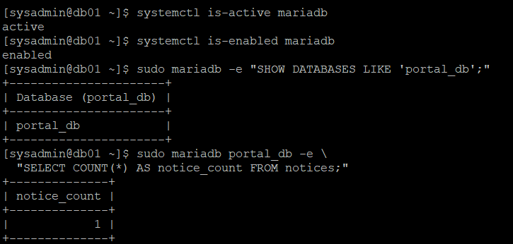

### 3.6 정상 상태 — WEB01 Apache 및 PHP-FPM 확인

**실행 서버: WEB01**

```bash
systemctl is-active httpd

systemctl is-active php-fpm
```

**실제 결과**

```text
active
active
```

WEB01의 Apache와 PHP-FPM이 정상적으로 실행되고 있었다.

### 3.7 WEB01에서 DB01 네트워크 경로 확인

```bash
ip -4 route get 192.168.100.31
```

**실제 결과**

```text
192.168.100.31 dev ens192 src 192.168.100.21 uid 1000
    cache
```

WEB01이 내부 Host-only 네트워크 인터페이스 `ens192`를 통해 DB01에 접근하도록 라우팅되는 것을 확인하였다.

### 3.8 장애 발생 전 포털 HTTP 응답 확인

```bash
curl -sS --max-time 10 \
  -o /dev/null \
  -w 'Portal HTTP status: %{http_code}\n' \
  http://127.0.0.1/portal/index.php
```

**실제 결과**

```text
Portal HTTP status: 200
```

Apache를 통해 업무 포털 페이지가 정상적으로 제공되었다.

### 3.9 실제 공지사항 데이터 조회

```bash
curl -sS --max-time 10 \
  http://127.0.0.1/portal/index.php \
  | grep -E '사내 업무 포털|사내 업무 포털 오픈 안내' \
  | head -n 5
```

**실제 확인 내용**

```text
<title>사내 업무 포털</title>
<h1>사내 업무 포털</h1>
사내 업무 포털 오픈 안내
```

HTTP 200 응답과 실제 공지사항 데이터 출력까지 확인하였다.

이는 WEB01의 Apache/PHP뿐 아니라 DB01과의 데이터 연동도 정상적으로 동작한다는 증거이다.

**스크린샷 02 — WEB01 업무 포털 정상 상태**

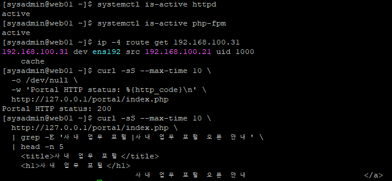

### 3.10 MariaDB 장애 재현

**실행 서버: DB01**

MariaDB 서비스를 일시적으로 중지하는 방식으로 장애를 재현하였다.

사용한 장애 재현 절차:

```bash
sudo systemctl stop mariadb

systemctl is-active mariadb
```

서비스 중지 로그 확인 명령어:

```bash
sudo journalctl -u mariadb -n 20 --no-pager
```

MariaDB 서비스가 중지되면 DB 연결에 의존하는 PHP 업무 포털의 데이터 조회 기능에 영향을 줄 수 있다.

단, **이번 실습 기록에서는 중지 당시의 `inactive` 출력과 종료 로그 원문을 확보하지 못했으므로 해당 결과를 임의로 기재하지 않았다.**

### 3.11 업무 포털 장애 영향 확인

MariaDB 장애 중 WEB01에서 Apache/PHP 서비스 상태와 포털 HTTP 응답을 비교하는 절차를 사용하였다.

```bash
systemctl is-active httpd

systemctl is-active php-fpm
```

포털 HTTP 응답 확인:

```bash
curl -sS --max-time 10 \
  -o /dev/null \
  -w 'Portal HTTP status: %{http_code}\n' \
  http://127.0.0.1/portal/index.php
```

Apache 오류 로그 확인:

```bash
sudo tail -n 20 /var/log/httpd/error_log
```

**검증 기록의 한계**

- 장애 전 포털 HTTP 200 확인
- DB01의 MariaDB 서비스 재시작 결과 확인
- 복구 후 포털 HTTP 200 확인
- 장애 발생 당시의 실제 포털 HTTP 오류 코드 및 오류 로그는 미기록

따라서 이번 문서에서는 장애 중 포털이 HTTP 500 등의 특정 상태 코드를 반환했다고 단정하지 않는다.

### 3.12 DB01 MariaDB 서비스 복구

**실행 서버: DB01**

```bash
sudo systemctl start mariadb

systemctl is-active mariadb
```

**실제 결과**

```text
active
```

MariaDB 서비스가 정상적으로 시작되었다.

### 3.13 기존 데이터 보존 확인

```bash
sudo mariadb portal_db -e \
  "SELECT COUNT(*) AS notice_count FROM notices;"
```

**실제 결과**

```text
+--------------+
| notice_count |
+--------------+
|            1 |
+--------------+
```

장애 발생 전과 동일하게 공지사항 데이터 1건이 유지되었다.

MariaDB 서비스 재시작 후 기존 업무 데이터가 정상적으로 조회되는 것을 확인하였다.

**스크린샷 05 — DB01 MariaDB 복구 및 데이터 확인**

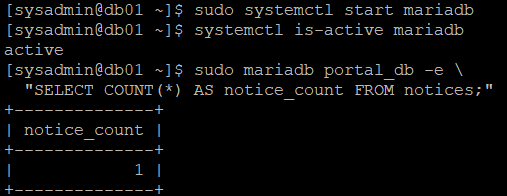

### 3.14 WEB01 업무 포털 복구 확인

**실행 서버: WEB01**

```bash
curl -sS --max-time 10 \
  -o /dev/null \
  -w 'Portal HTTP status: %{http_code}\n' \
  http://127.0.0.1/portal/index.php
```

**실제 결과**

```text
Portal HTTP status: 200
```

이어서 공지사항 데이터를 다시 조회하였다.

```bash
curl -sS --max-time 10 \
  http://127.0.0.1/portal/index.php \
  | grep '사내 업무 포털 오픈 안내'
```

**실제 결과**

```text
사내 업무 포털 오픈 안내
```

MariaDB 서비스를 복구한 뒤 웹 포털에서 기존 공지사항 데이터를 정상적으로 조회할 수 있었다.

**스크린샷 06 — WEB01 업무 포털 복구**

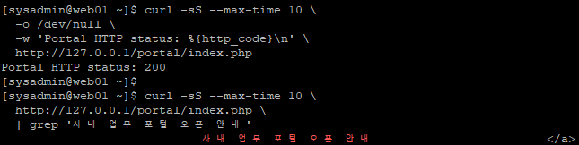

### 3.15 시나리오 A 검증 결과

| 검증 항목 | 결과 |
|---|---|
| 장애 전 MariaDB | active |
| 장애 전 데이터베이스 | portal_db 존재 |
| 장애 전 공지사항 | 1건 |
| 장애 전 Apache | active |
| 장애 전 PHP-FPM | active |
| 장애 전 포털 HTTP | 200 |
| MariaDB 장애 중 실제 HTTP 응답 | 기록 미확보 |
| MariaDB 재시작 | 성공 |
| 복구 후 MariaDB | active |
| 복구 후 공지사항 | 1건 |
| 복구 후 포털 HTTP | 200 |
| 복구 후 공지사항 조회 | 성공 |

**최종 결과: MariaDB 서비스 재시작 및 업무 포털 정상 동작 확인 완료**

이번 실습에서는 DB 서비스 복구 후 기존 데이터와 포털 기능이 정상임을 검증하였다. 장애 중 포털의 구체적인 오류 응답과 로그는 추가 증빙이 필요한 항목으로 남겼다.

---

## 4. 시나리오 B — NAS01 백업 연결 장애 및 복구

### 4.1 실습 목적

WEB01에서 NAS01으로 수행하는 rsync 기반 파일 백업의 연결 장애를 재현한다.

NAS01의 SSH 서비스를 중지하여 원격 백업을 실패시키고, 실제 백업 스크립트가 오류를 감지하는지 확인한다.

이후 SSH 서비스를 복구하고 백업을 재실행하여 파일 무결성을 검증한다.

### 4.2 실습 서버

| 서버 | IP | 역할 |
|---|---|---|
| WEB01 | 192.168.100.21 | rsync 백업 실행 |
| NAS01 | 192.168.100.41 | SSH 및 백업 파일 저장 |

### 4.3 백업 시스템 구성

29단원에서 다음과 같이 자동 백업 환경을 구축하였다.

```text
WEB01
192.168.100.21
      |
      | /home/sysadmin/backup-web01.sh
      |
      | rsync + SSH
      |
      v
NAS01
192.168.100.41
      |
      v
/data/backups/web01/current/
```

주요 경로는 다음과 같다.

| 구분 | 경로 |
|---|---|
| WEB01 원본 | `/var/www/html/` |
| 백업 스크립트 | `/home/sysadmin/backup-web01.sh` |
| 백업용 SSH 키 | `/home/sysadmin/.ssh/id_ed25519_backup_nas01` |
| 백업 로그 | `/home/sysadmin/backup-logs/` |
| NAS01 백업 경로 | `/data/backups/web01/current/` |

### 4.4 NAS01 정상 상태 확인

**실행 서버: NAS01**

```bash
systemctl is-active sshd

systemctl is-active nfs-server
```

**실제 결과**

```text
active
active
```

SSH와 NFS 서비스가 모두 정상 실행 중이었다.

### 4.5 NAS01 백업 디렉터리 확인

```bash
sudo ls -ld /data/backups/web01/current
```

**실제 결과**

```text
drwxr-xr-x. 3 sysadmin sysadmin 38 Oct 30 09:59 /data/backups/web01/current
```

백업 저장 디렉터리가 존재하고 `sysadmin` 계정으로 관리되고 있음을 확인하였다.

### 4.6 WEB01 cron 자동 백업 설정 확인

**실행 서버: WEB01**

```bash
crontab -l
```

**실제 결과**

```text
0 10 * * * /home/sysadmin/backup-web01.sh
```

기존 백업 스크립트가 매일 10:00에 자동 실행되도록 설정되어 있었다.

### 4.7 백업 스크립트 권한 및 문법 확인

```bash
ls -l ~/backup-web01.sh

bash -n ~/backup-web01.sh
```

**실제 결과**

```text
-rwx------. 1 sysadmin sysadmin 1000 Oct 30 10:30 /home/sysadmin/backup-web01.sh
```

`bash -n`에서 오류가 출력되지 않았다.

백업 스크립트의 Bash 문법이 정상이며 소유자에게만 실행 권한이 부여된 상태였다.

### 4.8 장애 발생 전 SSH 접속 확인

WEB01에서 NAS01으로 SSH 키 인증 연결을 확인하였다.

```bash
ssh -i ~/.ssh/id_ed25519_backup_nas01 \
  -o BatchMode=yes \
  -o IdentitiesOnly=yes \
  -o ConnectTimeout=5 \
  sysadmin@192.168.100.41 \
  'hostnamectl --static'
```

**실제 결과**

```text
nas01
```

비밀번호 입력 없이 전용 SSH 키를 사용해 NAS01에 접속할 수 있었다.

### 4.9 NAS01 SSH 서비스 장애 재현

SSH 서비스 중단 후에는 PuTTY로 새로 접속할 수 없으므로 VMware Workstation의 NAS01 콘솔을 통해 장애를 발생시켰다.

**실행 서버: NAS01 VMware 콘솔**

```bash
sudo systemctl stop sshd

systemctl is-active sshd
```

**실제 결과**

```text
inactive
```

SSH 서비스가 중지되었다.

이번 장애는 NAS01의 SSH 연결 기능을 대상으로 하며, NFS 데이터나 백업 파일 자체를 삭제하지 않았다.

### 4.10 WEB01에서 SSH 연결 장애 확인

**실행 서버: WEB01**

```bash
ssh -i ~/.ssh/id_ed25519_backup_nas01 \
  -o BatchMode=yes \
  -o IdentitiesOnly=yes \
  -o ConnectTimeout=5 \
  sysadmin@192.168.100.41 \
  'hostnamectl --static'
```

**실제 결과**

```text
ssh: connect to host 192.168.100.41 port 22: Connection refused
```

NAS01의 TCP 22번 포트에 연결할 수 없었다.

장애 발생 전에는 같은 명령어로 `nas01`이 반환되었으므로 SSH 서비스 중지에 따른 연결 장애임을 확인할 수 있었다.

### 4.11 rsync 백업 실패 재현

WEB01에서 기존 백업 스크립트를 수동 실행하였다.

```bash
timeout 30s ~/backup-web01.sh

echo "Backup exit code: $?"
```

**실제 결과**

```text
Backup exit code: 1
```

SSH 연결 장애로 원격 rsync 백업 작업이 실패하였다.

### 4.12 백업 실패 로그 분석

```bash
tail -n 25 ~/backup-logs/backup-web01-$(date +%F).log
```

**실제 결과 중 장애 구간**

```text
==================================
WEB01 File Backup
Start: 2026-10-30 14:42:38
==================================

ssh: connect to host 192.168.100.41 port 22: Connection refused
rsync: connection unexpectedly closed (0 bytes received so far) [sender]
rsync error: error in rsync protocol data stream (code 12) at io.c(285) [sender=3.2.7]
ERROR: Backup failed.
```

**로그 분석**

| 로그 메시지 | 의미 |
|---|---|
| `Connection refused` | NAS01 SSH 연결 거부 |
| `connection unexpectedly closed` | rsync 전송 연결 종료 |
| `rsync code 12` | rsync 프로토콜 데이터 스트림 오류 |
| `ERROR: Backup failed.` | Bash 스크립트에서 백업 실패 감지 |
| `Backup exit code: 1` | 스크립트 실패 종료 |

SSH 연결이 거부되면서 rsync가 원격 서버와 데이터를 교환하지 못하였다.

백업 스크립트는 rsync 오류를 감지하여 실패 메시지를 기록하고 종료 코드 `1`을 반환하였다.

### 4.13 장애 원인 분석

```text
NAS01 SSH 서비스 중지
          |
          v
TCP 22번 포트 연결 거부
          |
          v
WEB01 SSH 인증 및 접속 실패
          |
          v
rsync 원격 연결 실패
          |
          v
백업 스크립트 종료 코드 1
          |
          v
백업 실패 로그 기록
```

**원인: NAS01의 SSH 서비스 중지로 인한 원격 백업 연결 장애**

이번 결과에서 확인된 것은 백업 연결 실패이며, 기존 NAS01 백업 파일이나 NFS 데이터가 손상되었다는 증거는 발견되지 않았다.

**스크린샷 07 — NAS01 SSH 장애 및 WEB01 백업 실패**

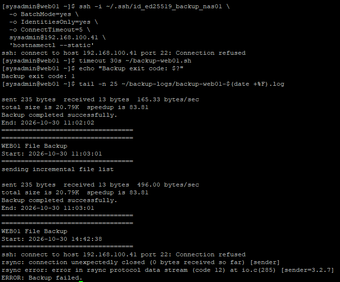

### 4.14 NAS01 SSH 서비스 복구

**실행 서버: NAS01 VMware 콘솔**

```bash
sudo systemctl start sshd

systemctl is-active sshd
```

**실제 결과**

```text
active
```

NAS01의 SSH 서비스가 정상적으로 다시 실행되었다.

### 4.15 WEB01에서 SSH 연결 복구 확인

**실행 서버: WEB01**

```bash
ssh -i ~/.ssh/id_ed25519_backup_nas01 \
  -o BatchMode=yes \
  -o IdentitiesOnly=yes \
  -o ConnectTimeout=5 \
  sysadmin@192.168.100.41 \
  'hostnamectl --static'
```

**실제 결과**

```text
nas01
```

NAS01으로의 SSH 연결이 정상적으로 복구되었다.

### 4.16 rsync 백업 재실행

```bash
timeout 30s ~/backup-web01.sh

echo "Backup retry exit code: $?"
```

**실제 결과**

```text
Backup retry exit code: 0
```

백업 스크립트가 정상적으로 종료되었다.

### 4.17 백업 성공 로그 확인

```bash
tail -n 25 ~/backup-logs/backup-web01-$(date +%F).log
```

**실제 결과 중 복구 구간**

```text
==================================
WEB01 File Backup
Start: 2026-10-30 14:44:26
==================================

sending incremental file list

sent 235 bytes  received 13 bytes  496.00 bytes/sec
total size is 20.79K  speedup is 83.81
Backup completed successfully.
End: 2026-10-30 14:44:26
==================================
```

장애 발생 당시의 실패 로그 다음에 복구 후 정상 실행 로그가 기록되었다.

이번 백업 재실행에서는 전송할 변경 파일이 없어 추가 파일 목록이 출력되지 않았다.

그러나 SSH 연결과 rsync 작업이 정상적으로 완료되었으며 스크립트 종료 코드가 `0`임을 확인하였다.

### 4.18 장애 발생 전후 백업 상태 비교

| 항목 | 장애 발생 중 | 복구 후 |
|---|---|---|
| NAS01 SSH | inactive | active |
| WEB01 SSH 접속 | Connection refused | nas01 응답 |
| rsync | code 12 | 정상 종료 |
| 스크립트 종료 코드 | 1 | 0 |
| 백업 로그 | Backup failed | Backup completed successfully |

**스크린샷 08 — SSH 복구 및 백업 재실행**

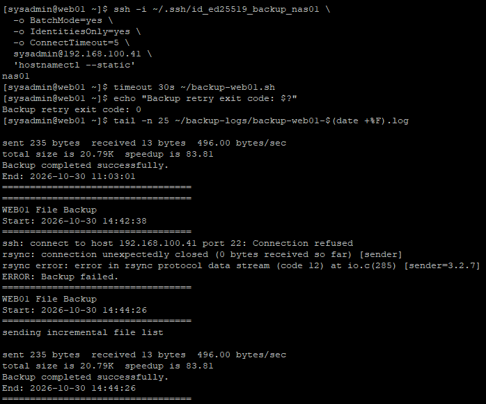

### 4.19 WEB01 원본 파일 SHA-256 확인

**실행 서버: WEB01**

```bash
sha256sum /var/www/html/portal/index.php
```

**실제 결과**

```text
cb5eed9acc50e3e5b7e5fec4c5980b19cea2680d8613e1a33440689ac314c9fc  /var/www/html/portal/index.php
```

### 4.20 NAS01 백업 파일 SHA-256 확인

**실행 서버: NAS01**

```bash
sha256sum /data/backups/web01/current/portal/index.php
```

**실제 결과**

```text
cb5eed9acc50e3e5b7e5fec4c5980b19cea2680d8613e1a33440689ac314c9fc  /data/backups/web01/current/portal/index.php
```

두 서버의 SHA-256 해시값이 일치하였다.

따라서 검증 대상인 `portal/index.php` 파일이 WEB01 원본과 NAS01 백업본에서 동일한 내용을 가지고 있음을 확인하였다.

**스크린샷 09 — WEB01/NAS01 SHA-256 비교**

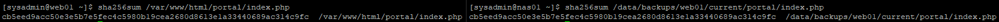

### 4.21 시나리오 B 최종 검증 결과

| 검증 항목 | 결과 |
|---|---|
| NAS01 SSH 장애 재현 | 성공 |
| SSH 연결 거부 확인 | 성공 |
| rsync 오류 확인 | code 12 |
| 백업 스크립트 실패 감지 | 종료 코드 1 |
| 실패 로그 기록 | 성공 |
| NAS01 SSH 복구 | active |
| WEB01 SSH 재접속 | 성공 |
| rsync 백업 재실행 | 종료 코드 0 |
| 백업 성공 로그 | 확인 |
| 원본·백업 SHA-256 | 일치 |

**최종 결과: NAS01 SSH 장애에 따른 백업 실패를 재현하고, SSH 복구 후 백업 작업 및 데이터 무결성 검증 완료**

---

## 5. 시나리오 C — HAProxy 장애 및 HTTP 서비스 복구

### 5.1 실습 목적

LB01의 HAProxy 서비스를 중지하여 로드밸런서를 통한 웹 서비스 접근 장애를 재현한다.

WEB01의 Apache는 정상적으로 유지하여 웹 서버 장애와 로드밸런서 장애를 구분한다.

HAProxy 복구 후 기존 HTTP 서비스 접근 경로가 정상적으로 복구되는지 검증한다.

### 5.2 실습 서버

| 서버 | IP | 역할 |
|---|---|---|
| LB01 | 192.168.100.10 | HAProxy |
| WEB01 | 192.168.100.21 | Apache 웹 서버 |

이번 단계에서는 DB01과 WEB02를 실행하지 않아도 되므로 데이터베이스가 필요한 PHP 업무 포털이 아닌 Apache 기본 HTTP 경로 `/`를 대상으로 검증하였다.

### 5.3 장애 발생 전 WEB01 Apache 상태 확인

**실행 서버: WEB01**

```bash
systemctl is-active httpd
```

**실제 결과**

```text
active
```

Apache 서비스가 정상 실행 중이었다.

### 5.4 WEB01 직접 HTTP 응답 확인

```bash
curl -sS --max-time 5 \
  -o /dev/null \
  -w 'WEB01 HTTP status: %{http_code}\n' \
  http://127.0.0.1/
```

**실제 결과**

```text
WEB01 HTTP status: 200
```

WEB01 자체의 HTTP 서비스가 정상임을 확인하였다.

### 5.5 LB01 HAProxy 서비스 확인

**실행 서버: LB01**

```bash
systemctl is-active haproxy

systemctl is-enabled haproxy
```

**실제 결과**

```text
active
enabled
```

HAProxy가 정상적으로 실행 중이며 자동 시작 설정도 적용되어 있었다.

### 5.6 HAProxy 설정 유효성 확인

```bash
sudo haproxy -c -f /etc/haproxy/haproxy.cfg
```

**실제 결과**

```text
Configuration file is valid
```

현재 HAProxy 설정 파일이 유효성 검사를 통과하였다.

### 5.7 HAProxy 경유 HTTP 정상 상태 확인

**실행 서버: WEB01**

```bash
curl -sS --max-time 5 \
  -o /dev/null \
  -w 'HAProxy HTTP status: %{http_code}\n' \
  http://192.168.100.10/
```

**실제 결과**

```text
HAProxy HTTP status: 200
```

HAProxy를 통한 HTTP 요청도 정상적으로 처리되었다.

**스크린샷 10 — 장애 발생 전 WEB01 및 HAProxy 상태**

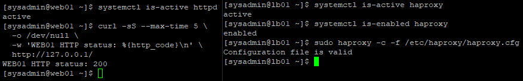

### 5.8 HAProxy 서비스 장애 재현

**실행 서버: LB01**

```bash
sudo systemctl stop haproxy

systemctl is-active haproxy
```

**실제 결과**

```text
inactive
```

HAProxy 서비스가 중지되었다.

### 5.9 HAProxy 서비스 종료 로그 확인

```bash
sudo journalctl -u haproxy -n 15 --no-pager
```

**실제 확인된 주요 로그**

```text
Oct 30 14:51:54 lb01 systemd[1]: Stopping HAProxy Load Balancer...
Oct 30 14:51:54 lb01 haproxy[1000]: [WARNING] : Exiting Master process...
Oct 30 14:51:54 lb01 haproxy[1000]: [WARNING] : All workers exited. Exiting... (0)
Oct 30 14:51:54 lb01 systemd[1]: haproxy.service: Deactivated successfully.
Oct 30 14:51:54 lb01 systemd[1]: Stopped HAProxy Load Balancer.
```

HAProxy 서비스가 정상적인 중지 절차에 따라 종료되었다.

**스크린샷 11 — LB01 HAProxy 장애 발생**

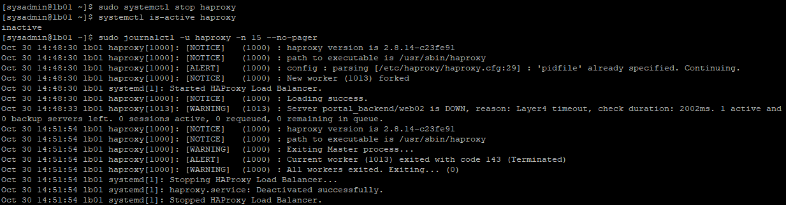

### 5.10 장애 발생 중 WEB01 직접 접속 확인

**실행 서버: WEB01**

```bash
curl -sS --max-time 5 \
  -o /dev/null \
  -w 'WEB01 Direct HTTP: %{http_code}\n' \
  http://127.0.0.1/
```

**실제 결과**

```text
WEB01 Direct HTTP: 200
```

HAProxy가 중지된 상태에서도 WEB01의 Apache는 정상적으로 동작하고 있었다.

따라서 웹 서버 자체의 장애는 아님을 확인하였다.

### 5.11 장애 발생 중 HAProxy 경유 접속 확인

```bash
curl -sS --max-time 5 \
  -o /dev/null \
  -w 'HAProxy HTTP: %{http_code}\n' \
  http://192.168.100.10/

echo "Curl exit code: $?"
```

**실제 결과**

```text
curl: (7) Failed to connect to 192.168.100.10 port 80: Connection refused
HAProxy HTTP: 000
Curl exit code: 7
```

HAProxy 서버의 HTTP 포트에 연결할 수 없었다.

여기서 `000`은 실제 HTTP 응답 상태 코드가 아니라 curl이 HTTP 응답을 받지 못했다는 의미이다.

종료 코드 `7`은 연결 실패를 나타낸다.

### 5.12 장애 영향 범위 분석

| 접속 방식 | 결과 |
|---|---|
| WEB01 직접 접근 | HTTP 200 |
| LB01 HAProxy 경유 | 연결 거부 |
| WEB01 Apache | active |
| LB01 HAProxy | inactive |

WEB01 서비스 자체는 정상이지만, HAProxy를 통한 접근 경로가 중단되었다.

이는 장애가 WEB01이 아닌 LB01의 HAProxy 서비스에 있음을 구분하는 중요한 근거이다.

**스크린샷 12 — HAProxy 경유 연결 실패**

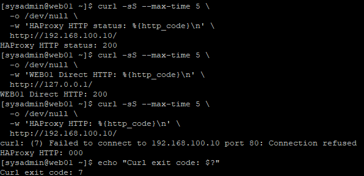

### 5.13 HAProxy 서비스 복구

**실행 서버: LB01**

```bash
sudo systemctl start haproxy

systemctl is-active haproxy
```

**실제 결과**

```text
active
```

HAProxy 서비스가 정상적으로 다시 실행되었다.

### 5.14 HAProxy 시작 로그 확인

```bash
sudo journalctl -u haproxy -n 15 --no-pager
```

**실제 확인된 주요 로그**

```text
Oct 30 14:54:31 lb01 systemd[1]: Starting HAProxy Load Balancer...
Oct 30 14:54:31 lb01 haproxy[2119]: [NOTICE] : New worker (2121) forked
Oct 30 14:54:31 lb01 systemd[1]: Started HAProxy Load Balancer.
Oct 30 14:54:31 lb01 haproxy[2119]: [NOTICE] : Loading success.
```

HAProxy 프로세스가 재시작되었으며 설정을 정상적으로 로드하였다.

### 5.15 WEB01 직접 HTTP 복구 확인

**실행 서버: WEB01**

```bash
curl -sS --max-time 5 \
  -o /dev/null \
  -w 'WEB01 Direct HTTP: %{http_code}\n' \
  http://127.0.0.1/
```

**실제 결과**

```text
WEB01 Direct HTTP: 200
```

WEB01 Apache가 계속 정상 동작하고 있음을 확인하였다.

### 5.16 HAProxy 경유 HTTP 복구 확인

```bash
curl -sS --max-time 5 \
  -o /dev/null \
  -w 'HAProxy HTTP: %{http_code}\n' \
  http://192.168.100.10/

echo "Curl exit code: $?"
```

**실제 결과**

```text
HAProxy HTTP: 200
Curl exit code: 0
```

HAProxy 서비스 재시작 후 HTTP 요청이 정상 처리되었다.

### 5.17 장애 발생 전후 비교

| 검증 항목 | 장애 전 | 장애 발생 중 | 복구 후 |
|---|---|---|---|
| WEB01 Apache | active | 정상 유지 | 정상 유지 |
| LB01 HAProxy | active | inactive | active |
| WEB01 직접 HTTP | 200 | 200 | 200 |
| HAProxy 경유 HTTP | 200 | 000 | 200 |
| curl 종료 코드 | 0 | 7 | 0 |

HAProxy 중지 시 웹 서버 직접 접근에는 문제가 없었지만, 로드밸런서를 경유한 HTTP 요청은 연결이 거부되었다.

이후 HAProxy를 재시작하면서 HTTP 200 응답이 복구되었다.

**스크린샷 13 — HAProxy 서비스 복구**

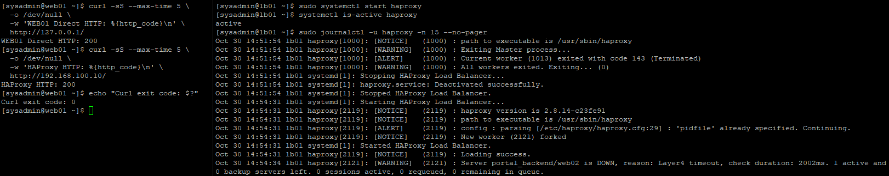

### 5.18 HAProxy 로그에서 확인한 추가 사항

HAProxy 로그에서는 다음 두 가지 메시지도 확인되었다.

**① WEB02 백엔드 DOWN**

```text
Server portal_backend/web02 is DOWN, reason: Layer4 timeout
```

이번 실습에서는 WEB02를 실행하지 않았으므로 WEB02의 헬스 체크 실패가 기록되었다.

하지만 WEB01이 정상적으로 동작하고 있어 HAProxy 경유 HTTP 200을 확인할 수 있었다.

이번 실습에서 검증한 것은 HAProxy 자체의 중지·재시작이며, 두 웹 서버 간 장애 자동 전환은 8단원에서 별도로 검증하였다.

**② HAProxy pidfile 경고**

```text
config : parsing [/etc/haproxy/haproxy.cfg:29] : 'pidfile' already specified. Continuing.
```

설정 검사에서 `Configuration file is valid`가 출력되었고 HAProxy 시작 및 HTTP 응답에도 문제가 없었다.

다만 `pidfile` 항목 중복 관련 경고가 있으므로 추후 설정 파일 점검 대상에 포함한다.

이번 실습에서는 해당 경고의 원인을 수정하거나 설정 파일을 변경하지 않았다.

### 5.19 시나리오 C 최종 결과

| 검증 항목 | 결과 |
|---|---|
| HAProxy 장애 전 상태 | active |
| HAProxy 설정 검사 | valid |
| 장애 전 HTTP | 200 |
| HAProxy 중지 | 성공 |
| 장애 중 HAProxy | inactive |
| 장애 중 WEB01 직접 HTTP | 200 |
| 장애 중 HAProxy HTTP | 연결 실패 |
| curl 종료 코드 | 7 |
| HAProxy 재시작 | 성공 |
| 복구 후 HAProxy | active |
| 복구 후 HAProxy HTTP | 200 |
| 복구 후 curl 종료 코드 | 0 |

**최종 결과: HAProxy 서비스 장애 재현, 영향 범위 분석 및 HTTP 서비스 복구 검증 완료**

---

## 6. 장애 시나리오별 비교 분석

### 6.1 장애 발생 위치와 영향 범위

| 시나리오 | 장애 지점 | 주요 영향 | 복구 방법 |
|---|---|---|---|
| A | DB01 MariaDB | DB 의존 포털 기능 | `systemctl start mariadb` |
| B | NAS01 SSH | 원격 rsync 백업 | `systemctl start sshd` |
| C | LB01 HAProxy | 로드밸런서 경유 HTTP | `systemctl start haproxy` |

### 6.2 장애 발생 및 복구 검증 비교

| 구분 | 시나리오 A | 시나리오 B | 시나리오 C |
|---|---|---|---|
| 정상 상태 검증 | 완료 | 완료 | 완료 |
| 장애 발생 증빙 | 일부 미확보 | 완료 | 완료 |
| 장애 오류 로그 | 일부 미확보 | 완료 | 완료 |
| 서비스 재시작 | 성공 | 성공 | 성공 |
| 복구 후 기능 검증 | 포털 HTTP 200 | 백업 종료 코드 0 | HTTP 200 |
| 데이터 검증 | 공지사항 1건 | SHA-256 일치 | HTTP 접근 검증 |
| 복구 성공 여부 | 확인 | 확인 | 확인 |

### 6.3 장애 원인 분석 방식 비교

**MariaDB 장애**

DB01의 MariaDB 서비스와 WEB01 업무 포털의 연동 관계를 확인하였다.

데이터베이스 복구 후 기존 공지사항 데이터와 포털의 정상 동작을 검증하였다.

**NAS 백업 연결 장애**

SSH 연결 오류와 rsync 종료 코드, 백업 스크립트 로그를 연결하여 장애 원인을 분석하였다.

**HAProxy 장애**

웹 서버 직접 접속과 로드밸런서 경유 접속 결과를 비교하여 장애 지점을 구분하였다.

---

## 7. 트러블슈팅 및 운영 시 고려 사항

### 7.1 서비스 정상 상태만으로 전체 시스템 정상 여부를 판단할 수 없음

WEB01의 Apache가 `active`여도 DB01 MariaDB 또는 LB01 HAProxy에 장애가 발생하면 사용자가 접근하는 서비스 기능에 문제가 생길 수 있다.

따라서 서비스 프로세스 상태와 실제 애플리케이션 응답을 함께 확인해야 한다.

### 7.2 HTTP 200과 애플리케이션 기능 검증의 차이

Apache 기본 경로 `/`의 HTTP 200은 웹 서버가 응답한다는 의미이다.

그러나 PHP 업무 포털의 데이터베이스 조회까지 정상이라는 의미는 아니다.

이번 시나리오 A에서는 실제 공지사항 조회를 함께 확인하였고, 시나리오 C에서는 DB01을 실행하지 않았으므로 기본 HTTP 서비스 복구만 검증하였다.

### 7.3 SSH 서비스 장애와 백업 실패의 관계

rsync 백업이 실패하면 파일시스템 손상이나 저장 공간 부족을 먼저 의심할 수 있다.

그러나 실제 오류 로그에서 `Connection refused`가 발견되었다면 네트워크 연결 및 SSH 서비스 상태를 우선 확인해야 한다.

이번 실습에서는 NAS01의 SSH 서비스 복구로 백업이 다시 정상적으로 수행되었다.

### 7.4 백업 작업은 종료 코드와 실제 파일을 함께 확인해야 함

백업 스크립트가 성공했다고 표시되어도 실제 백업 데이터가 올바르게 저장되었는지 추가 검증이 필요하다.

이번 실습에서는 WEB01 원본 파일과 NAS01 백업 파일의 SHA-256 해시값을 비교하였다.

단, 이번 무결성 검증 범위는 `portal/index.php` 파일이며 백업 디렉터리의 모든 파일을 개별 해시 비교한 것은 아니다.

### 7.5 장애 복구 시 기존 데이터 보호

MariaDB 장애 실습에서는 실제 데이터베이스를 삭제하거나 변경하지 않았다.

NAS 백업 장애 실습에서는 기존 백업 파일을 삭제하지 않았다.

HAProxy 장애 실습에서는 설정 파일을 변경하지 않았다.

서비스의 중지 및 재시작으로 장애를 재현하여 데이터 손상 가능성을 줄였다.

### 7.6 장애를 발생시키기 전에 복구 경로 확보

NAS01의 SSH 서비스를 중지하면 원격 접속이 제한된다.

따라서 VMware Workstation 콘솔에서 직접 조작할 수 있는지 확인한 뒤 실습을 진행하였다.

실제 운영 환경에서도 원격 관리 서비스 장애에 대비한 별도 관리 경로가 중요하다.

### 7.7 장애 검증 로그는 실패 및 성공 기록을 함께 남겨야 함

정상 상태만 기록하면 장애가 실제로 발생했는지 확인하기 어렵다.

이번 실습에서는 SSH 장애 중 `Backup failed`와 복구 후 `Backup completed successfully`를 같은 백업 로그에서 비교하였다.

HAProxy에서도 장애 중 curl 종료 코드 `7`과 복구 후 종료 코드 `0`을 비교하였다.

### 7.8 HAProxy 경고 메시지와 실제 장애 구분

`pidfile already specified` 경고는 설정 파일 검사를 실패시키지 않았으며 이번 서비스 복구도 정상적으로 완료되었다.

그러나 경고가 남아 있는 상태이므로 실제 운영 환경에서는 HAProxy 설정과 systemd 서비스 실행 인자를 함께 검토할 필요가 있다.

---

## 8. GitHub 스크린샷 정리

이번 단원에서 사용한 스크린샷은 하나의 디렉터리로 관리한다.

```text
screenshots/
└── integrated-recovery/
    ├── 01-db01-mariadb-baseline.png
    ├── 02-web01-portal-baseline.png
    ├── 03-db01-mariadb-failure.png
    ├── 04-web01-portal-failure.png
    ├── 05-db01-mariadb-recovery.png
    ├── 06-web01-portal-recovered.png
    ├── 07-nas-backup-failure.png
    ├── 08-nas-backup-recovery.png
    ├── 09-nas-backup-sha256-verified.png
    ├── 10-lb01-haproxy-baseline.png
    ├── 11-lb01-haproxy-failure.png
    ├── 12-haproxy-connection-failure.png
    └── 13-haproxy-recovery.png
```

### 8.1 스크린샷별 내용

| 번호 | 증빙 내용 |
|---|---|
| 01 | DB01 MariaDB 정상 상태 및 공지사항 데이터 |
| 02 | WEB01 포털 HTTP 200 및 공지사항 조회 |
| 03 | DB01 MariaDB 장애 발생 상태 및 로그 |
| 04 | WEB01 포털 장애 응답 및 오류 로그 |
| 05 | DB01 MariaDB 복구 및 데이터 유지 |
| 06 | WEB01 포털 HTTP 200 복구 |
| 07 | NAS01 SSH 연결 거부 및 rsync 백업 실패 |
| 08 | NAS01 SSH 연결 복구 및 rsync 재실행 성공 |
| 09 | WEB01과 NAS01의 백업 파일 SHA-256 비교 |
| 10 | WEB01 Apache 및 LB01 HAProxy 정상 상태 |
| 11 | LB01 HAProxy 중지 및 systemd 로그 |
| 12 | WEB01 HTTP 200과 HAProxy 경유 연결 실패 |
| 13 | HAProxy 재시작 및 HTTP 200 복구 |

**증빙 주의 사항**

03번과 04번은 이번 문서 작성 시 실제 출력과 캡처가 확인되지 않은 항목이다. 해당 스크린샷이 있다면 장애 발생 및 영향 분석 부분에 추가할 수 있다.

나머지 스크린샷도 GitHub에 올릴 때 실제 파일명과 Markdown 이미지 경로가 일치하도록 관리한다.

---

## 9. 최종 검증 결과

### 9.1 통합 검증 결과

| 검증 항목 | 실제 결과 | 상태 |
|---|---|---|
| DB01 MariaDB 정상 상태 확인 | active | 성공 |
| portal_db 존재 확인 | 존재 | 성공 |
| 공지사항 원본 데이터 | 1건 | 성공 |
| WEB01 Apache/PHP 정상 상태 | active | 성공 |
| 장애 전 포털 HTTP | 200 | 성공 |
| MariaDB 장애 중 HTTP 오류 | 미기록 | 추가 증빙 필요 |
| MariaDB 서비스 복구 | active | 성공 |
| 공지사항 데이터 보존 | 1건 유지 | 성공 |
| WEB01 포털 복구 | HTTP 200 | 성공 |
| NAS01 SSH 장애 재현 | inactive | 성공 |
| SSH 연결 거부 확인 | Connection refused | 성공 |
| rsync 백업 실패 | code 12 | 성공 |
| 백업 스크립트 실패 감지 | exit code 1 | 성공 |
| NAS01 SSH 복구 | active | 성공 |
| 백업 재실행 | exit code 0 | 성공 |
| 백업 성공 로그 | 확인 | 성공 |
| 백업 파일 SHA-256 | 일치 | 성공 |
| HAProxy 장애 전 서비스 | active | 성공 |
| HAProxy 설정 유효성 | valid | 성공 |
| HAProxy 장애 재현 | inactive | 성공 |
| WEB01 직접 HTTP | 200 유지 | 성공 |
| HAProxy 경유 접속 실패 | curl exit code 7 | 성공 |
| HAProxy 서비스 복구 | active | 성공 |
| HAProxy 경유 HTTP 복구 | 200 | 성공 |
| 복구 후 curl 종료 코드 | 0 | 성공 |

### 9.2 최종 복구 상태

**시나리오 A**

MariaDB 서비스를 다시 실행한 뒤 `portal_db`의 공지사항 1건과 WEB01 포털 HTTP 200 응답을 확인하였다.

**시나리오 B**

NAS01의 SSH 서비스를 복구한 뒤 WEB01의 자동 백업 스크립트를 수동 재실행하여 종료 코드 0 및 성공 로그를 확인하였다. 또한 WEB01 원본과 NAS01 백업본의 SHA-256 해시값이 일치하였다.

**시나리오 C**

HAProxy 서비스 재시작 후 WEB01 직접 HTTP 200과 HAProxy 경유 HTTP 200을 확인하였으며 curl이 정상 종료되었다.

---

## 10. 실습을 통해 배운 점

### 10.1 장애 발생 위치에 따라 영향 범위가 달라짐

MariaDB, SSH, HAProxy 장애는 서로 다른 서비스에 영향을 준다.

따라서 장애를 분석할 때 단순히 서버가 실행 중인지 확인하는 것이 아니라 어느 계층에서 오류가 발생했는지 구분해야 한다.

### 10.2 로그와 종료 코드의 중요성

장애를 분석할 때 다음 정보를 함께 확인해야 한다.

- 서비스 상태
- 시스템 로그
- 애플리케이션 오류 로그
- 연결 실패 메시지
- 명령어 종료 코드

이번 실습에서는 rsync 종료 코드 `12`, 백업 스크립트 종료 코드 `1`, curl 종료 코드 `7`을 확인하였다.

### 10.3 장애 복구 후 실제 기능 검증

서비스가 `active`가 되었다고 모든 문제가 해결된 것은 아니다.

MariaDB는 실제 데이터를 조회하고, rsync는 백업 성공 로그와 해시값을 확인하고, HAProxy는 HTTP 200 응답을 확인하였다.

### 10.4 데이터 무결성 검증

백업 연결 장애 복구 후에는 파일 존재 여부만 확인하지 않고 SHA-256 해시값을 비교하였다.

이는 서비스 복구와 데이터 검증을 분리해서 수행해야 한다는 점을 이해하는 데 도움이 되었다.

### 10.5 복구 절차 문서화

장애 발생 전 상태와 장애 발생 중 오류, 복구 후 결과를 순서대로 기록하면 원인 분석과 재발 대응에 활용할 수 있다.

또한 실제 시스템 운영에서는 장애 시점, 원인, 영향 서비스 및 복구 결과를 함께 기록해야 한다는 점을 확인하였다.

---

## 11. 최종 결과

이번 실습에서는 Rocky Linux 9.8 기반 사내 업무 포털 인프라에서 세 가지 장애 복구 시나리오를 수행하였다.

첫 번째 시나리오에서는 DB01 MariaDB 서비스 복구 후 기존 업무 데이터와 WEB01 PHP 포털 기능이 정상적으로 동작하는 것을 확인하였다.

두 번째 시나리오에서는 NAS01 SSH 서비스 중지로 rsync 백업 연결 장애를 재현하고, 백업 실패 로그 및 종료 코드를 분석하였다. 이후 SSH 서비스 복구, 백업 재실행 및 SHA-256 비교를 통해 복구 결과를 검증하였다.

세 번째 시나리오에서는 LB01 HAProxy 서비스를 중지하여 웹 서버 직접 접속은 정상인 상태에서 로드밸런서 경유 접속만 실패하는 것을 확인하였다. HAProxy 재시작 후 HTTP 200 응답으로 정상 복구되었다.

이 과정을 통해 장애 발생 위치에 따른 영향 범위, 로그 기반 원인 분석, 서비스 복구 절차 및 복구 후 검증의 중요성을 학습하였다.

**최종 성과: MariaDB, NAS 원격 백업, HAProxy 세 가지 서비스의 복구 검증 완료. MariaDB 장애 중 포털 오류 증빙은 추가 확인 항목으로 유지한다.**

---

## 12. 관련 문서

- [07. HAProxy 로드밸런싱 구성](./07-haproxy.md)
- [08. HAProxy 장애 전환 및 복구 검증](./08-haproxy-failover.md)
- [09. MariaDB 설치 및 연동 검증](./09-mariadb.md)
- [10. PHP 및 MariaDB 연동](./10-php-mariadb.md)
- [11. PHP + MariaDB 업무 포털 CRUD 구현](./11-php-portal-crud.md)
- [17. NFS 클라이언트 연동](./17-nfs-client.md)
- [23. 로그 관리 및 장애 분석](./23-log-management.md)
- [28. Bash·rsync 파일 백업 및 복구](./28-file-backup.md)
- [29. cron 기반 자동 백업](./29-cron-backup.md)
- [30. MariaDB 데이터베이스 백업 및 복구](./30-mariadb-backup.md)
- [31. NFS 데이터 백업 및 복구](./31-nfs-backup.md)

---

## 13. 다음 실습

**33. 전체 통합 검증 및 GitHub·PPT 최종 결과 정리**

마지막 단원에서는 현재까지 구축한 전체 인프라 구성을 종합하고, 네트워크·웹 서비스·데이터베이스·스토리지·보안·모니터링·백업 및 장애 복구 검증 결과를 정리한다.

최종적으로 GitHub README와 문서·스크린샷 링크를 점검하고, 프로젝트 소개 및 면접 발표에 사용할 PPT를 제작한다.
