# 33. 전체 인프라 최종 검증

## 검증 범위

Rocky Linux 9.8 기반 6대 서버 실습의 최종 상태를 2026-10-30에 점검했다. 아래 결과는 실제 기록과 저장소 캡처에 근거한다. 장애 재현 결과는 [32단원](./32-integrated-recovery.md)에 별도로 기록했다.

| 서버 | 역할 | 내부 IP |
|---|---|---|
| LB01 | HAProxy | 192.168.100.10 |
| WEB01 | Apache/PHP | 192.168.100.21 |
| WEB02 | Apache/PHP | 192.168.100.22 |
| DB01 | MariaDB | 192.168.100.31 |
| NAS01 | RAID/LVM/NFS·백업 | 192.168.100.41 |
| MON01 | Prometheus/Grafana/Alertmanager | 192.168.100.51 |

## 최종 확인 결과

| 분야 | 실제 확인된 결과 | 증빙 |
|---|---|---|
| 네트워크 | WEB01↔LB01 Ping 양방향 손실 0% | 01~03 |
| 웹·로드밸런싱 | 웹 직접 접속과 HAProxy 경유 HTTP 200 | 02~03, 05 |
| DB·포털 | DB01 MariaDB의 portal_db 공지사항 1건, WEB01 PHP 포털 HTTP 200 | 04~05 |
| RAID | NAS01 /dev/md0 RAID 1, [UU], clean, 2/2 디스크 | 06 |
| LVM·파일시스템 | vg_data/lv_data, XFS 8GiB, /data 마운트 | 06 |
| NFS | NAS01 nfs-server active, WEB01 NFSv4.2 공유 파일 읽기 성공 | 07 |
| 백업 | cron 매일 10:00, 최근 실행 성공 | 08~09 |
| 무결성 | WEB01 원본과 NAS01 백업 portal/index.php SHA-256 일치 | 09 |
| 모니터링 | MON01 Prometheus 전체 대상 7/7 UP | 10~11 |
| 대시보드 | Grafana Linux Infrastructure Monitoring의 CPU·메모리·디스크 그래프 확인 | 12 |
| 알림 | Alertmanager 연결 및 Webhook 서비스 active | 13 |

HTTP 200은 해당 요청 시점의 응답이다. 7/7 UP은 캡처 시점의 수집 대상 상태이며 장기 가용률을 뜻하지 않는다. SHA-256 비교 대상은 portal/index.php 한 파일이다.

## 장애 복구와의 연결

[32단원](./32-integrated-recovery.md)에서는 MariaDB 중지 시 포털 HTTP 500과 복구 후 HTTP 200, NAS01 SSH 중지 시 원격 rsync 백업 오류와 복구 후 성공, HAProxy 중지 시 경유 접속 실패와 재시작 후 HTTP 200을 검증했다. MariaDB 장애 중 PHP 예외 메시지 원문은 확인하지 못했으므로 원인을 그 수준까지 특정하지 않는다.

## 최종 스크린샷

다음 13개 파일은 저장소의 `screenshots/final-verification/`에 존재하며 아래 경로로 연결된다.

01. 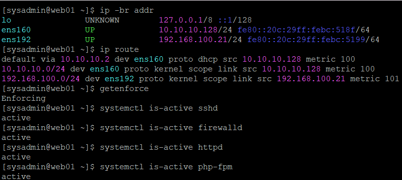

02. 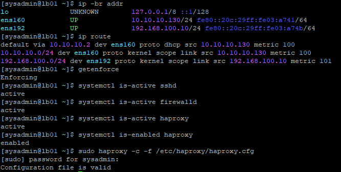

03. 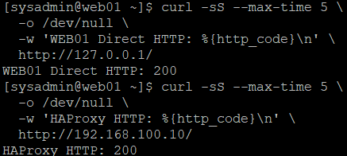

04. 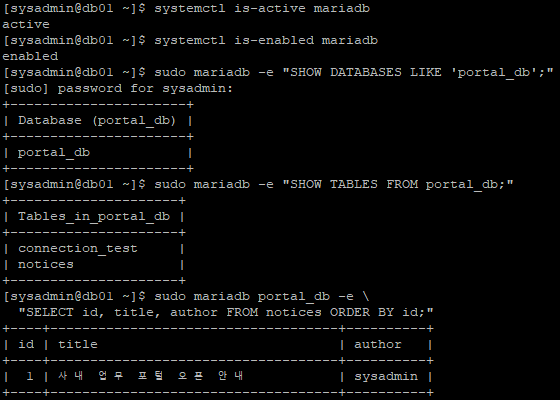

05. 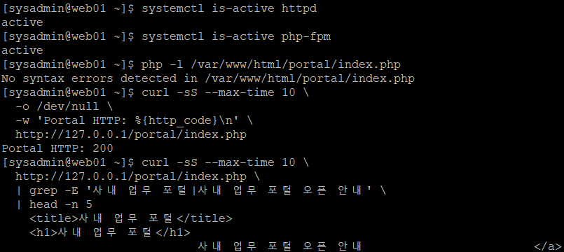

06. 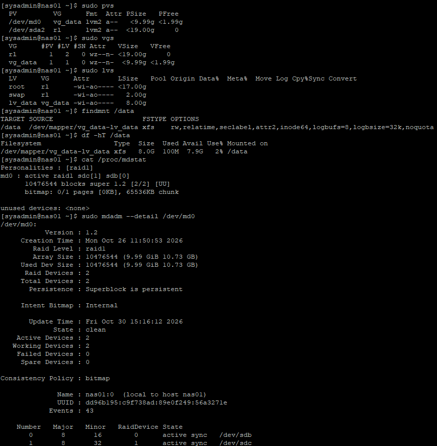

07. 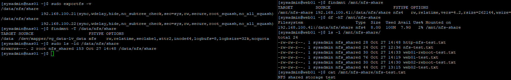

08. 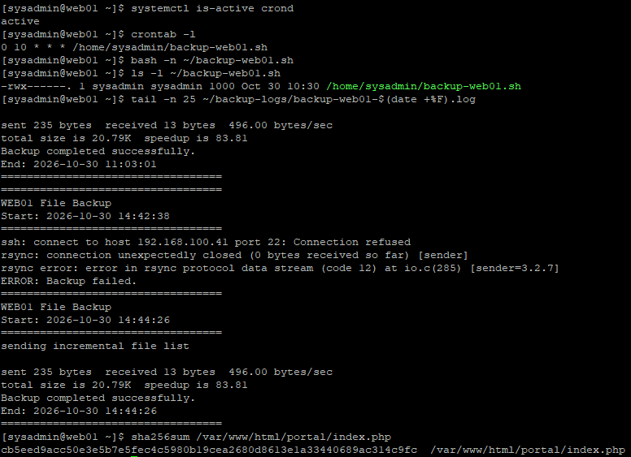

09. 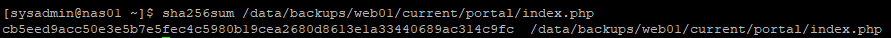

10. 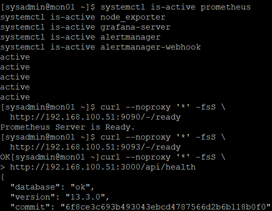

11. 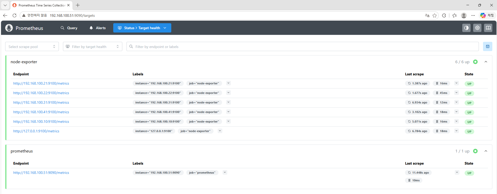

12. 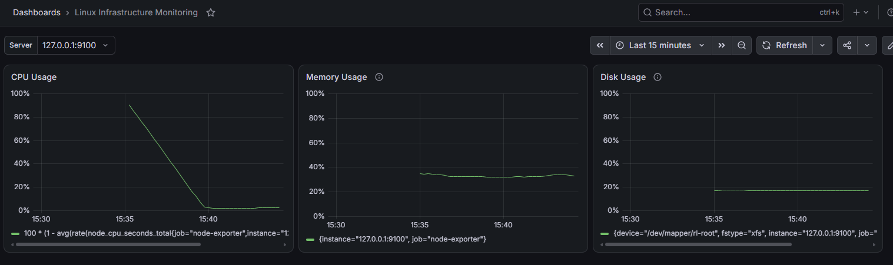

13. 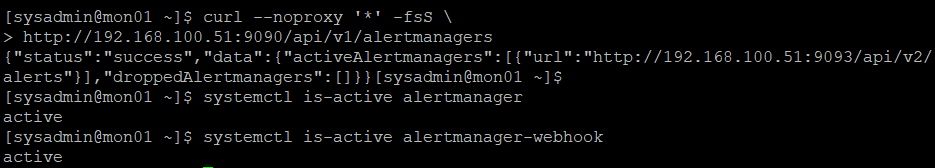

## 프로젝트 범위와 개선 방향

VMware 호스트 메모리 16GB 제약으로 시나리오별 필요한 가상머신을 선택적으로 실행했다. 최종 캡처는 구성요소별 점검 기록이며 모든 서버의 장기 동시 부하 시험은 아니다. 운영 수준으로 확장하려면 장기 모니터링, 복구 시간 측정, 백업 정기 복원 시험과 HAProxy 자체 이중화를 추가할 필요가 있다.

## 배운 점

프로세스의 active 상태와 실제 서비스 응답을 함께 확인해야 장애 범위를 구분할 수 있다. 백업은 성공 로그에 더해 복원과 파일 무결성으로 검증해야 한다. 설정, 실행 결과, 캡처를 연결해 기록하면 복구 판단의 근거가 명확해진다.
